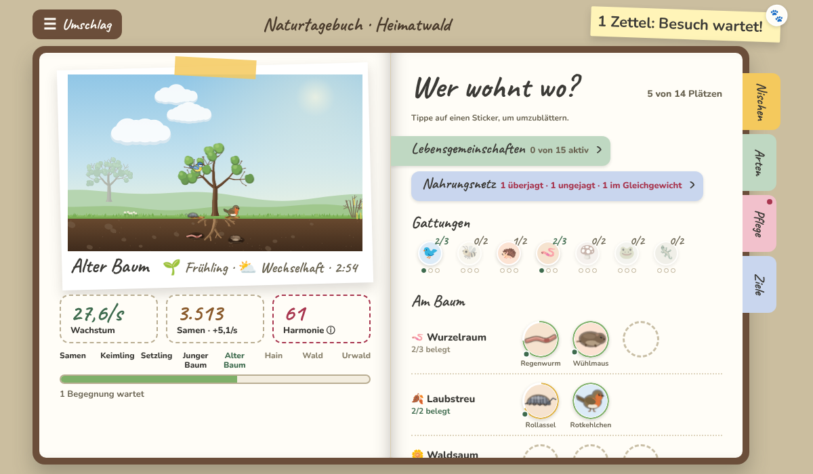
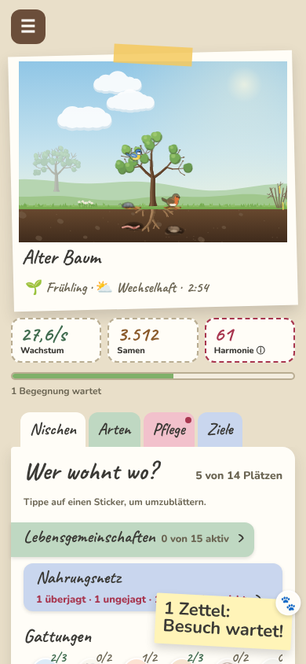

# 🌱 Vom Samen zum Wald

Ein grafisches Incremental Game im Browser: Du beginnst als kleiner Samen und wächst
über Keimling, Setzling und Baum bis zu einem riesigen Urwald.





Die Oberfläche ist ein Sammelalbum: Die Szene klebt als Polaroid im Buch, Tiere als Sticker
in den Reitern Nischen, Arten, Pflege, Ziele und Landschaft (Konzept:
[`docs/ALBUM_UI.md`](docs/ALBUM_UI.md)). Eine Album-Demo mit Beispieldaten gibt es unter
`/src/ui/demo.html` (mit `npm run dev`).

## Loslegen

```bash
npm install
npm run dev     # http://localhost:5173
npm run check   # Typecheck + Tests (schnell, vor jedem Commit)
npm run balance # großer Balancing-Lauf: 500 Durchgänge, alle Tabellen (DESIGN_V2.md 15.4)
```

## Als App installieren und offline spielen

Das Spiel ist eine installierbare Web-App (PWA): Im Browser „Zum Startbildschirm
hinzufügen“ bzw. „App installieren“ wählen. Nach einem Besuch mit Netz startet es auch
offline; Konto und Gerätesync brauchen weiterhin Netz und holen den Abgleich später nach.
Gibt es eine neue Version, erscheint oben „Neue Version verfügbar – neu laden“ – der
Spielstand wird vor dem Neuladen gespeichert.

- Manifest und Icons: `public/manifest.webmanifest`, `public/icons/` (erzeugt mit
  `node --experimental-strip-types scripts/generate-icons.ts`)
- Service Worker: von Hand in `src/pwa/service-worker.ts`; `npm run build` schreibt daraus
  `dist/sw.js` mit allen gebauten Dateien und einer Inhalts-Version (Plugin in
  `vite.config.ts`). Seiten zuerst aus dem Netz, gehashte Dateien aus dem Cache; der
  Sync-Server (andere Adresse, `/api/`, Event-Stream) wird nie abgefangen.
- Angemeldet wird er nur im Build, nicht mit `npm run dev` und nicht in e2e-Tests
  (außer `e2e/pwa.spec.ts`, das ihn mit `window.__VSZW_SW__ = true` einschaltet).
- Mehrere Tabs: Lädt ein Tab die neue Version, zeigen die anderen „Neue Version aktiv –
  bitte neu laden“.
- Das Spiel bittet beim Start um dauerhaften Speicher (`navigator.storage.persist()`), damit
  der Browser Spielstand und Cache nicht bei Platzmangel räumt.

**iPhone/iPad:** Eine zum Home-Bildschirm hinzugefügte App hat in iOS einen *eigenen*
Speicher, getrennt von Safari. Wer dort weiterspielen will, meldet sich vorher mit dem Konto
an (Gerätesync) oder überträgt den Spielstand über „Spielstand exportieren“ in Safari und
„Importieren“ in der App.

### Not-Aus für den Service Worker

Hängen Spieler nach einem fehlerhaften Build in einer kaputten Version fest:

1. Mit `VSZW_SW_KILL=1 npm run build` bauen – bei GitHub Pages die Repository-Variable
   `VSZW_SW_KILL` auf `1` setzen (Settings → Secrets and variables → Actions → Variables)
   und den Workflow „Pages“ neu starten. Dann liegt statt des normalen ein
   Not-Aus-`sw.js` aus: Er übernimmt sofort, löscht alle `vszw-shell-*`-Caches, meldet
   sich ab und lädt offene Tabs neu. Das Spiel meldet in diesem Build keinen Service
   Worker an (und vorhandene ab). Spielstände in `localStorage` bleiben unberührt.
2. Der Browser holt das neue `sw.js` beim nächsten Besuch (Prüfung ohne HTTP-Cache,
   `updateViaCache: 'none'`). Den Not-Aus einige Tage stehen lassen.
3. Danach die Variable wieder entfernen (bzw. ohne `VSZW_SW_KILL` bauen): Der normale
   Service Worker wird wieder angemeldet.

Einzelner Spieler mit Problemen: In den Entwicklerwerkzeugen unter *Application → Service
Workers* „Unregister“ wählen und neu laden. **Achtung:** „Websitedaten löschen“ bzw.
„Clear site data“ löscht auch den Spielstand – vorher über „Spielstand exportieren“
sichern (oder mit dem Konto synchronisieren).

### Kein Rollback über einen Spielstand-Sprung

Steigt mit einem Update `SAVE_VERSION` (z. B. 12 → 13 mit den Lebensräumen), lässt sich
der Build danach **nicht** auf die ältere Version zurückrollen: Spielstände im neuen Format
lädt die ältere Version nicht. Sie wehrt sie ab, statt Arten, Nischen oder Ereignisse still
zu verwerfen – Import und Konto-Abgleich melden „neuere Spielversion“, ein so gespeicherter
Stand im Browser wird weder geladen noch überschrieben; der Tab zeigt dauerhaft einen Hinweis
(gilt ab v13; ältere Builds schützen nur Import und Abgleich). Bei einem fehlerhaften Build
darum vorwärts reparieren (Fix mit derselben oder höherer `SAVE_VERSION`), bei Bedarf mit
dem Not-Aus oben – nie einen Build mit kleinerer `SAVE_VERSION` ausrollen.

## Projekt

- [`docs/GAME_DESIGN.md`](docs/GAME_DESIGN.md) – Spielregeln, Zahlen, geplante Systeme
- [`docs/ALBUM_UI.md`](docs/ALBUM_UI.md) – Album-Oberfläche: Seiten, Navigation, Komponenten
- [`docs/ROADMAP.md`](docs/ROADMAP.md) – Aufgaben nach Phasen
- [`docs/KONTO.md`](docs/KONTO.md) – optionales Konto mit Gerätesync (Sync-Server in `server/`)
- [`CLAUDE.md`](CLAUDE.md) – Architektur und Regeln für Entwickler und Claude-Agenten

## Mit Claude-Agenten arbeiten

Unter [`.claude/agents/`](.claude/agents/) liegen spezialisierte Rollen:

| Agent | Bereich |
|---|---|
| `game-designer` | Balancing, Inhalte, `docs/GAME_DESIGN.md` |
| `core-engineer` | Spiellogik in `src/core/`, Speichern, Game Loop |
| `renderer` | Prozeduraler Baum und Szene in `src/render/` |
| `ui-dev` | Oberfläche in `src/ui/` (Album in `src/ui/album/`) und `src/style.css` |
| `qa-tester` | Unit- und Playwright-Tests |
| `reviewer` | Code-Review (nur lesend) |

In einer Claude-Code-Session einfach ansprechen, z. B.
*„Lass den game-designer die Upgrades bis zum Hain balancen.“*

Für parallele Arbeit: pro Roadmap-Aufgabe eine eigene Session auf claude.ai/code
starten. Jede Session arbeitet auf ihrem eigenen Branch und öffnet einen PR.

## Lizenzen

Die Schriften Caveat und Nunito liegen selbst gehostet in `src/ui/album/fonts/` und stehen
unter der SIL Open Font License 1.1; die Lizenztexte werden unter `licenses/` mit
ausgeliefert (`public/licenses/`).
