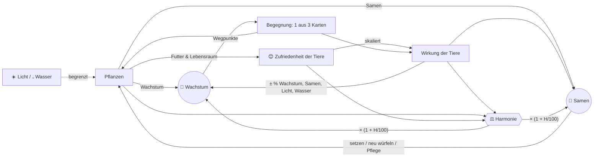
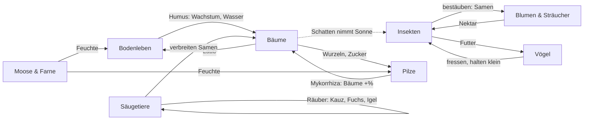
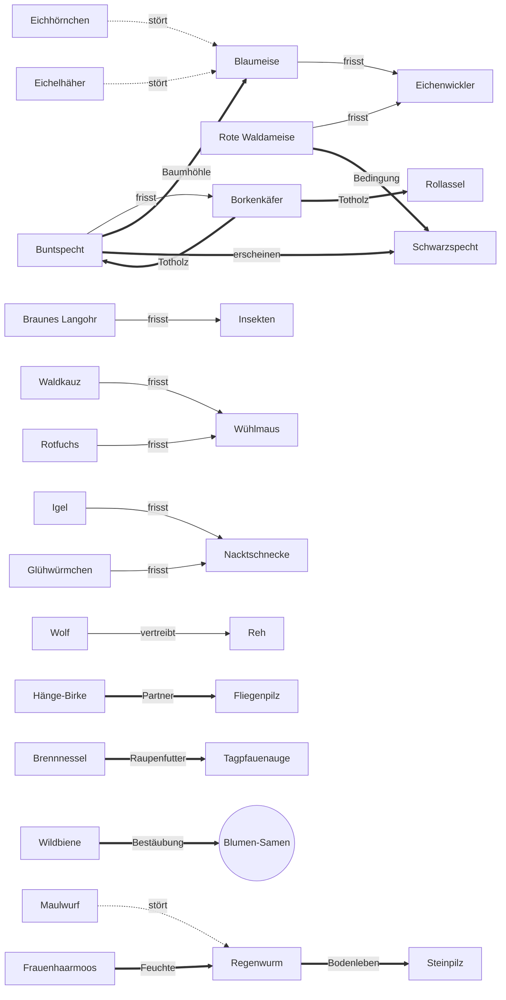

# Design v2 – Vom Samen zum Wald: ein Ökosystem wächst

> **Status:** Maßgebliches Designdokument für die Neuausrichtung (v2). Noch nicht
> implementiert – der aktuelle Code (v1: Wasser/Licht/Energie/Upgrades) ist in
> `GAME_DESIGN.md` beschrieben. Das Ökosystem-Konzept aus `ECOSYSTEM.md` ist hier
> überführt.
>
> **Alle Zahlen sind vorläufig.** Sie stammen aus dem Monte-Carlo-Prototyp in
> `scripts/v2/` (Abschnitt 15) und liegen in einer plausiblen Größenordnung, sind aber
> noch nicht am echten Spiel gebalanced. Maßgeblich für Zahlen ist bis zur Umsetzung
> `scripts/v2/content.ts`; die Tabellen hier sind daraus erzeugt.

---

## 1. Vision & Spielgefühl

Du bist ein Eichensamen. Während du zum Urwald heranwächst, ziehen Tiere ein, Pilze
umspinnen deine Wurzeln, Sträucher und Blumen keimen um dich herum. **Du baust kein
Upgrade-Rad, sondern eine Lebensgemeinschaft.** An Wegpunkten deines Wachstums bietet
dir der Wald drei Karten an – du wählst eine. Wie im Brettspiel *Mischwald* und in
Deckbuildern geht es darum, Synergien zu entdecken und ein stimmiges Gefüge zu bauen.

**Gefühl:** ruhig, organisch, neugierig. Ein Idle-Spiel mit gelegentlichen, kleinen
Entscheidungen (früh etwa jede Minute, später alle fünf Minuten). Kein Zeitdruck,
keine Strafe für Abwesenheit, nichts stirbt. Der Baum bleibt der Mittelpunkt.

**Leitsätze**
- *Der Baum ist die Bühne.* Er wächst vom Samen zum Urwald; die Nischen hängen an ihm.
- *Jede Wahl ist eine Abwägung*, selten eine Rechenaufgabe: Wachstum, Samen oder
  Harmonie – meist kann man nicht alles haben (Simulation: in ~70 % der Begegnungen).
- *Harmonie ist das Ziel* – eine Punktzahl, die sich gut anfühlt und beim Neuen Zyklus
  dauerhaft belohnt wird.
- *Tiere haben Zufriedenheit, Pflanzen haben Wachstum.*

### Ein typischer 10-Minuten-Ablauf

> **0:04** – Der Samen bricht auf. *„Etwas regt sich in der Erde …“* Drei Karten:
> Regenwurm, Wühlmaus, Pfifferling. Der Regenwurm braucht Feuchte – die gibt es noch
> nicht. Du nimmst ihn trotzdem: 75 % zufrieden, also +6 % statt +8 % Wachstum. Die
> Harmonie springt von 5 auf 38.
>
> **0:25** – *„Etwas keimt.“* Frauenhaarmoos, Buschwindröschen – du setzt das Moos.
> Der Regenwurm ist jetzt zu 100 % zufrieden; die Harmonie steigt auf 50.
>
> **0:50** – Setzling! Neue Nischen: Laubstreu und Waldsaum. Eine Wildbiene wird
> angeboten, aber es blüht noch nichts. Du lehnst ab (+10 🌰) und kaufst wenig später
> mit den Samen ein Buschwindröschen.
>
> **4:10** – Junger Baum. Die Krone öffnet sich. Karten: Eichenwickler, Blaumeise,
> Eichhörnchen. Die Meise hätte nichts zu fressen und keine Höhle; der Wickler frisst
> Laub (−10 % Wachstum), wäre aber Futter für die Meise. Du nimmst das Eichhörnchen
> (+12 % Samen) – und merkst dir die Raupenwacht für später.
>
> **7:40** – *Sturmnacht.* Ein Ast ist abgebrochen. „Totholz liegen lassen“ (öffnet einen
> Höhlenplatz, Rollassel und Steinläufer freuen sich) oder „Holz verwerten“ (+137 🌰)?
> Du lässt es liegen.
>
> **9:50** – Die Gattungsleiste leuchtet: 2 Bodenleben → +2 Wasser. Die Harmonie steht
> bei 64, Wachstum 14/s. Du schaust dem Baum beim Wachsen zu und schließt den Tab.
> Als du zurückkommst, warten drei Begegnungen.

---

## 2. Ressourcen & Kernschleife

| Symbol | Ressource | Art | Wofür |
|---|---|---|---|
| 🌿 | **Wachstum** | Fluss (pro s), summiert sich | treibt den Hauptbaum durch Wegpunkte und Stufen |
| 😊 | **Zufriedenheit** | je Tier 0–100 % | skaliert die Wirkung des Tiers, fließt in die Harmonie |
| 🌰 | **Samen** | einzige Währung | Pflanzen setzen, neu würfeln, Pflegemaßnahmen |
| ⚖️ | **Harmonie** | Punktzahl | Multiplikator auf 🌿 und 🌰; bestimmt die Prestige-Belohnung |
| ☀️ 💧 | **Licht, Wasser** | Umweltgrenzen, keine Währung | begrenzen, wie viele Pflanzen nebeneinander gedeihen |



### 2.1 Wachstum pro Sekunde

```
🌿/s = ( Hauptbaum(Stufe) · (1 + B_Bäume)
       + V · Σ_Pflanzen  w_p · (1 + B_Gruppe(p)) )
       · max(0,5 ; 1 + B_🌿 − F)
       · (1 + H / 100)
```

- **Hauptbaum (Stieleiche)** je Stufe: 1 · 2 · 3,5 · 6 · 10 · 16 · 24 · 34 (Samen … Urwald).
- `w_p` Wachstum der Begleitpflanze (Abschnitt 4), `B_Gruppe` Boni auf eine
  Pflanzengruppe (z. B. Pilze: Bäume +20 % – wirkt auch auf den Hauptbaum).
- `V` **Versorgung** der Begleitpflanzen mit Licht und Wasser (2.5).
- `B_🌿` Summe aller Wachstumsboni: Tiere (× ihre Zufriedenheit), Gattungsboni,
  Lebensgemeinschaften, Durchreisende, Ereignisse.
- `F` **Fraßschaden** der Pflanzenfresser (2.4). Untergrenze des Faktors: 0,5.

### 2.2 Samen pro Sekunde

```
🌰/s = ( Hauptbaum_🌰(Stufe) · (1 + B_🌰,Bäume) + V · Σ s_p · (1 + B_🌰,Gruppe(p)) )
       · (1 + B_🌰) · (1 + H / 100)
```

Hauptbaum: 0,1 · 0,15 · 0,25 · 0,4 · 0,6 · 0,9 · 1,3 · 1,8 🌰/s. Den Großteil der Samen
liefern Blumen und Sträucher – verstärkt durch Bestäuber und Samenverbreiter.

### 2.3 Zufriedenheit eines Tiers

```
z = clamp( b_Seltenheit + (1 − b_Seltenheit) · q
           − 0,15 · störende Arten − 0,10 · min(2, Jäger)  [+ Fähigkeiten],  0, 1 )

q = (2 · Futter + erfüllte Wünsche) / (2 + Anzahl Wünsche)
```

| Seltenheit | gewöhnlich | selten | besonders | legendär |
|---|---|---|---|---|
| Grundzufriedenheit `b` | 25 % | 15 % | 5 % | 0 % |

- **Futter** (zählt doppelt) = `max` über die Nahrungsmerkmale des Tiers von
  `min(1, Angebot / Nachfrage)`. Angebot je Merkmal: Hauptbaum 2, jede Pflanze 1, jedes
  Tier 1, Ereignis 1. Nachfrage: Anzahl der Tiere, die dieses Merkmal fressen. Zwei
  Räuber teilen sich also eine Wühlmaus.
- **Wünsche** an den Lebensraum, je einfach: Pflanzengruppen („2× Sträucher“),
  bestimmte Arten („Große Brennnessel“), Merkmale (Feuchte, Totholz, Baumhöhle),
  **sonnig** (nach allen Begleitpflanzen bleiben ≥ 2 Licht frei) oder **schattig**
  (≥ 3 Bäume inkl. Hauptbaum). Sonnig und schattig ziehen in entgegengesetzte
  Richtungen – mehr Bäume bringen Wachstum, nehmen aber Bienen und Faltern die Sonne.
- **Störung:** z. B. Eichhörnchen und Eichelhäher plündern Meisennester, der Maulwurf
  frisst Regenwürmer. **Räuberdruck:** Beute ist etwas weniger zufrieden, wenn sie
  gejagt wird – dafür hält der Räuber ihren Schaden klein.
- Seltene Tiere sind also **wählerisch**: Ohne passende Bedingungen bleiben sie
  schwach, mit allen Bedingungen sind sie die stärksten Karten.

**Wirkung eines Tiers** = Grundwirkung × z. Ausnahme: Fraßschaden wird nicht mit der
Zufriedenheit skaliert, sondern von Räubern gemindert.

### 2.4 Fraßschaden und Räuber

```
F = Σ_Schädlinge  Schaden · Π_Jäger (1 − Jagdstärke · z_Jäger)
```

Ein Schädling ist **unbewacht**, solange mehr als die Hälfte seines Schadens wirkt
(−4 Harmonie, siehe 9). Beispiel: Eichenwickler −10 %; mit zufriedener Blaumeise
(−50 %) und Gattungsbonus Vögel (−25 % auf Insekten) nur noch −3,75 %.

### 2.5 Licht und Wasser als Umweltgrenzen

Jede Begleitpflanze braucht Licht ☀️ und Wasser 💧 (Moose speichern Wasser: negativer
Bedarf). Das Angebot wächst mit der Stufe und durch Tiere, Ereignisse, Pflege:

| Stufe | Samen | Keimling | Setzling | Junger Baum | Alter Baum | Hain | Wald | Urwald |
|---|---|---|---|---|---|---|---|---|
| ☀️ Licht | 0 | 2 | 3 | 5 | 7 | 9 | 12 | 15 |
| 💧 Wasser | 0 | 2 | 3 | 5 | 7 | 9 | 11 | 14 |
| Pflanzplätze | 0 | 1 | 2 | 3 | 5 | 7 | 9 | 12 |

```
V = min(1, Licht / Σ Lichtbedarf, Wasser / Σ Wasserbedarf)
```

Wer nur lichthungrige Bäume setzt, landet bei V ≈ 0,6 – alle Begleitpflanzen wachsen
dann langsamer. Schattenpflanzen (Hirschzunge, Moos: 0 Licht) und genügsame Arten
(Kiefer: 1 Wasser) sind deshalb mehr als Füllmaterial. Der Hauptbaum ist davon nicht
betroffen.

### 2.6 Optional, später: Humus-Kreislauf 🍂

Skizze für eine Erweiterung, nicht Teil von v2.0: Laubfall erzeugt Streu, Zersetzer
(Regenwurm, Rollassel, Pilze) wandeln sie in Humus. Humus erhöht das Wasserangebot
und schaltet zusätzliche Pflanzplätze frei. Spielerisch würde das Zersetzer zu einer
eigenen „Wirtschaft“ machen; vorher prüfen, ob die Ebene „Zersetzer“ in der Pyramide
(Abschnitt 9) nicht schon genügt.

---

## 3. Der Hauptbaum & seine Stufen

Der Hauptbaum ist eine **Stieleiche**. Gesamt-Wachstum führt ihn durch **Wegpunkte**;
an jedem Wegpunkt findet eine Begegnung statt. Die Stufen bleiben als Rahmen und
fallen auf feste Wegpunkte.

```
Wegpunkt k liegt bei  4 · k^3,4  Gesamt-Wachstum
```

| # | Stufe | ab Wegpunkt | Gesamt-🌿 | Gesamt-🌿 im Code² | Ziel-Spielzeit* | im Code (Simulation 15.4) | Begegnungen im Abschnitt | neu |
|---|---|---|---|---|---|---|---|---|
| 0 | Samen | – | 0 | 0 | – | – | – | – |
| 1 | Keimling | 1 | 4 | 4 | < 30 s | 4 s | 2 | Wurzelraum (1); erste Karten |
| 2 | Setzling | 3 | 168 | 147 | ~ 1 min | 45 s | 3 | Laubstreu, Waldsaum; Pflanzen setzen |
| 3 | Junger Baum | 6 | 1.769 | 1.548 | ~ 4–5 min | 3:42 min | 6 | Krone, Stamm & Rinde; Ereignisse; Gattungsboni sichtbar |
| 4 | Alter Baum | 12 | 18.676 | 16.341 | ~ 20 min | 18:55 min | 8 | Höhlen & Totholz; Durchreisende; Eicheln (Nüsse) |
| 5 | Hain | 20 | 106.063 | 92.805 | ~ 60 min | 51:03 min | 8 | legendäre Arten; **Neuer Zyklus möglich** |
| 6 | Wald | 28 | 332.964 | 291.344 | ~ 1:40 h | 1:32 h | 8 | Wolf; mehr Plätze |
| 7 | Urwald | 36 | 782.507 | 684.694 | ~ 2:20 h | 2:17 h | – | Harmoniestufe „Urwald“ färbt die Szene |

\* für einen harmonie-orientierten Spieler, der jede Begegnung sofort auflöst
(Simulation, Abschnitt 15). Gegenüber v1 (Setzling 2 min, Junger Baum 8 min) ist der
Anfang schneller: Die ersten Karten sollen sofort kommen.

² **Im Code seit Schritt 2.1** (`src/content/waypoints.ts`): Wegpunkt k liegt bei
`3,5 · k^3,4` – Exponent wie im Design, Basis 12,5 % kleiner. Mit 9 Arten (2.1) nötig,
mit 32 Arten (2.2) läge auch Basis 4 im Ziel (Hain 58 min); der Wechsel wartet auf eine
Umrechnung gespeicherter v3-Stände. Der Prototyp ohne Pflanzen (Schritt 1) lief mit
`4 · k^3,2` – siehe 15.4. Spielzeiten: Schritt 2.2, 32 Arten.

### Nischen und Plätze

Jede Nische hat begrenzte Plätze; eine Art lebt höchstens einmal im Ökosystem.

| Nische | Lage | Keimling | Setzling | Junger Baum | Alter Baum | Hain | Wald | Urwald |
|---|---|---|---|---|---|---|---|---|
| 🪱 Wurzelraum | Erde, Wurzeln | 1 | 2 | 2 | 3 | 3 | 4 | 4 |
| 🍂 Laubstreu | Boden um den Stamm | – | 1 | 2 | 2 | 3 | 3 | 4 |
| 🌼 Waldsaum | Blumen, Sträucher, Wiese rund um den Baum | – | 1 | 2 | 3 | 3 | 4 | 4 |
| 🌳 Krone | Äste, Blätter | – | – | 2 | 2 | 3 | 4 | 4 |
| 🪵 Stamm & Rinde | Borke | – | – | 1 | 2 | 2 | 3 | 3 |
| 🕳️ Höhlen & Totholz | Spechthöhlen, tote Äste | – | – | (–)¹ | 1 | 2 | 2 | 3 |
| **Summe** | | 1 | 4 | 9 | 13 | 16 | 20 | 22 |

¹ Höhlen öffnen sich schon früher, wenn Totholz entsteht: +1 durch Borkenkäfer,
Buntspecht, Ereignis „Sturmnacht“ oder Pflege „Nistkästen“; +1 Krone und Höhlen durch
den Schwarzspecht.

Die frühere Nische „Lichtung“ ist im **Waldsaum** aufgegangen: Er öffnet schon beim
Setzling, weil dort die Begleitpflanzen wachsen und Bienen und Falter leben.

---

## 4. Pflanzen

Pflanzen haben **Wachstum**, **Samen**, **Licht-** und **Wasserbedarf** und bieten
Tieren **Futter und Lebensraum**. Sie kommen über Begegnungen („Etwas keimt“, gratis)
oder werden mit Samen gesetzt:

```
Kosten der nächsten Pflanze = 20 · 1,9^n   (n = Begleitpflanzen, die schon wachsen)
→ 20 · 38 · 72 · 137 · 261 · 495 · 941 · 1.788 · 3.397 🌰
```

Pflanzen sterben nicht; ein voller Pflanzring heißt: ersetzen oder warten.

| Gruppe | Rolle im Gefüge |
|---|---|
| **Bäume** | viel Wachstum, viel Licht; Laub für Zersetzer; Lebensraum für Kronen- und Pilzarten; machen es **schattig** |
| **Sträucher** | Beeren und Nüsse; Deckung (Rotkehlchen, Igel, Fuchs, Reh) |
| **Blumen & Kräuter** | wenig Wachstum, **viele Samen**, Nektar für Bestäuber |
| **Moose & Farne** | wenig Licht, Moos speichert Wasser; **Feuchte** für Regenwurm, Pilze, Schnecken |

| Pflanze | Gruppe | ab | 🌿/s | 🌰/s | ☀️ | 💧 | bietet | Text |
|---|---|---|---|---|---|---|---|---|
| Hänge-Birke | Bäume | Junger Baum | 1,5 | 0,3 | 4 | 2 | Laub | „Pionierin mit weißer Rinde – wächst schnell, wo Licht ist.“ |
| Eberesche | Bäume | Junger Baum | 1 | 0,6 | 3 | 2 | Laub, Beeren, Nektar | „Ihre roten Beeren sind ein Festmahl für Vögel.“ |
| Rotbuche | Bäume | Alter Baum | 2 | 0,4 | 3 | 3 | Laub, Nüsse | „Die Mutter des Waldes – kommt auch im Schatten zurecht.“ |
| Waldkiefer | Bäume | Alter Baum | 1,5 | 0,4 | 3 | 1 | Laub, Nadeln | „Genügsam und harzig, liebt sandigen Boden.“ |
| Hasel | Sträucher | Setzling | 0,8 | 0,6 | 2 | 2 | Laub, Nüsse | „Blüht schon im Februar – und dann die Nüsse!“ |
| Brombeere | Sträucher | Setzling | 0,5 | 1 | 2 | 1 | Beeren, Nektar | „Stachelig, wuchernd, ein sicheres Versteck.“ |
| Schwarzer Holunder | Sträucher | Junger Baum | 0,8 | 0,8 | 2 | 2 | Laub, Beeren, Nektar | „Duftende Dolden im Juni, dunkle Beeren im Herbst.“ |
| Buschwindröschen | Blumen & Kräuter | Keimling | 0,3 | 0,8 | 1 | 1 | Nektar, Kraut | „Blüht, bevor sich das Kronendach schließt.“ |
| Große Brennnessel | Blumen & Kräuter | Setzling | 0,4 | 0,6 | 2 | 2 | Kraut | „Brennt – und ernährt die Raupen vieler Falter.“ |
| Wald-Erdbeere | Blumen & Kräuter | Setzling | 0,3 | 1 | 2 | 1 | Beeren, Nektar, Kraut | „Winzig, rot und süßer als jede Gartenerdbeere.“ |
| Roter Fingerhut | Blumen & Kräuter | Junger Baum | 0,3 | 1,4 | 3 | 1 | Nektar | „Hohe Glockenblüten – die Hummeln kriechen ganz hinein.“ |
| Frauenhaarmoos | Moose & Farne | Keimling | 0,3 | 0,2 | 0 | −2 | Feuchte | „Ein grünes Polster, das Regen speichert wie ein Schwamm.“ |
| Wurmfarn | Moose & Farne | Setzling | 0,6 | 0,2 | 1 | 2 | Feuchte | „Rollt im Frühling seine Wedel aus wie Bischofsstäbe.“ |
| Hirschzunge | Moose & Farne | Alter Baum | 0,7 | 0,3 | 0 | 2 | Feuchte | „Ein Farn mit ungeteilten, glänzenden Blättern – liebt tiefen Schatten.“ |

Der Hauptbaum zählt als Baum (für „2× Bäume“ usw.), bietet Laub und Wurzeln, ab
„Alter Baum“ auch Nüsse (Eicheln), und wiegt in der Nahrungspyramide wie 3 Pflanzen.

---

## 5. Tiere

### 5.1 Gattungen und Schwellenboni

Fünf Gattungen (eigentlich Lebensweise-Gruppen). Entscheidungen zu den offenen Punkten:
**Fledermäuse** gehören zu den Säugetieren (das Braune Langohr zählt per Fähigkeit
zusätzlich als Vogel). **Amphibien** bekommen in v2.0 keine eigene Gattung – der
Feuersalamander lebt als legendäres Bodenleben in der Laubstreu; eine Gattung
Amphibien (mit Waldtümpel, Erdkröte, Bergmolch) ist eine spätere Erweiterung.

**Schwellen 2 / 3 / 5** (à la Teamfight Tactics). Weil jede Art nur einmal vorkommt
und Gattungen 6–8 Arten haben, liegen die Schwellen niedriger als die im Briefing
genannten 2/4/6: Ein ausgewogener Wald erreicht mehrere kleine Boni, wer eine Gattung
stapelt, den großen. Durchreisende zählen mit.

| Gattung | 2 | 3 | 5 |
|---|---|---|---|
| 🐦 Vögel | Insektenschaden −25 % | +15 % Samen | +20 % Wachstum, +20 % Samen |
| 🐝 Insekten | Blumen +30 % Samen | Sträucher und Bäume +30 % Samen | +40 % Samen |
| 🦔 Säugetiere | +10 % Samen | +12 % Wachstum | +25 % Wachstum |
| 🪱 Bodenleben | +2 Wasser | +12 % Wachstum | +25 % Wachstum, +3 Wasser |
| 🍄 Pilze | Bäume +10 % Wachstum | +3 Wasser, +2 Licht | +30 % Wachstum |

### 5.2 Seltenheit

| | gewöhnlich | selten | besonders | legendär |
|---|---|---|---|---|
| Grundzufriedenheit | 25 % | 15 % | 5 % | 0 % |
| Stärke | Grundwert | ~1,5× | ~2× + Fähigkeit | ~2,5× + **regelverändernde** Fähigkeit |
| Erscheinen | immer | immer | erst wenn ihre **Erscheinungsbedingung** erfüllt ist | wie besonders, ab Hain/Wald |
| Arten | 14 | 8 | 5 | 5 |

### 5.3 Katalog (32 Arten)

**Ebenen** der Nahrungspyramide: Pflanzenfresser (inkl. Bestäuber, Samenverbreiter) ·
Räuber · Zersetzer & Partner (inkl. Mykorrhiza-Pilze). **Wirkung** wird mit der
Zufriedenheit multipliziert (außer Fraß). Überführte Arten aus `ECOSYSTEM.md` sind
mit ↻ markiert; neue Arten mit ✦.

#### 🐦 Vögel

| Art | Seltenheit | Ebene | Nische | ab | Nahrung | Wünsche | erscheint, wenn | bietet | Wirkung | Fähigkeit |
|---|---|---|---|---|---|---|---|---|---|---|
| ✦ Rotkehlchen | gewöhnlich | Räuber | Laubstreu | Setzling | Würmer / Insekten / Beeren | 1× Sträucher | – | – | jagt Insekten (−20 %), +8 % 🌰 | – |
| ↻ Blaumeise | gewöhnlich | Räuber | Krone | Junger Baum | Raupen / Insekten | 2× Bäume, Baumhöhle | – | – | jagt Raupen (−50 %), +4 % 🌰 | – |
| ↻ Buntspecht | selten | Räuber | Stamm & Rinde | Alter Baum | Käfer / Insekten / Nüsse | Totholz | – | Baumhöhle | jagt Käfer (−60 %), +1 Platz Höhlen, +4 % 🌿 | – |
| ↻ Eichelhäher | selten | Pflanzenfresser | Krone | Alter Baum | Nüsse | – | – | – | +12 % 🌿, +10 % 🌰, stört Blaumeise | – |
| ↻ Waldkauz | besonders | Räuber | Höhlen & Totholz | Alter Baum | Kleinsäuger | 2× Bäume | Kleinsäuger leben hier | – | jagt Kleinsäuger (−70 %), +8 % 🌿 | **Nachtwache:** Schaden aller Pflanzenfresser −20 % |
| ✦ Schwarzspecht | legendär | Räuber | Stamm & Rinde | Hain | Insekten / Käfer | Rote Waldameise, Totholz, 3× Bäume | Buntspecht lebt hier | Baumhöhle | +10 % 🌿, jagt Käfer (−40 %) | **Baumeister:** +1 Platz Krone und Höhlen; Höhlenbewohner +20 % Zufriedenheit |

#### 🐝 Insekten

| Art | Seltenheit | Ebene | Nische | ab | Nahrung | Wünsche | erscheint, wenn | bietet | Wirkung | Fähigkeit |
|---|---|---|---|---|---|---|---|---|---|---|
| ↻ Eichenwickler | gewöhnlich | Pflanzenfresser | Krone | Junger Baum | Laub | – | – | Insekten, Raupen | Fraß −10 % 🌿, +3 % 🌿 (Raupenkot) | – |
| ↻ Wildbiene | gewöhnlich | Pflanzenfresser | Waldsaum | Setzling | Nektar | 1× Blumen, sonnig | – | Insekten | Blumen +40 % 🌰, Sträucher +25 % 🌰, +5 % 🌰 | – |
| ✦ Tagpfauenauge | gewöhnlich | Pflanzenfresser | Waldsaum | Junger Baum | Nektar | Große Brennnessel, sonnig | – | Insekten, Raupen | +10 % 🌰, Blumen +20 % 🌰 | – |
| ↻ Borkenkäfer | gewöhnlich | Pflanzenfresser | Stamm & Rinde | Junger Baum | Laub / Nadeln | – | – | Insekten, Käfer, Totholz | Fraß −8 % 🌿, +1 Platz Höhlen | – |
| ✦ Rote Waldameise | selten | Räuber | Laubstreu | Alter Baum | Insekten | Nadeln (Kiefer), sonnig | – | Insekten | jagt Raupen (−40 %), Blumen +30 % 🌰 (trägt Samen), +4 % 🌿 | – |
| ✦ Glühwürmchen | besonders | Räuber | Waldsaum | Alter Baum | Schnecken | Feuchte, 1× Blumen | Schnecken leben hier | Insekten | jagt Schnecken (−60 %), +4 ⚖️ | **Lichterabend:** jede Lebensgemeinschaft +3 Harmonie |
| ↻ Hirschkäfer | legendär | Zersetzer | Höhlen & Totholz | Hain | Totholz | schattig *und* sonnig (lichter Altwald), 1× Pilze | Totholz | Insekten, Käfer | +10 % 🌿, +5 ⚖️ | **König des Totholzes:** alle Zersetzer & Partner +20 % Zufriedenheit |

#### 🦔 Säugetiere

| Art | Seltenheit | Ebene | Nische | ab | Nahrung | Wünsche | erscheint, wenn | bietet | Wirkung | Fähigkeit |
|---|---|---|---|---|---|---|---|---|---|---|
| ↻ Wühlmaus | gewöhnlich | Pflanzenfresser | Wurzelraum | Keimling | Wurzeln / Kraut | – | – | Kleinsäuger | Fraß −8 % 🌿, +4 % 🌰 | – |
| ↻ Eichhörnchen | gewöhnlich | Pflanzenfresser | Krone | Junger Baum | Nüsse | 2× Bäume | – | – | +12 % 🌰, +6 % 🌿, stört Blaumeise | – |
| ↻ Reh | gewöhnlich | Pflanzenfresser | Waldsaum | Alter Baum | Kraut / Laub | 1× Sträucher, sonnig | – | Rehe | +3 ☀️ (hält den Saum offen), Fraß −10 % 🌿 | – |
| ↻ Maulwurf | selten | Räuber | Wurzelraum | Setzling | Würmer / Insekten | – | – | – | +2 💧, +5 % 🌿, stört Regenwurm | – |
| ↻ Igel | selten | Räuber | Laubstreu | Junger Baum | Schnecken / Insekten / Würmer | 1× Sträucher | – | – | jagt Schnecken (−70 %), +4 % 🌿 | – |
| ↻ Rotfuchs | selten | Räuber | Waldsaum | Alter Baum | Kleinsäuger | 2× Sträucher | – | – | jagt Kleinsäuger (−50 %), +6 % 🌰 | – |
| ↻ Braunes Langohr | besonders | Räuber | Höhlen & Totholz | Alter Baum | Insekten | 2× Blumen | 2 Insektenarten leben hier | – | jagt Insekten (−40 %), +8 % 🌰 | **Nachtflieger:** zählt zusätzlich als Vogel |
| ↻ Wolf | legendär | Räuber | Waldsaum | Wald | Rehe | 3× Bäume | Reh lebt hier | – | +15 % 🌿 | **Landschaft der Angst:** Reh-Schaden entfällt, Reh-Licht ×2 |

#### 🪱 Bodenleben

| Art | Seltenheit | Ebene | Nische | ab | Nahrung | Wünsche | erscheint, wenn | bietet | Wirkung | Fähigkeit |
|---|---|---|---|---|---|---|---|---|---|---|
| ↻ Regenwurm | gewöhnlich | Zersetzer | Wurzelraum | Keimling | Laub | Feuchte | – | Würmer | +2 💧, +8 % 🌿 | – |
| ↻ Rollassel | gewöhnlich | Zersetzer | Laubstreu | Setzling | Laub | Totholz | – | Insekten | +8 % 🌿 | – |
| ↻ Nacktschnecke | gewöhnlich | Pflanzenfresser | Laubstreu | Setzling | Kraut | Feuchte, schattig | – | Schnecken | Fraß −6 % 🌿, +1 💧 | – |
| ✦ Steinläufer | selten | Räuber | Laubstreu | Junger Baum | Insekten / Würmer | Totholz | – | – | jagt Insekten (−30 %), +6 % 🌿 | – |
| ✦ Weinbergschnecke | besonders | Zersetzer | Laubstreu | Alter Baum | Laub / Kraut | 2× Blumen, Feuchte | Feuchte | Schnecken | +12 % 🌿, +2 💧 | **Gelassen:** Zufriedenheit nie unter 50 % |
| ✦ Feuersalamander | legendär | Räuber | Laubstreu | Hain | Schnecken / Würmer / Insekten | 2× Moose & Farne, Totholz, schattig | 2× Moose & Farne und Totholz | – | +15 % 🌿, jagt Schnecken (−50 %) | **Hüter der Feuchte:** Moose & Farne brauchen kein Wasser |

#### 🍄 Pilze

| Art | Seltenheit | Ebene | Nische | ab | Nahrung | Wünsche | erscheint, wenn | bietet | Wirkung | Fähigkeit |
|---|---|---|---|---|---|---|---|---|---|---|
| ✦ Pfifferling | gewöhnlich | Partner | Wurzelraum | Keimling | Wurzeln | Feuchte, schattig | – | – | Bäume +10 % 🌿 | – |
| ✦ Zunderschwamm | gewöhnlich | Zersetzer | Stamm & Rinde | Junger Baum | Laub (Holz) | 2× Bäume | – | Totholz | +5 % 🌿, Fraß −3 % 🌿 | – |
| ↻ Steinpilz (früher „Mykorrhiza-Pilz“) | selten | Partner | Wurzelraum | Junger Baum | Wurzeln | 2× Bäume, 1× Bodenleben | – | – | Bäume +20 % 🌿, +3 💧 | – |
| ✦ Fliegenpilz | besonders | Partner | Wurzelraum | Alter Baum | Wurzeln | Hänge-Birke, Feuchte | Hänge-Birke wächst hier | – | Bäume +15 % 🌿, +10 % 🌰 | **Glückspilz:** seltene, besondere und legendäre Karten je +5 Prozentpunkte |
| ✦ Hallimasch | legendär | Zersetzer | Wurzelraum | Hain | Wurzeln / Totholz | 3× Bäume, Totholz, 2× Pilze | 2 Pilzarten und Totholz | – | +20 % 🌿 | **Waldweites Netz:** Versorgung aller Pflanzen mindestens 90 % |

Kurztexte (Auswahl, Rest in `scripts/v2/content.ts`): Rotkehlchen „Folgt jedem, der im
Boden gräbt – vielleicht kommt ein Wurm zum Vorschein.“ · Schwarzspecht „Der Baumeister
des Waldes. In seine Höhlen ziehen später Kauz, Fledermaus und Hohltaube.“ ·
Feuersalamander „Schwarz-gelb und uralt. Wo er lebt, ist der Wald noch feucht und
heil.“ · Hallimasch „Das größte Lebewesen der Erde ist ein Pilz. Sein Netz verbindet
den ganzen Wald.“ · Glühwürmchen „Seine Larven jagen Schnecken. An Juniabenden
leuchtet der Waldsaum.“

### 5.4 Was aus dem alten Katalog geändert wurde

- **Prozent auf Wasser/Licht/Photosynthese → Wachstum, Samen, Zufriedenheit.**
  Positive Ressourcen-Effekte wurden zu Wachstum (Zersetzer, Partner) oder Samen
  (Bestäuber, Verbreiter); Licht/Wasser-Effekte bleiben als Umweltgrenze (Regenwurm
  +💧, Reh +☀️).
- **Einzugskosten in Energie → Kartenwahl.** Tiere kosten nichts; der Preis ist der
  Platz und die Gelegenheit. „Braucht X“ wurde zu Nahrung/Wünschen (weiche Bedingung
  über Zufriedenheit) bzw. bei seltenen Arten zur Erscheinungsbedingung.
- **„Hungrig“ → Futter-Erfüllung** in der Zufriedenheit; **Nesträuber/Konkurrenz →
  Störung** (−15 % Zufriedenheit).
- Mykorrhiza-Pilz wird zum **Steinpilz** (selten); Lichtung geht im **Waldsaum** auf.
- Neue Arten füllen die Gattungen auf: Rotkehlchen, Schwarzspecht, Tagpfauenauge,
  Rote Waldameise, Glühwürmchen, Steinläufer, Weinbergschnecke, Feuersalamander und
  vier Pilze. Wildbiene und Reh wechseln in den Waldsaum.

---

## 6. Wechselwirkungen

### 6.1 Gattungen untereinander



| wirkt auf → | Vögel | Insekten | Säugetiere | Bodenleben | Pilze | Pflanzen |
|---|---|---|---|---|---|---|
| **Vögel** | Häher/Hörnchen stören Meisen | mindern Fraß (Meise, Spechte); Gattungsbonus −25 % Insektenschaden | Kauz jagt Wühlmaus | Rotkehlchen frisst Würmer | – | Häher +Wachstum (pflanzt Eicheln) |
| **Insekten** | Futter | – | Futter für Langohr | Futter für Steinläufer | – | Bestäubung: Samen ↑; Raupen/Käfer: Fraß |
| **Säugetiere** | Fuchs/Langohr teilen Beute mit Kauz | Langohr jagt Falter | Fuchs/Kauz jagen Wühlmaus; Wolf hält Reh in Schach | Maulwurf stört Regenwurm; Igel frisst Schnecken | – | Samen verbreiten; Reh: Licht ↑, Fraß |
| **Bodenleben** | Futter (Würmer) | Steinläufer jagt Insekten | Futter für Igel, Maulwurf | – | Steinpilz braucht Bodenleben | Wachstum ↑, Wasser ↑ |
| **Pilze** | – | Hirschkäfer braucht Pilze | – | Humusküche | Hallimasch braucht 2 Pilze | Bäume +%, Versorgung |
| **Pflanzen** | Bäume, Höhlen, Beeren | Nektar, Brennnessel | Nüsse, Deckung | Laub, Feuchte | Wurzeln, Birke | Licht/Wasser-Konkurrenz |

### 6.2 Wichtigste Art-Beziehungen



Legende: `-- frisst -->` Räuber–Beute · `-.->` Störung · `==>` schafft Lebensraum,
Bedingung oder Partnerschaft.

### 6.3 Beispiele

- **Totholz-Kette:** Der Borkenkäfer kostet 8 % Wachstum, schafft aber Totholz (+1
  Höhlenplatz, Rollassel und Steinläufer werden zufrieden). Der Buntspecht frisst die
  Käfer (Restschaden ~3 %), zimmert Höhlen (+1 Platz, Blaumeise zufrieden) und lässt
  den Schwarzspecht erscheinen.
- **Raupenwacht:** Eichenwickler allein −10 %, mit Blaumeise −5 %, mit Meise und
  Gattungsbonus Vögel −3,75 %. Zieht das Eichhörnchen ein, ist die Meise gestört
  (−15 % Zufriedenheit) und jagt schlechter.
- **Sonne oder Schatten:** Eine zweite Rotbuche bringt +2 🌿/s und macht es schattig
  (Pfifferling, Nacktschnecke, Feuersalamander freuen sich) – aber Biene und
  Tagpfauenauge verlieren die Sonne. Ein Reh (+3 ☀️) oder die Pflege „Lichte Krone“
  lösen das auf – zum Preis von Fraß bzw. Kronenplätzen.
- **Geteilte Beute:** Waldkauz und Rotfuchs fressen beide Kleinsäuger. Mit nur einer
  Wühlmaus sind beide nur halb satt.

---

## 7. Begegnungen

### 7.1 Typen

| Typ | Karten | Auflösung | ab |
|---|---|---|---|
| 🐾 **Tier zieht ein** | 3 Tierkarten | eine wählen → Platz in ihrer Nische; Nische voll → ein Tier dieser Nische entlassen (Vorschau) oder ablehnen | Keimling |
| 🌱 **Etwas keimt** | 3 Pflanzenkarten | eine gratis setzen; Ring voll → ersetzen oder ablehnen | Keimling |
| ⛈️ **Ereignis mit Wahl** | 1 Ereignis, 2–3 Optionen | eine Option wählen: Wirkung für den Zyklus, Zeit-Bonus, Wunsch-Begegnung *oder* Samen; kein Ablehnen | Junger Baum |
| 🦢 **Durchreisende** | 1 Gast | bewirten (kostet Samen): rastet einige Minuten, braucht keinen Platz, wirkt und zählt für Gattungsboni; *oder* ziehen lassen (kleiner Samen-Dank) | Alter Baum |

Inhalte: `src/content/events.ts` (7.4) und `src/content/visitors.ts` (7.5); Logik offen
(Umsetzungsnotiz 7.8).

- **Ablehnen** bringt immer Samen: +5 🌰 (`DECLINE_SEEDS` in content/encounters.ts).
- **Neu würfeln** (Tier- und Pflanzenbegegnung) kostet 10 🌰, jedes weitere Mal in
  derselben Begegnung doppelt so viel (`REROLL_BASE_COST` × `REROLL_COST_GROWTH`^n).
- Die ersten drei Begegnungen sind festgelegt: Tier, Pflanze, Tier (Einführung).
- **Voller Pflanzring:** „Etwas keimt“ kommt nur halb so oft (Gewicht × 0,5 – im
  Schatten der Begleitpflanzen keimt weniger). Pflanzen, die schon im Ring wachsen,
  werden als Karte seltener gezogen (Gewicht 0,35 statt 1). Siehe 7.7.
- Nichts ist verloren: Entlassene Tiere stehen im Naturtagebuch und können wieder
  angeboten werden.

### 7.2 Takt und Häufigkeit

**Am Wegpunkt** (`ENCOUNTER_WEIGHTS`, Stand Schritt 2.4 – Inhalte):

| Stufe | Tier | Pflanze | Ereignis | Durchreisende | Zwischenhalt |
|---|---|---|---|---|---|
| Keimling | 60 | 40 | – | – | – |
| Setzling | 60 | 40 | – | – | – |
| Junger Baum | 65 | 25 | 10 | – | – |
| Alter Baum | 60 | 20 | 10 | 10 | – |
| Hain, Wald, Urwald | 60 | 20 | 10 | 10 | 50 %: Ereignis 55 : Gast 45 |

Vorher (Entwurf): Junger Baum 60 : 25 : 15 : 0, ab Alter Baum 55 : 20 : 15 : 10. Die
Gewichte sind relativ; Pflanze bei vollem Ring × 0,5 (7.7). Kommt für den gezogenen
Typ nichts in Frage (alle Ereignisse bzw. Gäste schon gesehen, Bedingungen nicht
erfüllt), gibt es eine Tierbegegnung (sonst Pflanze, wie bisher).

**Zwischenhalt (neu, ab Hain):** Auf halbem Weg zwischen zwei Wegpunkten (bei
`thr(k) + 0,5 · (thr(k+1) − thr(k))` Gesamt-Wachstum) kommt mit 50 % Wahrscheinlichkeit
*zusätzlich* ein Ereignis (Gewicht 55) oder ein Gast (45). Er verdrängt keine Tier- oder
Pflanzenbegegnung; passt nichts, passiert nichts. Konstanten `INTERLUDE_STAGE = 5`,
`INTERLUDE_POSITION = 0,5`, `INTERLUDE_CHANCE = 0,5`, `INTERLUDE_WEIGHTS = [55, 45]`
in `src/content/encounters.ts`.

**Warum so:** Mit reinen Gewichten (Ereignis *statt* Tier) kann es nicht mehr Begegnungen
geben als Wegpunkte – die Durststrecken im Wald blieben im Modell fast gleich (90 %:
12:23 → 11:53 min, 200 Durchgänge), und jede verdrängte Tierbegegnung kostet Harmonie. Der Zwischenhalt
halbiert ab dem Hain die Wartezeit dort, wo der Takt lang wird, und hängt nur vom
Gesamt-Wachstum ab (online = offline). Vor dem Hain sind die Strecken kurz genug; dort
nehmen Ereignisse und Gäste darum nur noch 10 % bzw. 20 % der Wegpunkte ein. Mehr
Zwischenhalte (75 %) helfen nicht: Dann sind im Wald alle 10 Ereignisse und 8 Gäste
verbraucht (jedes nur einmal pro Zyklus), und die Strecken werden wieder länger.

| Takt (Median der Wartezeit je Begegnung) | Keimling | Setzling | Junger Baum | Alter Baum | Hain | Wald |
|---|---|---|---|---|---|---|
| Code heute (nur Tier/Pflanze, 15.4) | 20 s | 54 s | 2:17 min | 3:27 min | 4:13 min | 4:25 min |
| Modell mit Ereignissen, Gästen, Zwischenhalt (Annahme, 200 Durchgänge) | 20 s | 54 s | 2:17 min | 3:38 min | ~2:30 min | ~2:35 min |

Bis die Logik da ist, zieht der Code nur Tier und Pflanze – im Verhältnis der Gewichte
(z. B. Alter Baum 60 : 20, bei vollem Ring 60 : 10).

Bis zum Hain sind es 20 Begegnungen am Wegpunkt (davon im Modell ~2,5 Ereignisse/Gäste),
bis zum Urwald 36 plus im Schnitt ~8 Zwischenhalte. Zwischen den
Begegnungen gibt es Samen-Entscheidungen (Pflanze setzen, Pflege).

### 7.3 Seltenheitsgewichte je Stufe

Jede Karte zieht erst eine Seltenheit, dann gleichverteilt eine Art dieser Seltenheit,
die freigeschaltet ist, eine offene Nische hat, noch nicht im Ökosystem lebt und ihre
Erscheinungsbedingung erfüllt. Gibt es keine, wird neu gewichtet.

| Stufe | gewöhnlich | selten | besonders | legendär |
|---|---|---|---|---|
| Samen, Keimling | 90 | 10 | – | – |
| Setzling | 85 | 15 | – | – |
| Junger Baum | 72 | 23 | 5 | – |
| Alter Baum | 60 | 28 | 10 | 2 |
| Hain | 50 | 30 | 14 | 6 |
| Wald | 45 | 30 | 17 | 8 |
| Urwald | 40 | 30 | 20 | 10 |

Fliegenpilz („Glückspilz“): +5 Prozentpunkte auf selten/besonders/legendär, −15 auf
gewöhnlich.

### 7.4 Ereignisse mit Wahl

10 Ereignisse in `src/content/events.ts`. Jedes kommt **höchstens einmal pro Zyklus**
(„gesehen“, sobald es gezogen ist), nur ab seiner Stufe und wenn seine Bedingung erfüllt
ist (Prüfung wie `appears` der Arten). **Keine Option ist eine Strafe** – alle Zahlen
sind positiv, die Samen-Option ist die neutrale Wahl; Ablehnen gibt es nicht.

**Wirkungstypen** (klein gehalten, Details im Typ-Kommentar `EventEffect`):

| Typ | Bedeutung | Beispiel |
|---|---|---|
| `seedsNow` | sofort Samen = Sekunden × aktuelle 🌰/s (mind. 5) – „Samen-Sekunden“, in jeder Stufe gleich spürbar | 120 s ≈ 4 🌰/s · 120 = 480 🌰 im Alten Baum |
| `timed` | eine Tier-Wirkung (`growth`, `seeds`, `groupGrowth`, `groupSeeds`) für N Sekunden Spielzeit, Faktor 1 | +25 % 🌿 für 300 s |
| `cycle` | eine Wirkung (`light`, `water`, `slot`, `harmony`) bis zum Neuen Zyklus | +3 💧; +1 Platz Höhlen |
| `habitat` | das Ökosystem stellt ein Merkmal bereit (1 Einheit wie eine Pflanze) bis zum Neuen Zyklus | Totholz, Feuchte |
| `nextEncounter` | die nächste Begegnung ist vom Typ Tier/Pflanze und zeigt zuerst Karten aus einer Liste (Seltenheit und Erscheinungsbedingung übergangen) | Pilzkarten, Beerensträucher |

| Ereignis | ab | Bedingung | Optionen | Text |
|---|---|---|---|---|
| 🌩️ Sturmnacht | Junger Baum | – | Totholz liegen lassen: Totholz + 1 Platz Höhlen (Zyklus) · Holz verwerten: 120 s 🌰 | „Ein Ast ist abgebrochen und liegt im Laub.“ |
| 🌧️ Regenreicher Frühling | Junger Baum | – | Waldtümpel: Feuchte + 3 💧 (Zyklus) · Alles austreiben lassen: +25 % 🌿 5 min · Wasser ableiten: 90 s 🌰 | „In einer Senke sammelt sich das Wasser.“ |
| ☀️ Mittsommer | Junger Baum | – | Lange Tage: +30 % 🌿 6 min · Alles blühen lassen: +60 % 🌰 6 min | „Die längsten Tage des Jahres – das Licht reicht bis tief in den Abend.“ |
| 🍄 Pilzherbst | Junger Baum | Feuchte | Den Hüten Zeit lassen: nächste Begegnung Pilze (Pfifferling, Steinpilz, Zunderschwamm, Fliegenpilz) · Myzel: Bäume +40 % 🌿 8 min · Pilze sammeln: 90 s 🌰 | „Über Nacht stehen überall Hüte im Moos.“ |
| 🌪️ Windwurf | Alter Baum | – | Lichtung offen lassen: +3 ☀️ (Zyklus) · Stamm verwerten: 150 s 🌰 | „Ein alter Nachbarbaum ist umgestürzt – plötzlich ist es hell.“ |
| 🌰 Mastjahr | Alter Baum | – | Eicheln liegen lassen: nächste Begegnung Eichelhäher/Eichhörnchen · Eicheln sammeln: +50 % 🌰 8 min | „Die Eiche trägt so viele Eicheln wie seit Jahren nicht.“ |
| 🐝 Bienenschwarm | Alter Baum | Baumhöhle | Höhle überlassen: Blumen und Sträucher +60 % 🌰 10 min · Weiterziehen lassen: 90 s 🌰 | „Eine summende Traube Honigbienen hängt im Geäst und sucht eine Bleibe.“ |
| 🫐 Vogelsaat | Alter Baum | ≥ 2 Vögel | Sämlinge stehen lassen: nächste Begegnung Eberesche/Holunder/Brombeere · Beeren reifen lassen: +40 % 🌰 6 min | „Die Vögel haben Beerensamen mitgebracht – überall spitzt es grün.“ |
| ⚡ Blitzschlag | Hain | ≥ 3 Bäume | Biotopbaum: Totholz + 1 Platz Stamm & Rinde (Zyklus) · Die Lücke nutzen: +2 ☀️ (Zyklus) · Holz verwerten: 150 s 🌰 | „Ein Blitz hat einen Nachbarbaum gespalten. Der Stumpf raucht noch.“ |
| 🐜 Ameisenstraße | Hain | Rote Waldameise | Hügel wachsen lassen: +5 ⚖️ (Zyklus) · Samen verbreiten lassen: Blumen +60 % 🌿 10 min + 60 s 🌰 | „Die Waldameisen tragen Samen in ihren Hügel – und verlieren unterwegs die Hälfte.“ |

**Abwägung je Ereignis:** Die Samen-Option entspricht 1½–2½ Minuten Samen (etwa eine
halbe bis ganze Pflanze). Zeit-Boni bringen grob dasselbe in Wachstum (z. B. +25 % für
5 min ≈ 75 s Wachstum). Die Zyklus-Wirkungen (Licht, Wasser, Platz, Merkmal, Harmonie)
lohnen sich je nach Ökosystem mehr oder weniger – genau das macht die Wahl.

### 7.5 Durchreisende

8 Gäste in `src/content/visitors.ts`. Jeder kommt höchstens einmal pro Zyklus, ab seiner
Stufe und wenn seine Bedingung erfüllt ist. Ein Gast belegt **keine Nische**. Wahl:

- **Bewirten** kostet *Samen-Sekunden* (30–60 s Samenproduktion). Dann rastet der Gast
  für seine Dauer (Spielzeit, auch offline), seine Wirkungen gelten mit Faktor 1 und er
  zählt für die Gattungsboni seiner Gattung. Reichen die Samen nicht, bleibt nur …
- **Ziehen lassen:** sofort 15–20 Samen-Sekunden als Dank.

Die IDs `cranes`, `bramblings` und `hummingbird-moth` haben eigene Bilder im Renderer
(PR #19); alle anderen zeigt er als kleinen Vogelschwarm, bis Sprites nachkommen.

| Gast | ID | Gattung | ab | Bedingung | Wirkung beim Bewirten | Dauer | Bewirten / Dank | Text |
|---|---|---|---|---|---|---|---|---|
| 🦢 Kranichzug | `cranes` | Vögel | Alter Baum | – | +25 % 🌰 | 8 min | 40 s / 15 s | „Trompetend ziehen sie nach Süden und rasten eine Nacht.“ |
| 🐦 Bergfinken-Schwarm | `bramblings` | Vögel | Alter Baum | Nüsse | +12 % 🌿, +12 % 🌰 | 7 min | 40 s / 15 s | „Ein Schwarm aus dem Norden plündert die Eicheln.“ |
| 🦋 Taubenschwänzchen | `hummingbird-moth` | Insekten | Alter Baum | ≥ 1 Blume | Blumen +60 % 🌰, +2 ⚖️ | 6 min | 30 s / 15 s | „Ein Falter, der vor den Blüten schwirrt wie ein Kolibri.“ |
| 🐦 Schwalbenschwarm | `swallows` | Vögel | Alter Baum | ≥ 2 Insekten | +10 % 🌿, +3 ⚖️ | 7 min | 40 s / 15 s | „Vor dem Abflug jagen sie in Schwärmen über der Lichtung nach Mücken.“ |
| 🐗 Wildschwein-Rotte | `boars` | Säugetiere | Hain | Nüsse | +15 % 🌿 | 8 min | 60 s / 20 s | „Sie pflügen den Boden nach Eicheln um – im aufgewühlten Boden keimt es gut.“ |
| 🦅 Wanderfalke | `peregrine` | Vögel | Hain | – | +6 ⚖️ | 10 min | 50 s / 15 s | „Er rastet auf dem höchsten Ast und hält Ausschau über den Wipfeln.“ |
| 🪲 Hirschkäfer-Hochzeitsflug | `stag-flight` | Insekten | Hain | Totholz | +8 % 🌿, +4 ⚖️ | 6 min | 40 s / 15 s | „An einem warmen Juniabend brummen die Hirschkäfer schwerfällig um die Krone.“ |
| 🐦 Seidenschwänze | `waxwings` | Vögel | Wald | Beeren | +25 % 🌰, Sträucher +30 % 🌿 | 7 min | 45 s / 15 s | „Gäste aus der Taiga mit gelben Schwanzspitzen – sie fressen die Sträucher leer.“ |

Abweichung vom Entwurf: Gäste rasten Sekunden statt „3 Wegpunkte“ (gleiche Einheit wie
die Zeit-Boni der Ereignisse, einfache Offline-Rechnung) und kosten beim Bewirten Samen
(echte Wahl statt reinem Geschenk).

### 7.6 Warteschlange und Offline

- Wird ein Wegpunkt erreicht, werden die Karten **sofort gezogen** und in
  `pendingEncounters` gespeichert (kein Neuladen-Trick).
- Höchstens **3 Begegnungen** warten. Kein Zeitdruck: Wachstum und Samen laufen weiter,
  auch wenn Begegnungen offen sind.
- Offline wie bisher bis 8 Stunden. Werden offline mehr als 3 Wegpunkte erreicht,
  werden die überzähligen automatisch **abgelehnt und als Samen gutgeschrieben**
  (Empfehlung, siehe Frage 1) – nichts verfällt.
- Willkommen-zurück-Meldung: „Während du weg warst: +12.400 🌿, +2.100 🌰, 3 Begegnungen
  warten.“ Erst ab 60 s Abwesenheit; bei kürzeren Pausen (Tab-Wechsel) erscheint nur der
  kurze Hinweis „Stapel voll – …“, falls dabei Begegnungen weitergezogen sind.
- Ereignisse und Gäste warten wie andere Begegnungen in der Warteschlange (zählen zu den
  3). Ein Gast beginnt erst zu rasten, wenn er bewirtet wird. Ist die Warteschlange am
  Zwischenhalt voll, entfällt er ersatzlos (es fehlt keine Begegnung, darum kein Samen-
  Ausgleich).

### 7.7 Vielfalt der Begegnungen

**Playtest-Befund (noch mit 9 Arten):** im Jungen Baum viermal hintereinander dieselben
drei Karten, im Alten Baum sechsmal dieselben zwei, 46 Minuten ohne lohnende Wahl,
„Neu würfeln“ dauerhaft gesperrt. Der Simulator (15.4) misst darum je Stufe:

| Kennzahl | Definition | Ziel |
|---|---|---|
| gleiches Set | Anteil der Begegnungen, deren Karten (erste Ziehung) dieselben sind wie bei der vorigen Begegnung desselben Typs | < 10 % |
| Durststrecke | längste Zeit ohne Begegnung mit lohnender Karte (eine Platzierung erhöht Harmonie oder Wachstum; auch nach Neu würfeln), je Durchgang | Harmonie-Spieler bis Hain < 15 min (90-%-Quantil) |
| Neu würfeln möglich | Anteil der Begegnungen, in denen der Knopf bei der ersten Ziehung frei ist (`rerollBlocker` = null) | > 70 % |
| 1–2 Karten | Anteil der Begegnungen mit weniger als drei Karten | klein |

**Befund mit 32 Arten (ohne Änderung):** Wiederholungen und gesperrtes Neu würfeln
waren ein Problem des kleinen Katalogs. Identische Folge-Sets kommen bis zum Hain in
< 1 % der Begegnungen vor, Neu würfeln ist in 89 % möglich. Gesperrt ist es nur im
Keimling: Dort gibt es nur 3 Arten und 2 Pflanzen für die zwei festgelegten
Einführungsbegegnungen (die Pflanzenbegegnung hat als einzige nur 2 Karten – gewollt).
Ein „Gedächtnis“ zuletzt gezogener Karten im Spielstand ist darum **nicht nötig**
(kein neues Feld, `SAVE_VERSION` bleibt 3).

Die Durststrecken kamen fast nur von **Pflanzenbegegnungen bei vollem Pflanzring**:
Wer den Ring mit Samen gezielt gefüllt hat, kann eine geschenkte Pflanze nur noch gegen
eine bessere tauschen. Beim Harmonie-Spieler lohnten sich nur 70 % der
Pflanzenbegegnungen (Tierbegegnungen: 99 %), und jede nicht lohnende kostet einen
ganzen Takt. Darum, rein über Gewichte beim Ziehen (`drawEncounter` / `drawPlants`):

- `PLANT_WEIGHT_RING_FULL = 0,5`: Ist der Ring voll, zählt das Gewicht von „Etwas
  keimt“ nur halb – im Schatten der Begleitpflanzen keimt weniger. Den Rest bekommt
  „Tier zieht ein“.
- `PLANT_WEIGHT_IN_RING = 0,35`: Pflanzen, die schon im Ring wachsen, werden als Karte
  seltener gezogen (Duplikate bleiben möglich). Neue Arten im Ring sind die
  abwechslungsreichere und öfter lohnende Karte.

Beides hängt nur vom Spielstand ab: deterministisch, online = offline. Faktor 0,25
statt 0,5 brächte kaum kürzere Durststrecken (90-%-Quantil 8:48 statt 9:16 min,
gemessen vor 2.3), aber nur noch ~2,9 Pflanzenbegegnungen bis zum Hain – darum 0,5.

| Harmonie-Spieler bis Hain (500 Durchgänge) | vorher | **nachher** |
|---|---|---|
| gleiches Set wie vorige | 0 % (Setzling 1 %) | **0 %** (Setzling 1 %) |
| Neu würfeln möglich | 89 % | **89 %** |
| 1–2 Karten (ab Setzling) | 0 % | **0 %** |
| lohnende Begegnungen | 90 % | **94 %** (Junger Baum 83 → 90 %) |
| längste Durststrecke Median / 90 % / max | 6:21 / 9:46 / 15:53 min | **5:34 / 8:38 / 17:28 min** |
| Pflanzenbegegnungen bis Hain | 5,7 | **4,0** |

Das Maximum über 500 Durchgänge bleibt ein Ausreißer um 15–18 min: zwei nicht lohnende
Begegnungen hintereinander bei langem Takt. Ab dem Hain (Wald: 90-%-Quantil 12 min,
max. ~24 min) wird die Strecke länger, weil der Takt wächst und volle Nischen nur noch
Tausch erlauben – Kandidat für Ereignisse und Durchreisende (2.4).

### 7.8 Umsetzungsnotiz für den core-engineer (Schritt 2.4, Logik)

Inhalte und Takt stehen als Daten bereit; die Logik baut auf **v4** (Neuer Zyklus,
`state.cycle`) auf. Alles, was nur für den laufenden Zyklus gilt, gehört nach
`state.cycle` – `createCycle()` setzt es beim Neuen Zyklus zurück.

**Spielstand (`SAVE_VERSION` 5, Migration v4 → v5 ergänzt leere Felder):**

```ts
interface CycleState {
  // … number, maxHarmony, newSpecies, startedAt (v4)
  /** IDs der in diesem Zyklus gezogenen Ereignisse und Gäste (beim Ziehen eintragen). */
  seen: string[];
  /** Wirkungen bis zum Zyklusende (Ereignis-Option `cycle`), mit Herkunft für die UI. */
  bonuses: { source: string; effect: CycleEffect }[];
  /** Merkmale aus `habitat` (z. B. 'totholz'), je 1 Einheit Angebot. */
  habitats: Tag[];
  /** Zeit-Boni aus Ereignissen (`timed`): Restdauer in Sekunden Spielzeit. */
  timed: { source: string; effect: TimedEffect; remaining: number }[];
  /** Bewirtete Gäste mit Restdauer; ihre Wirkungen kommen aus VISITORS_BY_ID. */
  visitors: { id: string; remaining: number }[];
  /** Vorgabe für die nächste Begegnung (`nextEncounter`), sonst null. */
  forced: { type: 'animal' | 'plant'; ids: string[] } | null;
  /** Wegpunkt, nach dem der Zwischenhalt schon ausgewertet wurde (Start: 0). */
  interlude: number;
}
type PendingEncounterType = 'animal' | 'plant' | 'event' | 'visitor';
// Ereignis/Gast: cards = [id], rerolls = 0. Neu würfeln ist dort gesperrt.
```

**Ziehen (`drawEncounter`, `reachWaypoint`):** Alle vier Typen werden nach
`ENCOUNTER_WEIGHTS` gezogen (die frühere Liste `DRAWABLE_TYPES` ist entfallen). Kandidaten: `minStage <= stage`, nicht in `cycle.seen`, `speciesAppears(state,
x)`; zufällig gleichverteilt (`pick` mit dem Zufall des Spielstands). Kein Kandidat →
Tier, sonst Pflanze (wie heute). Ist `cycle.forced` gesetzt, wird die Begegnung am
nächsten Wegpunkt (ab Wegpunkt 4) genau so gebaut wie in `EventEffect` beschrieben und
`forced` gelöscht. **Zwischenhalt:** ab `INTERLUDE_STAGE`, wenn `cycle.interlude <
waypoint` und das Gesamt-Wachstum die Schwelle `thr(k) + INTERLUDE_POSITION · (thr(k+1) −
thr(k))` erreicht: `cycle.interlude = waypoint`, dann mit `INTERLUDE_CHANCE` Ereignis
oder Gast nach `INTERLUDE_WEIGHTS` (nur Typen mit Kandidaten) in die Warteschlange; ist
sie voll oder gibt es nichts, passiert nichts.

**Aktionen (neu):** `chooseEventOption(state, i, option)` und `hostVisitor(state, i)` /
`farewellVisitor(state, i)` – oder `chooseCard` mit Options-Index; wichtig nur:
Samen-Sekunden = Sekunden × `evaluate(state).seeds` zum Zeitpunkt der Wahl (mit aktiven
Boni), mindestens `SEED_SECONDS_MIN_SEEDS`; `hostVisitor` scheitert, wenn die Samen nicht
reichen. Nach jeder Wahl `maxHarmony` nachführen (wie in v4).

**Bewerten (`evaluate`):** Das Ökosystem bekommt die Zusatz-Wirkungen: `cycle.bonuses`,
aktive `cycle.timed` und die Wirkungen aktiver `cycle.visitors` laufen durch das
vorhandene `apply(e, 1)` (wie Lebensgemeinschaften); `slot`-Boni zählen in
`nicheSlots` wie Platz-Wirkungen der Tiere (inkl. `opensEarly`); `habitats` addieren
`SUPPLY_PLANT` Angebot und zählen in `appearsContext`; Gäste zählen in `genusCounts`
(Gattungsboni), nicht aber in Erscheinungsbedingungen. Der Cache-Schlüssel
`ecosystemKey` muss alle diese Felder enthalten (IDs genügen, nicht die Restdauer).

**Zeit und Offline (`tick`):** Die Raten bleiben zwischen zwei Ereignissen konstant.
Nächstes Ereignis = Minimum aus nächstem Wegpunkt, Zwischenhalt-Schwelle (über das
Wachstum, wie Wegpunkte) und kleinster Restdauer in `timed`/`visitors`. Jeden Schritt
von allen Restdauern abziehen, Einträge bei ≤ 0 entfernen (exakt an der Grenze anhalten,
wie heute am Wegpunkt). So liefern viele kleine Ticks und `simulateOffline` dasselbe.
Boni laufen auch offline ab; ein Gast in der Warteschlange rastet noch nicht.
Überzählige Begegnungen am Wegpunkt werden wie bisher abgelehnt (`DECLINE_SEEDS`) –
dabei wird nichts gezogen, also auch nichts als „gesehen“ markiert.

**Darstellung:** Renderer bekommt `cycle.visitors.map((v, i) => ({ id: v.id, slot: i }))`;
die UI kennt `EncounterKind` 'event'/'visitor' schon (`src/ui/view-model.ts`).

**Umgesetzt (Schritt 2.4, Logik):** wie oben, mit diesen Festlegungen:

- Spielstand v5; Migration v4 → v5 setzt die neuen Felder leer. Steht ein Stand schon
  hinter dem Zwischenhalt seines Abschnitts, gilt dieser als ausgewertet (kein Ereignis
  direkt nach dem Update). Beim Laden (Schutz vor manipulierten Ständen): Boni und
  Zeit-Boni nur, wenn ein Ereignis aus `seen` sie genau so vergibt, je (Quelle, Wirkung)
  höchstens einmal; Habitate je Merkmal höchstens so oft, wie die Ereignisse in `seen` es
  vergeben können; aktive Gäste nur aus `seen`; `forced` nur mit IDs, die ein
  `nextEncounter` desselben Typs vorgibt; in der Warteschlange keine doppelten Ereignisse
  oder Gäste, keine Gäste, die schon rasten, keine Ereignisse, deren Wirkungen schon
  vergeben sind. Restdauern werden auf die Dauer begrenzt.
- Samen-Sekunden rechnen zur Samenrate **ohne** Zeit-Boni und Gäste (`seedSecondsRate`),
  damit sich Samen-Optionen nicht durch vorher gewählte Zeit-Boni aufblähen lassen.
- `hostBlocker` meldet `'already-active'`, wenn der Gast schon rastet. `TickReport`
  meldet mit `interludesReached` auch Zwischenhalte ohne Ergebnis – `main.ts` speichert
  dann sofort, damit Neuladen den Zufall nicht neu würfelt.
- Aktionen: `chooseEventOption(state, i, option)`, `hostVisitor(state, i)`,
  `farewellVisitor(state, i)`, Blocker `eventOptionBlocker` / `hostBlocker` als Codes.
  `declineEncounter` und Neu würfeln gehen bei Ereignissen und Gästen nicht ('wrong-type').
  Die Zeit kommt über `tick` (Restdauern in Spielsekunden), die Aktionen brauchen keine Uhr.
- `TickReport` meldet `interludes` (Ereignisse/Gäste am Zwischenhalt) und `expired`
  (abgelaufene Boni und abgereiste Gäste).
- `nextEncounter` gilt nicht für die festgelegten Wegpunkte 1–3 und bleibt bei voller
  Warteschlange stehen, bis wirklich gezogen wird.

**Tests (Vorschlag):** jede Wirkungsart einzeln (Raten vorher/nachher); Ablauf genau
nach `seconds` (online in vielen Ticks = ein großer Tick = offline); einmal pro Zyklus;
Bedingungen; `nextEncounter` inkl. „passt nichts mehr“; Zwischenhalt nur ab Hain, je
Abschnitt höchstens einmal, nicht bei voller Warteschlange; Migration v4 → v5; Neuer
Zyklus setzt alles zurück; Simulator (`scripts/simulate.ts`) danach auf die echte Logik
umstellen und `scripts/extras.ts` löschen.

---

## 8. Pflegemaßnahmen

Pflege ist die **Samen-Senke** des Spiels (Befund seit 2.1: Pflanzen binden bis zum Hain
nur ~1.700 🌰, der Bestand wächst auf 25–35 Minuten Produktion). Inhalte:
`src/content/care.ts`; Logik in `src/core/tick.ts` (`buyCare`, `careBlocker`) und
`formulas.ts` (Umsetzungsnotiz 8.2).

**Regeln (Stand Schritt 2.7):**

- 8 Maßnahmen mit je **1–3 Rängen**, die nacheinander mit Samen gekauft werden. Ein
  gekaufter Rang wirkt **bis zum Neuen Zyklus**; die Wirkungen aller Ränge addieren
  sich. Kein Ein-/Ausschalten, kein Verkaufen.
- **Kostenkurve:** feste Samen je Rang, je Rang mindestens ×3 teurer (×3–×8,6); Rang 1
  ab Junger Baum bzw. Alter Baum, spätere Ränge ab Alter Baum (Wildblumen-Saum), Hain
  bzw. Wald (Katalog 8.1). Bei Freischaltung kosten die Ränge des Jungen Baums 5–8 Minuten
  Produktion (600–900 🌰 bei ~2 🌰/s), die des Alten Baums 8–25 min (2.000–6.000 🌰 bei
  ~4 🌰/s), die des Hains 7–20 min (~10 🌰/s) und die des Walds 15–23 min (~22 🌰/s). Vor dem Hain gibt es Ränge für 19.700 🌰 – mehr, als bis
  dahin übrig ist: Man muss wählen, was zuerst kommt.
- **Wirkungen** nutzen die Typen der Ereignisse (`events.ts`): `cycle` (Licht, Wasser,
  Platz, Harmonie und – nur für Pflege – dauerhafte 🌿/🌰-Boni) und `habitat`
  (Merkmal). Keine neuen Wirkungstypen.
- **Zielkonflikt:** „Lichte Krone“ und „Dichte Krone“ schließen sich aus; die Dichte
  Krone kostet im ersten Rang 2 ☀️. Sonst ist der Verlierer jeder Maßnahme der Preis:
  Samen für Pflege fehlen für Pflanzen, Neu würfeln und Gäste.

### 8.1 Katalog

| Maßnahme | ID | Bedingung | Rang 1 | Rang 2 | Rang 3 | Text |
|---|---|---|---|---|---|---|
| 🍂 Laub liegen lassen | `leaf-litter` | – | Junger Baum, 600 🌰: +1 Platz Laubstreu | Hain, 4.000 🌰: +2 💧, +3 ⚖️ | – | „Im Herbst bleibt das Laub, wo es fällt.“ |
| 🏠 Nistkästen | `nest-boxes` | – | Junger Baum, 900 🌰: Baumhöhle, +1 Platz Höhlen | Hain, 6.000 🌰: +1 Platz Krone | – | „Ein Holzkasten mit kleinem Flugloch. Gemütlich – und leicht zu finden.“ |
| 🌼 Wildblumen-Saum | `wildflower-hem` | – | Junger Baum, 700 🌰: Blumen +40 % 🌰 | Alter Baum, 6.000 🌰: +1 Platz Waldsaum | Wald, 20.000 🌰: Blumen +40 % 🌿 und 🌰 | „Margeriten, Klee und hohes Gras am Rand des Baums.“ |
| 🪵 Totholzhaufen | `deadwood-pile` | – | Alter Baum, 2.500 🌰: Totholz | Hain, 8.000 🌰: +1 Platz Stamm & Rinde, +2 ⚖️ | – | „Ein Stapel alter Äste – Kinderstube für Käfer, Versteck für Igel.“ |
| ☀️ Lichte Krone | `light-crown` | nicht mit Dichter Krone | Alter Baum, 3.000 🌰: +3 ☀️ | Hain, 10.000 🌰: +2 ☀️ | Wald, 30.000 🌰: +2 ☀️ | „Ein paar Äste weniger – Sonnenflecken tanzen über den Boden.“ |
| 🌳 Dichte Krone | `dense-crown` | nicht mit Lichter Krone | Alter Baum, 3.000 🌰: +1 Platz Krone, −2 ☀️ | Hain, 10.000 🌰: Bäume +10 % 🌿 | Wald, 30.000 🌰: Bäume +10 % 🌿 | „Ein Dach aus Blättern, unter dem Vögel sicher brüten.“ |
| 💧 Waldtümpel | `pond` | – | Alter Baum, 4.000 🌰: Feuchte, +3 💧 | Hain, 12.000 🌰: +3 💧, +2 ⚖️ | – | „Eine feuchte Senke, in der sich der Regen sammelt.“ |
| 🐝 Insektenhotel | `insect-hotel` | ≥ 1 Insekt | Alter Baum, 2.000 🌰: +3 ⚖️ | Hain, 7.000 🌰: Blumen und Sträucher +25 % 🌰 | Wald, 25.000 🌰: +4 ⚖️ | „Hohle Stängel und gebohrte Löcher – jedes Zimmer ist bald belegt.“ |

Summe: vor dem Hain 19.700 🌰, Hain-Ränge 47.000 🌰, Wald-Ränge 75.000 🌰 (mit nur
einer der beiden Kronen).

**Was sich gegenüber dem Entwurf ändert:** Die zehn Maßnahmen des Entwurfs (aus
`ECOSYSTEM.md`) brauchten neue Wirkungstypen (Zufriedenheit je Gattung oder Art,
Fraß-Multiplikatoren, Pflanzplätze, Ein-/Ausschalten). Für die erste Fassung sind sie
auf die vorhandenen Typen reduziert. „Pilzfreundlicher Boden“, „Blühender Efeu“,
„Wildwiese“ und „Wildschutzzaun“ entfallen vorerst, neu sind „Wildblumen-Saum“ und
„Insektenhotel“. Mit eigenen Zufriedenheits-Wirkungen (neuer Typ, Aufgabe für später)
kämen die Verlierer des Entwurfs zurück. Ränge statt Einmalkauf, weil eine Senke mit dem
Einkommen mitwachsen muss: Einmalkäufe zu 400–3.000 🌰 wären bis zum Hain bezahlt, danach
gäbe es wieder nichts zu kaufen.

**Simulation:** Zahlen und Bewertung auf echter Logik in 15.4 („Stand Schritt 2.7 –
Logik“): Der Samenbestand des Harmonie-Spielers beim Hain sinkt von ~25 auf ~4 Minuten
Produktion, das Tempo ändert sich kaum.

### 8.2 Umsetzungsnotiz für den core-engineer (Schritt 2.7, Logik)

Baut auf v4 und der Ereignis-Logik (2.4, Abschnitt 7.8) auf; nutzt deren Wirkungspfad.

**Spielstand** (additiv in v5, keine neue `SAVE_VERSION` – Abschnitt 14, Punkt 8; fehlt
das Feld, ergänzt das Laden `{}`):

```ts
interface CycleState {
  // … (v4, 2.4)
  /** Gekaufte Pflege-Ränge je Maßnahme (ID → 1 … ranks.length). Fehlt = 0. */
  care: Record<string, number>;
}
```

`createCycle()` setzt `care` beim Neuen Zyklus auf `{}`. Gespeichert werden nur die
Ränge; die Wirkungen kommen immer aus `CARE_BY_ID`.

**Aktion** `buyCare(state, id): ActionResult` und `careBlocker(state, id)` (für die UI,
Muster wie `plantBlocker`/`rerollBlocker`). Blocker in dieser Reihenfolge:

| Blocker | Bedingung |
|---|---|
| `'unknown'` | ID nicht in `CARE_BY_ID` |
| `'maxed'` | alle Ränge gekauft |
| `'stage'` | `state.stage < ranks[rang].minStage` |
| `'excluded'` | eine Maßnahme aus `excludes` hat schon einen Rang |
| `'requires'` | `requires` nicht erfüllt (`speciesAppears(state, { appears: requires })`) |
| `'too-expensive'` | `state.seeds < ranks[rang].cost` |

Kauf: Samen abziehen, `care[id]++`, danach `maxHarmony` nachführen (wie bei jeder
Änderung am Ökosystem). Die Bedingung gilt nur beim Kauf; fällt sie später weg (das
Insekt wird entlassen), bleibt die Wirkung.

**Bewerten (`evaluate`):** Für jede Maßnahme die Wirkungen der Ränge `0 … care[id]−1`
einsammeln und genauso behandeln wie die Ereignis-Wirkungen aus 7.8: `cycle` über
`apply(e, 1)` (inkl. negativer Lichtwerte; Licht/Wasser nie unter 0 im Ergebnis), `slot`
in `nicheSlots` (mit `opensEarly`), `habitat` als Angebot (`SUPPLY_PLANT`) und in
`appearsContext`. `care` gehört in den Cache-Schlüssel `ecosystemKey`. Ein Platz aus
Pflege geht nie verloren (kein Verkaufen) – kein Überlauf-Fall.

**Zeit/Offline:** Pflege wirkt dauerhaft, also keine Restdauer und nichts in `tick`.

**Umgesetzt (Schritt 2.7, Logik):** wie oben, additiv in v5 (Abschnitt 14, Punkt 8).
Aktionen `buyCare(state, id)`, `careBlocker(state, id)`, `careRank`, `nextCareRank`,
`previewCare`; der Blocker für eine unbekannte Maßnahme heißt `'unknown-care'` (statt
`'unknown'`, weil die Codes mit den übrigen Aktionsfehlern zusammenlaufen). Wirkungen
laufen über denselben Weg wie die Ereignis-Boni (`cycleEffects`, `cycleSlotBonuses`,
Habitate in `ecosystemOf`); Licht und Wasser werden nach allen Wirkungen auf ≥ 0
begrenzt. Beim Laden zählen nur bekannte Maßnahmen, Ränge ganzzahlig in 1 … ranks.length
und höchstens bis zum letzten Rang, dessen `minStage` die aktuelle Stufe erlaubt; von sich
ausschließenden Maßnahmen (Kronen) bleibt nur die erste in `CARE`-Reihenfolge. `requires`
gilt bewusst nur beim Kauf, nicht beim Laden.
Die Seitenleiste zeigt die Liste „Pflege“ (`src/ui/care-panel.ts`, View `toCareViews`):
Maßnahmen ab ihrer Stufe mit nächstem Rang, Kosten, Wirkung, Vorschau als kurze Zeile
(„+3 ⚖️ / +2 % 🌿“), Blocker-Text (zu wenig Samen: „Noch X 🌰“, aufgerundet) und
Kaufen-Knopf. Gesperrte Knöpfe tragen `aria-disabled` statt `disabled` (fokussierbar,
Sperrgrund vorlesbar); nach dem letzten Rang geht der Fokus auf den Titel der Maßnahme.
Doppelklick, gehaltene Enter-Taste und Klicks binnen 400 ms nach einem Kauf kaufen keinen
weiteren Rang.

- **Aufklappen:** wie die Lebensgemeinschaften; am Desktop offen, unter 640 px Breite
  anfangs zu. Der Kopf nennt „N kaufbar“ bzw. „alles ausgebaut“.
- **Sortierung:** kaufbar → zu wenig Samen → gesperrt (Stufe, Ausschluss, Bedingung) →
  voll ausgebaut; in den ersten beiden Gruppen nach Kosten, sonst in `CARE`-Reihenfolge.
- **Festhalten:** Die Reihenfolge bleibt stehen, solange der Mauszeiger in der Liste ist,
  der Tastaturfokus (`:focus-visible`) darin liegt oder ein Kauf weniger als 1,5 s her ist
  (Touch: `pointerleave` kommt vor `click`). Danach wird neu sortiert – ein Mausklick
  allein hält die Liste nicht fest.
- **Bestätigung:** Die Zeile leuchtet kurz auf (nicht bei reduzierter Bewegung), über dem
  Knopf schwebt der `boughtText` der Maßnahme (z. B. „🏠 Nistkästen angebracht“, ab Rang 2
  mit „(Rang N)“), derselbe Text steht in einer Statuszeile für Screenreader.

**UI (für ui-dev):** Liste der Maßnahmen mit nächstem Rang, Kosten, Kurzwirkung
(`summary`), Blocker-Text und Vorschau (`previewCare` analog `previewPlant`).

**Tests (Vorschlag):** jeder Blocker; Kauf zieht genau die Kosten ab und erhöht den Rang;
Wirkungen addieren sich über Ränge; Ausschluss beider Kronen; negative Lichtwirkung;
Slot öffnet Höhlen vor dem Alten Baum (Nistkästen im Jungen Baum); Neuer Zyklus setzt
`care` zurück; Migration. Danach den Simulator auf die echte Logik umstellen.

---

## 9. Harmonie

### 9.1 Formel

```
H = Vielfalt + Zufriedenheit + Pyramide + Lebensgemeinschaften + Sonderpunkte

Vielfalt        = 3 · vertretene Gruppen (5 Tiergattungen + 4 Pflanzengruppen; Hauptbaum zählt nicht)
                + 1 · verschiedene Arten (Tiere und Pflanzen)
Zufriedenheit   = 30 · Ø Zufriedenheit der Tiere
Pyramide (≤ 20) = 5 · (besetzte Ebenen von Pflanzenfresser, Räuber, Zersetzer) / 3
                + 5 · min(1, P / (1,5 · Pflanzenfresser))        Tragfähigkeit
                + 5 · Ø Futter-Erfüllung der Räuber               satte Räuber
                + 5 · min(1, Zersetzer / ((P + Pflanzenfresser + Räuber) / 5))   Kreislauf
                − 4 · unbewachte Schädlinge
                  (P = 3 für den Hauptbaum + Begleitpflanzen)
Multiplikator   = 1 + H / 100     auf 🌿 und 🌰
```

**Harmoniestufen** (Anzeige und Grafik): 0–29 „Zarte Anfänge“ · 30–59 „Lebendiges
Gefüge“ · 60–89 „Stimmiges Ökosystem“ · 90–119 „Blühender Mischwald“ · ab 120 „Urwald“.
Typische Werte (Simulation): Setzling ~50, Alter Baum ~75, Hain ~95, Urwald ~140.

### 9.2 Lebensgemeinschaften

Im Naturtagebuch als Silhouette mit Rätselhinweis, bis sie entdeckt sind. Entdeckt ist
eine Gemeinschaft, sobald sie zum ersten Mal besteht. Das bleibt so, auch wenn sie später
wieder zerfällt.

**Spoiler-Regel:** Solange eine Gemeinschaft unentdeckt ist, zeigt das Spiel nur ihren
Rätselhinweis und den Fortschritt (z. B. „2/3“). Name, Symbol und „fehlt: …“ erscheinen
erst nach der Entdeckung. Einzige gewollte Ausnahme ist die Kartenvorschau: Vervollständigt
eine Karte eine Gemeinschaft, nennt sie den Namen („✨ vervollständigt Humusküche
(+8 Harmonie)“). Das ist der Moment der Entdeckung, danach folgt die Meldung „Neue
Lebensgemeinschaft: Humusküche 🌱“.

Entdeckte Gemeinschaften nennen im Naturtagebuch **alle** Mitglieder, auch Arten, die
selbst noch unentdeckt sind. Das ist gewollt, genau wie „fehlt: …“ in der Seitenleiste:
Die Gemeinschaft ist dann ein Ziel, auf das man hinarbeiten kann. Den Fortschritt „x/y“
zeigen Seitenleiste und Tagebuch für jede Gemeinschaft, die gerade nicht besteht, auch
für unentdeckte.

| Lebensgemeinschaft | Mitglieder | ⚖️ | Extra | Hinweis |
|---|---|---|---|---|
| Humusküche | Regenwurm, Rollassel, Pfifferling oder Steinpilz | +8 | +5 % 🌿 | „Aus Laub wird Erde, aus Erde wird Leben.“ |
| Raupenwacht | Eichenwickler, Blaumeise, Braunes Langohr oder Rote Waldameise | +8 | – | „Tags und nachts wird die Krone bewacht.“ |
| Totholz-Kette | Borkenkäfer, Buntspecht, Zunderschwamm, Waldkauz oder Braunes Langohr | +10 | – | „Was stirbt, schafft Wohnraum.“ |
| Nachtschicht | Waldkauz, Braunes Langohr, Igel oder Glühwürmchen | +6 | – | „Wenn du schläfst, arbeiten sie.“ |
| Samenboten | Eichhörnchen, Eichelhäher, Wildbiene | +8 | +10 % 🌰 | „Blüte, Frucht und Versteck.“ |
| Wilder Waldsaum | Reh, Rotfuchs, Wolf | +10 | – | „Erst der Jäger bringt den Wald ins Gleichgewicht.“ |
| Blütensaum | Wildbiene, Tagpfauenauge, Große Brennnessel, Wald-Erdbeere oder Roter Fingerhut | +6 | – | „Wo Brennnesseln stehen dürfen, tanzen Falter.“ |
| Birkenbund | Hänge-Birke, Fliegenpilz, Frauenhaarmoos | +6 | – | „Weiß, rot und grün – ein altes Bündnis.“ |
| Feuchter Grund | Frauenhaarmoos, Wurmfarn, Nacktschnecke oder Feuersalamander | +6 | – | „Im Schatten, wo es nie ganz trocknet.“ |

### 9.3 Beispielrechnung (Stufe Hain, mit dem Prototyp berechnet)

**A – Stimmiger Mischwald** (16 Tiere, 7 Pflanzen, Totholz vom Sturm)

| Bereich | Belegung |
|---|---|
| Pflanzen | Rotbuche, Hasel, Buschwindröschen, Große Brennnessel, Frauenhaarmoos, Wurmfarn, Hirschzunge |
| Wurzelraum | Regenwurm, Steinpilz, Wühlmaus |
| Laubstreu | Rollassel, Igel, Rotkehlchen |
| Waldsaum | Wildbiene, Tagpfauenauge, Rotfuchs |
| Krone | Eichenwickler, Blaumeise, Eichhörnchen |
| Stamm & Rinde | Borkenkäfer, Buntspecht |
| Höhlen & Totholz | Waldkauz, Braunes Langohr |

**B – Unausgewogen** (nur Bäume und Sträucher, Schädlinge ohne Jäger)

| Bereich | Belegung |
|---|---|
| Pflanzen | Rotbuche, Hänge-Birke, Waldkiefer, Eberesche, Hasel, Holunder, Brombeere |
| Wurzelraum | Wühlmaus, Maulwurf, Regenwurm |
| Laubstreu | Igel, Nacktschnecke, Rollassel |
| Waldsaum | Reh, Rotfuchs, Wildbiene |
| Krone | Eichhörnchen, Eichenwickler, Eichelhäher |
| Stamm & Rinde | Borkenkäfer, Zunderschwamm |
| Höhlen & Totholz | Braunes Langohr |

| Posten | A – stimmig | B – unausgewogen |
|---|---|---|
| Vielfalt | 9 Gruppen · 3 + 23 Arten = **50** | 7 Gruppen · 3 + 22 Arten = **43** |
| Zufriedenheit | Ø 80 % → **24** | Ø 80 % → **24** |
| Pyramide | alle Ebenen 5 + Tragfähigkeit 5 + satte Räuber 4,3 + Kreislauf 3,3 = **17,5** | 5 + 4,2 + 5,0 + 3,4 − 4 · 4 unbewacht (Reh, Eichenwickler, Borkenkäfer, Zunderschwamm) = **1,6** |
| Lebensgemeinschaften | Humusküche, Raupenwacht, Nachtschicht = **22** | Samenboten = **8** |
| **Harmonie** | **114 → ×2,14** | **76 → ×1,76** |
| Versorgung (Licht/Wasser) | 100 % | 60 % (19 Lichtbedarf bei ~11 Licht: 9 + Reh) |
| erreichte Gattungsschwellen | Vögel 5 (mit Langohr), Säugetiere 5, Insekten 3, Bodenleben 2 | Säugetiere 5, Insekten 3, Bodenleben 3, Vögel 2 (Häher + Langohr) |
| **Wachstum** | **101 🌿/s** | **61 🌿/s** |
| **Samen** | **21,8 🌰/s** | **12,7 🌰/s** |

Zum Vergleich: nur die Pflanzen von A, ohne Tiere: 25,5 🌿/s, H = 24. Ein
Säugetier-Stapel (7 Tiere) mit den Pflanzen von B: 40 🌿/s, H = 47.

Was A gut macht: Jeder Schädling hat einen Jäger, die Zersetzer tragen den Kreislauf,
Schattenpflanzen halten die Versorgung bei 100 %. Was A noch verschenkt: Biene und
Tagpfauenauge sind nur zu 43 % zufrieden (es ist nicht sonnig – alle 9 Licht sind
verplant), der Fuchs findet nur eine Hasel statt zwei Sträucher. Ein Reh oder „Lichte
Krone“ wäre der nächste Schritt – genau diese Rückkopplung soll das System erzeugen.
Wichtig: Auch B schadet nicht, es bringt nur weniger.

---

## 10. Prestige & Naturtagebuch („Neuer Zyklus“)

**Wann:** ab Stufe Hain (erstes Mal ~60 min). **Erzählung:** Ein Blitz, ein Waldbrand
– oder einfach die nächste Generation: Aus einer Eichel der alten Eiche wächst ein
neuer Baum. „Aus der Asche wächst ein stärkerer Wald.“

| | wird zurückgesetzt | bleibt |
|---|---|---|
| Hauptbaum, Stufe, Wachstum | ✔ | |
| Tiere, Pflanzen, Pflegemaßnahmen, Samen | ✔ | |
| **Naturtagebuch** (entdeckte Arten, Pflanzen, Lebensgemeinschaften) | | ✔ |
| **Waldgedächtnis** (dauerhafter Bonus) | | ✔ |
| **Stammgäste** (Startkarten) | | ✔ |

- **Naturtagebuch = Kartenpool.** Im ersten Zyklus enthält der Pool alle gewöhnlichen
  und seltenen Arten; besondere und legendäre erscheinen nur, wenn ihre
  Erscheinungsbedingung erfüllt ist. Einmal entdeckt (ins Ökosystem aufgenommen),
  erscheinen sie in späteren Zyklen mit doppeltem Gewicht. Spätere Inhalte (z. B.
  Amphibien) werden über Tagebuch-Ziele freigeschaltet („Entdecke 3
  Lebensgemeinschaften“).
- **Waldgedächtnis:** `+ floor(H_max / 10) + 2 · neu entdeckte Arten` Punkte je Zyklus;
  jeder Punkt gibt dauerhaft +2 % Wachstum und Samen. `H_max` ist die höchste Harmonie
  des Zyklus – Umbauen kurz vor dem Neustart wird nie bestraft. Beispiel erster Zyklus
  bis Hain: H_max ≈ 96, ~12 Arten → 9 + 24 = 33 Punkte → +66 %. (Bewusst kein
  ausgebbares Gut: Samen bleiben die einzige Währung.)
- **Stammgäste:** je 25 Punkte Waldgedächtnis ein Platz für eine entdeckte Art, die
  automatisch einzieht, sobald ihre Nische öffnet – das „Startdeck“ des Roguelites.
- Harmonie ist damit das Langzeitziel: Wer im Zyklus nur auf Wachstum spielt, kommt
  schneller zum Hain (Abschnitt 15), nimmt aber weniger Waldgedächtnis mit.

**Umsetzung (Schritt 2.8):**

- Zahlen in `src/content/memory.ts`: ab Stufe Hain (`NEW_CYCLE_MIN_STAGE = 5`),
  1 Punkt je 10 H_max, 2 Punkte je neuer Art, 1 Stammgast-Platz je 25 Punkte,
  Tagebuch-Gewicht 2. Obergrenze `MAX_FOREST_MEMORY = 1000` (Gewinn füllt nur bis dahin auf).
- Spielstand v4: `cycle = { number, maxHarmony, newSpecies, startedAt? }` und
  `meta.regulars`. H_max wird nach jeder Änderung am Ökosystem nachgeführt (Karte wählen,
  Pflanze setzen, Wegpunkt mit Stufenwechsel und Stammgästen, Zyklusstart, Laden).
  „Neu entdeckt“ heißt: die Art kam in diesem Zyklus zum ersten Mal ins Naturtagebuch.
- Zurückgesetzt werden Wachstum, Samen, Wegpunkt, Stufe, Pflanzen, Nischen und offene
  Begegnungen. Tagebuch (Arten, Pflanzen, Lebensgemeinschaften, Andenken),
  Waldgedächtnis, Stammgäste und der Zufallsgenerator bleiben.
- Kartenpool: Ab Zyklus 2 ziehen Tagebuch-Arten **innerhalb ihrer Seltenheit** mit
  doppeltem Gewicht; die Seltenheitsgewichte (7.3) bleiben unverändert. Im ersten Zyklus
  zieht alles exakt wie vorher.
- Stammgäste ziehen beim Erreichen jedes Wegpunkts (vor dem Ziehen der Karten) und beim
  Zyklusstart ein – in Wahl-Reihenfolge, kostenlos, nur bei freiem Platz in ihrer Nische
  und erst ab ihrer Freischalt-Stufe. Erscheinungsbedingungen gelten für sie nicht.
- Bedienung: Bereich „Neuer Zyklus“ in der Seitenleiste mit Grund oder Vorschau
  („+33 Waldgedächtnis (+66 %)“), Bestätigung per zweitem Klick, danach ein Toast.
  Stammgäste-Liste erscheint ab dem ersten Platz.

---

## 11. Darstellung & UI

### 11.1 Kartenwahl-Dialog

```
┌──────────────────────── Etwas regt sich in der Krone … ───────────────────────┐
│  ┌─────────────┐   ┌─────────────┐   ┌─────────────┐                         │
│  │ 🐦 VÖGEL     │   │ 🐝 INSEKTEN  │   │ 🦔 SÄUGETIER │                         │
│  │ Blaumeise   │   │Eichenwickler│   │ Eichhörnchen│                         │
│  │ gewöhnlich  │   │ gewöhnlich  │   │ gewöhnlich  │                         │
│  │ [Bild]      │   │ [Bild]      │   │ [Bild]      │                         │
│  │ 🍽 Raupen ✗  │   │ 🍽 Laub ✓    │   │ 🍽 Nüsse ✓   │                         │
│  │ 🌳 2 Bäume ✓ │   │             │   │ 🌳 2 Bäume ✓ │                         │
│  │ 🕳 Höhle ✗   │   │             │   │             │                         │
│  │ 😊 55 %      │   │ 😊 100 %     │   │ 😊 100 %     │                         │
│  │ ⚖️ +6  🌿 +1% │   │ ⚖️ +5 🌿 −7% │   │ ⚖️ +7 🌰 +12%│                         │
│  └─────────────┘   └─────────────┘   └─────────────┘                         │
│  Krone: 2/2 belegt – wen entlassen?  [Rotkehlchen ▾]                          │
│  [ Neu würfeln – 36 🌰 ]                       [ Ablehnen – +18 🌰 ]           │
└───────────────────────────────────────────────────────────────────────────────┘
```

- **Vorschau** je Karte: erwartete Zufriedenheit mit Haken/Kreuzen je Bedingung und die
  Änderung von Harmonie, Wachstum, Samen – der wichtigste Baustein gegen Frust.
- Gattung farbig (Rahmen), Seltenheit als Edelstein-Rand (Moos, Bernstein, Amethyst,
  Gold). Legendäre Karten mit kurzem Schimmer – ohne Glücksspiel-Effekte.
- Ist die Nische voll, zeigt die Karte „ersetzt …“ mit Auswahl; die Vorschau rechnet
  den Tausch mit ein.
- Die Begegnungs-Warteschlange (max. 3) ist ein ruhiger Stapel am Bildrand, kein
  Popup, das sich aufdrängt.

### 11.2 Ökosystem-Übersicht (Seitenleiste)

- **Kopf:** 🌿/s, 🌰 (Vorrat und /s), ⚖️ Harmonie mit Stufe und Multiplikator,
  Fortschritt zum nächsten Wegpunkt (Kerbe am Stamm).
- **Gattungsleiste** wie in TFT: je Gattung Zähler und Schwellen 2 · 3 · 5, aktive
  Boni hervorgehoben, Hover zeigt die Texte.
- **Nischen** als Zeilen mit Platz-Kacheln; Tierkarte mit Zufriedenheitsring.
  Hover: Linien zu Beute (rot), Partnern (grün), Störern (grau).
- **Pflanzenring:** Plätze mit Pflanzen, Licht- und Wasserbalken (Bedarf/Angebot),
  „Pflanze setzen“ (Kosten).
- **Harmonie-Aufschlüsselung:** Vielfalt, Zufriedenheit, Pyramide (kleines Dreieck mit
  den Ebenen), Lebensgemeinschaften, Abzüge.
- **Lebensgemeinschaften** (aufklappbar, anfangs zu): Die Kopfzeile zeigt eine
  Kurzfassung wie „1 von 9 aktiv · +8 ⚖️“. Aufgeklappt stehen die aktiven Gemeinschaften
  oben, mit Symbol, Name, Harmonie-Beitrag und Extra-Wirkung (z. B. „+5 % 🌿“). Darunter
  folgen die übrigen nach Fortschritt, jeweils mit „x/y“ und kleinem Balken; ab 50 % ist
  der Balken golden („fast fertig“). Entdeckte, aber gerade unvollständige Gemeinschaften
  nennen dann „fehlt: Pfifferling oder Steinpilz“. Unentdeckte erscheinen als „???“ mit
  Rätselhinweis und Fortschritt, ohne „fehlt“ (Spoiler-Regel, 9.2). Entsteht eine
  Gemeinschaft, leuchtet ihre Zeile kurz auf.
- **Kartenvorschau:** Tier- und Pflanzenkarten sowie „Pflanze setzen“ zeigen unter der
  Vorschau „✨ vervollständigt …“ bzw. „⚠️ löst … auf“ samt Harmonie. Beim Ersetzen ist
  eine Option vorausgewählt, die keine Gemeinschaft auflöst, sofern es eine gibt.
- **Naturtagebuch** (Dialog „📖 Naturtagebuch“ in der Seitenleiste) mit den Reitern Arten,
  Pflanzen, Gemeinschaften und Andenken. Die Kopfzeile zeigt die Zähler
  („12/32 Arten · 5/14 Pflanzen · 2/9 Gemeinschaften“), den Zyklus und das Waldgedächtnis.
  Entdeckte Arten haben Gattung, Seltenheit, Nische und einen Stammgast-Schalter, der mit
  dem Zyklus-Panel synchron ist. Unentdeckte Arten und Pflanzen erscheinen als Silhouette
  mit „???“. Gattungs- bzw. Gruppensymbol und Seltenheitsrahmen bleiben **bewusst** als
  Hinweis sichtbar, der Name dagegen nie (auch nicht in Attributen oder IDs). Unentdeckte
  Gemeinschaften zeigen nur Rätselhinweis und Fortschritt „x/y“ (Spoiler-Regel, 9.2).
- **Pflege** als Schalterliste.

### 11.3 Tiere im Baum (Renderer)

- Feste **Ankerpunkte je Nische** am prozeduralen Baum: Wurzelraum (Querschnitt unter
  der Erde), Laubstreu (Bodenrand), Waldsaum (Blumen und Sträucher links/rechts),
  Krone (Äste), Stamm (Rinde), Höhlen (Astlöcher).
- Tiere und Pflanzen als **gecachte Sprites** (Offscreen-Canvas je Art); Animation nur
  über billige Transformationen (hüpfen, nicken, blinzeln, schlängeln).
- **Zufriedenheit sichtbar, aber freundlich:** zufriedene Tiere bewegen sich öfter
  (Meise hüpft, Biene kreist), unzufriedene ruhen. Keine traurigen Gesichter.
- Harmoniestufe färbt die Szene: mehr Blüten, Glühwürmchen in der Dämmerung, sattere
  Farben.
- Der Renderer liest nur `ecosystemView(state)`: `{ species, niche, slot, happiness }[]`,
  Pflanzen, Harmoniestufe – er verändert nie den Spielstand.

---

## 12. Technik & Migration

### 12.1 Was bleibt, was ersetzt wird

| Bereich | bleibt | wird ersetzt / entfällt |
|---|---|---|
| `main.ts` | Game Loop (rAF), Autosave, Offline beim Start, Banner | Klick-Verdrahtung, Upgrade-Kauf |
| `core/state.ts` | Grundmuster (reine Daten, JSON) | `resources` Wasser/Licht/Energie, `upgrades` |
| `core/save.ts` | robustes Laden, `finiteOr`, `isRecord`, localStorage-Kapselung | Migration v1 → v2 (neu) |
| `core/tick.ts` | `tick(state, dt)`, `simulateOffline` (Schrittgrenze, 8 h) | Photosynthese, `clickGrow`, `buyUpgrade` |
| `core/formulas.ts` | `growth()` als Schnittstelle zum Renderer (Stufe + Fortschritt) | Raten/Photosynthese → `evaluate(state)` (Zufriedenheit, Harmonie, 🌿/s, 🌰/s) |
| `content/` | `stages.ts` (Namen, Texte; Schwellen → Wegpunkte) | `upgrades.ts` → `species.ts`, `plants.ts`, `niches.ts`, `traits.ts`, `communities.ts`, `encounters.ts`, `stewardship.ts` |
| `render/` | gesamter Baum- und Szenen-Renderer, Caching | – (Tiere/Pflanzen kommen als neue Ebene dazu) |
| `ui/` | `format.ts`, Feedback-Grundlagen | `panel.ts` → Ökosystem-Übersicht + Kartenwahl-Dialog |
| Tests | `formulas`/`save`/`tick`-Muster, e2e-Smoke | `balance.test.ts` → v2-Balance auf echter Logik |
| `scripts/` | Simulator-Idee (Strategien, Tabellen) | `simulate.ts` auf v2-Core umstellen; `scripts/v2/` danach nur noch Referenz |

`growth()` bleibt die Brücke zum Renderer: Stufe + Fortschritt, jetzt aus
Gesamt-Wachstum und Wegpunkten statt Energie.

### 12.2 GameState v2 (Skizze)

```ts
export const SAVE_VERSION = 2;

export interface GameState {
  version: 2;
  /** Gesamt-Wachstum in diesem Zyklus (bestimmt Wegpunkte und Stufe). */
  totalGrowth: number;
  seeds: number;
  /** Erreichte Wegpunkte (Begegnungen ausgelöst). Stufe wird daraus abgeleitet. */
  waypoint: number;
  stage: number;
  /** Begleitpflanzen um den Hauptbaum (Pflanzen-IDs, Duplikate erlaubt). */
  plants: string[];
  /** Nische → Art-IDs (je Art höchstens einmal im Ökosystem). */
  niches: Record<NicheId, string[]>;
  /** Dauerhafte Wirkungen aus Ereignissen dieses Zyklus. */
  events: { id: string; choice: 'keep' | 'take' }[];
  visitors: { id: string; untilWaypoint: number }[];
  /** Gekaufte Pflegemaßnahmen → aktiv? */
  stewardship: Record<string, boolean>;
  /** Bereits gezogene, noch offene Begegnungen (max. 3). */
  pendingEncounters: PendingEncounter[];
  /** Zustand des Zufallsgenerators (mulberry32, uint32). */
  rngState: number;
  harmonyMax: number;
  /** Überdauert den Neuen Zyklus. */
  meta: {
    cycle: number;
    journal: { species: string[]; plants: string[]; communities: string[] };
    forestMemory: number;
    regulars: string[];
  };
  lastTick: number;
}

export interface PendingEncounter {
  type: 'animal' | 'plant' | 'event' | 'visitor';
  cards: string[];      // Art-/Pflanzen-/Ereignis-IDs
  rerolls: number;      // in dieser Begegnung schon neu gewürfelt
}
```

Abgeleitete Werte (Zufriedenheit, Harmonie, Raten) werden **nicht gespeichert**,
sondern aus dem Zustand berechnet und gecacht (sie ändern sich nur bei Aktionen und
Stufenwechseln, nicht pro Tick).

### 12.3 Migration v1 → v2

**Empfehlung: sauberer Neustart mit Dankeschön.** v1-Werte (Wasser, Licht, Energie,
Upgrades) haben in v2 keine Entsprechung; eine Umrechnung würde einen
unausgewogenen Start erzeugen.

- `deserialize`: `version` fehlt oder `1` → neuer v2-Stand. Hatte der alte Stand
  mindestens „Junger Baum“ erreicht, gibt es das Tagebuch-Andenken „Die alte Eiche“
  (+5 Waldgedächtnis) und eine Meldung: „Dein Wald beginnt neu – mit Erinnerungen.“
- Robustes Laden v2: unbekannte Art-/Pflanzen-IDs verwerfen, Nischen auf die aktuelle
  Platzzahl kürzen, Duplikate entfernen, `pendingEncounters` auf 3 kürzen und
  ungültige Karten entfernen, `rngState` 0/ungültig → aus `lastTick` neu setzen,
  Stufe aus `totalGrowth` ableiten. Tests für jeden Fall.

### 12.4 Determinismus

- `core/` bleibt ohne `Math.random()` und `Date.now()`. Der Generator ist ein
  mulberry32 mit 32-Bit-Zustand `rngState` im GameState (Prototyp:
  `scripts/v2/rng.ts`). Den Startwert setzt `main.ts` einmal beim neuen Spiel.
- Karten werden **beim Erreichen des Wegpunkts** gezogen und gespeichert; Neuladen
  ändert nichts. Neu würfeln zieht mit demselben Generator weiter.
- Offline-Simulation zieht die Karten in derselben Reihenfolge wie online → Tests
  können ganze Zyklen mit festem Seed nachspielen (Golden Tests).
- Zwischen zwei Aktionen sind die Raten konstant: Die Offline-Simulation kann
  ereignisgesteuert (bis zum nächsten Wegpunkt) statt in festen Schritten rechnen.

---

## 13. Umsetzungsplan

Jeder Schritt ist ein Branch und ein PR; `reviewer` prüft jeden PR vor dem Merge.

### Schritt 1 – spielbarer Prototyp „nur Begegnungen + Kartenwahl“

Ziel: Fühlt sich die Kartenwahl gut an? **3 Gattungen × 3 Tiere**, keine Pflanzen,
keine neue Grafik (der bestehende Baum wächst mit `growth()`), Harmonie vereinfacht
(Vielfalt + Zufriedenheit + Pyramide).

| Gattung | gewöhnlich | gewöhnlich | selten |
|---|---|---|---|
| Vögel | Rotkehlchen | Blaumeise | Buntspecht |
| Insekten | Wildbiene | Eichenwickler | Borkenkäfer |
| Bodenleben | Regenwurm | Rollassel | Steinläufer |

(Räuber–Beute: Meise ↔ Wickler, Specht ↔ Borkenkäfer, Steinläufer ↔ Insekten;
Lebensraum: Borkenkäfer → Totholz → Rollassel, Specht → Höhle → Meise.)

| # | Agent | PR | abhängig von |
|---|---|---|---|
| 1.1 | `game-designer` | Inhalte v2 als Daten: `content/species.ts`, `niches.ts`, `traits.ts`, `waypoints.ts` (9 Arten, 4 Nischen), Typen, Inhaltstests (IDs, Verweise) | – |
| 1.2 | `core-engineer` | GameState v2, `SAVE_VERSION = 2`, Migration „Neustart mit Andenken“, robustes Laden, `rngState` + Generator; Tests | – |
| 1.3 | `core-engineer` | `evaluate(state)` (Zufriedenheit, Harmonie, 🌿/s), Wegpunkte, `tick` → Begegnungs-Warteschlange (max. 3), Offline; Golden Test gegen `scripts/v2` | 1.1, 1.2 |
| 1.4 | `core-engineer` | Aktionen `chooseCard`, `declineEncounter`, `rerollEncounter` (Samen: vorerst feste Kosten) + Tests | 1.3 |
| 1.5 | `ui-dev` | Kartenwahl-Dialog mit Vorschau, Nischen-Liste, Harmonie-Anzeige; Upgrade-Panel und Klick-Button entfernen | 1.4 |
| 1.6 | `game-designer` | `scripts/simulate.ts` + `balance.test.ts` auf die echte v2-Logik umstellen, Takt und Stufenzeiten prüfen, Tabellen in `GAME_DESIGN.md` | 1.4 |
| 1.7 | `qa-tester` | Playwright: Start → erste Begegnung → Karte wählen → Neuladen → gleiche offene Karten | 1.5 |
| 1.8 | PO | **Playtest** des Prototyps: Takt, Lesbarkeit der Karten, Spaß der Wahl | 1.5 |

### Schritt 2 und folgende – Ausbau

| # | Agent(en) | PR | abhängig von |
|---|---|---|---|
| 2.1 | `game-designer` + `core-engineer` | Pflanzen, Licht/Wasser-Versorgung, Samen, „Etwas keimt“, Pflanzen setzen | 1.x |
| 2.2 | `game-designer` + `core-engineer` | alle 5 Gattungen, 32 Arten, Gattungsboni 2/3/5, Seltenheit, Erscheinungsbedingungen, Fähigkeiten | 2.1 |
| 2.3 | `game-designer` | Lebensgemeinschaften, Harmonie vollständig (Pyramide, unbewachte Schädlinge) | 2.2 |
| 2.4 | `core-engineer` + `game-designer` | Ereignisse mit Wahl, Durchreisende | 2.2 |
| 2.5 | `ui-dev` | Gattungsleiste, Pflanzenring, Harmonie-Aufschlüsselung, Beziehungslinien | 2.2 |
| 2.6 | `renderer` | Tiere und Pflanzen im Bild: Ankerpunkte, gecachte Sprites, Zufriedenheits-Animation | 2.2 (parallel zu 2.5) |
| 2.7 | `game-designer` + `core-engineer` + `ui-dev` | Pflegemaßnahmen | 2.3 |
| 2.8 | `core-engineer` + `game-designer` + `ui-dev` | Neuer Zyklus, Naturtagebuch, Waldgedächtnis, Stammgäste | 2.3 |
| 2.9 | `qa-tester` | e2e: voller Zyklus mit festem Seed, Neuladen mitten in einer Begegnung | 2.8 |
| 2.10 | `game-designer` | Balancing aller Zahlen mit dem v2-Simulator; `scripts/v2/` löschen oder als Referenz markieren | 2.8 |

Danach (Roadmap Phase 3/4): Jahreszeiten, Amphibien-Erweiterung, Hauptbaum-Arten
(Buche, Kiefer als Startbaum), Humus-Kreislauf.

---

## 14. Entscheidungen des Product Owners

Der Product Owner hat die Entscheidungen an das Entwicklungsteam delegiert; es gelten die
Empfehlungen (Stand 20.10.2026):

1. **Offline-Überlauf:** Mehr als 3 offene Begegnungen werden automatisch abgelehnt und
   als Samen gutgeschrieben (wie „Ablehnen“). Nichts verfällt ersatzlos.
2. **Alte Spielstände:** Sauberer Neustart mit Andenken (+5 Waldgedächtnis, wenn der
   v1-Stand mindestens „Junger Baum“ erreicht hatte) und der Meldung „Dein Wald beginnt
   neu – mit Erinnerungen.“
3. **Wachstum gegen Harmonie:** bleibt ein milder Zielkonflikt, Multiplikator `1 + H/100`.
   Das Waldgedächtnis beim Neuen Zyklus belohnt Harmonie. Nach dem Balancing (2.10) neu
   bewerten.
4. **Duplikate:** Jede Art höchstens einmal im Ökosystem. Kolonien ggf. später als
   Fähigkeit einzelner Arten.
5. **Klick-Button „Wachsen“:** entfällt in v2. Der Platz gehört dem Begegnungs-Stapel.

6. **Neuer Zyklus (Team, Schritt 2.8):** Stammgäste respektieren die Freischalt-Stufe
   ihrer Art (kein legendäres Tier am Keimling), aber nicht die Erscheinungsbedingung.
   Sie ziehen erst beim nächsten Wegpunkt bzw. Zyklusstart ein, nicht sofort beim Wählen;
   Abwählen entlässt kein Tier. Alte v3-Stände laufen als erster Zyklus weiter, alle
   Tagebuch-Arten zählen dort als neu entdeckt.

7. **Ereignisse und Durchreisende (Team, Schritt 2.4):** Ereignis-Wirkungen gelten
   höchstens bis zum Neuen Zyklus (nicht darüber hinaus – das bleibt dem Waldgedächtnis).
   Samen aus Ereignissen und Gästen skalieren mit der Samenrate („Samen-Sekunden“).
   Gäste rasten Spielzeit (Sekunden) statt Wegpunkte und kosten beim Bewirten Samen.
   Ab dem Hain gibt es zusätzlich den Zwischenhalt (7.2), damit die Durststrecken
   kürzer werden, ohne Tierbegegnungen zu verdrängen.

8. **Pflege ohne neue Version (Team, Schritt 2.7):** `cycle.care` kommt additiv in v5
   (wie das Tagebuch in v3). Fehlt das Feld in einem gespeicherten v5-Stand, ergänzt das
   Laden `{}`; eine Migration oder neue `SAVE_VERSION` gibt es dafür nicht.

Weitere Designentscheidungen trifft das Team selbst und dokumentiert sie hier bzw. in den
PR-Beschreibungen.

---

## 15. Simulation

### 15.1 Modell

`scripts/v2/` ist ein vereinfachter, eigenständiger Prototyp (reines TypeScript, wird
von `src/` nicht importiert):

- `content.ts` – alle vorläufigen Zahlen dieses Dokuments,
- `model.ts` – `evaluate(eco)`: Zufriedenheit, Harmonie, Versorgung, 🌿/s, 🌰/s
  (Formeln aus Abschnitt 2 und 9),
- `rng.ts` – mulberry32 mit 32-Bit-Zustand (wie später im GameState),
- `sim.ts` – Durchgänge mit Begegnungen, Neu würfeln, Ablehnen, Pflanzenkauf,
  Ereignissen und Durchreisenden; Strategien; Auswertung.

Die Zeit läuft ereignisgesteuert (zwischen zwei Entscheidungen sind die Raten
konstant). **Vereinfachungen:** keine Pflegemaßnahmen, kein Neuer Zyklus, der Spieler
löst jede Begegnung sofort auf, „Mastjahr“ und „Pilzherbst“ fehlen.

**Strategien** (Pflanzen setzt jede Strategie nach ihrem eigenen Maß, der Zufallsspieler
zufällig):

| Strategie | Kartenwahl |
|---|---|
| Zufällig | zufällige Karte; bei voller Nische zufällig ersetzen oder ablehnen |
| Gierig nach Harmonie | Option mit der höchsten Harmonie; würfelt einmal neu, wenn keine Karte verbessert |
| Gierig nach Wachstum | Option mit dem höchsten 🌿/s; würfelt ebenso neu |
| Immer die seltenste Karte | höchste Seltenheit, bei Gleichstand Harmonie |
| *Gattung* stapeln | nimmt jede Karte der Gattung (ersetzt lieber Fremde); sonst einmal neu würfeln, dann wie Harmonie |

Ausführen (Tabellen im Protokoll):

```bash
npx vitest run tests/design-v2.test.ts --silent=false                        # 40 Durchgänge, ~3 s
DESIGN_V2_RUNS=1000 npx vitest run tests/design-v2.test.ts --silent=false    # wie unten, ~45 s
```

`tests/design-v2.test.ts` prüft großzügig: (a) Harmonie-Streben schlägt jede gestapelte
Gattung in Harmonie und ist nicht mehr als 5 % langsamer; seltenste Karte und Zufall
sind schlechter; Wachstums-Streben ist höchstens 40 % schneller und behält ≥ 80 % der
Harmonie. (b) Takt: früh < 1 min, jeder Abschnitt bis Hain im Median 10 s – 8 min.
(c) Stufenzeiten innerhalb Faktor 2 der Ziele. (d) 40–97 % echte Wahlen, ≥ 3 %
eindeutige, < 35 % ohne lohnende Karte. Dazu Inhaltstests und Determinismus.

### 15.2 Ergebnisse (1.000 Durchgänge je Strategie)

**Strategien im Vergleich, Kennzahlen beim Erreichen des Hains**

| Strategie | Hain nach (Median) | Harmonie | Wachstum/s | Ø Zufriedenheit | Lebensgemeinschaften |
|---|---|---|---|---|---|
| **Gierig nach Harmonie** | 57:01 min | **96** | 69 | **91 %** | 1,4 |
| Gierig nach Wachstum | **46:18 min** | 90 | **83** | 88 % | 1,5 |
| Immer die seltenste Karte | 1:00 h | 87 | 61 | 84 % | 0,7 |
| Pilze stapeln | 55:26 min | 88 | 66 | 91 % | 0,9 |
| Vögel stapeln | 1:00 h | 91 | 62 | 87 % | 1,0 |
| Bodenleben stapeln | 1:02 h | 86 | 57 | 88 % | 1,1 |
| Säugetiere stapeln | 1:07 h | 77 | 56 | 87 % | 0,4 |
| Insekten stapeln | 1:15 h | 89 | 49 | 83 % | 1,2 |
| Zufällig | 1:26 h | 72 | 41 | 78 % | 0,5 |

**Stufen und Takt – Gierig nach Harmonie**

| Stufe | Ziel | Median | 10–90 % | Ø Harmonie | Ø 🌿/s | Ø 🌰/s | Tiere / Pflanzen | Begegnungen im Abschnitt | Takt Median | Takt 90 % |
|---|---|---|---|---|---|---|---|---|---|---|
| Keimling | < 30 s | 4 s | 4 s | 5 | 2,1 | 0,2 | 0 / 0 | 2 | 23 s | 34 s |
| Setzling | ~ 1 min | 51 s | 51 s | 50 | 6,1 | 0,7 | 1 / 1 | 3 | 1:02 min | 1:40 min |
| Junger Baum | ~ 5 min | 4:12 min | 4:02 – 4:26 min | 62 | 12,8 | 2,0 | 2,5 / 2 | 6 | 2:40 min | 4:28 min |
| Alter Baum | ~ 20 min | 21:20 min | 18:50 – 23:36 min | 76 | 27,7 | 3,8 | 4,9 / 3 | 8 | 4:21 min | 6:21 min |
| Hain | ~ 60 min | 57:01 min | 49:07 min – 1:07 h | 96 | 68,6 | 9,7 | 8,0 / 5 | 8 | 5:15 min | 6:56 min |
| Wald | ~ 1:40 h | 1:39 h | 1:25 – 1:57 h | 116 | 140,7 | 20,6 | 11,5 / 7 | 8 | 5:20 min | 6:45 min |
| Urwald | ~ 2:20 h | 2:21 h | 2:04 – 2:46 h | 139 | 260,8 | 37,7 | 14,9 / 9 | – | – | – |

Zum Vergleich der Zufallsspieler: Junger Baum 5:04 min, Alter Baum 27:37 min, Hain
1:26 h; sein Takt im Alter Baum liegt bei ~7 min.

**Wie echt ist die Wahl?** (Tier- und Pflanzenbegegnungen bis Hain; jede Karte mit
ihrer besten Platzierung)

| Strategie | Entscheidungen | echte Wahl | Zielkonflikt (≥ 2 Karten vorn in 🌿, 🌰 oder ⚖️) | knapp in Harmonie | eindeutig | keine Karte lohnt |
|---|---|---|---|---|---|---|
| Gierig nach Harmonie | 20.567 | 67 % | 77 % | 52 % | 15 % | 20 % |
| Gierig nach Wachstum | 18.983 | 67 % | 73 % | 47 % | 19 % | 15 % |
| Zufällig | 17.136 | 83 % | 78 % | 46 % | 14 % | 3 % |

*Echte Wahl* = mindestens zwei Karten liegen in Wachstum, Samen oder Harmonie vorn
(Pareto-Front ≥ 2) oder die zwei besten liegen in der Harmonie höchstens 2 Punkte bzw.
30 % auseinander – und mindestens eine Karte lohnt sich. *Eindeutig* = eine Karte ist
in allem besser und deutlich vorn.

**Begegnungen bis Hain (Mittel je Durchgang)**

| Strategie | Tier-Begegnungen | davon mit voller Nische | neu gewürfelt | abgelehnt | gewählte Seltenheit g/s/b/l | Tiere je Gattung V/I/S/B/P |
|---|---|---|---|---|---|---|
| Gierig nach Harmonie | 12,1 | 6,4 | 3,4 | 2,4 | 6,5 / 2,6 / 0,9 / 0,1 | 1,6 / 1,5 / 1,3 / 2,3 / 1,7 |
| Gierig nach Wachstum | 12,0 | 7,1 | 1,9 | 1,1 | 6,5 / 3,5 / 1,2 / 0,1 | 1,3 / 1,3 / 1,1 / 3,0 / 2,5 |
| Immer die seltenste Karte | 12,1 | 6,7 | 0 | 0,3 | 5,2 / 5,3 / 1,5 / 0,1 | 1,3 / 1,6 / 1,7 / 2,1 / 1,4 |
| Säugetiere stapeln | 12,0 | 5,9 | 7,4 | 0,7 | 7,0 / 4,2 / 0,5 / 0 | 0,7 / 0,9 / 4,8 / 1,3 / 1,0 |

### 15.3 Bewertung

- **(a) Keine dominante Einseitigkeit.** Harmonie-Streben erreicht in allen
  Vergleichen die höchste Harmonie und ist so schnell wie der schnellste Stapler.
  Stapeln ist spielbar (55 min – 1:15 h bis Hain), aber kostet 5–19 Harmoniepunkte.
  Auffällig: **Pilze stapeln** ist ~3 % schneller als Harmonie-Streben (Pilze wirken auf
  den Hauptbaum), hat aber 8 Punkte weniger Harmonie – im Auge behalten. Insekten
  stapeln ist am langsamsten: viele Samen, wenig Wachstum.
- **Seltenheit ist kein Selbstzweck:** „immer die seltenste Karte“ ist langsamer und
  weniger harmonisch, weil seltene Arten wählerisch sind.
- **Wachstum vs. Harmonie:** Reines Wachstums-Streben ist ~19 % schneller, behält aber
  nur ~94 % der Harmonie und hat 3 Punkte weniger Zufriedenheit (Frage 3). Die beiden
  Ziele zeigen in dieselbe Richtung, sind aber nicht identisch – genau das macht die
  Wahl interessant.
- **(b) Takt:** früh alle 25–60 s, ab Junger Baum ~3 min, ab Alter Baum ~4–5 min, danach
  stabil ~5 min. Ziel „früh häufiger, später alle paar Minuten“ erfüllt. Mehr als ~7 min
  ohne Begegnung kommt bei harmonischem Spiel kaum vor.
- **(c) Stufenzeiten** liegen bei den Zielen (Hain ~57 min, Urwald ~2:20 h). Der Start
  ist schneller als in v1 – gewollt, damit die erste Karte sofort kommt.
- **(d) Echte Wahl:** In ~2/3 der Begegnungen gibt es eine echte Abwägung, in ~15 %
  ist die Wahl eindeutig. In ~20 % lohnt beim harmonie-orientierten Spieler keine Karte
  – meist bei voller Nische; dann sind Neu würfeln und Ablehnen (+Samen) die sinnvolle
  Wahl. Das ist gewollt, sollte aber im Playtest beobachtet werden.
- **Volle Nischen:** In gut der Hälfte der Tier-Begegnungen betrifft mindestens eine
  Karte eine volle Nische – Entlassen ist eine regelmäßige, keine seltene Entscheidung.
- **Samen** sind bis zum Hain knapp genug, dass Pflanzenkäufe 0,5–2 Minuten Produktion
  kosten; Pflegemaßnahmen (nicht simuliert) werden sie zusätzlich binden.

### 15.4 Simulation auf echter Logik

`scripts/simulate.ts` spielt das Spiel mit der **echten Spiellogik** aus `src/core/`
(`tick`, `chooseCard`, `declineEncounter`, `rerollEncounter`, `plantSeed`, `evaluate`,
`previewChoice`, `previewPlant`, `cardStatus`): seit Schritt 2.1 mit Tier- **und**
Pflanzenbegegnungen („Etwas keimt“), Pflanzen setzen und Licht/Wasser-Versorgung;
seit Schritt 2.2 mit allen 32 Arten in 5 Gattungen, Fähigkeiten, Erscheinungsbedingungen
und Seltenheitsgewichten; seit Schritt 2.3 mit Lebensgemeinschaften (vollständige
Harmonie); noch ohne Pflegemaßnahmen, Ereignisse und Durchreisende nur als grobes
Modell (Schritt 2.4, siehe unten). Der Spieler löst jede Begegnung sofort auf; die Zeit läuft von
Wegpunkt zu Wegpunkt bzw. bis zum nächsten Pflanzenkauf (dazu Zwischenstopps für den
Samen-Verlauf). Strategien wie in 15.1: zufällig, gierig nach
Harmonie bzw. Wachstum (nimmt die beste Platzierung, wenn sie verbessert, sonst bei
Tierbegegnungen einmal neu würfeln, sonst ablehnen), immer die seltenste Karte, je
Gattung stapeln (ersetzt nie ein eigenes Tier). Pflanzenkarten wählen alle außer dem
Zufallsspieler wie der Harmonie-Spieler. **Pflanzen setzen:** Sobald die Samen für
`20 · 1,9^n` reichen und der Ring Platz hat, setzt jede Strategie die Pflanze, die ihr
Maß (Harmonie bzw. Wachstum) am stärksten verbessert – nichts, wenn keine verbessert;
der Zufallsspieler setzt irgendeine freigeschaltete Pflanze (wie `scripts/v2/sim.ts`).

```bash
SIM_LOG=1 npx vitest run tests/balance.test.ts                 # 100 Durchgänge, ~8 s
SIM_LOG=1 SIM_RUNS=500 npx vitest run tests/balance.test.ts    # Tabellen unten, ~3 min
```

`tests/balance.test.ts` prüft großzügig: alle Strategien erreichen den Hain ohne NaN;
deterministisch; Harmonie-Spieler: Stufenzeiten 0,7–1,35 × Ziel (Keimling < 30 s),
Takt bis Hain im Median 10 s – 8 min und nie über 15 min; Harmonie-Strategie hat die
höchste Harmonie, jede andere Strategie liegt mindestens 1 Punkt darunter (Schritt 2.1:
±1), Zufall ist spürbar schlechter; Lebensgemeinschaften: der Harmonie-Spieler hat beim
Hain im Schnitt mehr als 0,5 aktiv, bei keiner Strategie stammt ein Viertel der Harmonie
oder mehr aus ihnen, bewusstes Spiel findet mehr als Zufall; kein Gattungs-Stapeln ist deutlich (> 10 %)
schneller und zugleich mindestens so harmonisch, und keines ist überhaupt mehr als
10 % schneller als der Harmonie-Spieler (Pilze im Blick); Wachstums-Streben ist schneller, aber höchstens 25 %, und behält ≥ 85 % der
Harmonie; der Zufallsspieler hat 30–98 % echte Wahlen; jede Strategie setzt und pflanzt
bis zum Hain (≥ 4 Pflanzen, Samen fließen in Pflanzen), der Harmonie-Spieler hält die
Versorgung über 90 %; **Vielfalt bis zum Hain (7.7):** für jede Strategie < 5 %
identische Folge-Sets, Neu würfeln in > 75 % möglich, ab Setzling < 5 % Begegnungen
mit 1–2 Karten; Harmonie-Spieler: längste Durststrecke im Median < 10 min und im
90-%-Quantil < 15 min, > 80 % lohnende Begegnungen.

Neu im Simulator (Begegnungs-Vielfalt): Tabellen „Vielfalt der Begegnungen“ je Stufe
(Harmonie-Spieler und Zufall) und „Vielfalt bis Hain je Strategie“ (`varietyStats`,
`varietyBefore`, `longestDrought`).

#### Stand Schritt 2.4 – Logik: Ereignisse und Durchreisende echt (100 Durchgänge)

Seit der Logik zieht der Simulator Ereignisse, Gäste und Zwischenhalte mit der echten
Logik (`scripts/extras.ts` ist entfernt). Strategien wählen Ereignis-Optionen nach einem
Wert aus der echten Aktion auf einer Kopie (Wachstum + 0,4 × Samen über die Wirkdauer,
Zyklus-Boni 30 min, Vorgabe pauschal 45 s); Gäste werden bewirtet, wenn die Samen
reichen (Zufall: jeder zweite).

| Strategie | Alter Baum | Hain | Wald | Urwald | ⚖️ beim Hain | Durststrecke Alter Baum 90 % / max | Hain 90 % / max | Wald 90 % / max | Ereignisse / Gäste (bewirtet) je Durchgang |
|---|---|---|---|---|---|---|---|---|---|
| Zufällig | 24:00 min | 1:14 h | 2:14 h | 3:14 h | 71,9 | 12:46 min / 20:53 min | 12:08 min / 14:50 min | 10:35 min / 14:02 min | 7,1 / 6,3 (3,1) |
| Gierig nach Harmonie | 16:56 min | 45:44 min | 1:18 h | 1:54 h | 100,1 | 7:58 min / 11:54 min | 7:39 min / 12:18 min | 9:09 min / 19:19 min | 7,4 / 6,1 (6,1) |
| Gierig nach Wachstum | 14:37 min | 37:31 min | 1:04 h | 1:33 h | 94,1 | 7:15 min / 13:47 min | 5:01 min / 6:47 min | 5:13 min / 8:11 min | 7,7 / 6,0 (6,0) |

Bewertung: Durststrecken im Hain und Wald liegen im 90-%-Quantil unter 10 min (Ziel
< 11 min). Der Harmonie-Spieler erreicht den Hain in ~46 min – am unteren Rand des
Korridors (Ziel ~60 min, Test > 42 min); Ereignisse und Gäste beschleunigen spürbar.
Beim Balancing (2.10) ggf. Samen-Sekunden oder Bonus-Höhen senken.

#### Stand Schritt 2.4 – Inhalte: Ereignisse und Durchreisende im Modell (500 Durchgänge, historisch)

Die Logik fehlt noch; `scripts/extras.ts` modelliert Ereignisse, Gäste und Zwischenhalt
**grob** neben der echten Logik (`runGame(…, { events: true })`). Annahmen:

- Am Wegpunkt würfelt das Modell mit eigenem Zufall nach `ENCOUNTER_WEIGHTS`, ob statt
  der gezogenen Tier-/Pflanzenbegegnung ein Ereignis oder Gast kommt (gleiche
  Verteilung wie im Design); der Zwischenhalt wie in 7.2.
- Wirkungen als Faktoren auf die echten Raten: 🌿/🌰-Boni additiv zu den Boni der
  Tiere, Harmonie über `1 + H/100`, Licht/Wasser über die Versorgung, Gruppenboni über
  den Anteil der Gruppe (ohne Gruppenboni der Tiere). **Nicht modelliert:** `habitat`,
  `slot`, Gäste in Gattungsboni, Licht macht nicht „sonnig“ – das Modell unterschätzt
  den Nutzen eher.
- Strategien: Ereignis – Zufallsspieler zufällig, alle anderen die Option mit dem
  höchsten geschätzten Wert (Wachstums-Sekunden + 0,4 × Samen-Sekunden, Zyklus-
  Wirkungen über 30 min, Wunsch-Begegnung pauschal 45 s); Gast – bewirten, wenn die
  Samen reichen (Zufall: jeder zweite). Ereignisse zählen als „lohnend“, Gäste, wenn
  Bewirten bezahlbar ist.
- Mit geänderten Gewichten am Wegpunkt; „ohne“ = heutiger Code (nur Tier/Pflanze, mit
  den neuen Gewichten – das ändert dort nur das Verhältnis Tier : Pflanze).

| Strategie | Variante | Alter Baum | Hain | Wald | Urwald | ⚖️ beim Hain | Durststrecke Alter Baum 90 % / max | Hain 90 % / max | Wald 90 % / max | Ereignisse / Gäste (bewirtet) je Durchgang |
|---|---|---|---|---|---|---|---|---|---|---|
| Gierig nach Harmonie | ohne | 17:39 min | 46:04 min | 1:19 h | 1:56 h | 103,0 | 8:14 min / 17:28 min | 10:07 min / 16:19 min | 12:28 min / 23:33 min | – |
| Gierig nach Wachstum | ohne | 14:46 min | 36:51 min | 1:04 h | 1:33 h | 97,9 | 8:19 min / 19:06 min | 7:19 min / 21:44 min | 5:36 min / 13:38 min | – |
| Zufällig | ohne | 23:57 min | 1:12 h | 2:11 h | 3:07 h | 74,5 | 11:28 min / 24:10 min | 12:14 min / 16:28 min | 10:38 min / 17:40 min | – |
| Gierig nach Harmonie | **mit** | 17:17 min | **46:34 min** | 1:19 h | 1:55 h | 98,7 | 8:16 min / 15:28 min | **7:39 min / 13:29 min** | **9:11 min / 19:31 min** | 7,4 / 5,9 (5,9) |
| Gierig nach Wachstum | **mit** | 14:25 min | 37:01 min | 1:04 h | 1:34 h | 94,3 | 7:18 min / 14:01 min | 5:26 min / 12:42 min | 5:22 min / 14:34 min | 7,5 / 5,9 (5,9) |
| Zufällig | **mit** | 23:40 min | 1:12 h | 2:14 h | 3:14 h | 73,0 | 11:48 min / 19:27 min | 12:05 min / 17:16 min | 11:00 min / 15:15 min | 7,2 / 6,2 (3,1) |

Varianten (Harmonie-Spieler, 200 Durchgänge, Durststrecke 90 % Hain / Wald):

| Variante | Hain nach | ⚖️ Hain | Hain | Wald |
|---|---|---|---|---|
| heutiger Code | 46:03 min | 102,6 | 10:29 min | 12:23 min |
| nur Gewichte des Entwurfs (55 : 20 : 15 : 10) | 45:58 min | 97,1 | 11:04 min | 11:53 min |
| Entwurf + Zwischenhalt 50 % | 45:58 min | 97,1 | 8:08 min | 10:07 min |
| Entwurf + Zwischenhalt 75 % | 45:58 min | 97,1 | 7:27 min | 10:51 min |
| ab Hain 60 : 20 : 10 : 10 + Zwischenhalt 50 % | 45:58 min | 97,1 | 8:13 min | 9:12 min |
| **gewählt:** zusätzlich Junger/Alter Baum 65 : 25 : 10 : 0 / 60 : 20 : 10 : 10 | 46:46 min | 98,4 | 7:43 min | 8:48 min |

**Bewertung**

- **Ziel erreicht (im Modell):** Durststrecke des Harmonie-Spielers im Hain 90 % 10:07
  → 7:39 min, im Wald 12:28 → 9:11 min, Maximum im Wald 23:33 → 19:31 min. Der
  Wachstums-Spieler profitiert ähnlich.
- **Tempo:** Hain 46:34 min (0,78 × Ziel) – im Korridor, praktisch unverändert. Die
  Boni gleichen die verdrängten Tierbegegnungen aus.
- **Harmonie beim Hain** −4,3 (103,0 → 98,7): ~2,5 Tierbegegnungen weniger bis zum Hain.
  Ein Teil kommt in der echten Logik über `habitat`/`slot` und Gäste in Gattungsboni
  zurück (nicht modelliert). Im Auge behalten; Stellschraube: Ereignis-Gewicht vor dem
  Hain.
- **Zufallsspieler:** Durststrecken etwa gleich – er bewirtet nur jeden zweiten Gast und
  seine Strecken kommen vom langsamen Takt.
- Je Zyklus kommen im Schnitt 7,4 der 10 Ereignisse und 5,9 der 8 Gäste – genug Vorrat,
  aber mehr Zwischenhalte bräuchten mehr Inhalte.

`tests/balance.test.ts` prüft das Modell zusätzlich: deterministisch, ohne NaN, nie mehr
Ereignisse/Gäste als es gibt (und im Schnitt > 4 bzw. > 3), Stufenzeiten des Harmonie-
Spielers 0,7–1,35 × Ziel und Hain höchstens 10 % schneller als ohne, Durststrecke (90 %)
im Hain und im Wald kürzer als ohne und im Wald < 11 min.

#### Stand Schritt 2.7 – Logik: Pflegemaßnahmen echt (100 Durchgänge)

Simulator mit der echten Logik (`runGame(…, { care: true })`, `buyCare`, `previewCare`).
Strategien sparen den Rang mit dem besten Wert je Samen an (Vorschau über 30 min,
Plätze/Merkmale pauschal 3 % bzw. 2 %), Pflanzen haben Vorrang; der Zufallsspieler
kauft einen beliebigen kaufbaren Rang. „ohne“ = Durchgänge mit Ereignissen und Gästen
(Stand 2.4), „mit“ = zusätzlich Pflege.

| Strategie | Pflege | Alter Baum | Hain | Wald | Urwald | ⚖️ beim Hain | 🌰-Bestand beim Hain (min Produktion) | im Wald | für Pflege bis Hain / Wald | Ränge bis Hain / Urwald |
|---|---|---|---|---|---|---|---|---|---|---|
| Gierig nach Harmonie | ohne | 16:56 min | 45:44 min | 1:18 h | 1:54 h | 100,1 | 14719 (24,5) | 45516 (32,8) | – | – |
| Gierig nach Wachstum | ohne | 14:37 min | 37:31 min | 1:04 h | 1:33 h | 94,1 | 9929 (21,9) | 29821 (30,5) | – | – |
| Zufällig | ohne | 24:00 min | 1:14 h | 2:14 h | 3:14 h | 71,9 | 31914 (49,2) | 93869 (72,7) | – | – |
| Gierig nach Harmonie | mit | 16:57 min | 43:18 min | 1:13 h | 1:44 h | 105,5 | 2862 (3,8) | 8807 (4,7) | 14630 / 50670 | 6,9 / 15,6 |
| Gierig nach Wachstum | mit | 14:37 min | 36:43 min | 1:01 h | 1:27 h | 96,9 | 1833 (4,0) | 2844 (2,7) | 8285 / 27021 | 4,7 / 12,5 |
| Zufällig | mit | 23:44 min | 1:10 h | 2:01 h | 2:48 h | 77,8 | 12281 (16,9) | 31971 (17,8) | 19230 / 64650 | 7,9 / 16,9 |

| Maßnahme | Gierig nach Harmonie: Ränge bis Hain / Urwald | Gierig nach Wachstum: Ränge bis Hain / Urwald | Zufällig: Ränge bis Hain / Urwald |
|---|---|---|---|
| 🍂 Laub liegen lassen | 1,00 / 2,00 | 1,00 / 1,99 | 1,00 / 2,00 |
| 🏠 Nistkästen | 1,00 / 2,00 | 1,00 / 2,00 | 1,00 / 2,00 |
| 🌼 Wildblumen-Saum | 1,66 / 2,98 | 0,20 / 1,65 | 1,95 / 3,00 |
| 🪵 Totholzhaufen | 1,00 / 2,00 | 0,76 / 2,00 | 1,00 / 2,00 |
| ☀️ Lichte Krone | 0,94 / 1,65 | 0,60 / 1,22 | 0,18 / 0,52 |
| 🌳 Dichte Krone | 0,01 / 0,06 | 0,08 / 0,32 | 0,81 / 2,41 |
| 💧 Waldtümpel | 0,28 / 1,98 | 0,14 / 1,47 | 0,98 / 2,00 |
| 🐝 Insektenhotel | 1,00 / 2,88 | 0,94 / 1,89 | 0,97 / 2,97 |

Bewertung: Pflege ist die Samen-Senke – der Bestand beim Hain fällt beim Harmonie-Spieler
von ~25 auf ~4 Minuten Produktion, im Wald von ~33 auf ~5. Das Tempo ändert sich kaum
(Hain 45:44 → 43:18 min), die Harmonie steigt um ~5. Harmonie- und Wachstums-Spieler
setzen andere Schwerpunkte (Wildblumen-Saum, Waldtümpel); die Dichte Krone wählt fast
nur der Zufall.

Geprüft in `tests/balance-care.test.ts` (eigene Datei, läuft parallel zu
`balance.test.ts`): im normalen Check 40 Durchgänge je Strategie bis zum Wald, die volle
Zahl (100 bzw. `SIM_RUNS`, bis zum Urwald) mit `SIM_LOG=1 npx vitest run
tests/balance-care.test.ts`. Prüfungen wie unten beim Modell.

#### Stand Schritt 2.7 – Inhalte: Pflegemaßnahmen im Modell (500 Durchgänge, historisch)

`runGame(…, { events: true, care: true })`: Pflege kommt zu Ereignissen und Gästen
(Stand 2.4) hinzu; verglichen wird mit und ohne Pflege. Modell (`scripts/extras.ts`):

- Gekaufte Ränge wirken wie die Zyklus-Wirkungen der Ereignisse (Faktoren auf die
  echten Raten). `slot` und `habitat` wirken im Modell nicht – das Modell unterschätzt
  den Nutzen, die echte Logik wird etwas schneller sein.
- Strategie: Pflanzen haben Vorrang (für eine geplante Pflanze wird zurückgelegt).
  Bewertende Strategien sparen auf den Rang mit dem besten Wert je Samen (Wachstums-
  Sekunden + 0,4 × Samen-Sekunden über 30 min; Platz pauschal +3 %, Merkmal +2 %) und
  kaufen, sobald es reicht. Der Zufallsspieler nimmt einen beliebigen, je Zustand
  festen Rang.

| Strategie | Pflege | Alter Baum | Hain | Wald | Urwald | ⚖️ beim Hain | 🌰-Bestand beim Hain (min Produktion) | im Wald | für Pflege bis Hain / Wald | Ränge bis Hain / Urwald |
|---|---|---|---|---|---|---|---|---|---|---|
| Gierig nach Harmonie | ohne | 17:17 min | 46:34 min | 1:19 h | 1:55 h | 98,7 | 14674 (26,0) | 43434 (37,4) | – | – |
| Gierig nach Wachstum | ohne | 14:25 min | 37:01 min | 1:04 h | 1:34 h | 94,3 | 10186 (22,6) | 30321 (33,7) | – | – |
| Zufällig | ohne | 23:40 min | 1:12 h | 2:14 h | 3:14 h | 73,0 | 32172 (48,5) | 94266 (76,5) | – | – |
| Gierig nach Harmonie | **mit** | 17:17 min | **44:45 min** | 1:15 h | 1:50 h | 98,7 | **2918 (5,2)** | **6923 (6,0)** | 14532 / 48692 | 6,9 / 15,3 |
| Gierig nach Wachstum | **mit** | 14:26 min | 36:44 min | 1:02 h | 1:31 h | 94,3 | 1760 (3,9) | 3222 (3,6) | 8768 / 28455 | 5,0 / 12,8 |
| Zufällig | **mit** | 23:40 min | 1:11 h | 2:08 h | 2:57 h | 73,0 | 17082 (25,8) | 44170 (35,9) | 19472 / 65818 | 7,9 / 16,9 |

| Maßnahme | Gierig nach Harmonie: Ränge bis Hain / Urwald | Gierig nach Wachstum | Zufällig |
|---|---|---|---|
| 🍂 Laub liegen lassen | 1,00 / 2,00 | 1,00 / 1,99 | 1,00 / 2,00 |
| 🏠 Nistkästen | 1,00 / 2,00 | 1,00 / 2,00 | 1,00 / 2,00 |
| 🌼 Wildblumen-Saum | 1,65 / 2,92 | 0,21 / 1,94 | 1,97 / 3,00 |
| 🪵 Totholzhaufen | 1,00 / 2,00 | 0,75 / 2,00 | 1,00 / 2,00 |
| ☀️ Lichte Krone | 0,84 / 1,29 | 0,49 / 0,57 | 0,17 / 0,51 |
| 🌳 Dichte Krone | 0,15 / 0,45 | 0,50 / 1,10 | 0,83 / 2,46 |
| 💧 Waldtümpel | 0,26 / 1,90 | 0,06 / 1,34 | 1,00 / 2,00 |
| 🐝 Insektenhotel | 0,98 / 2,75 | 0,95 / 1,86 | 0,97 / 2,99 |

Vorher (Entwurf der Kosten mit ~½ der Preise vor dem Hain, 200 Durchgänge): alles vor dem
Hain wurde gekauft, Hain nach 44:02 min (0,73 × Ziel) ohne Ereignisse – zu schnell und
keine Wahl. Darum kosten die Ränge vor dem Hain jetzt 600–6.000 🌰 (Summe 19.700).

**Bewertung**

- **Ziel erreicht:** Samen haben ab dem Alten Baum durchgehend Verwendung; der Bestand
  des Harmonie-Spielers bleibt bei 4–8 Minuten Produktion (30/60/90 min: 3,9 / 4,8 /
  7,6 min bei 200 Durchgängen) statt 17 → 35 Minuten.
- **Tempo:** Hain 44:45 min = 0,75 × Ziel (Korridor 0,7–1,3), 4 % schneller als ohne
  Pflege. Weil `slot`/`habitat` nicht modelliert sind, wird die echte Logik eher bei
  0,72–0,74 liegen – der offene Wechsel auf `WAYPOINT_BASE` 4 (15.4, Schritt 2.2) würde
  wieder Luft schaffen.
- **Kein Pflichtkauf:** Die billigen ersten Ränge (Laub, Nistkästen, Insektenhotel)
  kauft jede bewertende Strategie, weil Ränge billig und Plätze/Merkmale pauschal
  bewertet sind; danach trennen sich die Wege (Wildblumen, Tümpel, Krone). Im Spiel
  entscheidet die echte Wirkung der Plätze und Merkmale – nach der Logik neu messen.
- **Zufallsspieler** profitiert wenig: Er kauft wahllos und behält ~26 Minuten Reserve.
- **Harmonie** beim Hain unverändert (98,7): Die Harmonie-Wirkungen der Pflege kommen
  vor allem nach dem Hain.

`tests/balance.test.ts` prüft: deterministisch, Samen nie negativ, Bestand (in Minuten
Produktion) beim Hain und im Wald für Harmonie- und Wachstums-Spieler höchstens halb so
groß wie ohne und unter 10 min, Hain 0,7–1,3 × Ziel und höchstens 10 % schneller als
ohne Pflege, mindestens zwei Maßnahmen mit verschiedenem Schwerpunkt der beiden
Strategien, beide Kronen kommen vor.

#### Stand Begegnungs-Vielfalt (500 Durchgänge je Strategie)

**Geänderte Zahlen:** neu `PLANT_WEIGHT_RING_FULL = 0,5` und `PLANT_WEIGHT_IN_RING =
0,35` (`src/content/encounters.ts`, siehe 7.7), sonst wie Schritt 2.3.
Pflanzenbegegnungen werden seltener (bis Hain 5,7 → 4,0), dafür gibt es mehr
Tierbegegnungen – das Spiel wird etwas schneller und harmonischer.

| Harmonie-Spieler | Ziel | Schritt 2.3 | **Begegnungs-Vielfalt** |
|---|---|---|---|
| Keimling | < 30 s | 4 s | **4 s** |
| Setzling | ~ 1 min | 45 s | **45 s** |
| Junger Baum | ~ 4 min | 3:42 min | **3:42 min** |
| Alter Baum | ~ 20 min | 18:05 min | **17:41 min** |
| Hain | ~ 60 min | 47:33 min | **46:11 min** |
| Wald | (~ 1:40 h) | 1:23 h | **1:19 h** |
| Urwald | (~ 2:20 h) | 2:01 h | **1:57 h** |
| ⚖️ beim Hain | (volles Design ~96) | 100,4 | **102,7** |

**Strategien beim Erreichen des Hains**

| Strategie | Hain nach (Median) | ⚖️ Harmonie | 🌿/s | 🌰/s | Ø Zufriedenheit | Tiere 🐦/🐝/🦔/🪱/🍄 | Pflanzen | Versorgung | echte Wahl |
|---|---|---|---|---|---|---|---|---|---|
| Zufällig | 1:12 h | 74,2 | 43,7 | 11,81 | 77 % | 1,4 / 2,7 / 2,7 / 1,8 / 1,5 | 5,0 | 98 % | 84 % |
| Gierig nach Harmonie | 46:11 min | 102,7 | 77,4 | 10,50 | 89 % | 1,6 / 1,6 / 1,4 / 2,3 / 1,9 | 5,0 | 94 % | 69 % |
| Gierig nach Wachstum | 36:53 min | 97,6 | 91,3 | 7,96 | 86 % | 1,7 / 1,5 / 1,4 / 3,0 / 2,8 | 5,0 | 100 % | 62 % |
| Immer die seltenste Karte | 51:34 min | 90,5 | 65,1 | 10,09 | 81 % | 1,5 / 1,8 / 2,0 / 2,2 / 1,5 | 5,0 | 96 % | 74 % |
| Vögel stapeln | 52:00 min | 93,9 | 64,3 | 9,84 | 85 % | 3,1 / 1,5 / 0,8 / 2,0 / 1,5 | 5,0 | 94 % | 73 % |
| Insekten stapeln | 1:02 h | 96,5 | 56,4 | 15,82 | 80 % | 1,6 / 4,6 / 1,3 / 2,0 / 1,3 | 5,0 | 99 % | 79 % |
| Säugetiere stapeln | 55:03 min | 82,6 | 62,0 | 9,62 | 86 % | 0,9 / 1,1 / 5,1 / 1,3 / 1,2 | 5,0 | 99 % | 70 % |
| Bodenleben stapeln | 50:06 min | 99,3 | 68,0 | 9,16 | 87 % | 1,2 / 1,6 / 1,1 / 2,9 / 1,5 | 5,0 | 97 % | 74 % |
| Pilze stapeln | 45:55 min | 92,0 | 71,6 | 9,14 | 90 % | 1,5 / 1,3 / 1,1 / 1,7 / 3,2 | 5,0 | 99 % | 69 % |

**Lebensgemeinschaften beim Erreichen des Hains**

| Strategie | aktiv (Ø) | ⚖️ daraus | Anteil an ⚖️ | entdeckt (Ø) | häufigste (Anteil der Durchgänge) |
|---|---|---|---|---|---|
| Zufällig | 0,52 | 3,9 | 5 % | 0,86 | Humusküche 21 %, Feuchter Grund 11 %, Blütensaum 8 % |
| Gierig nach Harmonie | 1,95 | 15,6 | 15 % | 1,95 | Humusküche 93 %, Samenboten 55 %, Birkenbund 34 % |
| Gierig nach Wachstum | 1,87 | 16,7 | 17 % | 1,92 | Humusküche 99 %, Samenboten 53 %, Birkenbund 33 % |
| Immer die seltenste Karte | 0,88 | 7,4 | 8 % | 1,03 | Humusküche 45 %, Birkenbund 16 %, Samenboten 14 % |
| Vögel stapeln | 1,19 | 9,2 | 10 % | 1,35 | Humusküche 84 %, Birkenbund 16 %, Samenboten 11 % |
| Insekten stapeln | 1,66 | 13,2 | 14 % | 1,74 | Humusküche 72 %, Raupenwacht 62 %, Blütensaum 23 % |
| Säugetiere stapeln | 0,61 | 4,6 | 6 % | 0,77 | Humusküche 23 %, Samenboten 20 %, Birkenbund 11 % |
| Bodenleben stapeln | 1,73 | 14,9 | 15 % | 1,84 | Humusküche 96 %, Feuchter Grund 38 %, Samenboten 21 % |
| Pilze stapeln | 1,22 | 8,9 | 10 % | 1,53 | Birkenbund 48 %, Humusküche 45 %, Samenboten 23 % |

**Stufen und Takt – Gierig nach Harmonie**

| Stufe | Ziel | Median | 10–90 % | ⚖️ | 🌿/s | 🌰/s | Ø Zufr. | Tiere / Pflanzen | Begegnungen im Abschnitt | Takt Median | Takt max |
|---|---|---|---|---|---|---|---|---|---|---|---|
| Keimling | < 30 s | 4 s | 4 s – 4 s | 5 | 2,1 | 0,16 | 0 % | 0,0 / 0,0 | 2,0 | 20 s | 30 s |
| Setzling | ~ 1 min | 45 s | 45 s – 45 s | 50 | 6,1 | 0,67 | 100 % | 1,0 / 1,0 | 3,0 | 54 s | 1:41 min |
| Junger Baum | ~ 4 min | 3:42 min | 3:33 min – 3:50 min | 62 | 13,0 | 2,06 | 88 % | 2,7 / 2,0 | 6,0 | 2:17 min | 5:10 min |
| Alter Baum | ~ 20 min | 17:41 min | 16:16 min – 20:08 min | 79 | 29,0 | 4,14 | 87 % | 5,6 / 3,0 | 8,0 | 3:28 min | 7:59 min |
| Hain | ~ 60 min | 46:11 min | 41:49 min – 52:32 min | 103 | 77,4 | 10,50 | 89 % | 8,9 / 5,0 | 8,0 | 4:14 min | 9:18 min |
| Wald | – | 1:19 h | 1:13 h – 1:30 h | 125 | 151,9 | 22,52 | 90 % | 12,5 / 7,0 | 8,0 | 4:25 min | 9:28 min |
| Urwald | – | 1:57 h | 1:46 h – 2:08 h | 150 | 271,1 | 39,22 | 90 % | 15,7 / 9,0 | 0,0 | – | – |

**Vielfalt der Begegnungen – Gierig nach Harmonie** (je Stufe; Durststrecke = längste
Strecke ohne lohnende Begegnung, die in dieser Stufe endet)

| Stufe | Begegnungen | gleiches Set wie vorige (Tier / Pflanze) | nur 1–2 Karten | Neu würfeln möglich | gesperrt: zu teuer / keine Alternative | lohnend | längste Durststrecke Median / 90 % / max |
|---|---|---|---|---|---|---|---|
| Keimling | 2,0 | 0 % (0 % / 0 %) | 50 % | 0 % | 0 % / 100 % | 100 % | 30 s / 30 s / 30 s |
| Setzling | 3,0 | 1 % (1 % / 0 %) | 0 % | 97 % | 3 % / 0 % | 91 % | 1:28 min / 2:14 min / 3:22 min |
| Junger Baum | 6,0 | 0 % (0 % / 0 %) | 0 % | 100 % | 0 % / 0 % | 90 % | 3:59 min / 6:52 min / 10:54 min |
| Alter Baum | 8,0 | 0 % (0 % / 0 %) | 0 % | 100 % | 0 % / 0 % | 95 % | 5:13 min / 8:24 min / 17:28 min |
| Hain | 8,0 | 0 % (0 % / 0 %) | 0 % | 100 % | 0 % / 0 % | 95 % | 5:48 min / 10:15 min / 19:11 min |
| Wald | 8,0 | 0 % (0 % / 0 %) | 0 % | 100 % | 0 % / 0 % | 92 % | 6:13 min / 12:17 min / 23:33 min |

Vorher (Schritt 2.3, gleiche Messung): Setzling 83 % lohnend; Junger Baum 83 % lohnend,
Durststrecke 4:37 / 7:54 / 14:46 min; Alter Baum 5:35 / 9:11 / 15:53 min; Hain
5:57 / 10:36 / 17:32 min.

**Vielfalt bis Hain je Strategie**

| Strategie | gleiches Set wie vorige | 1–2 Karten (ab Setzling) | Neu würfeln möglich | lohnend | längste Durststrecke Median / 90 % / max |
|---|---|---|---|---|---|
| Zufällig | 0 % | 0 % | 89 % | 98 % | 8:56 min / 11:35 min / 24:10 min |
| Gierig nach Harmonie | 0 % | 0 % | 89 % | 94 % | 5:34 min / 8:38 min / 17:28 min |
| Gierig nach Wachstum | 0 % | 0 % | 87 % | 92 % | 4:49 min / 8:16 min / 17:27 min |
| Immer die seltenste Karte | 0 % | 0 % | 89 % | 91 % | 6:46 min / 10:09 min / 24:06 min |
| Vögel stapeln | 1 % | 0 % | 89 % | 95 % | 6:25 min / 9:21 min / 14:54 min |
| Insekten stapeln | 1 % | 0 % | 89 % | 97 % | 7:11 min / 9:59 min / 18:43 min |
| Säugetiere stapeln | 1 % | 0 % | 89 % | 94 % | 6:19 min / 9:38 min / 15:07 min |
| Bodenleben stapeln | 0 % | 0 % | 89 % | 96 % | 5:57 min / 8:49 min / 20:23 min |
| Pilze stapeln | 1 % | 0 % | 88 % | 95 % | 5:39 min / 8:36 min / 16:53 min |

Vorher (Schritt 2.3): Harmonie-Spieler 90 % lohnend, Durststrecke 6:21 / 9:46 /
15:53 min; Zufall 9:12 / 11:52 / 24:13 min. Die langen Strecken des Zufallsspielers
kommen vom langsameren Takt (er wächst langsamer), nicht von fehlenden guten Karten
(98 % lohnend).

**Bewertung**

- **Ziele erreicht:** identische Folge-Sets ~0 % (< 10 %), Neu würfeln in 89 % möglich
  (> 70 %), Durststrecke des Harmonie-Spielers bis Hain im 90-%-Quantil 8:38 min
  (< 15 min). Einzelne Ausreißer bis ~17 min bleiben (zwei nicht lohnende Begegnungen
  bei langem Takt).
- **Tempo:** Hain 46:11 min = 0,77 × Ziel – noch im Korridor, aber weiter im unteren
  Teil (vorher 0,79). Der offene Wechsel auf `WAYPOINT_BASE` 4 (Schritt 2.2) wird
  dringlicher; nicht hier, weil er die Wegpunkt-Kurve gespeicherter Stände verschiebt.
- **Harmonie-Vorsprung:** +3,4 vor dem besten Stapler (Bodenleben 99,3), Zufall
  −28,5. **Pilze stapeln** ist jetzt minimal schneller als der Harmonie-Spieler
  (45:55 vs. 46:11 min, Grenze 10 %), zahlt aber ~11 Harmonie-Punkte.
- **Wachstums-Streben** ~20 % schneller (2.3: ~19 %) bei 95 % der Harmonie – innerhalb
  der Testgrenzen, bleibt Kandidat für 2.10.

#### Stand Schritt 2.3: Lebensgemeinschaften, Harmonie vollständig (500 Durchgänge je Strategie, historisch)

**Keine geänderten Zahlen.** Die 9 Lebensgemeinschaften (`src/content/communities.ts`,
Abschnitt 9.2) stammen 1:1 aus `scripts/v2/content.ts`; „Lichterabend“ (Glühwürmchen)
wirkt jetzt (+3 ⚖️ je aktiver Lebensgemeinschaft). `evaluate` stimmt nun für **alle**
Ökosysteme exakt mit `scripts/v2/model.ts` überein (bis auf Ereignisse und
Durchreisende, die es noch nicht gibt). Die Harmonie ist damit vollständig laut 9.1:
Vielfalt + 30 · Ø Zufriedenheit + Pyramide (≤ 20, −4 je unbewachtem Schädling) +
Lebensgemeinschaften + Sonderpunkte der Tiere. Neu im Simulator: Tabelle
„Lebensgemeinschaften“ (aktiv beim Hain, Harmonie daraus, im Naturtagebuch entdeckt).

| Harmonie-Spieler | Ziel | Schritt 2.2 | **Schritt 2.3** |
|---|---|---|---|
| Keimling | < 30 s | 4 s | **4 s** |
| Setzling | ~ 1 min | 45 s | **45 s** |
| Junger Baum | ~ 4 min | 3:42 min | **3:42 min** |
| Alter Baum | ~ 20 min | 18:55 min | **18:05 min** |
| Hain | ~ 60 min | 51:03 min | **47:33 min** |
| Wald | (~ 1:40 h) | 1:32 h | **1:23 h** |
| Urwald | (~ 2:20 h) | 2:17 h | **2:01 h** |
| ⚖️ beim Hain | (volles Design ~96) | 88,1 | **100,4** |

**Strategien beim Erreichen des Hains**

| Strategie | Hain nach (Median) | ⚖️ Harmonie | 🌿/s | 🌰/s | Ø Zufriedenheit | Tiere 🐦/🐝/🦔/🪱/🍄 | Pflanzen | Versorgung | echte Wahl |
|---|---|---|---|---|---|---|---|---|---|
| Zufällig | 1:13 h | 72,3 | 42,3 | 11,02 | 77 % | 1,4 / 2,4 / 2,6 / 1,7 / 1,4 | 5,0 | 96 % | 84 % |
| Gierig nach Harmonie | 47:33 min | 100,4 | 73,7 | 9,93 | 89 % | 1,6 / 1,6 / 1,4 / 2,2 / 1,9 | 5,0 | 94 % | 67 % |
| Gierig nach Wachstum | 38:36 min | 94,4 | 88,7 | 7,50 | 87 % | 1,5 / 1,4 / 1,3 / 2,9 / 2,7 | 5,0 | 100 % | 64 % |
| Immer die seltenste Karte | 52:52 min | 88,7 | 62,9 | 9,56 | 82 % | 1,4 / 1,6 / 1,9 / 2,1 / 1,5 | 5,0 | 97 % | 73 % |
| Vögel stapeln | 53:02 min | 92,4 | 62,5 | 9,55 | 86 % | 3,2 / 1,4 / 0,8 / 1,9 / 1,4 | 5,0 | 94 % | 71 % |
| Insekten stapeln | 1:04 h | 93,6 | 53,3 | 15,49 | 80 % | 1,5 / 4,5 / 1,2 / 1,8 / 1,2 | 5,0 | 99 % | 79 % |
| Säugetiere stapeln | 56:53 min | 81,4 | 59,0 | 9,49 | 86 % | 0,8 / 1,1 / 4,9 / 1,3 / 1,0 | 5,0 | 100 % | 69 % |
| Bodenleben stapeln | 50:38 min | 96,6 | 66,0 | 8,53 | 87 % | 1,2 / 1,5 / 1,0 / 2,9 / 1,4 | 5,0 | 97 % | 75 % |
| Pilze stapeln | 47:26 min | 89,8 | 68,9 | 8,62 | 90 % | 1,4 / 1,2 / 1,0 / 1,6 / 3,2 | 5,0 | 99 % | 68 % |

**Lebensgemeinschaften beim Erreichen des Hains** („aktiv“ = Ø Anzahl gerade
bestehender, „entdeckt“ = Ø Einträge im Naturtagebuch)

| Strategie | aktiv (Ø) | ⚖️ daraus | Anteil an ⚖️ | entdeckt (Ø) | häufigste (Anteil der Durchgänge) |
|---|---|---|---|---|---|
| Zufällig | 0,42 | 3,1 | 4 % | 0,75 | Humusküche 16 %, Feuchter Grund 10 %, Blütensaum 7 % |
| Gierig nach Harmonie | 1,76 | 14,0 | 14 % | 1,76 | Humusküche 89 %, Samenboten 42 %, Birkenbund 33 % |
| Gierig nach Wachstum | 1,75 | 15,1 | 16 % | 1,81 | Humusküche 97 %, Samenboten 46 %, Birkenbund 31 % |
| Immer die seltenste Karte | 0,78 | 6,4 | 7 % | 0,91 | Humusküche 42 %, Birkenbund 18 %, Samenboten 9 % |
| Vögel stapeln | 1,07 | 8,3 | 9 % | 1,17 | Humusküche 76 %, Birkenbund 17 %, Samenboten 7 % |
| Insekten stapeln | 1,51 | 11,7 | 13 % | 1,57 | Humusküche 60 %, Raupenwacht 51 %, Blütensaum 29 % |
| Säugetiere stapeln | 0,53 | 4,0 | 5 % | 0,64 | Humusküche 21 %, Samenboten 15 %, Birkenbund 10 % |
| Bodenleben stapeln | 1,58 | 13,4 | 14 % | 1,70 | Humusküche 91 %, Feuchter Grund 38 %, Samenboten 13 % |
| Pilze stapeln | 1,08 | 7,8 | 9 % | 1,33 | Birkenbund 44 %, Humusküche 43 %, Samenboten 16 % |

**Stufen und Takt – Gierig nach Harmonie**

| Stufe | Ziel | Median | 10–90 % | ⚖️ | 🌿/s | 🌰/s | Ø Zufr. | Tiere / Pflanzen | Begegnungen im Abschnitt | Takt Median | Takt max |
|---|---|---|---|---|---|---|---|---|---|---|---|
| Keimling | < 30 s | 4 s | 4 s – 4 s | 5 | 2,1 | 0,16 | 0 % | 0,0 / 0,0 | 2,0 | 20 s | 30 s |
| Setzling | ~ 1 min | 45 s | 45 s – 45 s | 50 | 6,1 | 0,67 | 100 % | 1,0 / 1,0 | 3,0 | 54 s | 1:41 min |
| Junger Baum | ~ 4 min | 3:42 min | 3:33 min – 3:54 min | 62 | 12,9 | 2,04 | 89 % | 2,5 / 2,0 | 6,0 | 2:18 min | 5:29 min |
| Alter Baum | ~ 20 min | 18:05 min | 16:17 min – 20:25 min | 78 | 28,5 | 3,95 | 88 % | 5,3 / 3,0 | 8,0 | 3:39 min | 8:27 min |
| Hain | ~ 60 min | 47:33 min | 42:18 min – 55:26 min | 100 | 73,7 | 9,93 | 89 % | 8,6 / 5,0 | 8,0 | 4:26 min | 9:40 min |
| Wald | – | 1:23 h | 1:15 h – 1:36 h | 122 | 146,1 | 21,36 | 90 % | 12,1 / 7,0 | 8,0 | 4:38 min | 8:37 min |
| Urwald | – | 2:01 h | 1:49 h – 2:18 h | 146 | 259,9 | 37,58 | 89 % | 15,2 / 9,0 | 0,0 | – | – |

**Begegnungen bis zum Hain** (Mittel je Durchgang)

| Strategie | Begegnungen | davon Pflanzen | Tier: Nische voll | neu gewürfelt | abgelehnt | autom. abgelehnt | gewählt g / s / b / l | Pflanzen gekeimt / gesetzt | eindeutig | keine Karte lohnt |
|---|---|---|---|---|---|---|---|---|---|---|
| Zufällig | 19,0 | 5,7 | 7,6 | 0,0 | 2,5 | 0,0 | 8,9 / 2,6 / 0,5 / 0,0 | 4,5 / 3,4 | 14 % | 3 % |
| Gierig nach Harmonie | 19,0 | 5,7 | 7,9 | 5,0 | 5,5 | 0,0 | 6,9 / 2,8 / 0,9 / 0,0 | 2,9 / 3,4 | 15 % | 21 % |
| Gierig nach Wachstum | 19,0 | 5,7 | 8,9 | 2,7 | 2,9 | 0,0 | 7,3 / 3,8 / 1,4 / 0,0 | 3,7 / 3,4 | 20 % | 18 % |
| Immer die seltenste Karte | 19,0 | 5,7 | 8,3 | 0,0 | 2,3 | 0,0 | 5,8 / 6,0 / 1,6 / 0,0 | 3,3 / 3,4 | 14 % | 14 % |
| Vögel stapeln | 19,0 | 5,7 | 7,6 | 10,1 | 4,2 | 0,0 | 8,3 / 2,6 / 0,6 / 0,0 | 3,3 / 3,2 | 18 % | 12 % |
| Insekten stapeln | 19,0 | 5,6 | 6,6 | 9,5 | 3,4 | 0,0 | 9,1 / 2,9 / 0,6 / 0,0 | 3,0 / 3,3 | 15 % | 6 % |
| Säugetiere stapeln | 19,0 | 5,7 | 7,3 | 8,8 | 2,8 | 0,0 | 7,8 / 4,5 / 0,6 / 0,0 | 3,3 / 3,4 | 21 % | 11 % |
| Bodenleben stapeln | 19,0 | 5,6 | 8,1 | 10,1 | 3,7 | 0,0 | 7,8 / 3,3 / 0,9 / 0,0 | 3,3 / 3,3 | 16 % | 10 % |
| Pilze stapeln | 19,0 | 5,6 | 7,6 | 10,5 | 4,1 | 0,0 | 8,1 / 3,0 / 0,8 / 0,0 | 3,0 / 3,2 | 20 % | 13 % |

**Bewertung**

- **Harmonie:** Das Harmonie-Streben bleibt klar vorn (⚖️ 100,4; bester Stapler
  Bodenleben 96,6, also +3,8) und trifft jetzt das volle Design (~96 beim Hain).
  Lebensgemeinschaften bringen ihm im Schnitt 1,8 Gemeinschaften bzw. 14 ⚖️ (14 % der
  Harmonie) – spürbar, aber nicht dominant (Test: < 25 % für jede Strategie). Am
  häufigsten: Humusküche (89 %), Samenboten, Birkenbund. Zufall findet kaum welche
  (0,4 / 3 ⚖️).
- **Tempo:** Hain 47:33 min = 0,79 × Ziel – im Korridor (0,7–1,35), aber im unteren
  Teil; Wald/Urwald (1:23 h / 2:01 h) ~15 % vor dem vollen Design. Der offene Wechsel
  auf `WAYPOINT_BASE` 4 (siehe Schritt 2.2) würde das ausgleichen; Content-Zahlen
  wurden darum nicht verändert.
- **Wachstums-Streben** findet genauso viele Lebensgemeinschaften (Humusküche bringt
  +5 % 🌿) und ist ~19 % schneller (2.2: ~17 %) bei 94 % der Harmonie – innerhalb der
  Testgrenzen (≤ 25 % schneller, ≥ 85 % Harmonie), bleibt Kandidat für 2.10.
- **Stapeln:** Insekten stapeln profitiert von Raupenwacht und Blütensaum (⚖️ 82,7 →
  93,6), Bodenleben von Humusküche und Feuchtem Grund (83,8 → 96,6). Säugetiere
  stapeln bleibt am wenigsten harmonisch (Wilder Waldsaum braucht den legendären Wolf).
  Kein Stapler ist mehr als 10 % schneller als der Harmonie-Spieler (Pilze 47:26 min).

#### Stand Schritt 2.2: alle 32 Arten (500 Durchgänge je Strategie, historisch)

**Keine geänderten Zahlen.** Alle Arten-, Gattungs-, Seltenheits-, Pflanzen- und
Stufenzahlen sind die aus `scripts/v2/content.ts` (Inhaltstest prüft das, `evaluate`
wird gegen `scripts/v2/model.ts` verglichen – ohne Lebensgemeinschaften). Mit 32 Arten
liegt der Harmonie-Spieler beim Hain bei ⚖️ 88 und ~66 🌿/s (Schritt 2.1: ⚖️ 78 /
~47 🌿/s; volles Design mit Lebensgemeinschaften, Ereignissen und Durchreisenden:
⚖️ 96 / ~69 🌿/s).

**`WAYPOINT_BASE` geprüft:** Mit 32 Arten läge auch die Design-Basis **4** im
Zielkorridor (Hain 58:24 min, siehe Tabelle) und träfe die Ziele sogar etwas genauer
als 3,5 (Hain 51:03 min, alle Stufen ~10 % früh, Test-Korridor 0,7–1,35 × Ziel
eingehalten). Die Basis bleibt trotzdem vorerst **3,5**: Ein Wechsel verschiebt die
Kurve schon gespeicherter v3-Stände (sie bräuchten eine Umrechnung beim Laden wie
v2 → v3, sonst fallen Spieler eine Stufe zurück) und die festen Wegpunkt-Konstanten der
e2e-Tests (`WAYPOINT_V3` in `e2e/smoke.spec.ts`). `save.ts` ist dafür vorbereitet
(`growthToCurrentCurve`); der Wechsel auf 4 ist eine eigene kleine Aufgabe (Core + QA).

| Harmonie-Spieler | Ziel | Schritt 2.1 (9 Arten, 3,5 · k^3,4) | **32 Arten, 3,5 · k^3,4** | 32 Arten, 4 · k^3,4 |
|---|---|---|---|---|
| Keimling | < 30 s | 4 s | **4 s** | 4 s |
| Setzling | ~ 1 min | 45 s | **45 s** | 51 s |
| Junger Baum | ~ 4 min | 3:46 min | **3:42 min** | 4:12 min |
| Alter Baum | ~ 20 min | 20:19 min | **18:55 min** | 21:35 min |
| Hain | ~ 60 min | 1:00 h | **51:03 min** | 58:24 min |
| Wald | (~ 1:40 h) | 2:05 h | **1:32 h** | 1:45 h |
| Urwald | (~ 2:20 h) | 3:33 h | **2:17 h** | 2:37 h |
| Takt im Alter Baum / Hain (Median) | ~ 4–5 min | 4:59 / 8:12 min | **3:59 / 5:06 min** | 4:33 / 5:50 min |

**Strategien beim Erreichen des Hains** (Tiere je Gattung: Vögel / Insekten /
Säugetiere / Bodenleben / Pilze)

| Strategie | Hain nach (Median) | ⚖️ Harmonie | 🌿/s | 🌰/s | Ø Zufriedenheit | Tiere 🐦/🐝/🦔/🪱/🍄 | Pflanzen | Versorgung | echte Wahl |
|---|---|---|---|---|---|---|---|---|---|
| Zufällig | 1:14 h | 69,2 | 41,2 | 10,78 | 77 % | 1,4 / 2,4 / 2,6 / 1,7 / 1,4 | 5,0 | 96 % | 86 % |
| Gierig nach Harmonie | 51:03 min | 88,1 | 66,4 | 9,53 | 90 % | 1,7 / 1,7 / 1,4 / 2,1 / 1,9 | 5,0 | 95 % | 69 % |
| Gierig nach Wachstum | 42:20 min | 78,9 | 78,5 | 6,61 | 86 % | 1,5 / 1,3 / 1,5 / 2,7 / 2,7 | 5,0 | 100 % | 68 % |
| Immer die seltenste Karte | 54:49 min | 82,7 | 59,6 | 9,45 | 82 % | 1,4 / 1,7 / 2,1 / 1,9 / 1,5 | 5,0 | 96 % | 75 % |
| Vögel stapeln | 55:49 min | 84,5 | 58,3 | 9,26 | 87 % | 3,2 / 1,4 / 0,8 / 1,7 / 1,5 | 5,0 | 94 % | 73 % |
| Insekten stapeln | 1:06 h | 82,7 | 50,0 | 14,07 | 81 % | 1,6 / 4,4 / 1,4 / 1,6 / 1,3 | 5,0 | 99 % | 82 % |
| Säugetiere stapeln | 57:33 min | 77,8 | 57,4 | 9,23 | 87 % | 0,8 / 1,1 / 5,0 / 1,3 / 1,0 | 5,0 | 100 % | 71 % |
| Bodenleben stapeln | 54:45 min | 83,8 | 60,8 | 7,73 | 88 % | 1,1 / 1,4 / 1,0 / 2,8 / 1,4 | 5,0 | 94 % | 79 % |
| Pilze stapeln | 49:41 min | 82,2 | 64,6 | 8,18 | 90 % | 1,4 / 1,2 / 1,1 / 1,5 / 3,2 | 5,0 | 99 % | 71 % |

**Stufen und Takt – Gierig nach Harmonie**

| Stufe | Ziel | Median | 10–90 % | ⚖️ | 🌿/s | 🌰/s | Ø Zufr. | Tiere / Pflanzen | Begegnungen im Abschnitt | Takt Median | Takt max |
|---|---|---|---|---|---|---|---|---|---|---|---|
| Keimling | < 30 s | 4 s | 4 s – 4 s | 5 | 2,1 | 0,16 | 0 % | 0,0 / 0,0 | 2,0 | 20 s | 30 s |
| Setzling | ~ 1 min | 45 s | 45 s – 45 s | 50 | 6,1 | 0,67 | 100 % | 1,0 / 1,0 | 3,0 | 54 s | 1:41 min |
| Junger Baum | ~ 4 min | 3:42 min | 3:33 min – 3:54 min | 62 | 12,9 | 2,04 | 89 % | 2,5 / 2,0 | 6,0 | 2:24 min | 5:29 min |
| Alter Baum | ~ 20 min | 18:55 min | 17:06 min – 20:33 min | 74 | 26,7 | 3,91 | 90 % | 4,9 / 3,0 | 8,0 | 3:59 min | 8:28 min |
| Hain | ~ 60 min | 51:03 min | 46:42 min – 57:41 min | 88 | 66,4 | 9,53 | 90 % | 8,7 / 5,0 | 8,0 | 5:06 min | 10:42 min |
| Wald | – | 1:32 h | 1:24 h – 1:43 h | 97 | 125,8 | 18,54 | 91 % | 12,2 / 7,0 | 8,0 | 5:26 min | 9:47 min |
| Urwald | – | 2:17 h | 2:04 h – 2:33 h | 104 | 221,4 | 30,27 | 91 % | 15,4 / 9,0 | – | – | – |

Der Zufallsspieler braucht 24:23 min bis zum Alter Baum und 1:14 h bis zum Hain.

**Samen über die Zeit – Gierig nach Harmonie**

| Zeit | Stufe (Median) | Bestand 🌰 | verdient passiv | verdient Ablehnen | ausgegeben Pflanzen | ausgegeben Neu würfeln | Pflanzen (gesetzt / gekeimt) | Bestand in Minuten Produktion |
|---|---|---|---|---|---|---|---|---|
| 5 min | Junger Baum | 434 | 525 | 7 | 87 | 11 | 1,7 / 1,7 | 2,5 |
| 10 min | Junger Baum | 1322 | 1416 | 11 | 87 | 18 | 1,7 / 1,8 | 7,3 |
| 20 min | Alter Baum | 3067 | 3452 | 17 | 374 | 29 | 3,0 / 2,1 | 10,3 |
| 30 min | Alter Baum | 6433 | 6897 | 21 | 448 | 37 | 3,4 / 2,6 | 17,3 |
| 45 min | Alter Baum | 12459 | 12984 | 26 | 502 | 49 | 3,5 / 3,0 | 28,1 |
| 60 min | Hain | 19812 | 21532 | 30 | 1691 | 59 | 5,1 / 3,4 | 29,2 |
| 90 min | Hain | 41766 | 45362 | 40 | 3557 | 78 | 5,8 / 3,9 | 42,8 |
| 120 min | Wald | 74535 | 81013 | 51 | 6431 | 99 | 6,9 / 4,4 | 54,5 |

**Begegnungen bis Hain (Mittel je Durchgang)** – gewählt nach Seltenheit gewöhnlich /
selten / besonders / legendär (legendäre Arten gibt es erst ab dem Hain).

| Strategie | Begegnungen | davon Pflanzen | Tier: Nische voll | neu gewürfelt | abgelehnt | autom. abgelehnt | gewählt g / s / b / l | Pflanzen gekeimt / gesetzt | eindeutig | keine Karte lohnt |
|---|---|---|---|---|---|---|---|---|---|---|
| Zufällig | 19,0 | 5,7 | 7,6 | 0,0 | 2,5 | 0,0 | 8,9 / 2,6 / 0,5 / 0,0 | 4,5 / 3,4 | 12 % | 3 % |
| Gierig nach Harmonie | 19,0 | 5,7 | 7,2 | 5,1 | 5,3 | 0,0 | 6,6 / 2,6 / 1,5 / 0,0 | 3,1 / 3,4 | 13 % | 21 % |
| Gierig nach Wachstum | 19,0 | 5,7 | 8,5 | 2,6 | 2,8 | 0,0 | 7,3 / 3,9 / 1,4 / 0,0 | 3,7 / 3,4 | 16 % | 17 % |
| Immer die seltenste Karte | 19,0 | 5,7 | 8,2 | 0,0 | 2,3 | 0,0 | 5,8 / 6,0 / 1,6 / 0,0 | 3,4 / 3,4 | 12 % | 14 % |
| Vögel stapeln | 19,0 | 5,7 | 7,0 | 10,2 | 4,4 | 0,0 | 7,9 / 2,6 / 0,7 / 0,0 | 3,4 / 3,2 | 15 % | 13 % |
| Insekten stapeln | 19,0 | 5,6 | 6,5 | 9,4 | 3,4 | 0,0 | 8,9 / 3,1 / 0,7 / 0,0 | 2,8 / 3,3 | 12 % | 6 % |
| Säugetiere stapeln | 19,0 | 5,7 | 7,3 | 8,8 | 2,8 | 0,0 | 7,7 / 4,5 / 0,6 / 0,0 | 3,3 / 3,4 | 19 % | 11 % |
| Bodenleben stapeln | 19,0 | 5,6 | 7,9 | 9,9 | 3,2 | 0,0 | 7,8 / 3,4 / 1,1 / 0,0 | 3,5 / 3,3 | 12 % | 10 % |
| Pilze stapeln | 19,0 | 5,6 | 7,2 | 10,4 | 4,2 | 0,0 | 7,8 / 3,1 / 0,8 / 0,0 | 3,1 / 3,2 | 17 % | 14 % |

**Abweichungen vom Design (Schritt 2.2)**

- **Wegpunkt-Basis 3,5 statt 4** (siehe oben).
- **Lebensgemeinschaften fehlen noch (2.3).** Damit wirkt die Fähigkeit des
  Glühwürmchens („Lichterabend“: +3 ⚖️ je Lebensgemeinschaft) vorerst nicht; die Zahl
  steht als `COMMUNITY_BOOST_HARMONY` in `src/content/abilities.ts` bereit.
- **Fähigkeiten** wirken, solange ihre Art lebt – unabhängig von ihrer Zufriedenheit
  und je einmal (wie `scripts/v2/model.ts`). „Landschaft der Angst“ trifft im Code jede
  Beute des Jägers (Arten, die ein Nahrungsmerkmal von ihm bereitstellen) – mit den
  heutigen Inhalten genau das Reh.
- **Erscheinungsbedingungen** prüfen nur, was im Ökosystem da ist: „sonnig“/„schattig“
  gelten dabei immer als erfüllt, Gattungen zählen ohne Fähigkeiten (das Langohr zählt
  hier nicht als Vogel) – wie im Referenzmodell. **Entscheidung:** Sie gelten nur fürs
  Anbieten. Eine schon gezogene Karte bleibt wählbar, auch wenn die Bedingung bis zur
  Wahl wegfällt (z. B. Waldkauz, nachdem die Wühlmaus entlassen wurde) – die Art ist
  dann eben wählerisch und wenig zufrieden.
- **Lichterabend** zeigt die Karte bis Schritt 2.3 mit dem Zusatz „(bald)“.
- Sonst wie in Schritt 2.1 (Begegnungsgewichte ohne Ereignisse/Durchreisende, feste
  Beträge für Ablehnen und Neu würfeln).

**Bewertung**

- **Tempo:** Setzling 45 s, Junger Baum 3:42 min, Alter Baum 18:55 min, Hain 51:03 min
  – alle im Korridor, aber ~10–15 % früh (mit Basis 4 genau im Ziel, siehe oben).
  Wald/Urwald (1:32 h / 2:17 h) liegen erstmals am vollen Design (1:40 h / 2:20 h).
- **Takt:** früh 20 s – 1 min, Junger Baum ~2:25 min, Alter Baum ~4 min, Hain ~5 min
  (max. 10:42 min) – deutlich dichter als in 2.1 (Hain 8:12 min), weil das Wachstum mit
  den neuen Arten schneller steigt als die Kurve.
- **Harmonie:** Das Harmonie-Streben liegt wieder klar vorn (⚖️ 88,1; bester Stapler
  Vögel 84,5, also +3,6). Der Test verlangt nun mindestens 1 Punkt Vorsprung vor jeder
  anderen Strategie (vorher ±1 Toleranz). Mehr Arten heißt mehr passende Karten: Der
  Harmonie-Spieler lehnt nur noch ~5 von 19 Begegnungen ab (vorher ~9), „keine Karte
  lohnt“ sinkt von 35 % auf 21 %.
- **Stapeln:** Kein Stapler dominiert. **Pilze** sind der schnellste Stapler
  (49:41 min, ~3 % schneller als der Harmonie-Spieler) – Pfifferling, Steinpilz und der
  Gattungsbonus (Bäume +10 %, +3 💧 / +2 ☀️) machen die Bäume stark –, zahlen dafür
  aber ~6 Harmonie-Punkte. Neuer Test: kein Stapler ist mehr als 10 % schneller.
  Säugetiere stapeln ist am wenigsten harmonisch (⚖️ 77,8: viele Pflanzenfresser,
  unbewachte Schädlinge), Insekten stapeln am langsamsten, aber mit den meisten Samen.
- **Wachstums-Streben** ist ~17 % schneller und behält ~90 % der Harmonie (Grenze im
  Test: höchstens 25 % schneller, ≥ 85 % Harmonie) – in 2.1 waren es 6 %. Der
  Zielkonflikt Wachstum ↔ Harmonie ist mit 32 Arten deutlicher; Kandidat für das
  Balancing in 2.10.
- **Seltenheit:** Bis zum Hain wählt der Harmonie-Spieler ~1,5 besondere Arten
  (Waldkauz, Langohr, Weinbergschnecke, Fliegenpilz, Glühwürmchen erscheinen erst mit
  ihrer Bedingung). „Immer die seltenste Karte“ bleibt kein Selbstzweck (⚖️ 82,7,
  langsamer).
- **Samen-Senke** unverändert zu schwach (bis zum Hain ~1.700 von ~21.500 🌰 in
  Pflanzen) – siehe 2.1.

#### Stand Schritt 2.1: Pflanzen (500 Durchgänge je Strategie, historisch)

**Geänderte Zahlen:** `WAYPOINT_POWER` zurück auf **3,4** (Design), dafür
`WAYPOINT_BASE` 4 → **3,5** (`src/content/waypoints.ts`). Alle Pflanzen-, Tier-,
Stufen- und Begegnungszahlen sind unverändert die aus `scripts/v2/content.ts`
(Inhaltstest prüft das). Begründung: Mit Pflanzen, aber nur 9 statt 32 Arten liegt der
Harmonie-Spieler beim Hain bei ⚖️ 78 und ~47 🌿/s statt ⚖️ 96 und ~69 🌿/s im vollen
Design; mit Basis 4 dauerte der Hain 1:09 h (Alter Baum 23:12 min). Die kleinere Basis
holt alle Wegpunkte gleichmäßig um 12,5 % nach vorn (Hain 92.805 statt 106.063 🌿),
ohne das Verhältnis der Strategien zu verändern. Mit Schritt 2.2 (32 Arten) erneut
prüfen und wenn möglich zurück auf 4.

| Harmonie-Spieler | Ziel | Prototyp (k^3,2, ohne Pflanzen) | Pflanzen, 4 · k^3,4 | **Pflanzen, 3,5 · k^3,4** |
|---|---|---|---|---|
| Keimling | < 30 s | 4 s | 4 s | **4 s** |
| Setzling | ~ 1 min | 49 s | 51 s | **45 s** |
| Junger Baum | ~ 4 min | 4:09 min | 4:16 min | **3:46 min** |
| Alter Baum | ~ 20 min | 21:02 min | 23:12 min | **20:19 min** |
| Hain | ~ 60 min | 1:01 h | 1:09 h | **1:00 h** |
| Wald | (~ 1:40 h) | 1:59 h | 2:22 h | **2:05 h** |
| Urwald | (~ 2:20 h) | 3:12 h | 4:03 h | **3:33 h** |
| Takt im Alter Baum / Hain (Median) | ~ 4–5 min | 4:45 / 7:11 min | 5:42 / 9:22 min | **4:59 / 8:12 min** |

**Strategien beim Erreichen des Hains**

| Strategie | Hain nach (Median) | ⚖️ Harmonie | 🌿/s | 🌰/s | Ø Zufriedenheit | Tiere V/I/B | Pflanzen | Versorgung | echte Wahl |
|---|---|---|---|---|---|---|---|---|---|
| Zufällig | 1:15 h | 71,8 | 38,3 | 10,99 | 79 % | 2,6 / 3,0 / 2,3 | 5,0 | 95 % | 87 % |
| Gierig nach Harmonie | 1:00 h | 78,4 | 47,1 | 6,19 | 90 % | 1,7 / 1,7 / 3,0 | 5,0 | 100 % | 53 % |
| Gierig nach Wachstum | 56:35 min | 74,2 | 48,8 | 5,95 | 87 % | 2,0 / 2,5 / 3,0 | 5,0 | 100 % | 68 % |
| Immer die seltenste Karte | 1:01 h | 78,7 | 45,1 | 8,98 | 88 % | 2,4 / 2,7 / 2,5 | 5,0 | 99 % | 71 % |
| Vögel stapeln | 1:03 h | 78,8 | 44,4 | 7,05 | 90 % | 2,5 / 2,0 / 2,5 | 5,0 | 99 % | 57 % |
| Insekten stapeln | 1:03 h | 78,9 | 48,7 | 8,81 | 88 % | 2,0 / 3,0 / 3,0 | 5,0 | 100 % | 75 % |
| Bodenleben stapeln | 59:23 min | 77,2 | 46,4 | 5,90 | 89 % | 1,3 / 1,3 / 3,0 | 5,0 | 99 % | 67 % |

**Stufen und Takt – Gierig nach Harmonie** (Kennzahlen beim Erreichen der Stufe, vor der
Wahl an diesem Wegpunkt; Takt = Wartezeit je Begegnung *während* der Stufe)

| Stufe | Ziel | Median | 10–90 % | ⚖️ | 🌿/s | 🌰/s | Ø Zufr. | Tiere / Pflanzen | Begegnungen im Abschnitt | Takt Median | Takt max |
|---|---|---|---|---|---|---|---|---|---|---|---|
| Keimling | < 30 s | 4 s | 4 s – 4 s | 5 | 2,1 | 0,16 | 0 % | 0,0 / 0,0 | 2,0 | 20 s | 30 s |
| Setzling | ~ 1 min | 45 s | 45 s – 45 s | 50 | 6,1 | 0,67 | 100 % | 1,0 / 1,0 | 3,0 | 55 s | 1:30 min |
| Junger Baum | ~ 4 min | 3:46 min | 3:37 min – 3:46 min | 62 | 12,5 | 2,10 | 95 % | 2,0 / 2,0 | 6,0 | 2:46 min | 5:10 min |
| Alter Baum | ~ 20 min | 20:19 min | 20:01 min – 21:02 min | 70 | 23,4 | 3,34 | 84 % | 4,7 / 3,0 | 8,0 | 4:59 min | 9:25 min |
| Hain | ~ 60 min | 1:00 h | 59:52 min – 1:03 h | 78 | 47,1 | 6,19 | 90 % | 6,4 / 5,0 | 8,0 | 8:12 min | 14:30 min |
| Wald | – | 2:05 h | 2:03 h – 2:08 h | 81 | 72,1 | 11,48 | 89 % | 8,0 / 7,0 | 8,0 | 11:21 min | 18:04 min |
| Urwald | – | 3:33 h | 3:31 h – 3:37 h | 82 | 100,6 | 18,64 | 87 % | 8,4 / 8,9 | – | – | – |

Der Zufallsspieler braucht 23:16 min bis zum Alter Baum und 1:15 h bis zum Hain.

**Samen über die Zeit – Gierig nach Harmonie**

| Zeit | Stufe (Median) | Bestand 🌰 | verdient passiv | verdient Ablehnen | ausgegeben Pflanzen | ausgegeben Neu würfeln | Pflanzen (gesetzt / gekeimt) | Bestand in Minuten Produktion |
|---|---|---|---|---|---|---|---|---|
| 5 min | Junger Baum | 422 | 507 | 9 | 92 | 2 | 1,7 / 1,6 | 2,8 |
| 10 min | Junger Baum | 1189 | 1273 | 14 | 92 | 7 | 1,7 / 1,8 | 7,7 |
| 20 min | Junger Baum | 2744 | 2829 | 22 | 96 | 11 | 1,8 / 1,8 | 17,3 |
| 30 min | Alter Baum | 5843 | 6290 | 25 | 455 | 17 | 3,5 / 2,3 | 16,4 |
| 45 min | Alter Baum | 10925 | 11367 | 36 | 455 | 23 | 3,5 / 2,5 | 33,0 |
| 60 min | Alter Baum | 15766 | 16327 | 45 | 579 | 27 | 3,7 / 2,7 | 45,6 |
| 90 min | Hain | 29957 | 31662 | 57 | 1734 | 29 | 5,2 / 3,5 | 53,1 |
| 120 min | Hain | 47023 | 48723 | 71 | 1742 | 30 | 5,2 / 3,8 | 82,3 |
| 180 min | Wald | 94594 | 100255 | 93 | 5723 | 31 | 6,6 / 4,9 | 104,2 |

**Begegnungen bis Hain (Mittel je Durchgang)** – „eindeutig“ und „keine Karte lohnt“
beziehen sich auf Begegnungen mit mindestens zwei spielbaren Karten (Tier und Pflanze).

| Strategie | Begegnungen | davon Pflanzen | Tier: Nische voll | neu gewürfelt | abgelehnt | autom. abgelehnt | gewählt gewöhnlich / selten | Pflanzen gekeimt / gesetzt | eindeutig | keine Karte lohnt |
|---|---|---|---|---|---|---|---|---|---|---|
| Zufällig | 19,0 | 5,6 | 8,6 | 0,0 | 3,1 | 0,0 | 8,8 / 2,7 | 4,5 / 3,5 | 9 % | 4 % |
| Gierig nach Harmonie | 19,0 | 5,6 | 7,8 | 2,7 | 8,9 | 0,0 | 5,5 / 1,9 | 2,7 / 3,5 | 12 % | 35 % |
| Gierig nach Wachstum | 19,0 | 5,6 | 9,0 | 1,2 | 6,2 | 0,0 | 7,2 / 2,0 | 3,6 / 3,5 | 10 % | 22 % |
| Immer die seltenste Karte | 19,0 | 5,6 | 8,9 | 0,0 | 2,6 | 0,0 | 9,1 / 4,2 | 3,0 / 3,5 | 4 % | 25 % |
| Vögel stapeln | 19,0 | 5,6 | 7,8 | 3,0 | 5,0 | 0,0 | 7,9 / 3,4 | 2,7 / 3,5 | 13 % | 31 % |
| Insekten stapeln | 19,0 | 5,6 | 6,1 | 0,6 | 7,5 | 0,0 | 7,0 / 2,0 | 2,6 / 3,4 | 9 % | 16 % |
| Bodenleben stapeln | 19,0 | 5,7 | 7,6 | 6,8 | 5,9 | 0,0 | 6,9 / 3,4 | 2,8 / 3,5 | 10 % | 23 % |

**Abweichungen vom Design (Schritt 2.1)**

- **Wegpunkt-Basis 3,5 statt 4** (siehe oben).
- **Begegnungsgewichte:** Ereignisse und Durchreisende gibt es noch nicht (Schritt 2.4).
  Ihre Spalten in `ENCOUNTER_WEIGHTS` zählen beim Ziehen nicht; Tier und Pflanze
  gelten im Verhältnis ihrer Gewichte: Keimling/Setzling 60 : 40, Junger Baum 60 : 25
  (≈ 71 % Tier), ab Alter Baum 55 : 20 (≈ 73 % Tier). Bis zum Hain sind das ~5,6
  Pflanzen- und ~13,4 Tierbegegnungen. Die Einführung (Wegpunkt 1–3: Tier, Pflanze, Tier)
  ist wie im Design. Kommt für eine Tierbegegnung keine Art in Frage, gibt es „Etwas
  keimt“ (und umgekehrt).
- **Ablehnen / Neu würfeln** bleiben fest bei +5 🌰 bzw. 10 🌰 · 2^Würfe (statt 25 % /
  50 % der nächsten Pflanze) – wird separat umgestellt; Pflanzenbegegnungen lassen sich
  wie Tierbegegnungen neu würfeln.
- **Pflanze setzen bei vollem Ring** ist nicht möglich (`'ring-full'`); ersetzen geht
  nur über „Etwas keimt“ (Karte wählen und eine Pflanze im Ring nennen).
- **Migration v2 → v3:** Samen-Bestand aus Prototyp-Ständen wird auf die Kosten der
  ersten zwei Pflanzen begrenzt (20 + 38 = 58 🌰), Pflanzenring leer. Das
  Gesamt-Wachstum wird von der Prototyp-Kurve (4 · k^3,2) auf dieselbe Stelle der neuen
  Kurve umgerechnet (gleicher Wegpunkt, gleicher Bruchteil) – niemand wird
  zurückgestuft, keine Nische gekürzt.

**Bewertung**

- **Tempo:** Setzling 45 s, Junger Baum 3:46 min, Alter Baum 20:19 min, Hain 1:00 h –
  alle Ziele getroffen. Wald/Urwald (2:05 h / 3:33 h) bleiben langsamer als im vollen
  Design; dort fehlen Inhalte (Arten, Lebensgemeinschaften).
- **Takt:** früh 20 s – 1 min, Junger Baum ~2:45 min, Alter Baum ~5 min, Hain ~8 min
  (max. 14:30 min). Im Hain etwas zäh wie im Prototyp – Ereignisse und Durchreisende
  (2.4) verdichten den Takt.
- **Pflanzen wirken:** Harmonie beim Hain ⚖️ 78 statt 56 im Prototyp, 🌰/s ~4× so hoch
  (6,2 statt 1,5) – Blumen und Sträucher liefern die Samen, wie im Design gedacht. Der
  Harmonie-Spieler hält die Versorgung bei 100 %; der Zufallsspieler setzt auch
  lichthungrige Bäume und landet bei 95 %.
- **Strategien:** Wachstums-Streben ist ~6 % schneller und behält 95 % der Harmonie.
  Kein Stapeln dominiert (alle langsamer als der Harmonie-Spieler). Neu: Vögel und
  Insekten stapeln erreichen ~0,5 Punkte **mehr** Harmonie als das kurzsichtige
  Harmonie-Streben, weil sie Karten nehmen, die erst später (mit Pflanzen und Räubern)
  Harmonie bringen; der Harmonie-Spieler lehnt dagegen ~9 von 19 Begegnungen ab. Der
  Test lässt darum ±1 Punkt zu. Seltenheit bleibt kein Selbstzweck (gleich harmonisch,
  langsamer).
- **Echte Wahl:** Zufallsspieler 87 %, Harmonie-Spieler 53 %; in 35 % der Begegnungen
  lohnt für ihn keine Karte (meist Tierkarten nach ~7 Tieren) – mit 32 Arten (2.2)
  erwartbar besser.
- **Samen-Senke – noch zu schwach:** Pflanzen binden bis zum Hain nur ~1.700 von
  ~31.700 verdienten 🌰. Der Pflanzring ist der Engpass: Ist er voll (Alter Baum ab
  ~30 min: 5 Plätze), gibt es nichts mehr zu kaufen, und der Bestand wächst auf ~45
  (60 min) bzw. ~80 Minuten Produktion (120 min). Die Kosten 20 · 1,9^n sind für die
  ersten Pflanzen spürbar (die zweite Pflanze kostet im Setzling ~1 min Produktion),
  später nicht mehr. Abhilfe in späteren Schritten: Ablehnen/Neu würfeln an die
  Pflanzenkosten koppeln (7.1), Pflegemaßnahmen (8), evtl. „Pflanze ersetzen“ mit Samen.

#### Stand Schritt 1: Prototyp ohne Pflanzen (historisch)

**Geänderte Zahl:** `WAYPOINT_POWER` 3,4 → **3,2** (`src/content/waypoints.ts`), sonst
nichts. Begründung: Ohne Pflanzen liegt der Harmonie-Spieler beim Hain bei ~32 🌿/s und
⚖️ 56 statt ~69 🌿/s und ⚖️ 96 im vollen Design – mit 3,4 dauerte der Hain 1:49 h.
Ein flacherer Exponent verkürzt alle Abschnitte gleichmäßig, ohne die Tier- und
Gattungszahlen (und damit das Verhältnis der Strategien) anzufassen.

| Harmonie-Spieler | Ziel | vorher (k^3,4) | nachher (k^3,2) |
|---|---|---|---|
| Keimling | < 30 s | 4 s | 4 s |
| Setzling | ~ 1 min | 1:00 min | 49 s |
| Junger Baum | ~ 4 min | 5:52 min | 4:09 min |
| Alter Baum | ~ 20 min | 34:03 min | 21:02 min |
| Hain | ~ 60 min | 1:49 h | 1:01 h |
| Wald | (~ 1:40 h) | 3:46 h | 1:59 h |
| Urwald | (~ 2:20 h) | > 6 h | 3:12 h |
| Takt im Alter Baum / Hain (Median) | ~ 4–5 min | 9:23 / 14:29 min | 4:45 / 7:11 min |

**Ergebnisse (500 Durchgänge je Strategie, k^3,2)**

Stand nach PR #8 (Nische Höhlen & Totholz, Borkenkäfer/Buntspecht +1 Höhlenplatz,
Neu würfeln schließt die aktuellen Karten aus und ist bei 'no-alternatives' gesperrt).
Der Simulator fragt dafür `rerollBlocker` ab. Stufenzeiten und Harmonie blieben praktisch
gleich; es wird seltener (sinnlos) neu gewürfelt, darum steigt der Anteil echter Wahl
beim Harmonie-Spieler von 43 % auf 52 %.

| Strategie | Hain nach (Median) | ⚖️ Harmonie | 🌿/s | 🌰/s | Ø Zufriedenheit | Tiere V/I/B | echte Wahl |
|---|---|---|---|---|---|---|---|
| Zufällig | 1:07 h | 52,5 | 27,9 | 2,10 | 60 % | 2,7 / 3,0 / 2,3 | 73 % |
| Gierig nach Harmonie | 1:01 h | 56,2 | 32,3 | 1,47 | 67 % | 2,0 / 2,0 / 3,0 | 52 % |
| Gierig nach Wachstum | 57:46 min | 56,2 | 32,3 | 1,47 | 67 % | 2,0 / 2,0 / 3,0 | 57 % |
| Immer die seltenste Karte | 1:01 h | 55,8 | 30,6 | 1,57 | 66 % | 2,4 / 2,0 / 2,6 | 68 % |
| Vögel stapeln | 1:10 h | 53,5 | 26,5 | 1,73 | 66 % | 3,0 / 2,0 / 1,3 | 76 % |
| Insekten stapeln | 1:03 h | 53,5 | 31,0 | 1,88 | 61 % | 2,0 / 3,0 / 3,0 | 70 % |
| Bodenleben stapeln | 59:02 min | 55,9 | 32,2 | 1,46 | 69 % | 1,9 / 1,6 / 3,0 | 65 % |

**Stufen und Takt – Gierig nach Harmonie** (Kennzahlen beim Erreichen der Stufe, vor der
Wahl an diesem Wegpunkt; Takt = Wartezeit je Begegnung *während* der Stufe)

| Stufe | Ziel | Median | 10–90 % | ⚖️ | 🌿/s | 🌰/s | Ø Zufr. | Tiere | Begegnungen im Abschnitt | Takt Median | Takt max |
|---|---|---|---|---|---|---|---|---|---|---|---|
| Keimling | < 30 s | 4 s | 4 s – 4 s | 5 | 2,1 | 0,16 | 0 % | 0,0 | 2,0 | 22 s | 33 s |
| Setzling | ~ 1 min | 49 s | 49 s – 49 s | 38 | 5,1 | 0,35 | 75 % | 1,0 | 3,0 | 1:04 min | 1:39 min |
| Junger Baum | ~ 4 min | 4:09 min | 4:09 min – 4:09 min | 49 | 9,4 | 0,64 | 58 % | 3,0 | 6,0 | 2:42 min | 4:36 min |
| Alter Baum | ~ 20 min | 21:02 min | 21:02 min – 21:02 min | 51 | 16,7 | 0,98 | 60 % | 4,0 | 8,0 | 4:45 min | 7:17 min |
| Hain | ~ 60 min | 1:01 h | 1:01 h – 1:01 h | 56 | 32,3 | 1,47 | 67 % | 7,0 | 8,0 | 7:11 min | 9:41 min |
| Wald | – | 1:59 h | 1:59 h – 1:59 h | 56 | 48,5 | 2,12 | 67 % | 7,0 | 8,0 | 9:01 min | 11:20 min |
| Urwald | – | 3:12 h | 3:12 h – 3:12 h | 56 | 68,7 | 2,94 | 67 % | 7,0 | 0,0 | – | – |

Der Zufallsspieler braucht 22:17 min bis zum Alter Baum und 1:07 h bis zum Hain.

**Samen über die Zeit – Gierig nach Harmonie**

| Zeit | Stufe (Median) | Bestand 🌰 | verdient passiv | verdient Ablehnen | ausgegeben (Neu würfeln) | Bestand in Minuten Produktion |
|---|---|---|---|---|---|---|
| 5 min | Junger Baum | 129 | 123 | 10 | 4 | 3,3 |
| 10 min | Junger Baum | 309 | 318 | 25 | 34 | 7,9 |
| 20 min | Junger Baum | 689 | 708 | 35 | 54 | 17,7 |
| 30 min | Alter Baum | 1280 | 1305 | 35 | 60 | 18,3 |
| 45 min | Alter Baum | 2200 | 2215 | 45 | 60 | 37,5 |
| 60 min | Alter Baum | 3091 | 3096 | 55 | 60 | 52,6 |
| 90 min | Hain | 5714 | 5694 | 80 | 60 | 64,9 |
| 120 min | Wald | 8390 | 8350 | 100 | 60 | 65,9 |
| 180 min | Wald | 16055 | 15985 | 130 | 60 | 126,2 |

**Begegnungen bis Hain (Mittel je Durchgang)** – „eindeutig“ und „keine Karte lohnt“
beziehen sich auf Begegnungen mit mindestens zwei spielbaren Karten.

| Strategie | Begegnungen | davon Nische voll | neu gewürfelt | abgelehnt | autom. abgelehnt | gewählt gewöhnlich / selten | eindeutig | keine Karte lohnt |
|---|---|---|---|---|---|---|---|---|
| Zufällig | 18,0 | 13,4 | 0,0 | 3,7 | 1,0 | 10,8 / 3,5 | 22 % | 6 % |
| Gierig nach Harmonie | 18,0 | 12,0 | 6,0 | 10,0 | 1,0 | 6,0 / 2,0 | 28 % | 38 % |
| Gierig nach Wachstum | 18,0 | 14,2 | 0,7 | 10,9 | 1,0 | 5,1 / 2,0 | 7 % | 36 % |
| Immer die seltenste Karte | 18,0 | 13,6 | 0,0 | 0,0 | 1,0 | 11,4 / 6,6 | 16 % | 20 % |
| Vögel stapeln | 18,0 | 5,0 | 1,8 | 10,2 | 1,0 | 6,0 / 1,8 | 17 % | 8 % |
| Insekten stapeln | 18,0 | 11,0 | 0,3 | 9,0 | 1,0 | 7,0 / 2,0 | 24 % | 6 % |
| Bodenleben stapeln | 18,0 | 12,1 | 6,8 | 4,5 | 1,0 | 9,0 / 4,4 | 15 % | 21 % |

**Bewertung**

- **Tempo:** Mit k^3,2 treffen Setzling, Junger Baum, Alter Baum und Hain die Ziele
  (Hain 1:01 h, leicht darüber wie gewünscht). Wald und Urwald sind langsam (1:59 h /
  3:12 h), weil nach dem Hain nichts Neues mehr hinzukommt – der Prototyp endet
  inhaltlich beim Hain.
- **Takt:** früh 22 s – 1 min, Junger Baum ~2:40 min, Alter Baum ~4:45 min, Hain ~7 min
  (max. < 10 min). Ab dem Hain wird es zäh; das löst sich erst mit mehr Arten,
  Pflanzen- und Ereignisbegegnungen.
- **Strategien:** Harmonie- und Wachstums-Streben landen im Prototyp beim selben
  Ökosystem (2 Vögel, 2 Insekten, 3 Bodenleben; ⚖️ 56); Wachstums-Streben ist nur
  durch die Reihenfolge ~5 % schneller. Bodenleben stapeln ist ebenso schnell
  (59 min) bei fast gleicher Harmonie – kein Stapeln *dominiert* (keins ist > 10 % schneller
  und harmonischer), aber Bodenleben ist der natürliche Kern jedes guten Ökosystems.
  Vögel stapeln ist am langsamsten (1:10 h, die Vögel brauchen Sträucher und mehrere
  Bäume, die es noch nicht gibt). Zufall: −4 Harmonie, +10 % Zeit.
- **Echte Wahl:** Der Zufallsspieler hat in 73 % der Begegnungen eine echte Abwägung;
  beim Harmonie-Spieler hat gut die Hälfte (52 %) eine echte Wahl, in 38 % lohnt keine Karte, weil nach ~7 Tieren
  nur noch Arten kommen, die die Harmonie senken (Schädlinge, Arten ohne Sträucher/
  zweiten Baum). Mit 9 Arten ist das erwartbar; 2.2 (32 Arten) behebt das.
- **Volle Nischen** betreffen bei fast allen Strategien 11–14 von 18 Begegnungen
  (Vögel stapeln: 5) – Tauschen ist im Prototyp Alltag.

**Samen-Senke:** Samen häufen sich an: bis zum Hain verdient der Harmonie-Spieler
~3.150 🌰 (≈ 98 % passiv, ≈ 2 % durch Ablehnen) und gibt nur ~60 🌰 für ~6 Würfe
aus; der Bestand entspricht beim Hain ~50 Minuten Produktion. **Bis zu den Pflanzen (2.1)
akzeptabel**, weil es im Prototyp nichts zu kaufen gibt und das Ziel des Prototyps die
Kartenwahl ist. Ablehnen (+5) und Neu würfeln (10, ×2) bleiben unverändert: Höhere
Kosten würden ohne weitere Senke nur die ersten ~5 Minuten verändern, danach ist der
Bestand ohnehin groß; zudem prüfen die e2e-Tests genau diese Werte. Nebenwirkung:
Neu würfeln ist ab ~5 min praktisch gratis (erst der 5.–6. Wurf in derselben Begegnung
kostet spürbar) – mit nur 9 Arten bringt das aber wenig.

**Geplante Anpassung mit den Pflanzen (Schritt 2.1)** – umgesetzt: 1. (Exponent 3,4,
dazu Basis 3,5) und 3. (Samen-Grenze 58 🌰 beim Laden); 2. ist noch offen:

1. `WAYPOINT_POWER` zurück auf **3,4** (Design-Kurve), Simulation erneut laufen lassen;
   Ziel bleibt Hain ~60 min für den Harmonie-Spieler.
2. Ablehnen/Neu würfeln an die Kosten der nächsten Pflanze koppeln (25 % / 50 %,
   Abschnitt 7.1) – dann sind Pflanzen die Hauptsenke.
3. Prototyp-Spielstände bringen dann einen großen Samen-Bestand mit (Hain: ~3.000 🌰,
   nach Stunden deutlich mehr). Empfehlung für `core-engineer`: beim Laden eines
   Prototyp-Stands (SAVE_VERSION 2 → 3) den Bestand auf die Kosten der ersten zwei
   Pflanzen begrenzen, damit niemand mit einem Schlag den ganzen Pflanzenring füllt.
