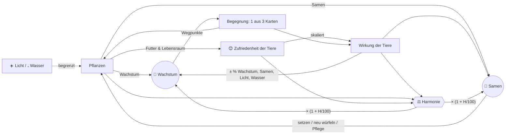
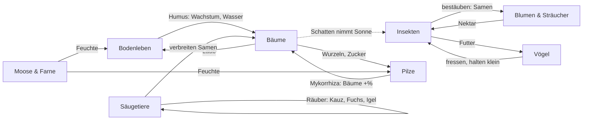
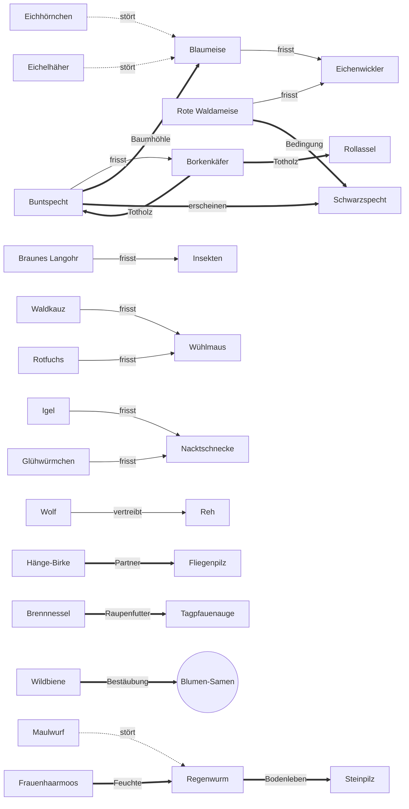

# Design v2 – Vom Samen zum Wald: ein Ökosystem wächst

> **Status:** Maßgebliches Designdokument für die Neuausrichtung (v2). Noch nicht
> implementiert – der aktuelle Code (v1: Wasser/Licht/Energie/Upgrades) ist in
> `GAME_DESIGN.md` beschrieben. Das Ökosystem-Konzept aus `ECOSYSTEM.md` ist hier
> überführt.
>
> **Alle Zahlen sind vorläufig.** Sie stammen aus dem Monte-Carlo-Prototyp in
> `scripts/v2/` (Abschnitt 15) und liegen in einer plausiblen Größenordnung, sind aber
> noch nicht am echten Spiel gebalanced. Maßgeblich für Zahlen ist bis zur Umsetzung
> `scripts/v2/content.ts`; die Tabellen hier sind daraus erzeugt.

---

## 1. Vision & Spielgefühl

Du bist ein Eichensamen. Während du zum Urwald heranwächst, ziehen Tiere ein, Pilze
umspinnen deine Wurzeln, Sträucher und Blumen keimen um dich herum. **Du baust kein
Upgrade-Rad, sondern eine Lebensgemeinschaft.** An Wegpunkten deines Wachstums bietet
dir der Wald drei Karten an – du wählst eine. Wie im Brettspiel *Mischwald* und in
Deckbuildern geht es darum, Synergien zu entdecken und ein stimmiges Gefüge zu bauen.

**Gefühl:** ruhig, organisch, neugierig. Ein Idle-Spiel mit gelegentlichen, kleinen
Entscheidungen (früh etwa jede Minute, später alle fünf Minuten). Kein Zeitdruck,
keine Strafe für Abwesenheit, nichts stirbt. Der Baum bleibt der Mittelpunkt.

**Leitsätze**
- *Der Baum ist die Bühne.* Er wächst vom Samen zum Urwald; die Nischen hängen an ihm.
- *Jede Wahl ist eine Abwägung*, selten eine Rechenaufgabe: Wachstum, Samen oder
  Harmonie – meist kann man nicht alles haben (Simulation: in ~70 % der Begegnungen).
- *Harmonie ist das Ziel* – eine Punktzahl, die sich gut anfühlt und beim Neuen Zyklus
  dauerhaft belohnt wird.
- *Tiere haben Zufriedenheit, Pflanzen haben Wachstum.*

### Ein typischer 10-Minuten-Ablauf

> **0:04** – Der Samen bricht auf. *„Etwas regt sich in der Erde …“* Drei Karten:
> Regenwurm, Wühlmaus, Pfifferling. Der Regenwurm braucht Feuchte – die gibt es noch
> nicht. Du nimmst ihn trotzdem: 75 % zufrieden, also +6 % statt +8 % Wachstum. Die
> Harmonie springt von 5 auf 38.
>
> **0:25** – *„Etwas keimt.“* Frauenhaarmoos, Buschwindröschen – du setzt das Moos.
> Der Regenwurm ist jetzt zu 100 % zufrieden; die Harmonie steigt auf 50.
>
> **0:50** – Setzling! Neue Nischen: Laubstreu und Waldsaum. Eine Wildbiene wird
> angeboten, aber es blüht noch nichts. Du lehnst ab (+10 🌰) und kaufst wenig später
> mit den Samen ein Buschwindröschen.
>
> **4:10** – Junger Baum. Die Krone öffnet sich. Karten: Eichenwickler, Blaumeise,
> Eichhörnchen. Die Meise hätte nichts zu fressen und keine Höhle; der Wickler frisst
> Laub (−10 % Wachstum), wäre aber Futter für die Meise. Du nimmst das Eichhörnchen
> (+12 % Samen) – und merkst dir die Raupenwacht für später.
>
> **7:40** – *Sturmnacht.* Ein Ast ist abgebrochen. „Totholz liegen lassen“ (öffnet einen
> Höhlenplatz, Rollassel und Steinläufer freuen sich) oder „Holz verwerten“ (+137 🌰)?
> Du lässt es liegen.
>
> **9:50** – Die Gattungsleiste leuchtet: 2 Bodenleben → +2 Wasser. Die Harmonie steht
> bei 64, Wachstum 14/s. Du schaust dem Baum beim Wachsen zu und schließt den Tab.
> Als du zurückkommst, warten drei Begegnungen.

---

## 2. Ressourcen & Kernschleife

| Symbol | Ressource | Art | Wofür |
|---|---|---|---|
| 🌿 | **Wachstum** | Fluss (pro s), summiert sich | treibt den Hauptbaum durch Wegpunkte und Stufen |
| 😊 | **Zufriedenheit** | je Tier 0–100 % | skaliert die Wirkung des Tiers, fließt in die Harmonie |
| 🌰 | **Samen** | einzige Währung | Pflanzen setzen, neu würfeln, Pflegemaßnahmen |
| ⚖️ | **Harmonie** | Punktzahl | Multiplikator auf 🌿 und 🌰; bestimmt die Prestige-Belohnung |
| ☀️ 💧 | **Licht, Wasser** | Umweltgrenzen, keine Währung | begrenzen, wie viele Pflanzen nebeneinander gedeihen |



### 2.1 Wachstum pro Sekunde

```
🌿/s = ( Hauptbaum(Stufe) · (1 + B_Bäume)
       + V · Σ_Pflanzen  w_p · (1 + B_Gruppe(p)) )
       · max(0,5 ; 1 + B_🌿 − F)
       · (1 + H / 100)
```

- **Hauptbaum (Stieleiche)** je Stufe: 1 · 2 · 3,5 · 6 · 10 · 16 · 24 · 34 (Samen … Urwald).
- `w_p` Wachstum der Begleitpflanze (Abschnitt 4), `B_Gruppe` Boni auf eine
  Pflanzengruppe (z. B. Pilze: Bäume +20 % – wirkt auch auf den Hauptbaum).
- `V` **Versorgung** der Begleitpflanzen mit Licht und Wasser (2.5).
- `B_🌿` Summe aller Wachstumsboni: Tiere (× ihre Zufriedenheit), Gattungsboni,
  Lebensgemeinschaften, Durchreisende, Ereignisse.
- `F` **Fraßschaden** der Pflanzenfresser (2.4). Untergrenze des Faktors: 0,5.

### 2.2 Samen pro Sekunde

```
🌰/s = ( Hauptbaum_🌰(Stufe) · (1 + B_🌰,Bäume) + V · Σ s_p · (1 + B_🌰,Gruppe(p)) )
       · (1 + B_🌰) · (1 + H / 100)
```

Hauptbaum: 0,1 · 0,15 · 0,25 · 0,4 · 0,6 · 0,9 · 1,3 · 1,8 🌰/s. Den Großteil der Samen
liefern Blumen und Sträucher – verstärkt durch Bestäuber und Samenverbreiter.

### 2.3 Zufriedenheit eines Tiers

```
z = clamp( b_Seltenheit + (1 − b_Seltenheit) · q
           − 0,15 · störende Arten − 0,10 · min(2, Jäger)  [+ Fähigkeiten],  0, 1 )

q = (2 · Futter + erfüllte Wünsche) / (2 + Anzahl Wünsche)
```

| Seltenheit | gewöhnlich | selten | besonders | legendär |
|---|---|---|---|---|
| Grundzufriedenheit `b` | 25 % | 15 % | 5 % | 0 % |

- **Futter** (zählt doppelt) = `max` über die Nahrungsmerkmale des Tiers von
  `min(1, Angebot / Nachfrage)`. Angebot je Merkmal: Hauptbaum 2, jede Pflanze 1, jedes
  Tier 1, Ereignis 1. Nachfrage: Anzahl der Tiere, die dieses Merkmal fressen. Zwei
  Räuber teilen sich also eine Wühlmaus.
- **Wünsche** an den Lebensraum, je einfach: Pflanzengruppen („2× Sträucher“),
  bestimmte Arten („Große Brennnessel“), Merkmale (Feuchte, Totholz, Baumhöhle),
  **sonnig** (nach allen Begleitpflanzen bleiben ≥ 2 Licht frei) oder **schattig**
  (≥ 3 Bäume inkl. Hauptbaum). Sonnig und schattig ziehen in entgegengesetzte
  Richtungen – mehr Bäume bringen Wachstum, nehmen aber Bienen und Faltern die Sonne.
- **Störung:** z. B. Eichhörnchen und Eichelhäher plündern Meisennester, der Maulwurf
  frisst Regenwürmer. **Räuberdruck:** Beute ist etwas weniger zufrieden, wenn sie
  gejagt wird – dafür hält der Räuber ihren Schaden klein.
- Seltene Tiere sind also **wählerisch**: Ohne passende Bedingungen bleiben sie
  schwach, mit allen Bedingungen sind sie die stärksten Karten.

**Wirkung eines Tiers** = Grundwirkung × z. Ausnahme: Fraßschaden wird nicht mit der
Zufriedenheit skaliert, sondern von Räubern gemindert.

### 2.4 Fraßschaden und Räuber

```
F = Σ_Schädlinge  Schaden · Π_Jäger (1 − Jagdstärke · z_Jäger)
```

Ein Schädling ist **unbewacht**, solange mehr als die Hälfte seines Schadens wirkt
(−4 Harmonie, siehe 9). Beispiel: Eichenwickler −10 %; mit zufriedener Blaumeise
(−50 %) und Gattungsbonus Vögel (−25 % auf Insekten) nur noch −3,75 %.

### 2.5 Licht und Wasser als Umweltgrenzen

Jede Begleitpflanze braucht Licht ☀️ und Wasser 💧 (Moose speichern Wasser: negativer
Bedarf). Das Angebot wächst mit der Stufe und durch Tiere, Ereignisse, Pflege:

| Stufe | Samen | Keimling | Setzling | Junger Baum | Alter Baum | Hain | Wald | Urwald |
|---|---|---|---|---|---|---|---|---|
| ☀️ Licht | 0 | 2 | 3 | 5 | 7 | 9 | 12 | 15 |
| 💧 Wasser | 0 | 2 | 3 | 5 | 7 | 9 | 11 | 14 |
| Pflanzplätze | 0 | 1 | 2 | 3 | 5 | 7 | 9 | 12 |

```
V = min(1, Licht / Σ Lichtbedarf, Wasser / Σ Wasserbedarf)
```

Wer nur lichthungrige Bäume setzt, landet bei V ≈ 0,6 – alle Begleitpflanzen wachsen
dann langsamer. Schattenpflanzen (Hirschzunge, Moos: 0 Licht) und genügsame Arten
(Kiefer: 1 Wasser) sind deshalb mehr als Füllmaterial. Der Hauptbaum ist davon nicht
betroffen.

### 2.6 Optional, später: Humus-Kreislauf 🍂

Skizze für eine Erweiterung, nicht Teil von v2.0: Laubfall erzeugt Streu, Zersetzer
(Regenwurm, Rollassel, Pilze) wandeln sie in Humus. Humus erhöht das Wasserangebot
und schaltet zusätzliche Pflanzplätze frei. Spielerisch würde das Zersetzer zu einer
eigenen „Wirtschaft“ machen; vorher prüfen, ob die Ebene „Zersetzer“ in der Pyramide
(Abschnitt 9) nicht schon genügt.

---

## 3. Der Hauptbaum & seine Stufen

Der Hauptbaum ist eine **Stieleiche**. Gesamt-Wachstum führt ihn durch **Wegpunkte**;
an jedem Wegpunkt findet eine Begegnung statt. Die Stufen bleiben als Rahmen und
fallen auf feste Wegpunkte.

```
Wegpunkt k liegt bei  4 · k^3,4  Gesamt-Wachstum
```

| # | Stufe | ab Wegpunkt | Gesamt-🌿 | Gesamt-🌿 Prototyp² | Ziel-Spielzeit* | Prototyp (Simulation 15.4) | Begegnungen im Abschnitt | neu |
|---|---|---|---|---|---|---|---|---|
| 0 | Samen | – | 0 | 0 | – | – | – | – |
| 1 | Keimling | 1 | 4 | 4 | < 30 s | 4 s | 2 | Wurzelraum (1); erste Karten |
| 2 | Setzling | 3 | 168 | 135 | ~ 1 min | 49 s | 3 | Laubstreu, Waldsaum; Pflanzen setzen |
| 3 | Junger Baum | 6 | 1.769 | 1.236 | ~ 4–5 min | 4:09 min | 6 | Krone, Stamm & Rinde; Ereignisse; Gattungsboni sichtbar |
| 4 | Alter Baum | 12 | 18.676 | 11.362 | ~ 20 min | 21:02 min | 8 | Höhlen & Totholz; Durchreisende; Eicheln (Nüsse) |
| 5 | Hain | 20 | 106.063 | 58.258 | ~ 60 min | 1:01 h | 8 | legendäre Arten; **Neuer Zyklus möglich** |
| 6 | Wald | 28 | 332.964 | 170.988 | ~ 1:40 h | 1:59 h | 8 | Wolf; mehr Plätze |
| 7 | Urwald | 36 | 782.507 | 382.145 | ~ 2:20 h | 3:12 h | – | Harmoniestufe „Urwald“ färbt die Szene |

\* für einen harmonie-orientierten Spieler, der jede Begegnung sofort auflöst
(Simulation, Abschnitt 15). Gegenüber v1 (Setzling 2 min, Junger Baum 8 min) ist der
Anfang schneller: Die ersten Karten sollen sofort kommen.

² **Prototyp ohne Pflanzen** (`src/content/waypoints.ts`): Wegpunkt k liegt bei
`4 · k^3,2`. Ohne den Schub der Begleitpflanzen hätte der Harmonie-Spieler mit `k^3,4`
den Hain erst nach ~1:49 h erreicht. Mit Schritt 2.1 (Pflanzen) geht der Exponent
zurück auf 3,4 – siehe 15.4.

### Nischen und Plätze

Jede Nische hat begrenzte Plätze; eine Art lebt höchstens einmal im Ökosystem.

| Nische | Lage | Keimling | Setzling | Junger Baum | Alter Baum | Hain | Wald | Urwald |
|---|---|---|---|---|---|---|---|---|
| 🪱 Wurzelraum | Erde, Wurzeln | 1 | 2 | 2 | 3 | 3 | 4 | 4 |
| 🍂 Laubstreu | Boden um den Stamm | – | 1 | 2 | 2 | 3 | 3 | 4 |
| 🌼 Waldsaum | Blumen, Sträucher, Wiese rund um den Baum | – | 1 | 2 | 3 | 3 | 4 | 4 |
| 🌳 Krone | Äste, Blätter | – | – | 2 | 2 | 3 | 4 | 4 |
| 🪵 Stamm & Rinde | Borke | – | – | 1 | 2 | 2 | 3 | 3 |
| 🕳️ Höhlen & Totholz | Spechthöhlen, tote Äste | – | – | (–)¹ | 1 | 2 | 2 | 3 |
| **Summe** | | 1 | 4 | 9 | 13 | 16 | 20 | 22 |

¹ Höhlen öffnen sich schon früher, wenn Totholz entsteht: +1 durch Borkenkäfer,
Buntspecht, Ereignis „Sturmnacht“ oder Pflege „Nistkästen“; +1 Krone und Höhlen durch
den Schwarzspecht.

Die frühere Nische „Lichtung“ ist im **Waldsaum** aufgegangen: Er öffnet schon beim
Setzling, weil dort die Begleitpflanzen wachsen und Bienen und Falter leben.

---

## 4. Pflanzen

Pflanzen haben **Wachstum**, **Samen**, **Licht-** und **Wasserbedarf** und bieten
Tieren **Futter und Lebensraum**. Sie kommen über Begegnungen („Etwas keimt“, gratis)
oder werden mit Samen gesetzt:

```
Kosten der nächsten Pflanze = 20 · 1,9^n   (n = Begleitpflanzen, die schon wachsen)
→ 20 · 38 · 72 · 137 · 261 · 495 · 941 · 1.788 · 3.397 🌰
```

Pflanzen sterben nicht; ein voller Pflanzring heißt: ersetzen oder warten.

| Gruppe | Rolle im Gefüge |
|---|---|
| **Bäume** | viel Wachstum, viel Licht; Laub für Zersetzer; Lebensraum für Kronen- und Pilzarten; machen es **schattig** |
| **Sträucher** | Beeren und Nüsse; Deckung (Rotkehlchen, Igel, Fuchs, Reh) |
| **Blumen & Kräuter** | wenig Wachstum, **viele Samen**, Nektar für Bestäuber |
| **Moose & Farne** | wenig Licht, Moos speichert Wasser; **Feuchte** für Regenwurm, Pilze, Schnecken |

| Pflanze | Gruppe | ab | 🌿/s | 🌰/s | ☀️ | 💧 | bietet | Text |
|---|---|---|---|---|---|---|---|---|
| Hänge-Birke | Bäume | Junger Baum | 1,5 | 0,3 | 4 | 2 | Laub | „Pionierin mit weißer Rinde – wächst schnell, wo Licht ist.“ |
| Eberesche | Bäume | Junger Baum | 1 | 0,6 | 3 | 2 | Laub, Beeren, Nektar | „Ihre roten Beeren sind ein Festmahl für Vögel.“ |
| Rotbuche | Bäume | Alter Baum | 2 | 0,4 | 3 | 3 | Laub, Nüsse | „Die Mutter des Waldes – kommt auch im Schatten zurecht.“ |
| Waldkiefer | Bäume | Alter Baum | 1,5 | 0,4 | 3 | 1 | Laub, Nadeln | „Genügsam und harzig, liebt sandigen Boden.“ |
| Hasel | Sträucher | Setzling | 0,8 | 0,6 | 2 | 2 | Laub, Nüsse | „Blüht schon im Februar – und dann die Nüsse!“ |
| Brombeere | Sträucher | Setzling | 0,5 | 1 | 2 | 1 | Beeren, Nektar | „Stachelig, wuchernd, ein sicheres Versteck.“ |
| Schwarzer Holunder | Sträucher | Junger Baum | 0,8 | 0,8 | 2 | 2 | Laub, Beeren, Nektar | „Duftende Dolden im Juni, dunkle Beeren im Herbst.“ |
| Buschwindröschen | Blumen & Kräuter | Keimling | 0,3 | 0,8 | 1 | 1 | Nektar, Kraut | „Blüht, bevor sich das Kronendach schließt.“ |
| Große Brennnessel | Blumen & Kräuter | Setzling | 0,4 | 0,6 | 2 | 2 | Kraut | „Brennt – und ernährt die Raupen vieler Falter.“ |
| Wald-Erdbeere | Blumen & Kräuter | Setzling | 0,3 | 1 | 2 | 1 | Beeren, Nektar, Kraut | „Winzig, rot und süßer als jede Gartenerdbeere.“ |
| Roter Fingerhut | Blumen & Kräuter | Junger Baum | 0,3 | 1,4 | 3 | 1 | Nektar | „Hohe Glockenblüten – die Hummeln kriechen ganz hinein.“ |
| Frauenhaarmoos | Moose & Farne | Keimling | 0,3 | 0,2 | 0 | −2 | Feuchte | „Ein grünes Polster, das Regen speichert wie ein Schwamm.“ |
| Wurmfarn | Moose & Farne | Setzling | 0,6 | 0,2 | 1 | 2 | Feuchte | „Rollt im Frühling seine Wedel aus wie Bischofsstäbe.“ |
| Hirschzunge | Moose & Farne | Alter Baum | 0,7 | 0,3 | 0 | 2 | Feuchte | „Ein Farn mit ungeteilten, glänzenden Blättern – liebt tiefen Schatten.“ |

Der Hauptbaum zählt als Baum (für „2× Bäume“ usw.), bietet Laub und Wurzeln, ab
„Alter Baum“ auch Nüsse (Eicheln), und wiegt in der Nahrungspyramide wie 3 Pflanzen.

---

## 5. Tiere

### 5.1 Gattungen und Schwellenboni

Fünf Gattungen (eigentlich Lebensweise-Gruppen). Entscheidungen zu den offenen Punkten:
**Fledermäuse** gehören zu den Säugetieren (das Braune Langohr zählt per Fähigkeit
zusätzlich als Vogel). **Amphibien** bekommen in v2.0 keine eigene Gattung – der
Feuersalamander lebt als legendäres Bodenleben in der Laubstreu; eine Gattung
Amphibien (mit Waldtümpel, Erdkröte, Bergmolch) ist eine spätere Erweiterung.

**Schwellen 2 / 3 / 5** (à la Teamfight Tactics). Weil jede Art nur einmal vorkommt
und Gattungen 6–8 Arten haben, liegen die Schwellen niedriger als die im Briefing
genannten 2/4/6: Ein ausgewogener Wald erreicht mehrere kleine Boni, wer eine Gattung
stapelt, den großen. Durchreisende zählen mit.

| Gattung | 2 | 3 | 5 |
|---|---|---|---|
| 🐦 Vögel | Insektenschaden −25 % | +15 % Samen | +20 % Wachstum, +20 % Samen |
| 🐝 Insekten | Blumen +30 % Samen | Sträucher und Bäume +30 % Samen | +40 % Samen |
| 🦔 Säugetiere | +10 % Samen | +12 % Wachstum | +25 % Wachstum |
| 🪱 Bodenleben | +2 Wasser | +12 % Wachstum | +25 % Wachstum, +3 Wasser |
| 🍄 Pilze | Bäume +10 % Wachstum | +3 Wasser, +2 Licht | +30 % Wachstum |

### 5.2 Seltenheit

| | gewöhnlich | selten | besonders | legendär |
|---|---|---|---|---|
| Grundzufriedenheit | 25 % | 15 % | 5 % | 0 % |
| Stärke | Grundwert | ~1,5× | ~2× + Fähigkeit | ~2,5× + **regelverändernde** Fähigkeit |
| Erscheinen | immer | immer | erst wenn ihre **Erscheinungsbedingung** erfüllt ist | wie besonders, ab Hain/Wald |
| Arten | 14 | 8 | 5 | 5 |

### 5.3 Katalog (32 Arten)

**Ebenen** der Nahrungspyramide: Pflanzenfresser (inkl. Bestäuber, Samenverbreiter) ·
Räuber · Zersetzer & Partner (inkl. Mykorrhiza-Pilze). **Wirkung** wird mit der
Zufriedenheit multipliziert (außer Fraß). Überführte Arten aus `ECOSYSTEM.md` sind
mit ↻ markiert; neue Arten mit ✦.

#### 🐦 Vögel

| Art | Seltenheit | Ebene | Nische | ab | Nahrung | Wünsche | erscheint, wenn | bietet | Wirkung | Fähigkeit |
|---|---|---|---|---|---|---|---|---|---|---|
| ✦ Rotkehlchen | gewöhnlich | Räuber | Laubstreu | Setzling | Würmer / Insekten / Beeren | 1× Sträucher | – | – | jagt Insekten (−20 %), +8 % 🌰 | – |
| ↻ Blaumeise | gewöhnlich | Räuber | Krone | Junger Baum | Raupen / Insekten | 2× Bäume, Baumhöhle | – | – | jagt Raupen (−50 %), +4 % 🌰 | – |
| ↻ Buntspecht | selten | Räuber | Stamm & Rinde | Alter Baum | Käfer / Insekten / Nüsse | Totholz | – | Baumhöhle | jagt Käfer (−60 %), +1 Platz Höhlen, +4 % 🌿 | – |
| ↻ Eichelhäher | selten | Pflanzenfresser | Krone | Alter Baum | Nüsse | – | – | – | +12 % 🌿, +10 % 🌰, stört Blaumeise | – |
| ↻ Waldkauz | besonders | Räuber | Höhlen & Totholz | Alter Baum | Kleinsäuger | 2× Bäume | Kleinsäuger leben hier | – | jagt Kleinsäuger (−70 %), +8 % 🌿 | **Nachtwache:** Schaden aller Pflanzenfresser −20 % |
| ✦ Schwarzspecht | legendär | Räuber | Stamm & Rinde | Hain | Insekten / Käfer | Rote Waldameise, Totholz, 3× Bäume | Buntspecht lebt hier | Baumhöhle | +10 % 🌿, jagt Käfer (−40 %) | **Baumeister:** +1 Platz Krone und Höhlen; Höhlenbewohner +20 % Zufriedenheit |

#### 🐝 Insekten

| Art | Seltenheit | Ebene | Nische | ab | Nahrung | Wünsche | erscheint, wenn | bietet | Wirkung | Fähigkeit |
|---|---|---|---|---|---|---|---|---|---|---|
| ↻ Eichenwickler | gewöhnlich | Pflanzenfresser | Krone | Junger Baum | Laub | – | – | Insekten, Raupen | Fraß −10 % 🌿, +3 % 🌿 (Raupenkot) | – |
| ↻ Wildbiene | gewöhnlich | Pflanzenfresser | Waldsaum | Setzling | Nektar | 1× Blumen, sonnig | – | Insekten | Blumen +40 % 🌰, Sträucher +25 % 🌰, +5 % 🌰 | – |
| ✦ Tagpfauenauge | gewöhnlich | Pflanzenfresser | Waldsaum | Junger Baum | Nektar | Große Brennnessel, sonnig | – | Insekten, Raupen | +10 % 🌰, Blumen +20 % 🌰 | – |
| ↻ Borkenkäfer | gewöhnlich | Pflanzenfresser | Stamm & Rinde | Junger Baum | Laub / Nadeln | – | – | Insekten, Käfer, Totholz | Fraß −8 % 🌿, +1 Platz Höhlen | – |
| ✦ Rote Waldameise | selten | Räuber | Laubstreu | Alter Baum | Insekten | Nadeln (Kiefer), sonnig | – | Insekten | jagt Raupen (−40 %), Blumen +30 % 🌰 (trägt Samen), +4 % 🌿 | – |
| ✦ Glühwürmchen | besonders | Räuber | Waldsaum | Alter Baum | Schnecken | Feuchte, 1× Blumen | Schnecken leben hier | Insekten | jagt Schnecken (−60 %), +4 ⚖️ | **Lichterabend:** jede Lebensgemeinschaft +3 Harmonie |
| ↻ Hirschkäfer | legendär | Zersetzer | Höhlen & Totholz | Hain | Totholz | schattig *und* sonnig (lichter Altwald), 1× Pilze | Totholz | Insekten, Käfer | +10 % 🌿, +5 ⚖️ | **König des Totholzes:** alle Zersetzer & Partner +20 % Zufriedenheit |

#### 🦔 Säugetiere

| Art | Seltenheit | Ebene | Nische | ab | Nahrung | Wünsche | erscheint, wenn | bietet | Wirkung | Fähigkeit |
|---|---|---|---|---|---|---|---|---|---|---|
| ↻ Wühlmaus | gewöhnlich | Pflanzenfresser | Wurzelraum | Keimling | Wurzeln / Kraut | – | – | Kleinsäuger | Fraß −8 % 🌿, +4 % 🌰 | – |
| ↻ Eichhörnchen | gewöhnlich | Pflanzenfresser | Krone | Junger Baum | Nüsse | 2× Bäume | – | – | +12 % 🌰, +6 % 🌿, stört Blaumeise | – |
| ↻ Reh | gewöhnlich | Pflanzenfresser | Waldsaum | Alter Baum | Kraut / Laub | 1× Sträucher, sonnig | – | Rehe | +3 ☀️ (hält den Saum offen), Fraß −10 % 🌿 | – |
| ↻ Maulwurf | selten | Räuber | Wurzelraum | Setzling | Würmer / Insekten | – | – | – | +2 💧, +5 % 🌿, stört Regenwurm | – |
| ↻ Igel | selten | Räuber | Laubstreu | Junger Baum | Schnecken / Insekten / Würmer | 1× Sträucher | – | – | jagt Schnecken (−70 %), +4 % 🌿 | – |
| ↻ Rotfuchs | selten | Räuber | Waldsaum | Alter Baum | Kleinsäuger | 2× Sträucher | – | – | jagt Kleinsäuger (−50 %), +6 % 🌰 | – |
| ↻ Braunes Langohr | besonders | Räuber | Höhlen & Totholz | Alter Baum | Insekten | 2× Blumen | 2 Insektenarten leben hier | – | jagt Insekten (−40 %), +8 % 🌰 | **Nachtflieger:** zählt zusätzlich als Vogel |
| ↻ Wolf | legendär | Räuber | Waldsaum | Wald | Rehe | 3× Bäume | Reh lebt hier | – | +15 % 🌿 | **Landschaft der Angst:** Reh-Schaden entfällt, Reh-Licht ×2 |

#### 🪱 Bodenleben

| Art | Seltenheit | Ebene | Nische | ab | Nahrung | Wünsche | erscheint, wenn | bietet | Wirkung | Fähigkeit |
|---|---|---|---|---|---|---|---|---|---|---|
| ↻ Regenwurm | gewöhnlich | Zersetzer | Wurzelraum | Keimling | Laub | Feuchte | – | Würmer | +2 💧, +8 % 🌿 | – |
| ↻ Rollassel | gewöhnlich | Zersetzer | Laubstreu | Setzling | Laub | Totholz | – | Insekten | +8 % 🌿 | – |
| ↻ Nacktschnecke | gewöhnlich | Pflanzenfresser | Laubstreu | Setzling | Kraut | Feuchte, schattig | – | Schnecken | Fraß −6 % 🌿, +1 💧 | – |
| ✦ Steinläufer | selten | Räuber | Laubstreu | Junger Baum | Insekten / Würmer | Totholz | – | – | jagt Insekten (−30 %), +6 % 🌿 | – |
| ✦ Weinbergschnecke | besonders | Zersetzer | Laubstreu | Alter Baum | Laub / Kraut | 2× Blumen, Feuchte | Feuchte | Schnecken | +12 % 🌿, +2 💧 | **Gelassen:** Zufriedenheit nie unter 50 % |
| ✦ Feuersalamander | legendär | Räuber | Laubstreu | Hain | Schnecken / Würmer / Insekten | 2× Moose & Farne, Totholz, schattig | 2× Moose & Farne und Totholz | – | +15 % 🌿, jagt Schnecken (−50 %) | **Hüter der Feuchte:** Moose & Farne brauchen kein Wasser |

#### 🍄 Pilze

| Art | Seltenheit | Ebene | Nische | ab | Nahrung | Wünsche | erscheint, wenn | bietet | Wirkung | Fähigkeit |
|---|---|---|---|---|---|---|---|---|---|---|
| ✦ Pfifferling | gewöhnlich | Partner | Wurzelraum | Keimling | Wurzeln | Feuchte, schattig | – | – | Bäume +10 % 🌿 | – |
| ✦ Zunderschwamm | gewöhnlich | Zersetzer | Stamm & Rinde | Junger Baum | Laub (Holz) | 2× Bäume | – | Totholz | +5 % 🌿, Fraß −3 % 🌿 | – |
| ↻ Steinpilz (früher „Mykorrhiza-Pilz“) | selten | Partner | Wurzelraum | Junger Baum | Wurzeln | 2× Bäume, 1× Bodenleben | – | – | Bäume +20 % 🌿, +3 💧 | – |
| ✦ Fliegenpilz | besonders | Partner | Wurzelraum | Alter Baum | Wurzeln | Hänge-Birke, Feuchte | Hänge-Birke wächst hier | – | Bäume +15 % 🌿, +10 % 🌰 | **Glückspilz:** seltene, besondere und legendäre Karten je +5 Prozentpunkte |
| ✦ Hallimasch | legendär | Zersetzer | Wurzelraum | Hain | Wurzeln / Totholz | 3× Bäume, Totholz, 2× Pilze | 2 Pilzarten und Totholz | – | +20 % 🌿 | **Waldweites Netz:** Versorgung aller Pflanzen mindestens 90 % |

Kurztexte (Auswahl, Rest in `scripts/v2/content.ts`): Rotkehlchen „Folgt jedem, der im
Boden gräbt – vielleicht kommt ein Wurm zum Vorschein.“ · Schwarzspecht „Der Baumeister
des Waldes. In seine Höhlen ziehen später Kauz, Fledermaus und Hohltaube.“ ·
Feuersalamander „Schwarz-gelb und uralt. Wo er lebt, ist der Wald noch feucht und
heil.“ · Hallimasch „Das größte Lebewesen der Erde ist ein Pilz. Sein Netz verbindet
den ganzen Wald.“ · Glühwürmchen „Seine Larven jagen Schnecken. An Juniabenden
leuchtet der Waldsaum.“

### 5.4 Was aus dem alten Katalog geändert wurde

- **Prozent auf Wasser/Licht/Photosynthese → Wachstum, Samen, Zufriedenheit.**
  Positive Ressourcen-Effekte wurden zu Wachstum (Zersetzer, Partner) oder Samen
  (Bestäuber, Verbreiter); Licht/Wasser-Effekte bleiben als Umweltgrenze (Regenwurm
  +💧, Reh +☀️).
- **Einzugskosten in Energie → Kartenwahl.** Tiere kosten nichts; der Preis ist der
  Platz und die Gelegenheit. „Braucht X“ wurde zu Nahrung/Wünschen (weiche Bedingung
  über Zufriedenheit) bzw. bei seltenen Arten zur Erscheinungsbedingung.
- **„Hungrig“ → Futter-Erfüllung** in der Zufriedenheit; **Nesträuber/Konkurrenz →
  Störung** (−15 % Zufriedenheit).
- Mykorrhiza-Pilz wird zum **Steinpilz** (selten); Lichtung geht im **Waldsaum** auf.
- Neue Arten füllen die Gattungen auf: Rotkehlchen, Schwarzspecht, Tagpfauenauge,
  Rote Waldameise, Glühwürmchen, Steinläufer, Weinbergschnecke, Feuersalamander und
  vier Pilze. Wildbiene und Reh wechseln in den Waldsaum.

---

## 6. Wechselwirkungen

### 6.1 Gattungen untereinander



| wirkt auf → | Vögel | Insekten | Säugetiere | Bodenleben | Pilze | Pflanzen |
|---|---|---|---|---|---|---|
| **Vögel** | Häher/Hörnchen stören Meisen | mindern Fraß (Meise, Spechte); Gattungsbonus −25 % Insektenschaden | Kauz jagt Wühlmaus | Rotkehlchen frisst Würmer | – | Häher +Wachstum (pflanzt Eicheln) |
| **Insekten** | Futter | – | Futter für Langohr | Futter für Steinläufer | – | Bestäubung: Samen ↑; Raupen/Käfer: Fraß |
| **Säugetiere** | Fuchs/Langohr teilen Beute mit Kauz | Langohr jagt Falter | Fuchs/Kauz jagen Wühlmaus; Wolf hält Reh in Schach | Maulwurf stört Regenwurm; Igel frisst Schnecken | – | Samen verbreiten; Reh: Licht ↑, Fraß |
| **Bodenleben** | Futter (Würmer) | Steinläufer jagt Insekten | Futter für Igel, Maulwurf | – | Steinpilz braucht Bodenleben | Wachstum ↑, Wasser ↑ |
| **Pilze** | – | Hirschkäfer braucht Pilze | – | Humusküche | Hallimasch braucht 2 Pilze | Bäume +%, Versorgung |
| **Pflanzen** | Bäume, Höhlen, Beeren | Nektar, Brennnessel | Nüsse, Deckung | Laub, Feuchte | Wurzeln, Birke | Licht/Wasser-Konkurrenz |

### 6.2 Wichtigste Art-Beziehungen



Legende: `-- frisst -->` Räuber–Beute · `-.->` Störung · `==>` schafft Lebensraum,
Bedingung oder Partnerschaft.

### 6.3 Beispiele

- **Totholz-Kette:** Der Borkenkäfer kostet 8 % Wachstum, schafft aber Totholz (+1
  Höhlenplatz, Rollassel und Steinläufer werden zufrieden). Der Buntspecht frisst die
  Käfer (Restschaden ~3 %), zimmert Höhlen (+1 Platz, Blaumeise zufrieden) und lässt
  den Schwarzspecht erscheinen.
- **Raupenwacht:** Eichenwickler allein −10 %, mit Blaumeise −5 %, mit Meise und
  Gattungsbonus Vögel −3,75 %. Zieht das Eichhörnchen ein, ist die Meise gestört
  (−15 % Zufriedenheit) und jagt schlechter.
- **Sonne oder Schatten:** Eine zweite Rotbuche bringt +2 🌿/s und macht es schattig
  (Pfifferling, Nacktschnecke, Feuersalamander freuen sich) – aber Biene und
  Tagpfauenauge verlieren die Sonne. Ein Reh (+3 ☀️) oder die Pflege „Lichte Krone“
  lösen das auf – zum Preis von Fraß bzw. Kronenplätzen.
- **Geteilte Beute:** Waldkauz und Rotfuchs fressen beide Kleinsäuger. Mit nur einer
  Wühlmaus sind beide nur halb satt.

---

## 7. Begegnungen

### 7.1 Typen

| Typ | Karten | Auflösung | ab |
|---|---|---|---|
| 🐾 **Tier zieht ein** | 3 Tierkarten | eine wählen → Platz in ihrer Nische; Nische voll → ein Tier dieser Nische entlassen (Vorschau) oder ablehnen | Keimling |
| 🌱 **Etwas keimt** | 3 Pflanzenkarten | eine gratis setzen; Ring voll → ersetzen oder ablehnen | Keimling |
| ⛈️ **Ereignis mit Wahl** | 1 Ereignis, 2 Optionen | dauerhafte Wirkung *oder* Samen | Junger Baum |
| 🦢 **Durchreisende** | 1 Gast | rastet 3 Wegpunkte lang, braucht keinen Platz, zählt für Gattungsboni; oder ablehnen | Alter Baum |

- **Ablehnen** bringt immer Samen: 25 % der nächsten Pflanze.
- **Neu würfeln** (Tier- und Pflanzenbegegnung) kostet 50 % der nächsten Pflanze,
  jedes weitere Mal in derselben Begegnung doppelt so viel.
- Die ersten drei Begegnungen sind festgelegt: Tier, Pflanze, Tier (Einführung).
- Nichts ist verloren: Entlassene Tiere stehen im Naturtagebuch und können wieder
  angeboten werden.

### 7.2 Takt und Häufigkeit

| Stufe | Tier | Pflanze | Ereignis | Durchreisende | Takt (Simulation, Median) |
|---|---|---|---|---|---|
| Keimling | 60 % | 40 % | – | – | ~25 s |
| Setzling | 60 % | 40 % | – | – | ~1 min |
| Junger Baum | 60 % | 25 % | 15 % | – | ~2:40 min |
| Alter Baum | 55 % | 20 % | 15 % | 10 % | ~4:20 min |
| Hain, Wald, Urwald | 55 % | 20 % | 15 % | 10 % | ~5:15 min |

Prototyp (nur Tierbegegnungen, keine Pflanzen; Simulation 15.4, Median der Wartezeit
je Begegnung): Keimling 22 s · Setzling 1:04 min · Junger Baum 2:46 min · Alter Baum
5:03 min · Hain 7:13 min · Wald 9:03 min.

Bis zum Hain sind es 20 Begegnungen (~12 Tiere), bis zum Urwald 36. Zwischen den
Begegnungen gibt es Samen-Entscheidungen (Pflanze setzen, Pflege).

### 7.3 Seltenheitsgewichte je Stufe

Jede Karte zieht erst eine Seltenheit, dann gleichverteilt eine Art dieser Seltenheit,
die freigeschaltet ist, eine offene Nische hat, noch nicht im Ökosystem lebt und ihre
Erscheinungsbedingung erfüllt. Gibt es keine, wird neu gewichtet.

| Stufe | gewöhnlich | selten | besonders | legendär |
|---|---|---|---|---|
| Samen, Keimling | 90 | 10 | – | – |
| Setzling | 85 | 15 | – | – |
| Junger Baum | 72 | 23 | 5 | – |
| Alter Baum | 60 | 28 | 10 | 2 |
| Hain | 50 | 30 | 14 | 6 |
| Wald | 45 | 30 | 17 | 8 |
| Urwald | 40 | 30 | 20 | 10 |

Fliegenpilz („Glückspilz“): +5 Prozentpunkte auf selten/besonders/legendär, −15 auf
gewöhnlich.

### 7.4 Ereignisse (Auswahl)

Jedes Ereignis höchstens einmal pro Zyklus. Keine Option ist eine Strafe.

| Ereignis | ab | Option A (dauerhaft) | Option B | Text |
|---|---|---|---|---|
| Sturmnacht | Junger Baum | Totholz liegen lassen: Totholz, +1 Platz Höhlen | Holz verwerten: 100 % der nächsten Pflanze in 🌰 | „Ein Ast ist abgebrochen und liegt im Laub.“ |
| Regenreicher Frühling | Junger Baum | Waldtümpel: Feuchte, +3 💧 | Wasser ableiten: 100 % in 🌰 | „In einer Senke sammelt sich das Wasser.“ |
| Windwurf | Alter Baum | Lichtung offen lassen: +3 ☀️ | Stamm verkaufen: 120 % in 🌰 | „Ein alter Nachbarbaum ist umgestürzt – plötzlich ist es hell.“ |
| Mastjahr *(nur Doku)* | Alter Baum | nächste Tierbegegnung: garantiert ein Samenverbreiter | +50 % 🌰 für 2 Wegpunkte | „Die Eiche trägt so viele Eicheln wie seit Jahren nicht.“ |
| Pilzherbst *(nur Doku)* | Junger Baum | nächste Tierbegegnung: 3 Pilzkarten | 80 % in 🌰 | „Über Nacht stehen überall Hüte im Moos.“ |

### 7.5 Durchreisende

| Gast | Gattung | Wirkung (3 Wegpunkte) | Text |
|---|---|---|---|
| Kraniche | Vögel | +20 % 🌰 | „Trompetend ziehen sie nach Süden und rasten eine Nacht.“ |
| Bergfinken | Vögel | +10 % 🌿, +10 % 🌰 | „Ein Schwarm aus dem Norden plündert die Bucheckern.“ |
| Taubenschwänzchen | Insekten | Blumen +50 % 🌰 | „Ein Falter, der schwirrt wie ein Kolibri.“ |

### 7.6 Warteschlange und Offline

- Wird ein Wegpunkt erreicht, werden die Karten **sofort gezogen** und in
  `pendingEncounters` gespeichert (kein Neuladen-Trick).
- Höchstens **3 Begegnungen** warten. Kein Zeitdruck: Wachstum und Samen laufen weiter,
  auch wenn Begegnungen offen sind.
- Offline wie bisher bis 8 Stunden. Werden offline mehr als 3 Wegpunkte erreicht,
  werden die überzähligen automatisch **abgelehnt und als Samen gutgeschrieben**
  (Empfehlung, siehe Frage 1) – nichts verfällt.
- Willkommen-zurück-Meldung: „Während du weg warst: +12.400 🌿, +2.100 🌰, 3 Begegnungen
  warten.“

---

## 8. Pflegemaßnahmen

Einmal mit Samen gekauft, danach **kostenlos ein- und ausschaltbar**. Jede hat genau
**einen klaren Gewinner und einen klaren Verlierer**. „Dichte“ und „Lichte Krone“
schließen sich aus. Kosten etwa 3–5 Minuten Samenproduktion bei Freischaltung
(Junger Baum ~2 🌰/s, Alter Baum ~4 🌰/s, Hain ~10 🌰/s).

| Maßnahme | ab | Kosten | Gewinner | Verlierer | Text |
|---|---|---|---|---|---|
| Laub liegen lassen | Junger Baum | 400 🌰 | +1 Platz Laubstreu; Bodenleben +15 % Zufriedenheit | Wildbiene −20 % Zufriedenheit (kein offener Boden); Schneckenfraß +50 % | „Im Herbst bleibt das Laub, wo es fällt.“ |
| Pilzfreundlicher Boden | Junger Baum | 400 🌰 | Pilze +20 % Zufriedenheit, Pilz-Wirkung ×1,25 | Maulwurf −30 % Zufriedenheit (zerreißt die Fäden) | „Nicht umgraben, nicht stören – das Geflecht wächst.“ |
| Nistkästen | Junger Baum | 500 🌰 | Merkmal Baumhöhle; +1 Platz Höhlen (nur Vögel, Fledermäuse) | Störung durch Eichhörnchen und Eichelhäher doppelt | „Ein Holzkasten mit kleinem Flugloch. Gemütlich – und leicht zu finden.“ |
| Dichte Krone | Alter Baum | 1.000 🌰 | +1 Platz Krone; Kronenvögel +15 % Zufriedenheit; zählt als schattig | −2 ☀️ (Waldsaum weniger sonnig) | „Ein Dach aus Blättern, unter dem Vögel sicher brüten.“ |
| Lichte Krone | Alter Baum | 1.000 🌰 | +3 ☀️; Bestäuber +20 % Zufriedenheit | −1 Platz Krone; Vögel −10 % Zufriedenheit | „Ein paar Äste weniger – Sonnenflecken tanzen über den Boden.“ |
| Blühender Efeu | Alter Baum | 800 🌰 | Insekten +20 % Zufriedenheit; +10 % 🌰 | −1 Platz Stamm & Rinde; Spechte −15 % Zufriedenheit | „Blüht spät im Jahr, wenn sonst nichts mehr blüht.“ |
| Totholz liegen lassen | Alter Baum | 1.200 🌰 | Merkmal Totholz; +1 Platz Höhlen; Höhlenbewohner +10 % | Borkenkäferfraß +50 % | „Ein toter Baum lebt länger als ein lebender.“ |
| Wildwiese | Hain | 3.000 🌰 | +1 Platz Waldsaum; zählt als sonnig; Bestäuber +20 % | Wühlmausfraß +50 %; −1 Pflanzplatz | „Margeriten, Klee und hohes Gras am Waldrand.“ |
| Waldtümpel | Hain | 3.000 🌰 | Merkmal Feuchte; +3 💧; Langohr +20 % (Insekten über dem Wasser) | Schneckenfraß ×2; Igel −20 % Zufriedenheit | „Eine feuchte Senke, in der sich der Regen sammelt.“ |
| Wildschutzzaun | Hain | 2.500 🌰 | Rehfraß −50 % | Rotfuchs und Wolf −30 % Zufriedenheit; Reh zählt weiter als unbewacht | „Ein Zaun schützt den Jungwuchs – und hält auch die Jäger draußen.“ |

Überführt aus `ECOSYSTEM.md`: alle zehn Maßnahmen, Energie-Kosten → Samen,
Prozent-Boni → Zufriedenheit; „Bejagung“ heißt jetzt „Wildschutzzaun“ (stimmiger für
ein friedliches Spiel). Pflegemaßnahmen sind im Prototyp **nicht** simuliert.

---

## 9. Harmonie

### 9.1 Formel

```
H = Vielfalt + Zufriedenheit + Pyramide + Lebensgemeinschaften + Sonderpunkte

Vielfalt        = 3 · vertretene Gruppen (5 Tiergattungen + 4 Pflanzengruppen; Hauptbaum zählt nicht)
                + 1 · verschiedene Arten (Tiere und Pflanzen)
Zufriedenheit   = 30 · Ø Zufriedenheit der Tiere
Pyramide (≤ 20) = 5 · (besetzte Ebenen von Pflanzenfresser, Räuber, Zersetzer) / 3
                + 5 · min(1, P / (1,5 · Pflanzenfresser))        Tragfähigkeit
                + 5 · Ø Futter-Erfüllung der Räuber               satte Räuber
                + 5 · min(1, Zersetzer / ((P + Pflanzenfresser + Räuber) / 5))   Kreislauf
                − 4 · unbewachte Schädlinge
                  (P = 3 für den Hauptbaum + Begleitpflanzen)
Multiplikator   = 1 + H / 100     auf 🌿 und 🌰
```

**Harmoniestufen** (Anzeige und Grafik): 0–29 „Zarte Anfänge“ · 30–59 „Lebendiges
Gefüge“ · 60–89 „Stimmiges Ökosystem“ · 90–119 „Blühender Mischwald“ · ab 120 „Urwald“.
Typische Werte (Simulation): Setzling ~50, Alter Baum ~75, Hain ~95, Urwald ~140.

### 9.2 Lebensgemeinschaften

Im Naturtagebuch als Silhouette mit Rätselhinweis, bis sie entdeckt sind.

| Lebensgemeinschaft | Mitglieder | ⚖️ | Extra | Hinweis |
|---|---|---|---|---|
| Humusküche | Regenwurm, Rollassel, Pfifferling oder Steinpilz | +8 | +5 % 🌿 | „Aus Laub wird Erde, aus Erde wird Leben.“ |
| Raupenwacht | Eichenwickler, Blaumeise, Braunes Langohr oder Rote Waldameise | +8 | – | „Tags und nachts wird die Krone bewacht.“ |
| Totholz-Kette | Borkenkäfer, Buntspecht, Zunderschwamm, Waldkauz oder Braunes Langohr | +10 | – | „Was stirbt, schafft Wohnraum.“ |
| Nachtschicht | Waldkauz, Braunes Langohr, Igel oder Glühwürmchen | +6 | – | „Wenn du schläfst, arbeiten sie.“ |
| Samenboten | Eichhörnchen, Eichelhäher, Wildbiene | +8 | +10 % 🌰 | „Blüte, Frucht und Versteck.“ |
| Wilder Waldsaum | Reh, Rotfuchs, Wolf | +10 | – | „Erst der Jäger bringt den Wald ins Gleichgewicht.“ |
| Blütensaum | Wildbiene, Tagpfauenauge, Große Brennnessel, Wald-Erdbeere oder Roter Fingerhut | +6 | – | „Wo Brennnesseln stehen dürfen, tanzen Falter.“ |
| Birkenbund | Hänge-Birke, Fliegenpilz, Frauenhaarmoos | +6 | – | „Weiß, rot und grün – ein altes Bündnis.“ |
| Feuchter Grund | Frauenhaarmoos, Wurmfarn, Nacktschnecke oder Feuersalamander | +6 | – | „Im Schatten, wo es nie ganz trocknet.“ |

### 9.3 Beispielrechnung (Stufe Hain, mit dem Prototyp berechnet)

**A – Stimmiger Mischwald** (16 Tiere, 7 Pflanzen, Totholz vom Sturm)

| Bereich | Belegung |
|---|---|
| Pflanzen | Rotbuche, Hasel, Buschwindröschen, Große Brennnessel, Frauenhaarmoos, Wurmfarn, Hirschzunge |
| Wurzelraum | Regenwurm, Steinpilz, Wühlmaus |
| Laubstreu | Rollassel, Igel, Rotkehlchen |
| Waldsaum | Wildbiene, Tagpfauenauge, Rotfuchs |
| Krone | Eichenwickler, Blaumeise, Eichhörnchen |
| Stamm & Rinde | Borkenkäfer, Buntspecht |
| Höhlen & Totholz | Waldkauz, Braunes Langohr |

**B – Unausgewogen** (nur Bäume und Sträucher, Schädlinge ohne Jäger)

| Bereich | Belegung |
|---|---|
| Pflanzen | Rotbuche, Hänge-Birke, Waldkiefer, Eberesche, Hasel, Holunder, Brombeere |
| Wurzelraum | Wühlmaus, Maulwurf, Regenwurm |
| Laubstreu | Igel, Nacktschnecke, Rollassel |
| Waldsaum | Reh, Rotfuchs, Wildbiene |
| Krone | Eichhörnchen, Eichenwickler, Eichelhäher |
| Stamm & Rinde | Borkenkäfer, Zunderschwamm |
| Höhlen & Totholz | Braunes Langohr |

| Posten | A – stimmig | B – unausgewogen |
|---|---|---|
| Vielfalt | 9 Gruppen · 3 + 23 Arten = **50** | 7 Gruppen · 3 + 22 Arten = **43** |
| Zufriedenheit | Ø 80 % → **24** | Ø 80 % → **24** |
| Pyramide | alle Ebenen 5 + Tragfähigkeit 5 + satte Räuber 4,3 + Kreislauf 3,3 = **17,5** | 5 + 4,2 + 5,0 + 3,4 − 4 · 4 unbewacht (Reh, Eichenwickler, Borkenkäfer, Zunderschwamm) = **1,6** |
| Lebensgemeinschaften | Humusküche, Raupenwacht, Nachtschicht = **22** | Samenboten = **8** |
| **Harmonie** | **114 → ×2,14** | **76 → ×1,76** |
| Versorgung (Licht/Wasser) | 100 % | 60 % (19 Lichtbedarf bei ~11 Licht: 9 + Reh) |
| erreichte Gattungsschwellen | Vögel 5 (mit Langohr), Säugetiere 5, Insekten 3, Bodenleben 2 | Säugetiere 5, Insekten 3, Bodenleben 3, Vögel 2 (Häher + Langohr) |
| **Wachstum** | **101 🌿/s** | **61 🌿/s** |
| **Samen** | **21,8 🌰/s** | **12,7 🌰/s** |

Zum Vergleich: nur die Pflanzen von A, ohne Tiere: 25,5 🌿/s, H = 24. Ein
Säugetier-Stapel (7 Tiere) mit den Pflanzen von B: 40 🌿/s, H = 47.

Was A gut macht: Jeder Schädling hat einen Jäger, die Zersetzer tragen den Kreislauf,
Schattenpflanzen halten die Versorgung bei 100 %. Was A noch verschenkt: Biene und
Tagpfauenauge sind nur zu 43 % zufrieden (es ist nicht sonnig – alle 9 Licht sind
verplant), der Fuchs findet nur eine Hasel statt zwei Sträucher. Ein Reh oder „Lichte
Krone“ wäre der nächste Schritt – genau diese Rückkopplung soll das System erzeugen.
Wichtig: Auch B schadet nicht, es bringt nur weniger.

---

## 10. Prestige & Naturtagebuch („Neuer Zyklus“)

**Wann:** ab Stufe Hain (erstes Mal ~60 min). **Erzählung:** Ein Blitz, ein Waldbrand
– oder einfach die nächste Generation: Aus einer Eichel der alten Eiche wächst ein
neuer Baum. „Aus der Asche wächst ein stärkerer Wald.“

| | wird zurückgesetzt | bleibt |
|---|---|---|
| Hauptbaum, Stufe, Wachstum | ✔ | |
| Tiere, Pflanzen, Pflegemaßnahmen, Samen | ✔ | |
| **Naturtagebuch** (entdeckte Arten, Pflanzen, Lebensgemeinschaften) | | ✔ |
| **Waldgedächtnis** (dauerhafter Bonus) | | ✔ |
| **Stammgäste** (Startkarten) | | ✔ |

- **Naturtagebuch = Kartenpool.** Im ersten Zyklus enthält der Pool alle gewöhnlichen
  und seltenen Arten; besondere und legendäre erscheinen nur, wenn ihre
  Erscheinungsbedingung erfüllt ist. Einmal entdeckt (ins Ökosystem aufgenommen),
  erscheinen sie in späteren Zyklen mit doppeltem Gewicht. Spätere Inhalte (z. B.
  Amphibien) werden über Tagebuch-Ziele freigeschaltet („Entdecke 3
  Lebensgemeinschaften“).
- **Waldgedächtnis:** `+ floor(H_max / 10) + 2 · neu entdeckte Arten` Punkte je Zyklus;
  jeder Punkt gibt dauerhaft +2 % Wachstum und Samen. `H_max` ist die höchste Harmonie
  des Zyklus – Umbauen kurz vor dem Neustart wird nie bestraft. Beispiel erster Zyklus
  bis Hain: H_max ≈ 96, ~12 Arten → 9 + 24 = 33 Punkte → +66 %. (Bewusst kein
  ausgebbares Gut: Samen bleiben die einzige Währung.)
- **Stammgäste:** je 25 Punkte Waldgedächtnis ein Platz für eine entdeckte Art, die
  automatisch einzieht, sobald ihre Nische öffnet – das „Startdeck“ des Roguelites.
- Harmonie ist damit das Langzeitziel: Wer im Zyklus nur auf Wachstum spielt, kommt
  schneller zum Hain (Abschnitt 15), nimmt aber weniger Waldgedächtnis mit.

---

## 11. Darstellung & UI

### 11.1 Kartenwahl-Dialog

```
┌──────────────────────── Etwas regt sich in der Krone … ───────────────────────┐
│  ┌─────────────┐   ┌─────────────┐   ┌─────────────┐                         │
│  │ 🐦 VÖGEL     │   │ 🐝 INSEKTEN  │   │ 🦔 SÄUGETIER │                         │
│  │ Blaumeise   │   │Eichenwickler│   │ Eichhörnchen│                         │
│  │ gewöhnlich  │   │ gewöhnlich  │   │ gewöhnlich  │                         │
│  │ [Bild]      │   │ [Bild]      │   │ [Bild]      │                         │
│  │ 🍽 Raupen ✗  │   │ 🍽 Laub ✓    │   │ 🍽 Nüsse ✓   │                         │
│  │ 🌳 2 Bäume ✓ │   │             │   │ 🌳 2 Bäume ✓ │                         │
│  │ 🕳 Höhle ✗   │   │             │   │             │                         │
│  │ 😊 55 %      │   │ 😊 100 %     │   │ 😊 100 %     │                         │
│  │ ⚖️ +6  🌿 +1% │   │ ⚖️ +5 🌿 −7% │   │ ⚖️ +7 🌰 +12%│                         │
│  └─────────────┘   └─────────────┘   └─────────────┘                         │
│  Krone: 2/2 belegt – wen entlassen?  [Rotkehlchen ▾]                          │
│  [ Neu würfeln – 36 🌰 ]                       [ Ablehnen – +18 🌰 ]           │
└───────────────────────────────────────────────────────────────────────────────┘
```

- **Vorschau** je Karte: erwartete Zufriedenheit mit Haken/Kreuzen je Bedingung und die
  Änderung von Harmonie, Wachstum, Samen – der wichtigste Baustein gegen Frust.
- Gattung farbig (Rahmen), Seltenheit als Edelstein-Rand (Moos, Bernstein, Amethyst,
  Gold). Legendäre Karten mit kurzem Schimmer – ohne Glücksspiel-Effekte.
- Ist die Nische voll, zeigt die Karte „ersetzt …“ mit Auswahl; die Vorschau rechnet
  den Tausch mit ein.
- Die Begegnungs-Warteschlange (max. 3) ist ein ruhiger Stapel am Bildrand, kein
  Popup, das sich aufdrängt.

### 11.2 Ökosystem-Übersicht (Seitenleiste)

- **Kopf:** 🌿/s, 🌰 (Vorrat und /s), ⚖️ Harmonie mit Stufe und Multiplikator,
  Fortschritt zum nächsten Wegpunkt (Kerbe am Stamm).
- **Gattungsleiste** wie in TFT: je Gattung Zähler und Schwellen 2 · 3 · 5, aktive
  Boni hervorgehoben, Hover zeigt die Texte.
- **Nischen** als Zeilen mit Platz-Kacheln; Tierkarte mit Zufriedenheitsring.
  Hover: Linien zu Beute (rot), Partnern (grün), Störern (grau).
- **Pflanzenring:** Plätze mit Pflanzen, Licht- und Wasserbalken (Bedarf/Angebot),
  „Pflanze setzen“ (Kosten).
- **Harmonie-Aufschlüsselung:** Vielfalt, Zufriedenheit, Pyramide (kleines Dreieck mit
  den Ebenen), Lebensgemeinschaften, Abzüge.
- **Naturtagebuch** als eigener Reiter: Arten, Lebensgemeinschaften (Silhouetten mit
  Hinweis), Waldgedächtnis, Stammgäste.
- **Pflege** als Schalterliste.

### 11.3 Tiere im Baum (Renderer)

- Feste **Ankerpunkte je Nische** am prozeduralen Baum: Wurzelraum (Querschnitt unter
  der Erde), Laubstreu (Bodenrand), Waldsaum (Blumen und Sträucher links/rechts),
  Krone (Äste), Stamm (Rinde), Höhlen (Astlöcher).
- Tiere und Pflanzen als **gecachte Sprites** (Offscreen-Canvas je Art); Animation nur
  über billige Transformationen (hüpfen, nicken, blinzeln, schlängeln).
- **Zufriedenheit sichtbar, aber freundlich:** zufriedene Tiere bewegen sich öfter
  (Meise hüpft, Biene kreist), unzufriedene ruhen. Keine traurigen Gesichter.
- Harmoniestufe färbt die Szene: mehr Blüten, Glühwürmchen in der Dämmerung, sattere
  Farben.
- Der Renderer liest nur `ecosystemView(state)`: `{ species, niche, slot, happiness }[]`,
  Pflanzen, Harmoniestufe – er verändert nie den Spielstand.

---

## 12. Technik & Migration

### 12.1 Was bleibt, was ersetzt wird

| Bereich | bleibt | wird ersetzt / entfällt |
|---|---|---|
| `main.ts` | Game Loop (rAF), Autosave, Offline beim Start, Banner | Klick-Verdrahtung, Upgrade-Kauf |
| `core/state.ts` | Grundmuster (reine Daten, JSON) | `resources` Wasser/Licht/Energie, `upgrades` |
| `core/save.ts` | robustes Laden, `finiteOr`, `isRecord`, localStorage-Kapselung | Migration v1 → v2 (neu) |
| `core/tick.ts` | `tick(state, dt)`, `simulateOffline` (Schrittgrenze, 8 h) | Photosynthese, `clickGrow`, `buyUpgrade` |
| `core/formulas.ts` | `growth()` als Schnittstelle zum Renderer (Stufe + Fortschritt) | Raten/Photosynthese → `evaluate(state)` (Zufriedenheit, Harmonie, 🌿/s, 🌰/s) |
| `content/` | `stages.ts` (Namen, Texte; Schwellen → Wegpunkte) | `upgrades.ts` → `species.ts`, `plants.ts`, `niches.ts`, `traits.ts`, `communities.ts`, `encounters.ts`, `stewardship.ts` |
| `render/` | gesamter Baum- und Szenen-Renderer, Caching | – (Tiere/Pflanzen kommen als neue Ebene dazu) |
| `ui/` | `format.ts`, Feedback-Grundlagen | `panel.ts` → Ökosystem-Übersicht + Kartenwahl-Dialog |
| Tests | `formulas`/`save`/`tick`-Muster, e2e-Smoke | `balance.test.ts` → v2-Balance auf echter Logik |
| `scripts/` | Simulator-Idee (Strategien, Tabellen) | `simulate.ts` auf v2-Core umstellen; `scripts/v2/` danach nur noch Referenz |

`growth()` bleibt die Brücke zum Renderer: Stufe + Fortschritt, jetzt aus
Gesamt-Wachstum und Wegpunkten statt Energie.

### 12.2 GameState v2 (Skizze)

```ts
export const SAVE_VERSION = 2;

export interface GameState {
  version: 2;
  /** Gesamt-Wachstum in diesem Zyklus (bestimmt Wegpunkte und Stufe). */
  totalGrowth: number;
  seeds: number;
  /** Erreichte Wegpunkte (Begegnungen ausgelöst). Stufe wird daraus abgeleitet. */
  waypoint: number;
  stage: number;
  /** Begleitpflanzen um den Hauptbaum (Pflanzen-IDs, Duplikate erlaubt). */
  plants: string[];
  /** Nische → Art-IDs (je Art höchstens einmal im Ökosystem). */
  niches: Record<NicheId, string[]>;
  /** Dauerhafte Wirkungen aus Ereignissen dieses Zyklus. */
  events: { id: string; choice: 'keep' | 'take' }[];
  visitors: { id: string; untilWaypoint: number }[];
  /** Gekaufte Pflegemaßnahmen → aktiv? */
  stewardship: Record<string, boolean>;
  /** Bereits gezogene, noch offene Begegnungen (max. 3). */
  pendingEncounters: PendingEncounter[];
  /** Zustand des Zufallsgenerators (mulberry32, uint32). */
  rngState: number;
  harmonyMax: number;
  /** Überdauert den Neuen Zyklus. */
  meta: {
    cycle: number;
    journal: { species: string[]; plants: string[]; communities: string[] };
    forestMemory: number;
    regulars: string[];
  };
  lastTick: number;
}

export interface PendingEncounter {
  type: 'animal' | 'plant' | 'event' | 'visitor';
  cards: string[];      // Art-/Pflanzen-/Ereignis-IDs
  rerolls: number;      // in dieser Begegnung schon neu gewürfelt
}
```

Abgeleitete Werte (Zufriedenheit, Harmonie, Raten) werden **nicht gespeichert**,
sondern aus dem Zustand berechnet und gecacht (sie ändern sich nur bei Aktionen und
Stufenwechseln, nicht pro Tick).

### 12.3 Migration v1 → v2

**Empfehlung: sauberer Neustart mit Dankeschön.** v1-Werte (Wasser, Licht, Energie,
Upgrades) haben in v2 keine Entsprechung; eine Umrechnung würde einen
unausgewogenen Start erzeugen.

- `deserialize`: `version` fehlt oder `1` → neuer v2-Stand. Hatte der alte Stand
  mindestens „Junger Baum“ erreicht, gibt es das Tagebuch-Andenken „Die alte Eiche“
  (+5 Waldgedächtnis) und eine Meldung: „Dein Wald beginnt neu – mit Erinnerungen.“
- Robustes Laden v2: unbekannte Art-/Pflanzen-IDs verwerfen, Nischen auf die aktuelle
  Platzzahl kürzen, Duplikate entfernen, `pendingEncounters` auf 3 kürzen und
  ungültige Karten entfernen, `rngState` 0/ungültig → aus `lastTick` neu setzen,
  Stufe aus `totalGrowth` ableiten. Tests für jeden Fall.

### 12.4 Determinismus

- `core/` bleibt ohne `Math.random()` und `Date.now()`. Der Generator ist ein
  mulberry32 mit 32-Bit-Zustand `rngState` im GameState (Prototyp:
  `scripts/v2/rng.ts`). Den Startwert setzt `main.ts` einmal beim neuen Spiel.
- Karten werden **beim Erreichen des Wegpunkts** gezogen und gespeichert; Neuladen
  ändert nichts. Neu würfeln zieht mit demselben Generator weiter.
- Offline-Simulation zieht die Karten in derselben Reihenfolge wie online → Tests
  können ganze Zyklen mit festem Seed nachspielen (Golden Tests).
- Zwischen zwei Aktionen sind die Raten konstant: Die Offline-Simulation kann
  ereignisgesteuert (bis zum nächsten Wegpunkt) statt in festen Schritten rechnen.

---

## 13. Umsetzungsplan

Jeder Schritt ist ein Branch und ein PR; `reviewer` prüft jeden PR vor dem Merge.

### Schritt 1 – spielbarer Prototyp „nur Begegnungen + Kartenwahl“

Ziel: Fühlt sich die Kartenwahl gut an? **3 Gattungen × 3 Tiere**, keine Pflanzen,
keine neue Grafik (der bestehende Baum wächst mit `growth()`), Harmonie vereinfacht
(Vielfalt + Zufriedenheit + Pyramide).

| Gattung | gewöhnlich | gewöhnlich | selten |
|---|---|---|---|
| Vögel | Rotkehlchen | Blaumeise | Buntspecht |
| Insekten | Wildbiene | Eichenwickler | Borkenkäfer |
| Bodenleben | Regenwurm | Rollassel | Steinläufer |

(Räuber–Beute: Meise ↔ Wickler, Specht ↔ Borkenkäfer, Steinläufer ↔ Insekten;
Lebensraum: Borkenkäfer → Totholz → Rollassel, Specht → Höhle → Meise.)

| # | Agent | PR | abhängig von |
|---|---|---|---|
| 1.1 | `game-designer` | Inhalte v2 als Daten: `content/species.ts`, `niches.ts`, `traits.ts`, `waypoints.ts` (9 Arten, 4 Nischen), Typen, Inhaltstests (IDs, Verweise) | – |
| 1.2 | `core-engineer` | GameState v2, `SAVE_VERSION = 2`, Migration „Neustart mit Andenken“, robustes Laden, `rngState` + Generator; Tests | – |
| 1.3 | `core-engineer` | `evaluate(state)` (Zufriedenheit, Harmonie, 🌿/s), Wegpunkte, `tick` → Begegnungs-Warteschlange (max. 3), Offline; Golden Test gegen `scripts/v2` | 1.1, 1.2 |
| 1.4 | `core-engineer` | Aktionen `chooseCard`, `declineEncounter`, `rerollEncounter` (Samen: vorerst feste Kosten) + Tests | 1.3 |
| 1.5 | `ui-dev` | Kartenwahl-Dialog mit Vorschau, Nischen-Liste, Harmonie-Anzeige; Upgrade-Panel und Klick-Button entfernen | 1.4 |
| 1.6 | `game-designer` | `scripts/simulate.ts` + `balance.test.ts` auf die echte v2-Logik umstellen, Takt und Stufenzeiten prüfen, Tabellen in `GAME_DESIGN.md` | 1.4 |
| 1.7 | `qa-tester` | Playwright: Start → erste Begegnung → Karte wählen → Neuladen → gleiche offene Karten | 1.5 |
| 1.8 | PO | **Playtest** des Prototyps: Takt, Lesbarkeit der Karten, Spaß der Wahl | 1.5 |

### Schritt 2 und folgende – Ausbau

| # | Agent(en) | PR | abhängig von |
|---|---|---|---|
| 2.1 | `game-designer` + `core-engineer` | Pflanzen, Licht/Wasser-Versorgung, Samen, „Etwas keimt“, Pflanzen setzen | 1.x |
| 2.2 | `game-designer` + `core-engineer` | alle 5 Gattungen, 32 Arten, Gattungsboni 2/3/5, Seltenheit, Erscheinungsbedingungen, Fähigkeiten | 2.1 |
| 2.3 | `game-designer` | Lebensgemeinschaften, Harmonie vollständig (Pyramide, unbewachte Schädlinge) | 2.2 |
| 2.4 | `core-engineer` + `game-designer` | Ereignisse mit Wahl, Durchreisende | 2.2 |
| 2.5 | `ui-dev` | Gattungsleiste, Pflanzenring, Harmonie-Aufschlüsselung, Beziehungslinien | 2.2 |
| 2.6 | `renderer` | Tiere und Pflanzen im Bild: Ankerpunkte, gecachte Sprites, Zufriedenheits-Animation | 2.2 (parallel zu 2.5) |
| 2.7 | `game-designer` + `core-engineer` + `ui-dev` | Pflegemaßnahmen | 2.3 |
| 2.8 | `core-engineer` + `game-designer` + `ui-dev` | Neuer Zyklus, Naturtagebuch, Waldgedächtnis, Stammgäste | 2.3 |
| 2.9 | `qa-tester` | e2e: voller Zyklus mit festem Seed, Neuladen mitten in einer Begegnung | 2.8 |
| 2.10 | `game-designer` | Balancing aller Zahlen mit dem v2-Simulator; `scripts/v2/` löschen oder als Referenz markieren | 2.8 |

Danach (Roadmap Phase 3/4): Jahreszeiten, Amphibien-Erweiterung, Hauptbaum-Arten
(Buche, Kiefer als Startbaum), Humus-Kreislauf.

---

## 14. Entscheidungen des Product Owners

Der Product Owner hat die Entscheidungen an das Entwicklungsteam delegiert; es gelten die
Empfehlungen (Stand 20.10.2026):

1. **Offline-Überlauf:** Mehr als 3 offene Begegnungen werden automatisch abgelehnt und
   als Samen gutgeschrieben (wie „Ablehnen“). Nichts verfällt ersatzlos.
2. **Alte Spielstände:** Sauberer Neustart mit Andenken (+5 Waldgedächtnis, wenn der
   v1-Stand mindestens „Junger Baum“ erreicht hatte) und der Meldung „Dein Wald beginnt
   neu – mit Erinnerungen.“
3. **Wachstum gegen Harmonie:** bleibt ein milder Zielkonflikt, Multiplikator `1 + H/100`.
   Das Waldgedächtnis beim Neuen Zyklus belohnt Harmonie. Nach dem Balancing (2.10) neu
   bewerten.
4. **Duplikate:** Jede Art höchstens einmal im Ökosystem. Kolonien ggf. später als
   Fähigkeit einzelner Arten.
5. **Klick-Button „Wachsen“:** entfällt in v2. Der Platz gehört dem Begegnungs-Stapel.

Weitere Designentscheidungen trifft das Team selbst und dokumentiert sie hier bzw. in den
PR-Beschreibungen.

---

## 15. Simulation

### 15.1 Modell

`scripts/v2/` ist ein vereinfachter, eigenständiger Prototyp (reines TypeScript, wird
von `src/` nicht importiert):

- `content.ts` – alle vorläufigen Zahlen dieses Dokuments,
- `model.ts` – `evaluate(eco)`: Zufriedenheit, Harmonie, Versorgung, 🌿/s, 🌰/s
  (Formeln aus Abschnitt 2 und 9),
- `rng.ts` – mulberry32 mit 32-Bit-Zustand (wie später im GameState),
- `sim.ts` – Durchgänge mit Begegnungen, Neu würfeln, Ablehnen, Pflanzenkauf,
  Ereignissen und Durchreisenden; Strategien; Auswertung.

Die Zeit läuft ereignisgesteuert (zwischen zwei Entscheidungen sind die Raten
konstant). **Vereinfachungen:** keine Pflegemaßnahmen, kein Neuer Zyklus, der Spieler
löst jede Begegnung sofort auf, „Mastjahr“ und „Pilzherbst“ fehlen.

**Strategien** (Pflanzen setzt jede Strategie nach ihrem eigenen Maß, der Zufallsspieler
zufällig):

| Strategie | Kartenwahl |
|---|---|
| Zufällig | zufällige Karte; bei voller Nische zufällig ersetzen oder ablehnen |
| Gierig nach Harmonie | Option mit der höchsten Harmonie; würfelt einmal neu, wenn keine Karte verbessert |
| Gierig nach Wachstum | Option mit dem höchsten 🌿/s; würfelt ebenso neu |
| Immer die seltenste Karte | höchste Seltenheit, bei Gleichstand Harmonie |
| *Gattung* stapeln | nimmt jede Karte der Gattung (ersetzt lieber Fremde); sonst einmal neu würfeln, dann wie Harmonie |

Ausführen (Tabellen im Protokoll):

```bash
npx vitest run tests/design-v2.test.ts --silent=false                        # 40 Durchgänge, ~3 s
DESIGN_V2_RUNS=1000 npx vitest run tests/design-v2.test.ts --silent=false    # wie unten, ~45 s
```

`tests/design-v2.test.ts` prüft großzügig: (a) Harmonie-Streben schlägt jede gestapelte
Gattung in Harmonie und ist nicht mehr als 5 % langsamer; seltenste Karte und Zufall
sind schlechter; Wachstums-Streben ist höchstens 40 % schneller und behält ≥ 80 % der
Harmonie. (b) Takt: früh < 1 min, jeder Abschnitt bis Hain im Median 10 s – 8 min.
(c) Stufenzeiten innerhalb Faktor 2 der Ziele. (d) 40–97 % echte Wahlen, ≥ 3 %
eindeutige, < 35 % ohne lohnende Karte. Dazu Inhaltstests und Determinismus.

### 15.2 Ergebnisse (1.000 Durchgänge je Strategie)

**Strategien im Vergleich, Kennzahlen beim Erreichen des Hains**

| Strategie | Hain nach (Median) | Harmonie | Wachstum/s | Ø Zufriedenheit | Lebensgemeinschaften |
|---|---|---|---|---|---|
| **Gierig nach Harmonie** | 57:01 min | **96** | 69 | **91 %** | 1,4 |
| Gierig nach Wachstum | **46:18 min** | 90 | **83** | 88 % | 1,5 |
| Immer die seltenste Karte | 1:00 h | 87 | 61 | 84 % | 0,7 |
| Pilze stapeln | 55:26 min | 88 | 66 | 91 % | 0,9 |
| Vögel stapeln | 1:00 h | 91 | 62 | 87 % | 1,0 |
| Bodenleben stapeln | 1:02 h | 86 | 57 | 88 % | 1,1 |
| Säugetiere stapeln | 1:07 h | 77 | 56 | 87 % | 0,4 |
| Insekten stapeln | 1:15 h | 89 | 49 | 83 % | 1,2 |
| Zufällig | 1:26 h | 72 | 41 | 78 % | 0,5 |

**Stufen und Takt – Gierig nach Harmonie**

| Stufe | Ziel | Median | 10–90 % | Ø Harmonie | Ø 🌿/s | Ø 🌰/s | Tiere / Pflanzen | Begegnungen im Abschnitt | Takt Median | Takt 90 % |
|---|---|---|---|---|---|---|---|---|---|---|
| Keimling | < 30 s | 4 s | 4 s | 5 | 2,1 | 0,2 | 0 / 0 | 2 | 23 s | 34 s |
| Setzling | ~ 1 min | 51 s | 51 s | 50 | 6,1 | 0,7 | 1 / 1 | 3 | 1:02 min | 1:40 min |
| Junger Baum | ~ 5 min | 4:12 min | 4:02 – 4:26 min | 62 | 12,8 | 2,0 | 2,5 / 2 | 6 | 2:40 min | 4:28 min |
| Alter Baum | ~ 20 min | 21:20 min | 18:50 – 23:36 min | 76 | 27,7 | 3,8 | 4,9 / 3 | 8 | 4:21 min | 6:21 min |
| Hain | ~ 60 min | 57:01 min | 49:07 min – 1:07 h | 96 | 68,6 | 9,7 | 8,0 / 5 | 8 | 5:15 min | 6:56 min |
| Wald | ~ 1:40 h | 1:39 h | 1:25 – 1:57 h | 116 | 140,7 | 20,6 | 11,5 / 7 | 8 | 5:20 min | 6:45 min |
| Urwald | ~ 2:20 h | 2:21 h | 2:04 – 2:46 h | 139 | 260,8 | 37,7 | 14,9 / 9 | – | – | – |

Zum Vergleich der Zufallsspieler: Junger Baum 5:04 min, Alter Baum 27:37 min, Hain
1:26 h; sein Takt im Alter Baum liegt bei ~7 min.

**Wie echt ist die Wahl?** (Tier- und Pflanzenbegegnungen bis Hain; jede Karte mit
ihrer besten Platzierung)

| Strategie | Entscheidungen | echte Wahl | Zielkonflikt (≥ 2 Karten vorn in 🌿, 🌰 oder ⚖️) | knapp in Harmonie | eindeutig | keine Karte lohnt |
|---|---|---|---|---|---|---|
| Gierig nach Harmonie | 20.567 | 67 % | 77 % | 52 % | 15 % | 20 % |
| Gierig nach Wachstum | 18.983 | 67 % | 73 % | 47 % | 19 % | 15 % |
| Zufällig | 17.136 | 83 % | 78 % | 46 % | 14 % | 3 % |

*Echte Wahl* = mindestens zwei Karten liegen in Wachstum, Samen oder Harmonie vorn
(Pareto-Front ≥ 2) oder die zwei besten liegen in der Harmonie höchstens 2 Punkte bzw.
30 % auseinander – und mindestens eine Karte lohnt sich. *Eindeutig* = eine Karte ist
in allem besser und deutlich vorn.

**Begegnungen bis Hain (Mittel je Durchgang)**

| Strategie | Tier-Begegnungen | davon mit voller Nische | neu gewürfelt | abgelehnt | gewählte Seltenheit g/s/b/l | Tiere je Gattung V/I/S/B/P |
|---|---|---|---|---|---|---|
| Gierig nach Harmonie | 12,1 | 6,4 | 3,4 | 2,4 | 6,5 / 2,6 / 0,9 / 0,1 | 1,6 / 1,5 / 1,3 / 2,3 / 1,7 |
| Gierig nach Wachstum | 12,0 | 7,1 | 1,9 | 1,1 | 6,5 / 3,5 / 1,2 / 0,1 | 1,3 / 1,3 / 1,1 / 3,0 / 2,5 |
| Immer die seltenste Karte | 12,1 | 6,7 | 0 | 0,3 | 5,2 / 5,3 / 1,5 / 0,1 | 1,3 / 1,6 / 1,7 / 2,1 / 1,4 |
| Säugetiere stapeln | 12,0 | 5,9 | 7,4 | 0,7 | 7,0 / 4,2 / 0,5 / 0 | 0,7 / 0,9 / 4,8 / 1,3 / 1,0 |

### 15.3 Bewertung

- **(a) Keine dominante Einseitigkeit.** Harmonie-Streben erreicht in allen
  Vergleichen die höchste Harmonie und ist so schnell wie der schnellste Stapler.
  Stapeln ist spielbar (55 min – 1:15 h bis Hain), aber kostet 5–19 Harmoniepunkte.
  Auffällig: **Pilze stapeln** ist ~3 % schneller als Harmonie-Streben (Pilze wirken auf
  den Hauptbaum), hat aber 8 Punkte weniger Harmonie – im Auge behalten. Insekten
  stapeln ist am langsamsten: viele Samen, wenig Wachstum.
- **Seltenheit ist kein Selbstzweck:** „immer die seltenste Karte“ ist langsamer und
  weniger harmonisch, weil seltene Arten wählerisch sind.
- **Wachstum vs. Harmonie:** Reines Wachstums-Streben ist ~19 % schneller, behält aber
  nur ~94 % der Harmonie und hat 3 Punkte weniger Zufriedenheit (Frage 3). Die beiden
  Ziele zeigen in dieselbe Richtung, sind aber nicht identisch – genau das macht die
  Wahl interessant.
- **(b) Takt:** früh alle 25–60 s, ab Junger Baum ~3 min, ab Alter Baum ~4–5 min, danach
  stabil ~5 min. Ziel „früh häufiger, später alle paar Minuten“ erfüllt. Mehr als ~7 min
  ohne Begegnung kommt bei harmonischem Spiel kaum vor.
- **(c) Stufenzeiten** liegen bei den Zielen (Hain ~57 min, Urwald ~2:20 h). Der Start
  ist schneller als in v1 – gewollt, damit die erste Karte sofort kommt.
- **(d) Echte Wahl:** In ~2/3 der Begegnungen gibt es eine echte Abwägung, in ~15 %
  ist die Wahl eindeutig. In ~20 % lohnt beim harmonie-orientierten Spieler keine Karte
  – meist bei voller Nische; dann sind Neu würfeln und Ablehnen (+Samen) die sinnvolle
  Wahl. Das ist gewollt, sollte aber im Playtest beobachtet werden.
- **Volle Nischen:** In gut der Hälfte der Tier-Begegnungen betrifft mindestens eine
  Karte eine volle Nische – Entlassen ist eine regelmäßige, keine seltene Entscheidung.
- **Samen** sind bis zum Hain knapp genug, dass Pflanzenkäufe 0,5–2 Minuten Produktion
  kosten; Pflegemaßnahmen (nicht simuliert) werden sie zusätzlich binden.

### 15.4 Prototyp auf echter Logik

`scripts/simulate.ts` spielt den Prototyp mit der **echten Spiellogik** aus `src/core/`
(`tick`, `chooseCard`, `declineEncounter`, `rerollEncounter`, `evaluate`,
`previewChoice`, `cardStatus`): nur Tierbegegnungen, 9 Arten, keine Pflanzen. Der
Spieler löst jede Begegnung sofort auf; die Zeit läuft von Wegpunkt zu Wegpunkt (dazu
Zwischenstopps für den Samen-Verlauf). Strategien wie in 15.1 (ohne Pilze/Säugetiere):
zufällig, gierig nach Harmonie bzw. Wachstum (nimmt die beste Platzierung, wenn sie
verbessert, sonst einmal neu würfeln, sonst ablehnen), immer die seltenste Karte,
je Gattung stapeln (ersetzt nie ein eigenes Tier).

```bash
SIM_LOG=1 npx vitest run tests/balance.test.ts                 # 100 Durchgänge, ~2 s
SIM_LOG=1 SIM_RUNS=500 npx vitest run tests/balance.test.ts    # Tabellen unten, ~9 s
```

`tests/balance.test.ts` prüft großzügig: alle Strategien erreichen den Hain ohne NaN;
deterministisch; Harmonie-Spieler: Stufenzeiten 0,7–1,35 × Ziel (Keimling < 30 s),
Takt bis Hain im Median 10 s – 8 min und nie über 15 min; Harmonie-Strategie hat die
höchste Harmonie (±0,5), Zufall ist spürbar schlechter; kein Gattungs-Stapeln ist
deutlich (> 10 %) schneller und zugleich mindestens so harmonisch; Wachstums-Streben
ist schneller, aber höchstens 25 %, und behält ≥ 85 % der Harmonie; der Zufallsspieler
hat 30–98 % echte Wahlen.

**Geänderte Zahl:** `WAYPOINT_POWER` 3,4 → **3,2** (`src/content/waypoints.ts`), sonst
nichts. Begründung: Ohne Pflanzen liegt der Harmonie-Spieler beim Hain bei ~32 🌿/s und
⚖️ 56 statt ~69 🌿/s und ⚖️ 96 im vollen Design – mit 3,4 dauerte der Hain 1:49 h.
Ein flacherer Exponent verkürzt alle Abschnitte gleichmäßig, ohne die Tier- und
Gattungszahlen (und damit das Verhältnis der Strategien) anzufassen.

| Harmonie-Spieler | Ziel | vorher (k^3,4) | nachher (k^3,2) |
|---|---|---|---|
| Keimling | < 30 s | 4 s | 4 s |
| Setzling | ~ 1 min | 1:00 min | 49 s |
| Junger Baum | ~ 4 min | 5:52 min | 4:09 min |
| Alter Baum | ~ 20 min | 34:03 min | 21:02 min |
| Hain | ~ 60 min | 1:49 h | 1:01 h |
| Wald | (~ 1:40 h) | 3:46 h | 1:59 h |
| Urwald | (~ 2:20 h) | > 6 h | 3:12 h |
| Takt im Alter Baum / Hain (Median) | ~ 4–5 min | 9:23 / 14:29 min | 5:03 / 7:13 min |

**Ergebnisse (500 Durchgänge je Strategie, k^3,2)**

| Strategie | Hain nach (Median) | ⚖️ Harmonie | 🌿/s | 🌰/s | Ø Zufriedenheit | Tiere V/I/B | echte Wahl |
|---|---|---|---|---|---|---|---|
| Zufällig | 1:07 h | 52,5 | 27,9 | 2,10 | 60 % | 2,7 / 3,0 / 2,3 | 73 % |
| Gierig nach Harmonie | 1:01 h | 56,2 | 32,3 | 1,47 | 67 % | 2,0 / 2,0 / 3,0 | 43 % |
| Gierig nach Wachstum | 57:47 min | 56,2 | 32,3 | 1,47 | 67 % | 2,0 / 2,0 / 3,0 | 51 % |
| Immer die seltenste Karte | 1:01 h | 55,8 | 30,6 | 1,57 | 66 % | 2,4 / 2,0 / 2,6 | 68 % |
| Vögel stapeln | 1:10 h | 53,6 | 26,7 | 1,72 | 66 % | 3,0 / 2,0 / 1,3 | 82 % |
| Insekten stapeln | 1:03 h | 53,5 | 31,0 | 1,88 | 61 % | 2,0 / 3,0 / 3,0 | 71 % |
| Bodenleben stapeln | 59:13 min | 56,1 | 32,3 | 1,46 | 69 % | 2,0 / 1,6 / 3,0 | 52 % |

**Stufen und Takt – Gierig nach Harmonie** (Kennzahlen beim Erreichen der Stufe, vor der
Wahl an diesem Wegpunkt; Takt = Wartezeit je Begegnung *während* der Stufe)

| Stufe | Ziel | Median | 10–90 % | ⚖️ | 🌿/s | 🌰/s | Ø Zufr. | Tiere | Begegnungen im Abschnitt | Takt Median | Takt max |
|---|---|---|---|---|---|---|---|---|---|---|---|
| Keimling | < 30 s | 4 s | 4 s – 4 s | 5 | 2,1 | 0,16 | 0 % | 0,0 | 2,0 | 22 s | 33 s |
| Setzling | ~ 1 min | 49 s | 49 s – 49 s | 38 | 5,1 | 0,35 | 75 % | 1,0 | 3,0 | 1:04 min | 1:39 min |
| Junger Baum | ~ 4 min | 4:09 min | 4:09 min – 4:09 min | 49 | 9,4 | 0,64 | 58 % | 3,0 | 6,0 | 2:46 min | 4:36 min |
| Alter Baum | ~ 20 min | 21:02 min | 21:02 min – 21:07 min | 51 | 16,7 | 0,98 | 60 % | 4,0 | 8,0 | 5:03 min | 8:39 min |
| Hain | ~ 60 min | 1:01 h | 1:01 h – 1:02 h | 56 | 32,3 | 1,47 | 67 % | 7,0 | 8,0 | 7:13 min | 9:47 min |
| Wald | – | 1:59 h | 1:59 h – 2:00 h | 56 | 48,5 | 2,12 | 67 % | 7,0 | 8,0 | 9:03 min | 11:26 min |
| Urwald | – | 3:12 h | 3:12 h – 3:13 h | 56 | 68,6 | 2,94 | 67 % | 7,0 | 0,0 | – | – |

Der Zufallsspieler braucht 22:17 min bis zum Alter Baum und 1:07 h bis zum Hain.

**Samen über die Zeit – Gierig nach Harmonie**

| Zeit | Stufe (Median) | Bestand 🌰 | verdient passiv | verdient Ablehnen | ausgegeben (Neu würfeln) | Bestand in Minuten Produktion |
|---|---|---|---|---|---|---|
| 5 min | Junger Baum | 120 | 123 | 11 | 14 | 3,1 |
| 10 min | Junger Baum | 300 | 318 | 25 | 43 | 7,7 |
| 20 min | Junger Baum | 680 | 708 | 35 | 63 | 17,4 |
| 30 min | Alter Baum | 1262 | 1295 | 37 | 71 | 18,8 |
| 45 min | Alter Baum | 2176 | 2217 | 45 | 87 | 36,9 |
| 60 min | Alter Baum | 3049 | 3100 | 55 | 107 | 51,9 |
| 90 min | Hain | 5609 | 5686 | 80 | 157 | 63,7 |
| 120 min | Wald | 8242 | 8337 | 98 | 193 | 72,0 |
| 180 min | Wald | 15833 | 15960 | 130 | 257 | 124,4 |

**Begegnungen bis Hain (Mittel je Durchgang)** – „eindeutig“ und „keine Karte lohnt“
beziehen sich auf Begegnungen mit mindestens zwei spielbaren Karten.

| Strategie | Begegnungen | davon Nische voll | neu gewürfelt | abgelehnt | autom. abgelehnt | gewählt gewöhnlich / selten | eindeutig | keine Karte lohnt |
|---|---|---|---|---|---|---|---|---|
| Zufällig | 18,0 | 13,4 | 0,0 | 3,7 | 1,0 | 10,8 / 3,5 | 22 % | 6 % |
| Gierig nach Harmonie | 18,0 | 11,7 | 10,7 | 10,0 | 1,0 | 6,0 / 2,0 | 27 % | 49 % |
| Gierig nach Wachstum | 18,0 | 14,1 | 11,4 | 10,9 | 1,0 | 5,1 / 2,0 | 5 % | 45 % |
| Immer die seltenste Karte | 18,0 | 13,6 | 0,0 | 0,0 | 1,0 | 11,4 / 6,6 | 16 % | 20 % |
| Vögel stapeln | 18,0 | 5,3 | 13,7 | 10,1 | 1,0 | 6,1 / 1,8 | 14 % | 5 % |
| Insekten stapeln | 18,0 | 11,0 | 14,2 | 9,0 | 1,0 | 7,0 / 2,0 | 25 % | 4 % |
| Bodenleben stapeln | 18,0 | 12,3 | 12,8 | 5,2 | 1,0 | 8,8 / 4,0 | 14 % | 36 % |

**Bewertung**

- **Tempo:** Mit k^3,2 treffen Setzling, Junger Baum, Alter Baum und Hain die Ziele
  (Hain 1:01 h, leicht darüber wie gewünscht). Wald und Urwald sind langsam (1:59 h /
  3:12 h), weil nach dem Hain nichts Neues mehr hinzukommt – der Prototyp endet
  inhaltlich beim Hain.
- **Takt:** früh 22 s – 1 min, Junger Baum ~2:45 min, Alter Baum ~5 min, Hain ~7 min
  (max. < 10 min). Ab dem Hain wird es zäh; das löst sich erst mit mehr Arten,
  Pflanzen- und Ereignisbegegnungen.
- **Strategien:** Harmonie- und Wachstums-Streben landen im Prototyp beim selben
  Ökosystem (2 Vögel, 2 Insekten, 3 Bodenleben; ⚖️ 56); Wachstums-Streben ist nur
  durch die Reihenfolge ~5 % schneller. Bodenleben stapeln ist ebenso schnell
  (59 min) bei gleicher Harmonie – kein Stapeln *dominiert* (keins ist > 10 % schneller
  und harmonischer), aber Bodenleben ist der natürliche Kern jedes guten Ökosystems.
  Vögel stapeln ist am langsamsten (1:10 h, die Vögel brauchen Sträucher und mehrere
  Bäume, die es noch nicht gibt). Zufall: −4 Harmonie, +10 % Zeit.
- **Echte Wahl:** Der Zufallsspieler hat in 73 % der Begegnungen eine echte Abwägung;
  beim Harmonie-Spieler lohnt in gut der Hälfte der Begegnungen keine Karte, weil nach ~7 Tieren
  nur noch Arten kommen, die die Harmonie senken (Schädlinge, Arten ohne Sträucher/
  zweiten Baum). Mit 9 Arten ist das erwartbar; 2.2 (32 Arten) behebt das.
- **Volle Nischen** betreffen bei fast allen Strategien 11–14 von 18 Begegnungen
  (Vögel stapeln: 5) – Tauschen ist im Prototyp Alltag.

**Samen-Senke:** Samen häufen sich an: bis zum Hain verdient der Harmonie-Spieler
~3.200 🌰 (≈ 98 % passiv, ≈ 2 % durch Ablehnen) und gibt nur ~110 🌰 für ~11 Würfe
aus; der Bestand entspricht beim Hain ~50 Minuten Produktion. **Bis zu den Pflanzen (2.1)
akzeptabel**, weil es im Prototyp nichts zu kaufen gibt und das Ziel des Prototyps die
Kartenwahl ist. Ablehnen (+5) und Neu würfeln (10, ×2) bleiben unverändert: Höhere
Kosten würden ohne weitere Senke nur die ersten ~5 Minuten verändern, danach ist der
Bestand ohnehin groß; zudem prüfen die e2e-Tests genau diese Werte. Nebenwirkung:
Neu würfeln ist ab ~5 min praktisch gratis (erst der 5.–6. Wurf in derselben Begegnung
kostet spürbar) – mit nur 9 Arten bringt das aber wenig.

**Geplante Anpassung mit den Pflanzen (Schritt 2.1):**

1. `WAYPOINT_POWER` zurück auf **3,4** (Design-Kurve), Simulation erneut laufen lassen;
   Ziel bleibt Hain ~60 min für den Harmonie-Spieler.
2. Ablehnen/Neu würfeln an die Kosten der nächsten Pflanze koppeln (25 % / 50 %,
   Abschnitt 7.1) – dann sind Pflanzen die Hauptsenke.
3. Prototyp-Spielstände bringen dann einen großen Samen-Bestand mit (Hain: ~3.000 🌰,
   nach Stunden deutlich mehr). Empfehlung für `core-engineer`: beim Laden eines
   Prototyp-Stands (SAVE_VERSION 2 → 3) den Bestand auf die Kosten der ersten zwei
   Pflanzen begrenzen, damit niemand mit einem Schlag den ganzen Pflanzenring füllt.
