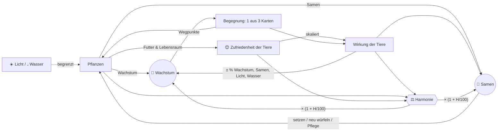
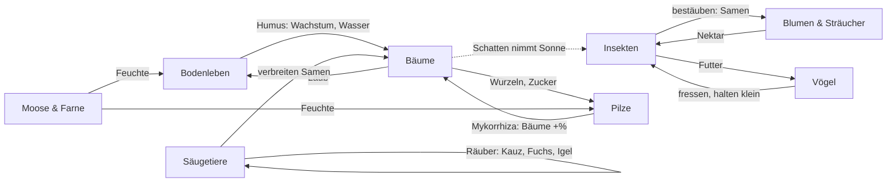
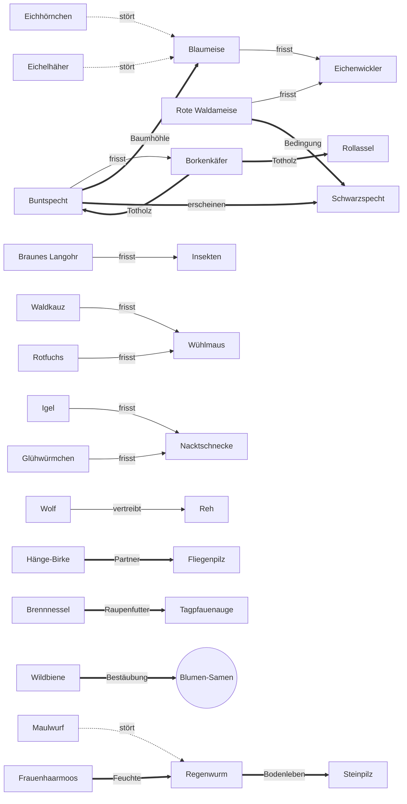

# Design v2 – Vom Samen zum Wald: ein Ökosystem wächst

> **Status:** Maßgebliches Designdokument für die Neuausrichtung (v2). Noch nicht
> implementiert – der aktuelle Code (v1: Wasser/Licht/Energie/Upgrades) ist in
> `GAME_DESIGN.md` beschrieben. Das Ökosystem-Konzept aus `ECOSYSTEM.md` ist hier
> überführt.
>
> **Zahlen:** Maßgeblich sind die Daten in `src/content/`. Seit dem Balancing 2.10
> (Abschnitt 15.4, „Stand Schritt 2.10“) sind sie mit dem Simulator auf der echten Logik
> (`scripts/simulate.ts`, `npm run balance`) abgestimmt. Der frühere Monte-Carlo-Prototyp
> `scripts/v2/`, aus dem die ersten Zahlen stammen (Abschnitt 15.1–15.3), ist entfernt;
> Tabellen „historisch“ beziehen sich auf ihn bzw. auf frühere Stände.

---

## 1. Vision & Spielgefühl

Du bist ein Eichensamen. Während du zum Urwald heranwächst, ziehen Tiere ein, Pilze
umspinnen deine Wurzeln, Sträucher und Blumen keimen um dich herum. **Du baust kein
Upgrade-Rad, sondern eine Lebensgemeinschaft.** An Wegpunkten deines Wachstums bietet
dir der Wald drei Karten an – du wählst eine. Wie im Brettspiel *Mischwald* und in
Deckbuildern geht es darum, Synergien zu entdecken und ein stimmiges Gefüge zu bauen.

**Gefühl:** ruhig, organisch, neugierig. Ein Idle-Spiel mit gelegentlichen, kleinen
Entscheidungen (früh etwa jede Minute, später alle fünf Minuten). Kein Zeitdruck,
keine Strafe für Abwesenheit, nichts stirbt. Der Baum bleibt der Mittelpunkt.

**Leitsätze**
- *Der Baum ist die Bühne.* Er wächst vom Samen zum Urwald; die Nischen hängen an ihm.
- *Jede Wahl ist eine Abwägung*, selten eine Rechenaufgabe: Wachstum, Samen oder
  Harmonie – meist kann man nicht alles haben (Simulation: in ~70 % der Begegnungen).
- *Harmonie ist das Ziel* – eine Punktzahl, die sich gut anfühlt und beim Neuen Zyklus
  dauerhaft belohnt wird.
- *Tiere haben Zufriedenheit, Pflanzen haben Wachstum.*

### Ein typischer 10-Minuten-Ablauf

> **0:04** – Der Samen bricht auf. *„Etwas regt sich in der Erde …“* Drei Karten:
> Regenwurm, Wühlmaus, Pfifferling. Der Regenwurm braucht Feuchte – die gibt es noch
> nicht. Du nimmst ihn trotzdem: 75 % zufrieden, also +4,5 % statt +6 % Wachstum. Die
> Harmonie springt von 5 auf 38.
>
> **0:25** – *„Etwas keimt.“* Frauenhaarmoos, Buschwindröschen – du setzt das Moos.
> Der Regenwurm ist jetzt zu 100 % zufrieden; die Harmonie steigt auf 50.
>
> **0:50** – Setzling! Neue Nischen: Laubstreu und Waldsaum. Eine Wildbiene wird
> angeboten, aber es blüht noch nichts. Du lehnst ab (+10 🌰) und kaufst wenig später
> mit den Samen ein Buschwindröschen.
>
> **3:15** – Der Pflanzring ist voll, aber die Samen haben einen Zweck: 200 🌰 für
> Kompost (der Boden bleibt feucht – der Regenwurm wäre endlich ganz zufrieden) oder für
> Laub liegen lassen (ein Platz mehr in der Laubstreu)? Du nimmst das Laub – der Kompost
> folgt eine Minute später.
>
> **4:10** – Junger Baum. Die Krone öffnet sich. Karten: Eichenwickler, Blaumeise,
> Eichhörnchen. Die Meise hätte nichts zu fressen und keine Höhle; der Wickler frisst
> Laub (−10 % Wachstum), wäre aber Futter für die Meise. Du nimmst das Eichhörnchen
> (+12 % Samen) – und merkst dir die Raupenwacht für später.
>
> **7:40** – *Sturmnacht.* Ein Ast ist abgebrochen. „Totholz liegen lassen“ (öffnet einen
> Höhlenplatz, Rollassel und Steinläufer freuen sich) oder „Holz verwerten“ (+137 🌰)?
> Du lässt es liegen.
>
> **9:50** – Die Gattungsleiste leuchtet: 2 Bodenleben → +2 Wasser. Die Harmonie steht
> bei 64, Wachstum 14/s. Du schaust dem Baum beim Wachsen zu und schließt den Tab.
> Als du zurückkommst, warten drei Begegnungen.

---

## 2. Ressourcen & Kernschleife

| Symbol | Ressource | Art | Wofür |
|---|---|---|---|
| 🌿 | **Wachstum** | Fluss (pro s), summiert sich | treibt den Hauptbaum durch Wegpunkte und Stufen |
| 😊 | **Zufriedenheit** | je Tier 0–100 % | skaliert die Wirkung des Tiers, fließt in die Harmonie |
| 🌰 | **Samen** | einzige Währung | Pflanzen setzen, neu würfeln, Pflegemaßnahmen |
| ⚖️ | **Harmonie** | Punktzahl | Multiplikator auf 🌿 und 🌰; bestimmt die Prestige-Belohnung |
| ☀️ 💧 | **Licht, Wasser** | Umweltgrenzen, keine Währung | begrenzen, wie viele Pflanzen nebeneinander gedeihen |



### 2.1 Wachstum pro Sekunde

```
🌿/s = ( Hauptbaum(Stufe) · (1 + B_Bäume)
       + V · Σ_Pflanzen  w_p · (1 + B_Gruppe(p)) )
       · max(0,5 ; 1 + B_🌿 − F)
       · (1 + H / 100)
```

- **Hauptbaum (Stieleiche)** je Stufe: 1 · 2 · 3,5 · 6 · 10 · 16 · 24 · 34 (Samen … Urwald).
- `w_p` Wachstum der Begleitpflanze (Abschnitt 4), `B_Gruppe` Boni auf eine
  Pflanzengruppe (z. B. Pilze: Bäume +20 % – wirkt auch auf den Hauptbaum).
- `V` **Versorgung** der Begleitpflanzen mit Licht und Wasser (2.5).
- `B_🌿` Summe aller Wachstumsboni: Tiere (× ihre Zufriedenheit), Gattungsboni,
  Lebensgemeinschaften, Durchreisende, Ereignisse.
- `F` **Fraßschaden** der Pflanzenfresser (2.4). Untergrenze des Faktors: 0,5.

### 2.2 Samen pro Sekunde

```
🌰/s = ( Hauptbaum_🌰(Stufe) · (1 + B_🌰,Bäume) + V · Σ s_p · (1 + B_🌰,Gruppe(p)) )
       · (1 + B_🌰) · (1 + H / 100)
```

Hauptbaum: 0,1 · 0,15 · 0,25 · 0,4 · 0,6 · 0,9 · 1,3 · 1,8 🌰/s. Den Großteil der Samen
liefern Blumen und Sträucher – verstärkt durch Bestäuber und Samenverbreiter.

### 2.3 Zufriedenheit eines Tiers

```
z = clamp( b_Seltenheit + (1 − b_Seltenheit) · q
           − 0,15 · störende Arten − 0,10 · min(2, Jäger)  [+ Fähigkeiten],  0, 1 )

q = (2 · Futter + erfüllte Wünsche) / (2 + Anzahl Wünsche)
```

| Seltenheit | gewöhnlich | selten | besonders | legendär |
|---|---|---|---|---|
| Grundzufriedenheit `b` | 25 % | 15 % | 5 % | 0 % |

- **Futter** (zählt doppelt) = `max` über die Nahrungsmerkmale des Tiers von
  `min(1, Angebot / Nachfrage)`. Angebot je Merkmal: Hauptbaum 2, jede Pflanze 1, jedes
  Tier 1, Ereignis 1. Nachfrage: Anzahl der Tiere, die dieses Merkmal fressen. Zwei
  Räuber teilen sich also eine Wühlmaus.
- **Wünsche** an den Lebensraum, je einfach: Pflanzengruppen („2× Sträucher“),
  bestimmte Arten („Große Brennnessel“), Merkmale (Feuchte, Totholz, Baumhöhle),
  **sonnig** (nach allen Begleitpflanzen bleiben ≥ 2 Licht frei) oder **schattig**
  (≥ 3 Bäume inkl. Hauptbaum). Sonnig und schattig ziehen in entgegengesetzte
  Richtungen – mehr Bäume bringen Wachstum, nehmen aber Bienen und Faltern die Sonne.
- **Störung:** z. B. Eichhörnchen und Eichelhäher plündern Meisennester, der Maulwurf
  frisst Regenwürmer. **Räuberdruck:** Beute ist etwas weniger zufrieden, wenn sie
  gejagt wird – dafür hält der Räuber ihren Schaden klein.
- Seltene Tiere sind also **wählerisch**: Ohne passende Bedingungen bleiben sie
  schwach, mit allen Bedingungen sind sie die stärksten Karten.

**Wirkung eines Tiers** = Grundwirkung × z. Ausnahme: Fraßschaden wird nicht mit der
Zufriedenheit skaliert, sondern von Räubern gemindert.

### 2.4 Fraßschaden und Räuber

```
F = Σ_Schädlinge  Schaden · Π_Jäger (1 − Jagdstärke · z_Jäger)
```

Ein Schädling ist **unbewacht**, solange mehr als die Hälfte seines Schadens wirkt
(−4 Harmonie, siehe 9). Beispiel: Eichenwickler −10 %; mit zufriedener Blaumeise
(−50 %) und Gattungsbonus Vögel (−25 % auf Insekten) nur noch −3,75 %.

### 2.5 Licht und Wasser als Umweltgrenzen

Jede Begleitpflanze braucht Licht ☀️ und Wasser 💧 (Moose speichern Wasser: negativer
Bedarf). Das Angebot wächst mit der Stufe und durch Tiere, Ereignisse, Pflege:

| Stufe | Samen | Keimling | Setzling | Junger Baum | Alter Baum | Hain | Wald | Urwald |
|---|---|---|---|---|---|---|---|---|
| ☀️ Licht | 0 | 2 | 3 | 5 | 7 | 9 | 12 | 15 |
| 💧 Wasser | 0 | 2 | 3 | 5 | 7 | 9 | 11 | 14 |
| Pflanzplätze | 0 | 1 | 2 | 3 | 5 | 7 | 9 | 12 |

```
V = min(1, Licht / Σ Lichtbedarf, Wasser / Σ Wasserbedarf)
```

Wer nur lichthungrige Bäume setzt, landet bei V ≈ 0,6 – alle Begleitpflanzen wachsen
dann langsamer. Schattenpflanzen (Hirschzunge, Moos: 0 Licht) und genügsame Arten
(Kiefer: 1 Wasser) sind deshalb mehr als Füllmaterial. Der Hauptbaum ist davon nicht
betroffen.

### 2.6 Optional, später: Humus-Kreislauf 🍂

Skizze für eine Erweiterung, nicht Teil von v2.0: Laubfall erzeugt Streu, Zersetzer
(Regenwurm, Rollassel, Pilze) wandeln sie in Humus. Humus erhöht das Wasserangebot
und schaltet zusätzliche Pflanzplätze frei. Spielerisch würde das Zersetzer zu einer
eigenen „Wirtschaft“ machen; vorher prüfen, ob die Ebene „Zersetzer“ in der Pyramide
(Abschnitt 9) nicht schon genügt.

---

## 3. Der Hauptbaum & seine Stufen

Der Hauptbaum ist eine **Stieleiche**. Gesamt-Wachstum führt ihn durch **Wegpunkte**;
an jedem Wegpunkt findet eine Begegnung statt. Die Stufen bleiben als Rahmen und
fallen auf feste Wegpunkte.

```
Wegpunkt k liegt bei  3,5 · k^3,5  Gesamt-Wachstum      (seit Schritt 2.10, Spielstand v7)
```

| # | Stufe | ab Wegpunkt | Gesamt-🌿 | bis 2.10 (3,5 · k^3,4) | Ziel-Spielzeit* | Simulation 2.10 (15.4) | vorher (main vor 2.10) | Begegnungen im Abschnitt | neu |
|---|---|---|---|---|---|---|---|---|---|
| 0 | Samen | – | 0 | 0 | – | – | – | – | – |
| 1 | Keimling | 1 | 4 | 4 | < 30 s | 3 s | 3 s | 2 | Wurzelraum (1); erste Karten |
| 2 | Setzling | 3 | 164 | 147 | ~ 45 s | 46 s | 41 s | 3 | Laubstreu, Waldsaum; Pflanzen setzen; erste Pflege (Kompost, Laub) |
| 3 | Junger Baum | 6 | 1.852 | 1.548 | ~ 4 min | 4:11 min | 3:26 min | 6 | Krone, Stamm & Rinde; Ereignisse; Gattungsboni sichtbar |
| 4 | Alter Baum | 12 | 20.951 | 16.341 | ~ 20 min | 23:02 min | 17:02 min | 8 | Höhlen & Totholz; Durchreisende; Eicheln (Nüsse) |
| 5 | Hain | 20 | 125.220 | 92.805 | ~ 60 min | 1:03:45 h | 43:41 min | 8 | legendäre Arten; **Neuer Zyklus möglich** |
| 6 | Wald | 28 | 406.557 | 291.344 | ~ 1:40 h | 1:54:40 h | 1:13:55 h | 8 | Wolf; mehr Plätze |
| 7 | Urwald | 36 | 979.776 | 684.694 | ~ 2:20 h | 2:47:31 h | 1:42:45 h | – | Harmoniestufe „Ursprüngliche Wildnis“ (ab 120 ⚖️) färbt die Szene |

\* für einen harmonie-orientierten Spieler mit allen Systemen (Pflege, Ereignisse, Gäste,
Jahreszeiten), der jede Begegnung sofort auflöst (Simulation 15.4, 500 Durchgänge,
Median). Korridor 0,8–1,25 × Ziel, Hain 55–65 min. Der Setzling liegt seit 2.10 bei ~45 s
(„45 Sekunden sollte der Sweetspot sein“); er fällt ganz in den ersten Frühling (+10 % 🌿)
– ohne den Frühlingsbonus kämen 50 s. Gegenüber v1 (Setzling 2 min, Junger Baum 8 min)
ist der Anfang schneller: Die ersten Karten sollen sofort kommen.

**Kurve:** Der ursprüngliche Entwurf sah `4 · k^3,4` vor, der Code nutzte seit Schritt 2.1
`3,5 · k^3,4` (Basis 12,5 % kleiner, weil mit 9 Arten nötig). Mit allen Systemen kam der
Harmonie-Spieler damit nach 44 min zum Hain. Die lange diskutierte Basis 4 hätte alle
Wegpunkte gleich stark verschoben (Hain ~48 min, Setzling 46 s, gemessen vor den übrigen
Änderungen); der Exponent 3,5 streckt
dagegen vor allem das späte Spiel (Setzling +12 %, Hain +35 %, Urwald +43 %) und trifft
so alle Stufen. Gespeicherte Stände bis v6 rechnet das Laden um (Migration v6 → v7,
`v6GrowthToV7`: gleicher Wegpunkt, gleicher Anteil bis zum nächsten). Der Prototyp ohne
Pflanzen (Schritt 1) lief mit `4 · k^3,2` – siehe 15.4.

### Nischen und Plätze

Jede Nische hat begrenzte Plätze; eine Art lebt höchstens einmal im Ökosystem.

| Nische | Lage | Keimling | Setzling | Junger Baum | Alter Baum | Hain | Wald | Urwald |
|---|---|---|---|---|---|---|---|---|
| 🪱 Wurzelraum | Erde, Wurzeln | 1 | 2 | 2 | 3 | 3 | 4 | 4 |
| 🍂 Laubstreu | Boden um den Stamm | – | 1 | 2 | 2 | 3 | 3 | 4 |
| 🌼 Waldsaum | Blumen, Sträucher, Wiese rund um den Baum | – | 1 | 2 | 3 | 3 | 4 | 4 |
| 🌳 Krone | Äste, Blätter | – | – | 2 | 2 | 3 | 4 | 4 |
| 🪵 Stamm & Rinde | Borke | – | – | 1 | 2 | 2 | 3 | 3 |
| 🕳️ Höhlen & Totholz | Spechthöhlen, tote Äste | – | – | (–)¹ | 1 | 2 | 2 | 3 |
| **Summe** | | 1 | 4 | 9 | 13 | 16 | 20 | 22 |
| 🫧 Waldtümpel² | Wasser und Ufer der Senke | – | – | – | – | – | – | – |

¹ Höhlen öffnen sich schon früher, wenn Totholz entsteht: +1 durch Borkenkäfer,
Buntspecht, Ereignis „Sturmnacht“ oder Pflege „Nistkästen“; +1 Krone und Höhlen durch
den Schwarzspecht.

² Erweiterung Amphibien (5.5): Der Waldtümpel hat nie Plätze aus der Stufe. Er öffnet nur
durch Platz-Wirkungen: Pflege „Waldtümpel“ (Alter Baum +2, Hain +1), Ereignis
„Regenreicher Frühling“ (+1) und „Krötenwanderung“ (+1).

Die frühere Nische „Lichtung“ ist im **Waldsaum** aufgegangen: Er öffnet schon beim
Setzling, weil dort die Begleitpflanzen wachsen und Bienen und Falter leben.

---

## 4. Pflanzen

Pflanzen haben **Wachstum**, **Samen**, **Licht-** und **Wasserbedarf** und bieten
Tieren **Futter und Lebensraum**. Sie kommen über Begegnungen („Etwas keimt“, gratis)
oder werden mit Samen gesetzt:

```
Kosten der nächsten Pflanze = 20 · 1,9^n   (n = Begleitpflanzen, die schon wachsen)
→ 20 · 38 · 72 · 137 · 261 · 495 · 941 · 1.788 · 3.397 🌰
```

Pflanzen sterben nicht; ein voller Pflanzring heißt: ersetzen oder warten.

| Gruppe | Rolle im Gefüge |
|---|---|
| **Bäume** | viel Wachstum, viel Licht; Laub für Zersetzer; Lebensraum für Kronen- und Pilzarten; machen es **schattig** |
| **Sträucher** | Beeren und Nüsse; Deckung (Rotkehlchen, Igel, Fuchs, Reh) |
| **Blumen & Kräuter** | wenig Wachstum, **viele Samen**, Nektar für Bestäuber |
| **Moose & Farne** | wenig Licht, Moos speichert Wasser; **Feuchte** für Regenwurm, Pilze, Schnecken |

| Pflanze | Gruppe | ab | 🌿/s | 🌰/s | ☀️ | 💧 | bietet | Text |
|---|---|---|---|---|---|---|---|---|
| Hänge-Birke | Bäume | Junger Baum | 1,5 | 0,3 | 4 | 2 | Laub | „Pionierin mit weißer Rinde – wächst schnell, wo Licht ist.“ |
| Eberesche | Bäume | Junger Baum | 1 | 0,6 | 3 | 2 | Laub, Beeren, Nektar | „Ihre roten Beeren sind ein Festmahl für Vögel.“ |
| Rotbuche | Bäume | Alter Baum | 2 | 0,4 | 3 | 3 | Laub, Nüsse | „Die Mutter des Waldes – kommt auch im Schatten zurecht.“ |
| Waldkiefer | Bäume | Alter Baum | 1,5 | 0,4 | 3 | 1 | Laub, Nadeln | „Genügsam und harzig, liebt sandigen Boden.“ |
| Hasel | Sträucher | Setzling | 0,8 | 0,6 | 2 | 2 | Laub, Nüsse | „Blüht schon im Februar – und dann die Nüsse!“ |
| Brombeere | Sträucher | Setzling | 0,5 | 1 | 2 | 1 | Beeren, Nektar | „Stachelig, wuchernd, ein sicheres Versteck.“ |
| Schwarzer Holunder | Sträucher | Junger Baum | 0,8 | 0,8 | 2 | 2 | Laub, Beeren, Nektar | „Duftende Dolden im Juni, dunkle Beeren im Herbst.“ |
| Buschwindröschen | Blumen & Kräuter | Keimling | 0,3 | 0,8 | 1 | 1 | Nektar, Kraut | „Blüht, bevor sich das Kronendach schließt.“ |
| Große Brennnessel | Blumen & Kräuter | Setzling | 0,4 | 0,6 | 2 | 2 | Kraut | „Brennt – und ernährt die Raupen vieler Falter.“ |
| Wald-Erdbeere | Blumen & Kräuter | Setzling | 0,3 | 1 | 2 | 1 | Beeren, Nektar, Kraut | „Winzig, rot und süßer als jede Gartenerdbeere.“ |
| Roter Fingerhut | Blumen & Kräuter | Junger Baum | 0,3 | 1,4 | 3 | 1 | Nektar | „Hohe Glockenblüten – die Hummeln kriechen ganz hinein.“ |
| Frauenhaarmoos | Moose & Farne | Keimling | 0,3 | 0,2 | 0 | −2 | Feuchte | „Ein grünes Polster, das Regen speichert wie ein Schwamm.“ |
| Wurmfarn | Moose & Farne | Setzling | 0,6 | 0,2 | 1 | 2 | Feuchte | „Rollt im Frühling seine Wedel aus wie Bischofsstäbe.“ |
| Hirschzunge | Moose & Farne | Alter Baum | 0,7 | 0,3 | 0 | 2 | Feuchte | „Ein Farn mit ungeteilten, glänzenden Blättern – liebt tiefen Schatten.“ |

Der Hauptbaum zählt als Baum (für „2× Bäume“ usw.), bietet Laub und Wurzeln, ab
„Alter Baum“ auch Nüsse (Eicheln), und wiegt in der Nahrungspyramide wie 3 Pflanzen.

---

## 5. Tiere

### 5.1 Gattungen und Schwellenboni

Fünf Gattungen (eigentlich Lebensweise-Gruppen). Entscheidungen zu den offenen Punkten:
**Fledermäuse** gehören zu den Säugetieren (das Braune Langohr zählt per Fähigkeit
zusätzlich als Vogel). **Amphibien** bekamen in v2.0 keine eigene Gattung. Seit der
Erweiterung **Amphibien mit Waldtümpel** (5.5) gibt es sie als sechste, kleine Gattung
(Erdkröte, Grasfrosch, Bergmolch, seit dem Playtest auch Laubfrosch und Kammmolch). Der Feuersalamander bleibt legendäres Bodenleben in der
Laubstreu: Er lebt an Land, und ein Wechsel ließe dem Bodenleben keine legendäre Art.

**Schwellen 2 / 3 / 5** (à la Teamfight Tactics). Weil jede Art nur einmal vorkommt
und Gattungen 6–8 Arten haben, liegen die Schwellen niedriger als die im Briefing
genannten 2/4/6: Ein ausgewogener Wald erreicht mehrere kleine Boni, wer eine Gattung
stapelt, den großen. Durchreisende zählen mit.

| Gattung | 2 | 3 | 5 |
|---|---|---|---|
| 🐦 Vögel | Insektenschaden −25 % | +15 % Samen | +12 % Wachstum, +20 % Samen |
| 🐝 Insekten | Blumen +30 % Samen | Sträucher und Bäume +30 % Samen | +40 % Samen |
| 🦔 Säugetiere | +10 % Samen | +7 % Wachstum | +15 % Wachstum |
| 🪱 Bodenleben | +2 Wasser | +7 % Wachstum | +15 % Wachstum, +3 Wasser |
| 🍄 Pilze | Bäume +6 % Wachstum | +3 Wasser, +2 Licht | +18 % Wachstum |
| 🐸 Amphibien (5.5) | Schneckenschaden −25 % | +2 Wasser, +5 % Wachstum | +12 % Wachstum (alle 5 Arten und ein Tümpelplatz aus einem Ereignis) |

**Balancing 2.10:** Alle Wachstums-Boni dieser Tabelle sind ×0,6 gegenüber dem Prototyp
(vorher Vögel +20 %, Säugetiere und Bodenleben +12 % / +25 %, Pilze Bäume +10 % / +30 %).
Der Wachstums-Spieler erreichte die mittlere Stufe (3 Bodenleben bzw. Säugetiere) viel
öfter als der Harmonie-Spieler, der für die Vielfalt streut (15.4). Samen, Licht, Wasser
und Schutz bleiben.

### 5.2 Seltenheit

| | gewöhnlich | selten | besonders | legendär |
|---|---|---|---|---|
| Grundzufriedenheit | 25 % | 15 % | 5 % | 0 % |
| Stärke | Grundwert | ~1,5× | ~2× + Fähigkeit | ~2,5× + **regelverändernde** Fähigkeit |
| Erscheinen | immer | immer | erst wenn ihre **Erscheinungsbedingung** erfüllt ist | wie besonders, ab Hain/Wald |
| Arten | 14 | 8 | 5 | 5 |

### 5.3 Katalog (32 Arten)

**Ebenen** der Nahrungspyramide: Pflanzenfresser (inkl. Bestäuber, Samenverbreiter) ·
Räuber · Zersetzer & Partner (inkl. Mykorrhiza-Pilze). **Wirkung** wird mit der
Zufriedenheit multipliziert (außer Fraß). Überführte Arten aus `ECOSYSTEM.md` sind
mit ↻ markiert; neue Arten mit ✦. **Seit dem Balancing 2.10** sind alle 🌿-Wirkungen der
Arten (auch „Bäume +x %“) 25 % kleiner als im Prototyp (×0,75, gerundet), damit der
Wachstums-Spieler höchstens ~15 % schneller ist als der Harmonie-Spieler (15.4).

#### 🐦 Vögel

| Art | Seltenheit | Ebene | Nische | ab | Nahrung | Wünsche | erscheint, wenn | bietet | Wirkung | Fähigkeit |
|---|---|---|---|---|---|---|---|---|---|---|
| ✦ Rotkehlchen | gewöhnlich | Räuber | Laubstreu | Setzling | Würmer / Insekten / Beeren | 1× Sträucher | – | – | jagt Insekten (−20 %), +8 % 🌰 | – |
| ↻ Blaumeise | gewöhnlich | Räuber | Krone | Junger Baum | Raupen / Insekten | 2× Bäume, Baumhöhle | – | – | jagt Raupen (−50 %), +4 % 🌰 | – |
| ↻ Buntspecht | selten | Räuber | Stamm & Rinde | Alter Baum | Käfer / Insekten / Nüsse | Totholz | – | Baumhöhle | jagt Käfer (−60 %), +1 Platz Höhlen, +3 % 🌿 | – |
| ↻ Eichelhäher | selten | Pflanzenfresser | Krone | Alter Baum | Nüsse | – | – | – | +9 % 🌿, +10 % 🌰, stört Blaumeise | – |
| ↻ Waldkauz | besonders | Räuber | Höhlen & Totholz | Alter Baum | Kleinsäuger | 2× Bäume | Kleinsäuger leben hier | – | jagt Kleinsäuger (−70 %), +6 % 🌿 | **Nachtwache:** Schaden aller Pflanzenfresser −20 % |
| ✦ Schwarzspecht | legendär | Räuber | Stamm & Rinde | Hain | Insekten / Käfer | Rote Waldameise, Totholz, 3× Bäume | Buntspecht lebt hier | Baumhöhle | +8 % 🌿, jagt Käfer (−40 %) | **Baumeister:** +1 Platz Krone und Höhlen; Höhlenbewohner +20 % Zufriedenheit |

#### 🐝 Insekten

| Art | Seltenheit | Ebene | Nische | ab | Nahrung | Wünsche | erscheint, wenn | bietet | Wirkung | Fähigkeit |
|---|---|---|---|---|---|---|---|---|---|---|
| ↻ Eichenwickler | gewöhnlich | Pflanzenfresser | Krone | Junger Baum | Laub | – | – | Insekten, Raupen | Fraß −10 % 🌿, +2 % 🌿 (Raupenkot) | – |
| ↻ Wildbiene | gewöhnlich | Pflanzenfresser | Waldsaum | Setzling | Nektar | 1× Blumen, sonnig | – | Insekten | Blumen +40 % 🌰, Sträucher +25 % 🌰, +5 % 🌰 | – |
| ✦ Tagpfauenauge | gewöhnlich | Pflanzenfresser | Waldsaum | Junger Baum | Nektar | Große Brennnessel, sonnig | – | Insekten, Raupen | +10 % 🌰, Blumen +20 % 🌰 | – |
| ↻ Borkenkäfer | gewöhnlich | Pflanzenfresser | Stamm & Rinde | Junger Baum | Laub / Nadeln | – | – | Insekten, Käfer, Totholz | Fraß −8 % 🌿, +1 Platz Höhlen | – |
| ✦ Rote Waldameise | selten | Räuber | Laubstreu | Alter Baum | Insekten | Nadeln (Kiefer), sonnig | – | Insekten | jagt Raupen (−40 %), Blumen +30 % 🌰 (trägt Samen), +3 % 🌿 | – |
| ✦ Glühwürmchen | besonders | Räuber | Waldsaum | Alter Baum | Schnecken | Feuchte, 1× Blumen | Schnecken leben hier | Insekten | jagt Schnecken (−60 %), +4 ⚖️ | **Lichterabend:** jede Lebensgemeinschaft +3 Harmonie |
| ↻ Hirschkäfer | legendär | Zersetzer | Höhlen & Totholz | Hain | Totholz | schattig *und* sonnig (lichter Altwald), 1× Pilze | Totholz | Insekten, Käfer | +8 % 🌿, +5 ⚖️ | **König des Totholzes:** alle Zersetzer & Partner +20 % Zufriedenheit |

#### 🦔 Säugetiere

| Art | Seltenheit | Ebene | Nische | ab | Nahrung | Wünsche | erscheint, wenn | bietet | Wirkung | Fähigkeit |
|---|---|---|---|---|---|---|---|---|---|---|
| ↻ Wühlmaus | gewöhnlich | Pflanzenfresser | Wurzelraum | Keimling | Wurzeln / Kraut | – | – | Kleinsäuger | Fraß −8 % 🌿, +4 % 🌰 | – |
| ↻ Eichhörnchen | gewöhnlich | Pflanzenfresser | Krone | Junger Baum | Nüsse | 2× Bäume | – | – | +12 % 🌰, +5 % 🌿, stört Blaumeise | – |
| ↻ Reh | gewöhnlich | Pflanzenfresser | Waldsaum | Alter Baum | Kraut / Laub | 1× Sträucher, sonnig | – | Rehe | +3 ☀️ (hält den Saum offen), Fraß −10 % 🌿 | – |
| ↻ Maulwurf | selten | Räuber | Wurzelraum | Setzling | Würmer / Insekten | – | – | – | +2 💧, +4 % 🌿, stört Regenwurm | – |
| ↻ Igel | selten | Räuber | Laubstreu | Junger Baum | Schnecken / Insekten / Würmer | 1× Sträucher | – | – | jagt Schnecken (−70 %), +3 % 🌿 | – |
| ↻ Rotfuchs | selten | Räuber | Waldsaum | Alter Baum | Kleinsäuger | 2× Sträucher | – | – | jagt Kleinsäuger (−50 %), +6 % 🌰 | – |
| ↻ Braunes Langohr | besonders | Räuber | Höhlen & Totholz | Alter Baum | Insekten | 2× Blumen | 2 Insektenarten leben hier | – | jagt Insekten (−40 %), +8 % 🌰 | **Nachtflieger:** zählt zusätzlich als Vogel |
| ↻ Wolf | legendär | Räuber | Waldsaum | Wald | Rehe | 3× Bäume | Reh lebt hier | – | +11 % 🌿 | **Landschaft der Angst:** Reh-Schaden entfällt, Reh-Licht ×2 |

#### 🪱 Bodenleben

| Art | Seltenheit | Ebene | Nische | ab | Nahrung | Wünsche | erscheint, wenn | bietet | Wirkung | Fähigkeit |
|---|---|---|---|---|---|---|---|---|---|---|
| ↻ Regenwurm | gewöhnlich | Zersetzer | Wurzelraum | Keimling | Laub | Feuchte | – | Würmer | +2 💧, +6 % 🌿 | – |
| ↻ Rollassel | gewöhnlich | Zersetzer | Laubstreu | Setzling | Laub | Totholz | – | Insekten | +6 % 🌿 | – |
| ↻ Nacktschnecke | gewöhnlich | Pflanzenfresser | Laubstreu | Setzling | Kraut | Feuchte, schattig | – | Schnecken | Fraß −6 % 🌿, +1 💧 | – |
| ✦ Steinläufer | selten | Räuber | Laubstreu | Junger Baum | Insekten / Würmer | Totholz | – | – | jagt Insekten (−30 %), +5 % 🌿 | – |
| ✦ Weinbergschnecke | besonders | Zersetzer | Laubstreu | Alter Baum | Laub / Kraut | 2× Blumen, Feuchte | Feuchte | Schnecken | +9 % 🌿, +2 💧 | **Gelassen:** Zufriedenheit nie unter 50 % |
| ✦ Feuersalamander | legendär | Räuber | Laubstreu | Hain | Schnecken / Würmer / Insekten | 2× Moose & Farne, Totholz, schattig | 2× Moose & Farne und Totholz | – | +11 % 🌿, jagt Schnecken (−50 %) | **Hüter der Feuchte:** Moose & Farne brauchen kein Wasser |

#### 🍄 Pilze

| Art | Seltenheit | Ebene | Nische | ab | Nahrung | Wünsche | erscheint, wenn | bietet | Wirkung | Fähigkeit |
|---|---|---|---|---|---|---|---|---|---|---|
| ✦ Pfifferling | gewöhnlich | Partner | Wurzelraum | Keimling | Wurzeln | Feuchte, schattig | – | – | Bäume +8 % 🌿 | – |
| ✦ Zunderschwamm | gewöhnlich | Zersetzer | Stamm & Rinde | Junger Baum | Laub (Holz) | 2× Bäume | – | Totholz | +4 % 🌿, Fraß −3 % 🌿 | – |
| ↻ Steinpilz (früher „Mykorrhiza-Pilz“) | selten | Partner | Wurzelraum | Junger Baum | Wurzeln | 2× Bäume, 1× Bodenleben | – | – | Bäume +15 % 🌿, +3 💧 | – |
| ✦ Fliegenpilz | besonders | Partner | Wurzelraum | Alter Baum | Wurzeln | Hänge-Birke, Feuchte | Hänge-Birke wächst hier | – | Bäume +11 % 🌿, +10 % 🌰 | **Glückspilz:** seltene, besondere und legendäre Karten je +5 Prozentpunkte |
| ✦ Hallimasch | legendär | Zersetzer | Wurzelraum | Hain | Wurzeln / Totholz | 3× Bäume, Totholz, 2× Pilze | 2 Pilzarten und Totholz | – | +15 % 🌿 | **Waldweites Netz:** Versorgung aller Pflanzen mindestens 90 % |

Kurztexte (Auswahl, Rest in `src/content/species.ts`): Rotkehlchen „Folgt jedem, der im
Boden gräbt – vielleicht kommt ein Wurm zum Vorschein.“ · Schwarzspecht „Der Baumeister
des Waldes. In seine Höhlen ziehen später Kauz, Fledermaus und Hohltaube.“ ·
Feuersalamander „Schwarz-gelb und uralt. Wo er lebt, ist der Wald noch feucht und
heil.“ · Hallimasch „Das größte Lebewesen der Erde ist ein Pilz. Sein Netz verbindet
den ganzen Wald.“ · Glühwürmchen „Seine Larven jagen Schnecken. An Juniabenden
leuchtet der Waldsaum.“

### 5.5 Erweiterung: Amphibien mit Waldtümpel

**Idee:** Ein Tümpel ist ein eigener Lebensraum. Er entsteht nicht von selbst mit dem
Baum, der Spieler legt ihn an (Pflege „Waldtümpel“) oder ein nasses Frühjahr schenkt ihn
(„Regenreicher Frühling“). Erst dann ziehen Amphibien ein. So bleibt die Erweiterung eine
bewusste Entscheidung und spoilert nichts: Die Nische steht verschlossen in der
Seitenleiste mit dem Hinweis „öffnet durch Pflege „Waldtümpel“ (ab „Alter Baum“)“.

**Umsetzung nur mit Daten** (keine neue Logik): neue Gattung `amphibians` und neue Nische
`pond` mit Plätzen 0 auf allen Stufen und `opensEarly`; Plätze kommen über die
bestehende Wirkung `slot` aus Pflege und Ereignissen. Karten zieht das Spiel nur für offene
Nischen, darum erscheinen Amphibien erst mit dem Tümpel. Spielstand v11 (12.8).

| Art | Seltenheit | Ebene | Nische | ab | Nahrung | Wünsche | bietet | Wirkung |
|---|---|---|---|---|---|---|---|---|
| ✦ Erdkröte | gewöhnlich | Räuber | Waldtümpel | Alter Baum | Schnecken / Würmer / Insekten | Feuchte, schattig | – | jagt Schnecken (−40 %), +4 % 🌿 |
| ✦ Grasfrosch | gewöhnlich | Räuber | Waldtümpel | Alter Baum | Insekten / Würmer | Feuchte, sonnig | – | jagt Insekten (−20 %), +5 % 🌰 |
| ✦ Bergmolch | selten | Räuber | Waldtümpel | Alter Baum | Insekten / Würmer | Feuchte, schattig, 1× Moose & Farne | – | jagt Insekten (−25 %), +5 % 🌿, +2 ⚖️ |
| ✦ Laubfrosch (Playtest) | selten | Räuber | Waldtümpel | Alter Baum | Insekten | Feuchte, sonnig, 1× Sträucher | – | jagt Insekten (−20 %), +6 % 🌰, +2 ⚖️ |
| ✦ Kammmolch (Playtest) | selten | Räuber | Waldtümpel | Hain | Schnecken / Würmer | Feuchte, schattig, Totholz | – | jagt Schnecken (−30 %), +6 % 🌿, +2 ⚖️ |

Kurztexte: Erdkröte „Wandert jedes Frühjahr zurück zu dem Tümpel, in dem sie selbst
geschlüpft ist.“ · Grasfrosch „Laicht als einer der Ersten im Jahr – große Ballen im
flachen, sonnigen Wasser.“ · Bergmolch „Im Frühling glänzt das Männchen blau, mit
getupftem Kamm und orangem Bauch.“ · Laubfrosch „Klettert mit Haftscheiben ins Gebüsch. In
Mainächten trägt sein Ruf weit über den Tümpel.“ · Kammmolch „Der größte unserer Molche. Zur
Laichzeit trägt das Männchen einen gezackten Kamm wie ein kleiner Drache.“

**Abwägungen:** Kröte und Molch wollen Schatten, der Frosch Sonne – ein Tümpel für alle
drei verlangt einen lichten Wald (wie der Hirschkäfer). Die Kröte jagt Schnecken: gut gegen
Nacktschnecke und Weinbergschnecke, aber sie drückt deren Zufriedenheit (Räuberdruck).

| Wo | Was |
|---|---|
| 💧 Pflege „Waldtümpel“ (8.1) | Rang 1 (Alter Baum, 7.500 🌰): Feuchte, +3 💧, **+2 Plätze Waldtümpel** · Rang 2 (Hain, 22.500 🌰): +3 💧, +2 ⚖️, **+2 Plätze** (bis zum Playtest +1) |
| 🌧️ Regenreicher Frühling (7.4) | „Waldtümpel entstehen lassen“: Feuchte, +3 💧, **+1 Platz Waldtümpel** (Zyklus) |
| 🐸 Krötenwanderung (7.4, neu) | Alter Baum, nur Frühling, Erdkröte lebt: „Den Wanderweg frei lassen“ +4 ⚖️ (Zyklus) · „Laichplätze schaffen“ +1 Platz Waldtümpel (Zyklus) und nächste Begegnung Grasfrosch/Bergmolch/Laubfrosch/Kammmolch |
| 🌱 Frühling (16.3) | Laichzeit: Amphibien +15 % 😊 |
| ❄️ Winter | keine Wirkung (kein Abzug); in der Szene Winterstarre und Eis auf dem Tümpel |
| Lebensgemeinschaften (9.2) | 🐸 Tümpelleben, 🐌 Schneckenwacht |
| Gattungsbonus (5.1) | 2: Schneckenschaden −25 % · 3: +2 💧, +5 % 🌿 · 5: +12 % 🌿 (Pflege 4 Plätze + 1 aus Regen oder Krötenwanderung) |

**Darstellung (11.3):** Am Boden ist auf keiner Bildschirmbreite eine Strecke frei
(Laubstreu, Waldsaum mit Sonderplätzen, Pilze und Begleitpflanzen teilen sich die ganze
Breite). Der Tümpel liegt darum als Senke **unter der Grasnarbe** im Erdschnitt am linken
Bildrand: Die Mulde beginnt 0,25 Tiergrößen unter der Bodenlinie, das Wasser bei 0,55,
der Grund bei 1,0 – darüber stehen Gras, Laub, Blumen, Pflanzen und Tiere der Oberfläche
unverändert, darunter liegen die Wurzelraum-Tiere. Seggen und Rohrkolben wachsen nur in
der Mulde. Kröte und Frösche stehen im flachen Wasser (der Kopf bleibt unter der Narbe),
die Molche schwimmen in der Mitte. Tiefer darf die Mulde nicht werden (schmal liegt ein
Wurzelraum-Platz knapp darunter), darum ist sie so breit, dass fünf Bewohner nebeneinander
Platz haben: halbe Breite 3,4 Tiergrößen, höchstens bis 1,2 Tiergrößen vor die Stammmitte,
mindestens 1,9 (1280 px: ~245 px, 390 px: ~157 px; flacher Grund, steile Ränder). Die Lage
der Bewohner hängt von allen Bewohnern ab (`pondPlaces` in `animals.ts`, nur beim Neuaufbau
des Plans berechnet): Kröte und Frösche nach Platz abwechselnd am linken und rechten Rand,
von außen nach innen, zur Mitte blickend; die Molche gleichmäßig verteilt in der tiefen
Mitte, jeder in einem eigenen Streifen, leicht höhenversetzt, und sie wenden um die eigene
Körpermitte. Auf kleinen Bildschirmen (Tiergröße < 30 px) zeichnen sich Amphibien bis zu
20 % größer; passen nicht alle hinein, werden alle gemeinsam kleiner (höchstens um ein
Fünftel, 320 px mit fünf Bewohnern: 19 px). Gezeichnet wird der Tümpel in der Tier-Ebene nach dem
Wurzelraum (Erdlöcher, Pilzgeflecht läuft hinter der Senke weiter) und vor allen übrigen
Tieren; ein gecachtes Sprite, im Winter mit überblendeter Eisdecke, Lage gemerkt
(`AnchorResolver.pond()`). Tests: keine Überlappung mit Laubstreu, Waldsaum, Wurzelraum
und den 14 Begleitpflanzen bei 320×480 bis 1920×1080, Stufen 4–8, und keine Überlappung
der Bewohner untereinander für 1–5 Bewohner in allen Belegungen
(`tests/render-anchors.test.ts`). Unbekannte Amphibien bekommen die Zeichnung der Kröte.
Ist der Tümpel offen, aber noch keine Amphibie freigeschaltet (Regen im Jungen Baum),
zeigt die Seitenleiste „Bewohner ab „Alter Baum““. Pflege mit Plätzen lässt passende
Stammgäste sofort einziehen.

**Playtest (entschieden, Zahlen in 15.4 „Stand Playtest Amphibien“):** Amphibien wurden nicht
zu selten gewählt, sondern zu selten angeboten. Dazu kamen **Laubfrosch** und **Kammmolch**
(beide selten, ohne Fähigkeit – „besonders“ bräuchte eine neue Fähigkeit und damit Logik);
Rang 2 der Pflege öffnet **2 statt 1** Plätze. Damit hat der Tümpel zwei Seiten: Sonne
(Grasfrosch, Laubfrosch – 🌰) und Schatten (Erdkröte, Bergmolch, Kammmolch – 🌿), und die
Stufe 5 ist ein seltenes Spätziel: alle fünf Arten plus der Platz aus „Regenreicher Frühling“
oder „Krötenwanderung“. Der Laubfrosch lebt im Tümpel (nicht im Waldsaum), damit er die
Gattung zählt, wo der Spieler sie sucht. **Ringelnatter verworfen:** Es gibt keinen Räuber-
Mechanismus gegen Tiere, der Spaß macht (nur Räuberdruck auf die Zufriedenheit) – eine
Natter, die die Tümpelbewohner unglücklich macht, wäre eine reine Strafe. Kandidaten für
später: Amphibien-Gäste (Moorfrosch-Balz im Frühling – erst, wenn der Renderer Gäste am Boden
zeigen kann; heute fliegen unbekannte Gäste als Schwarm). Achievements nennen keine
Artnamen; „Von allem etwas“ und „Alle Bewohner“ zählen die neue Gattung und alle fünf Arten
automatisch mit.

**Bedienung (Playtest):** Die verschlossene Nische zeigt ab „Alter Baum“ neben dem Hinweis
den Knopf **„Zur Pflege“** (`NicheView.careLink`). Er klappt die Pflege auf (auf dem Handy ist
sie zugeklappt und liegt unter dem Naturtagebuch) und setzt den Fokus auf die Maßnahme
(`CarePanel.reveal`). Laubfrosch (grün, dunkler Seitenstreif, Haftscheiben) und Kammmolch
(dunkel, gezackter Kamm, gelb-orange gefleckter Bauch) haben eigene Zeichnungen.

### 5.4 Was aus dem alten Katalog geändert wurde

- **Prozent auf Wasser/Licht/Photosynthese → Wachstum, Samen, Zufriedenheit.**
  Positive Ressourcen-Effekte wurden zu Wachstum (Zersetzer, Partner) oder Samen
  (Bestäuber, Verbreiter); Licht/Wasser-Effekte bleiben als Umweltgrenze (Regenwurm
  +💧, Reh +☀️).
- **Einzugskosten in Energie → Kartenwahl.** Tiere kosten nichts; der Preis ist der
  Platz und die Gelegenheit. „Braucht X“ wurde zu Nahrung/Wünschen (weiche Bedingung
  über Zufriedenheit) bzw. bei seltenen Arten zur Erscheinungsbedingung.
- **„Hungrig“ → Futter-Erfüllung** in der Zufriedenheit; **Nesträuber/Konkurrenz →
  Störung** (−15 % Zufriedenheit).
- Mykorrhiza-Pilz wird zum **Steinpilz** (selten); Lichtung geht im **Waldsaum** auf.
- Neue Arten füllen die Gattungen auf: Rotkehlchen, Schwarzspecht, Tagpfauenauge,
  Rote Waldameise, Glühwürmchen, Steinläufer, Weinbergschnecke, Feuersalamander und
  vier Pilze. Wildbiene und Reh wechseln in den Waldsaum.

---

## 6. Wechselwirkungen

### 6.1 Gattungen untereinander



| wirkt auf → | Vögel | Insekten | Säugetiere | Bodenleben | Pilze | Pflanzen |
|---|---|---|---|---|---|---|
| **Vögel** | Häher/Hörnchen stören Meisen | mindern Fraß (Meise, Spechte); Gattungsbonus −25 % Insektenschaden | Kauz jagt Wühlmaus | Rotkehlchen frisst Würmer | – | Häher +Wachstum (pflanzt Eicheln) |
| **Insekten** | Futter | – | Futter für Langohr | Futter für Steinläufer | – | Bestäubung: Samen ↑; Raupen/Käfer: Fraß |
| **Säugetiere** | Fuchs/Langohr teilen Beute mit Kauz | Langohr jagt Falter | Fuchs/Kauz jagen Wühlmaus; Wolf hält Reh in Schach | Maulwurf stört Regenwurm; Igel frisst Schnecken | – | Samen verbreiten; Reh: Licht ↑, Fraß |
| **Bodenleben** | Futter (Würmer) | Steinläufer jagt Insekten | Futter für Igel, Maulwurf | – | Steinpilz braucht Bodenleben | Wachstum ↑, Wasser ↑ |
| **Pilze** | – | Hirschkäfer braucht Pilze | – | Humusküche | Hallimasch braucht 2 Pilze | Bäume +%, Versorgung |
| **Pflanzen** | Bäume, Höhlen, Beeren | Nektar, Brennnessel | Nüsse, Deckung | Laub, Feuchte | Wurzeln, Birke | Licht/Wasser-Konkurrenz |

### 6.2 Wichtigste Art-Beziehungen



Legende: `-- frisst -->` Räuber–Beute · `-.->` Störung · `==>` schafft Lebensraum,
Bedingung oder Partnerschaft.

### 6.3 Beispiele

- **Totholz-Kette:** Der Borkenkäfer kostet 8 % Wachstum, schafft aber Totholz (+1
  Höhlenplatz, Rollassel und Steinläufer werden zufrieden). Der Buntspecht frisst die
  Käfer (Restschaden ~3 %), zimmert Höhlen (+1 Platz, Blaumeise zufrieden) und lässt
  den Schwarzspecht erscheinen.
- **Raupenwacht:** Eichenwickler allein −10 %, mit Blaumeise −5 %, mit Meise und
  Gattungsbonus Vögel −3,75 %. Zieht das Eichhörnchen ein, ist die Meise gestört
  (−15 % Zufriedenheit) und jagt schlechter.
- **Sonne oder Schatten:** Eine zweite Rotbuche bringt +2 🌿/s und macht es schattig
  (Pfifferling, Nacktschnecke, Feuersalamander freuen sich) – aber Biene und
  Tagpfauenauge verlieren die Sonne. Ein Reh (+3 ☀️) oder die Pflege „Lichte Krone“
  lösen das auf – zum Preis von Fraß bzw. Kronenplätzen.
- **Geteilte Beute:** Waldkauz und Rotfuchs fressen beide Kleinsäuger. Mit nur einer
  Wühlmaus sind beide nur halb satt.

---

## 7. Begegnungen

### 7.1 Typen

| Typ | Karten | Auflösung | ab |
|---|---|---|---|
| 🐾 **Tier zieht ein** | 3 Tierkarten | eine wählen → Platz in ihrer Nische; Nische voll → ein Tier dieser Nische entlassen (Vorschau) oder ablehnen | Keimling |
| 🌱 **Etwas keimt** | 3 Pflanzenkarten | eine gratis setzen; Ring voll → ersetzen oder ablehnen | Keimling |
| ⛈️ **Ereignis mit Wahl** | 1 Ereignis, 2–3 Optionen | eine Option wählen: Wirkung für den Zyklus, Zeit-Bonus, Wunsch-Begegnung *oder* Samen; kein Ablehnen | Junger Baum |
| 🦢 **Durchreisende** | 1 Gast | bewirten (kostet Samen): rastet einige Minuten, braucht keinen Platz, wirkt und zählt für Gattungsboni; *oder* ziehen lassen (kleiner Samen-Dank) | Alter Baum |

Inhalte: `src/content/events.ts` (7.4) und `src/content/visitors.ts` (7.5); Logik offen
(Umsetzungsnotiz 7.8).

- **Ablehnen** bringt immer Samen: 10 Samen-Sekunden, mindestens 5 🌰
  (`DECLINE_SEED_SECONDS` in content/encounters.ts, 7.9) – wie „Ziehen lassen“ beim Gast,
  damit Ablehnen auch ab dem Hain noch etwas bringt. Gilt auch beim Weiterziehen (Stapel
  voll, keine Karte), online wie offline.
- **Neu würfeln** (Tier- und Pflanzenbegegnung) kostet 10 🌰, jedes weitere Mal in
  derselben Begegnung doppelt so viel (`REROLL_BASE_COST` × `REROLL_COST_GROWTH`^n).
- Die ersten drei Begegnungen sind festgelegt: Tier, Pflanze, Tier (Einführung).
- **Voller Pflanzring:** „Etwas keimt“ kommt nur halb so oft (Gewicht × 0,5 – im
  Schatten der Begleitpflanzen keimt weniger). Pflanzen, die schon im Ring wachsen,
  werden als Karte seltener gezogen (Gewicht 0,35 statt 1). Siehe 7.7.
- Nichts ist verloren: Entlassene Tiere stehen im Naturtagebuch und können wieder
  angeboten werden.

### 7.2 Takt und Häufigkeit

**Am Wegpunkt** (`ENCOUNTER_WEIGHTS`, Stand Schritt 2.4 – Inhalte):

| Stufe | Tier | Pflanze | Ereignis | Durchreisende | Zwischenhalt |
|---|---|---|---|---|---|
| Keimling | 60 | 40 | – | – | – |
| Setzling | 60 | 40 | – | – | – |
| Junger Baum | 65 | 25 | 10 | – | – |
| Alter Baum | 60 | 20 | 10 | 10 | – |
| Hain, Wald, Urwald | 60 | 20 | 10 | 10 | 70 %: Ereignis 55 : Gast 45 |

Vorher (Entwurf): Junger Baum 60 : 25 : 15 : 0, ab Alter Baum 55 : 20 : 15 : 10. Die
Gewichte sind relativ; Pflanze bei vollem Ring × 0,5 (7.7). Kommt für den gezogenen
Typ nichts in Frage (alle Ereignisse bzw. Gäste schon gesehen, Bedingungen nicht
erfüllt), gibt es eine Tierbegegnung (sonst Pflanze, wie bisher).

**Zwischenhalt (neu, ab Hain):** Auf halbem Weg zwischen zwei Wegpunkten (bei
`thr(k) + 0,5 · (thr(k+1) − thr(k))` Gesamt-Wachstum) kommt mit 70 % Wahrscheinlichkeit
(bis Schritt 2.10: 50 %)
*zusätzlich* ein Ereignis (Gewicht 55) oder ein Gast (45). Er verdrängt keine Tier- oder
Pflanzenbegegnung; passt nichts, passiert nichts. Konstanten `INTERLUDE_STAGE = 5`,
`INTERLUDE_POSITION = 0,5`, `INTERLUDE_CHANCE = 0,7`, `INTERLUDE_WEIGHTS = [55, 45]`
in `src/content/encounters.ts`.

**Warum so:** Mit reinen Gewichten (Ereignis *statt* Tier) kann es nicht mehr Begegnungen
geben als Wegpunkte – die Durststrecken im Wald blieben im Modell fast gleich (90 %:
12:23 → 11:53 min, 200 Durchgänge), und jede verdrängte Tierbegegnung kostet Harmonie. Der Zwischenhalt
halbiert ab dem Hain die Wartezeit dort, wo der Takt lang wird, und hängt nur vom
Gesamt-Wachstum ab (online = offline). Vor dem Hain sind die Strecken kurz genug; dort
nehmen Ereignisse und Gäste darum nur noch 10 % bzw. 20 % der Wegpunkte ein. Mehr
Zwischenhalte (75 %) halfen im Modell nicht: Dann waren im Wald alle 10 Ereignisse und 8
Gäste verbraucht (jedes nur einmal pro Zyklus), und die Strecken wurden wieder länger.
**Balancing 2.10:** Mit der gestreckten Wegpunkt-Kurve (3,5 · k^3,5) wurde die längste
Strecke im Hain (90 %) 11:15 min lang; mit 70 % sind es 9:16 min, im Wald 9:37 statt
9:53 min (echte Logik, 100 Durchgänge). Bis zum Urwald kommen dann im Schnitt 8,3 der 10
Ereignisse und 7,0 der 8 Gäste – der Vorrat reicht noch.

| Takt (Median der Wartezeit je Begegnung) | Keimling | Setzling | Junger Baum | Alter Baum | Hain | Wald |
|---|---|---|---|---|---|---|
| Code heute (nur Tier/Pflanze, 15.4) | 20 s | 54 s | 2:17 min | 3:27 min | 4:13 min | 4:25 min |
| Modell mit Ereignissen, Gästen, Zwischenhalt (Annahme, 200 Durchgänge) | 20 s | 54 s | 2:17 min | 3:38 min | ~2:30 min | ~2:35 min |

Bis die Logik da ist, zieht der Code nur Tier und Pflanze – im Verhältnis der Gewichte
(z. B. Alter Baum 60 : 20, bei vollem Ring 60 : 10).

Bis zum Hain sind es 20 Begegnungen am Wegpunkt (davon im Modell ~2,5 Ereignisse/Gäste),
bis zum Urwald 36 plus im Schnitt ~8 Zwischenhalte. Zwischen den
Begegnungen gibt es Samen-Entscheidungen (Pflanze setzen, Pflege).

### 7.3 Seltenheitsgewichte je Stufe

Jede Karte zieht erst eine Seltenheit, dann gleichverteilt eine Art dieser Seltenheit,
die freigeschaltet ist, eine offene Nische hat, noch nicht im Ökosystem lebt und ihre
Erscheinungsbedingung erfüllt. Gibt es keine, wird neu gewichtet.

| Stufe | gewöhnlich | selten | besonders | legendär |
|---|---|---|---|---|
| Samen, Keimling | 90 | 10 | – | – |
| Setzling | 85 | 15 | – | – |
| Junger Baum | 72 | 23 | 5 | – |
| Alter Baum | 60 | 28 | 10 | 2 |
| Hain | 50 | 30 | 14 | 6 |
| Wald | 45 | 30 | 17 | 8 |
| Urwald | 40 | 30 | 20 | 10 |

Fliegenpilz („Glückspilz“): +5 Prozentpunkte auf selten/besonders/legendär, −15 auf
gewöhnlich.

### 7.4 Ereignisse mit Wahl

14 Ereignisse in `src/content/events.ts` (4 davon an eine Jahreszeit gebunden, 16.4). Jedes kommt **höchstens einmal pro Zyklus**
(„gesehen“, sobald es gezogen ist), nur ab seiner Stufe und wenn seine Bedingung erfüllt
ist (Prüfung wie `appears` der Arten). **Keine Option ist eine Strafe** – alle Zahlen
sind positiv; wo ein Ereignis eine Samen-Option hat, ist sie die neutrale Wahl (nicht
jedes hat eine, z. B. Mittsommer oder Laubfall). Ablehnen gibt es nicht.

**Wirkungstypen** (klein gehalten, Details im Typ-Kommentar `EventEffect`):

| Typ | Bedeutung | Beispiel |
|---|---|---|
| `seedsNow` | sofort Samen = Sekunden × aktuelle 🌰/s (mind. 5) – „Samen-Sekunden“, in jeder Stufe gleich spürbar | 120 s ≈ 4 🌰/s · 120 = 480 🌰 im Alten Baum |
| `timed` | eine Tier-Wirkung (`growth`, `seeds`, `groupGrowth`, `groupSeeds`) für N Sekunden Spielzeit, Faktor 1 | +25 % 🌿 für 300 s |
| `cycle` | eine Wirkung (`light`, `water`, `slot`, `harmony`) bis zum Neuen Zyklus | +3 💧; +1 Platz Höhlen |
| `habitat` | das Ökosystem stellt ein Merkmal bereit (1 Einheit wie eine Pflanze) bis zum Neuen Zyklus | Totholz, Feuchte |
| `nextEncounter` | die nächste Begegnung ist vom Typ Tier/Pflanze und zeigt zuerst bis zu 2 Karten aus einer Liste (Seltenheit und Erscheinungsbedingung übergangen), die dritte normal gezogen (seit dem Playtest Amphibien) | Pilzkarten, Beerensträucher |

| Ereignis | ab | Bedingung | Optionen | Text |
|---|---|---|---|---|
| 🌩️ Sturmnacht | Junger Baum | – | Totholz liegen lassen: Totholz + 1 Platz Höhlen (Zyklus) · Holz verwerten: 120 s 🌰 | „Ein Ast ist abgebrochen und liegt im Laub.“ |
| 🌧️ Regenreicher Frühling | Junger Baum | – | Waldtümpel: Feuchte + 3 💧 + 1 Platz Waldtümpel (Zyklus) · Alles austreiben lassen: +25 % 🌿 5 min · Wasser ableiten: 90 s 🌰 | „In einer Senke sammelt sich das Wasser.“ |
| ☀️ Mittsommer | Junger Baum | – | Lange Tage: +30 % 🌿 6 min · Alles blühen lassen: +60 % 🌰 6 min | „Die längsten Tage des Jahres – das Licht reicht bis tief in den Abend.“ |
| 🍄 Pilzherbst | Junger Baum | Feuchte | Den Hüten Zeit lassen: nächste Begegnung Pilze (Pfifferling, Steinpilz, Zunderschwamm, Fliegenpilz) · Myzel: Bäume +40 % 🌿 8 min · Pilze sammeln: 90 s 🌰 | „Über Nacht stehen überall Hüte im Moos.“ |
| 🧊 Spätfrost | Junger Baum | nur Frühling | Neu austreiben lassen: +30 % 🌿 5 min · Den Frühblühern das Licht lassen: Blumen +60 % 🌿 8 min · Reserven schonen: 90 s 🌰 | „Eine klare Mainacht – der Frost hat die jungen Blätter geschwärzt.“ |
| 🌡️ Hitzewelle | Junger Baum | nur Sommer | Tiefer wurzeln: +2 💧 (Zyklus) · Früh reifen lassen: +50 % 🌰 6 min | „Wochenlang kein Regen – schon im Juli rascheln die ersten gelben Blätter.“ |
| 🍁 Laubfall | Junger Baum | nur Herbst | Laub den Bodentieren lassen: nächste Begegnung Laubbewohner (Igel, Steinläufer, Rollassel; ab Alter Baum auch Weinbergschnecke) · Zu Humus werden lassen: +4 ⚖️ (Zyklus) | „Ein Herbststurm hat die Krone geleert – knöcheltief liegt das Laub.“ |
| 🌨️ Schneebruch | Junger Baum | nur Winter | Den Ast liegen lassen: Totholz + nächste Begegnung Totholzbewohner (Zunderschwamm, Borkenkäfer, Steinläufer, Rollassel) · Reisig aufschichten: +1 Platz Laubstreu (Zyklus) · Äste räumen: 120 s 🌰 | „Nasser Schnee lastet auf der Krone – krachend bricht ein Ast.“ |
| 🌪️ Windwurf | Alter Baum | – | Lichtung offen lassen: +3 ☀️ (Zyklus) · Stamm verwerten: 150 s 🌰 | „Ein alter Nachbarbaum ist umgestürzt – plötzlich ist es hell.“ |
| 🌰 Mastjahr | Alter Baum | Nüsse (für die Eiche ab Alter Baum immer; Kiefer: nie, 17.3) | Eicheln liegen lassen: nächste Begegnung Eichelhäher/Eichhörnchen · Eicheln sammeln: +50 % 🌰 8 min | „Die Eiche trägt so viele Eicheln wie seit Jahren nicht.“ |
| 🐝 Bienenschwarm | Alter Baum | Baumhöhle | Höhle überlassen: Blumen und Sträucher +60 % 🌰 10 min · Weiterziehen lassen: 90 s 🌰 | „Eine summende Traube Honigbienen hängt im Geäst und sucht eine Bleibe.“ |
| 🫐 Vogelsaat | Alter Baum | ≥ 2 Vögel | Sämlinge stehen lassen: nächste Begegnung Eberesche/Holunder/Brombeere · Beeren reifen lassen: +40 % 🌰 6 min | „Die Vögel haben Beerensamen mitgebracht – überall spitzt es grün.“ |
| 🐸 Krötenwanderung | Alter Baum | Erdkröte, nur Frühling | Den Wanderweg frei lassen: +4 ⚖️ (Zyklus) · Laichplätze schaffen: +1 Platz Waldtümpel (Zyklus) + nächste Begegnung Grasfrosch/Bergmolch | „In einer milden Regennacht machen sich die Kröten auf den Weg zum Tümpel.“ |
| ⚡ Blitzschlag | Hain | ≥ 3 Bäume | Biotopbaum: Totholz + 1 Platz Stamm & Rinde (Zyklus) · Die Lücke nutzen: +2 ☀️ (Zyklus) · Holz verwerten: 150 s 🌰 | „Ein Blitz hat einen Nachbarbaum gespalten. Der Stumpf raucht noch.“ |
| 🐜 Ameisenstraße | Hain | Rote Waldameise | Hügel wachsen lassen: +5 ⚖️ (Zyklus) · Samen verbreiten lassen: Blumen +60 % 🌿 10 min + 60 s 🌰 | „Die Waldameisen tragen Samen in ihren Hügel – und verlieren unterwegs die Hälfte.“ |

**Jahreszeiten-Ereignisse (Phase 3):** Jede Jahreszeit hat ein eigenes Ereignis ab Junger
Baum ohne Bedingung, naturkundlich begründet: Spätfrost in klaren Mainächten (der
Baum treibt aus Reserveknospen neu aus; unter der geschwärzten Krone bekommen die
Frühblüher Licht), Hitzewelle (tiefe Wurzeln heben nachts Wasser in den trockenen
Oberboden – „hydraulischer Lift“ –, oder der Baum lässt seine Früchte notreif werden),
Laubfall (Laubhaufen als Winterquartier für Igel und Futter für Bodentiere oder langsam
Humus) und Schneebruch (nasser Schnee bricht Äste: Totholz für Pilze und Käfer, ein
Reisighaufen als Unterschlupf oder Holz). Alle nutzen vorhandene Wirkungstypen.

**Versprechen einlösbar:** Nennt eine Option „nächste Begegnung: …“, müssen ab der
Stufe des Ereignisses alle genannten Arten bis auf höchstens eine (und mindestens zwei)
freigeschaltet sein und in einer offenen Nische leben können (Inhaltstest). Eine
spätere Art darf als Bonus dabeistehen (Fliegenpilz im Pilzherbst, Weinbergschnecke
im Laubfall). Darum nennt der Schneebruch keinen Buntspecht und keinen Hirschkäfer.
Die Nacktschnecke fehlt im Laubfall bewusst: Ein Fraß-Tier als Belohnung wäre eine
versteckte Strafe.

**Totholz aus mehreren Ereignissen** (Sturmnacht, Schneebruch, Blitzschlag) addiert
sich: Jede gewählte Option zählt als eine eigene Einheit Angebot wie eine
Begleitpflanze, bis zum Neuen Zyklus. Wie
alle Ereignisse ist keine Option eine Strafe – ein kurzer Wachstums-Abzug nach dem
Schneebruch wäre zwar naturnah, widerspräche aber dieser Regel und ist darum nicht umgesetzt.

Messung mit echter Logik (`scripts/simulate.ts`, 200 Durchgänge, Eiche, erster Zyklus,
`SIM_LOG=1 SIM_RUNS=200` für `tests/balance*.test.ts` und `tests/seasons-balance.test.ts`):

| Kennzahl | 10 Ereignisse | 14 Ereignisse |
|---|---|---|
| Hain, Gierig nach Harmonie | 1:03:34 h · ⚖️ 106,9 | 1:03:32 h · ⚖️ 107,2 |
| Wald / Urwald, Harmonie | 1:54:41 h / 2:48:13 h | 1:54:29 h / 2:48:14 h |
| Hain, Gierig nach Wachstum | 54:34 min · ⚖️ 100,5 | 54:54 min · ⚖️ 100,4 |
| Hain, Zufällig | 1:39:15 h · ⚖️ 80,8 | 1:39:27 h · ⚖️ 81,6 |
| Wachstum ÷ Harmonie (Hain) | 0,858 | 0,864 |
| Buche / Kiefer ggü. Eiche (Harmonie) | −0,7 % / −1,9 % | −0,5 % / −1,9 % |
| Ereignisse / Gäste je Durchgang bis Urwald (Harmonie) | 8,2 / 6,9 | 9,8 / 6,5 |
| Zyklus 2 bis Hain (Harmonie) | −28,8 % | −27,8 % |

Die neuen Ereignisse verdrängen keine Tierbegegnungen in nennenswertem Maß (der Takt der
Ereignisse ist unverändert, es fehlen nur seltener passende Ereignisse); Tempo und
Spielweisen-Verhältnisse bleiben innerhalb der Streuung.

**Abwägung je Ereignis:** Die Samen-Option entspricht 1½–2½ Minuten Samen (etwa eine
halbe bis ganze Pflanze). Zeit-Boni bringen grob dasselbe in Wachstum (z. B. +25 % für
5 min ≈ 75 s Wachstum). Die Zyklus-Wirkungen (Licht, Wasser, Platz, Merkmal, Harmonie)
lohnen sich je nach Ökosystem mehr oder weniger – genau das macht die Wahl.

### 7.5 Durchreisende

8 Gäste in `src/content/visitors.ts`. Jeder kommt höchstens einmal pro Zyklus, ab seiner
Stufe und wenn seine Bedingung erfüllt ist. Ein Gast belegt **keine Nische**. Wahl:

- **Bewirten** kostet *Samen-Sekunden* (30–60 s Samenproduktion). Dann rastet der Gast
  für seine Dauer (Spielzeit, auch offline), seine Wirkungen gelten mit Faktor 1 und er
  zählt für die Gattungsboni seiner Gattung. Reichen die Samen nicht, bleibt nur …
- **Ziehen lassen:** sofort 15–20 Samen-Sekunden als Dank.

Die IDs `cranes`, `bramblings` und `hummingbird-moth` haben eigene Bilder im Renderer
(PR #19); alle anderen zeigt er als kleinen Vogelschwarm, bis Sprites nachkommen.

| Gast | ID | Gattung | ab | Bedingung | Wirkung beim Bewirten | Dauer | Bewirten / Dank | Text |
|---|---|---|---|---|---|---|---|---|
| 🦢 Kranichzug | `cranes` | Vögel | Alter Baum | – | +25 % 🌰 | 8 min | 40 s / 15 s | „Trompetend ziehen sie nach Süden und rasten eine Nacht.“ |
| 🐦 Bergfinken-Schwarm | `bramblings` | Vögel | Alter Baum | Nüsse | +12 % 🌿, +12 % 🌰 | 7 min | 40 s / 15 s | „Ein Schwarm aus dem Norden plündert die Eicheln.“ |
| 🦋 Taubenschwänzchen | `hummingbird-moth` | Insekten | Alter Baum | ≥ 1 Blume | Blumen +60 % 🌰, +2 ⚖️ | 6 min | 30 s / 15 s | „Ein Falter, der vor den Blüten schwirrt wie ein Kolibri.“ |
| 🐦 Schwalbenschwarm | `swallows` | Vögel | Alter Baum | ≥ 2 Insekten | +10 % 🌿, +3 ⚖️ | 7 min | 40 s / 15 s | „Vor dem Abflug jagen sie in Schwärmen über der Lichtung nach Mücken.“ |
| 🐗 Wildschwein-Rotte | `boars` | Säugetiere | Hain | Nüsse | +15 % 🌿 | 8 min | 60 s / 20 s | „Sie pflügen den Boden nach Eicheln um – im aufgewühlten Boden keimt es gut.“ |
| 🦅 Wanderfalke | `peregrine` | Vögel | Hain | – | +6 ⚖️ | 10 min | 50 s / 15 s | „Er rastet auf dem höchsten Ast und hält Ausschau über den Wipfeln.“ |
| 🪲 Hirschkäfer-Hochzeitsflug | `stag-flight` | Insekten | Hain | Totholz | +8 % 🌿, +4 ⚖️ | 6 min | 40 s / 15 s | „An einem warmen Juniabend brummen die Hirschkäfer schwerfällig um die Krone.“ |
| 🐦 Seidenschwänze | `waxwings` | Vögel | Wald | Beeren | +25 % 🌰, Sträucher +30 % 🌿 | 7 min | 45 s / 15 s | „Gäste aus der Taiga mit gelben Schwanzspitzen – sie fressen die Sträucher leer.“ |

Abweichung vom Entwurf: Gäste rasten Sekunden statt „3 Wegpunkte“ (gleiche Einheit wie
die Zeit-Boni der Ereignisse, einfache Offline-Rechnung) und kosten beim Bewirten Samen
(echte Wahl statt reinem Geschenk).

### 7.6 Warteschlange und Offline

- Wird ein Wegpunkt erreicht, werden die Karten **sofort gezogen** und in
  `pendingEncounters` gespeichert (kein Neuladen-Trick).
- Höchstens **3 Begegnungen** warten. Kein Zeitdruck: Wachstum und Samen laufen weiter,
  auch wenn Begegnungen offen sind.
- Offline wie bisher bis 8 Stunden. Werden offline mehr als 3 Wegpunkte erreicht,
  werden die überzähligen automatisch **abgelehnt und als Samen gutgeschrieben**
  (Empfehlung, siehe Frage 1) – nichts verfällt.
- Willkommen-zurück-Meldung: „Willkommen zurück! In 2 Std. ist dein Wald gewachsen:
  +12.400 🌿, +2.100 🌰. 3 Begegnungen warten auf dich – 2 weitere zogen weiter und ließen
  +40 🌰 da.“ Wurde offline eine neue Stufe erreicht, steht sie vorn („… wuchs dein Baum bis
  zur Stufe „Hain“: …“); das Stufen-Banner entfällt dann, damit die Nachricht nicht doppelt
  kommt. Erträge, die gerundet 0 wären, fallen weg; unter 10 mit einer Nachkommastelle
  (+0,4 🌰 statt +0 🌰). Erst ab 60 s Abwesenheit; bei kürzeren Pausen (Tab-Wechsel)
  erscheint nur der kurze Hinweis „Stapel voll – …“, falls dabei Begegnungen weitergezogen sind.
- Ereignisse und Gäste warten wie andere Begegnungen in der Warteschlange (zählen zu den
  3). Ein Gast beginnt erst zu rasten, wenn er bewirtet wird. Ist die Warteschlange am
  Zwischenhalt voll, entfällt er ersatzlos (es fehlt keine Begegnung, darum kein Samen-
  Ausgleich).

### 7.7 Vielfalt der Begegnungen

**Playtest-Befund (noch mit 9 Arten):** im Jungen Baum viermal hintereinander dieselben
drei Karten, im Alten Baum sechsmal dieselben zwei, 46 Minuten ohne lohnende Wahl,
„Neu würfeln“ dauerhaft gesperrt. Der Simulator (15.4) misst darum je Stufe:

| Kennzahl | Definition | Ziel |
|---|---|---|
| gleiches Set | Anteil der Begegnungen, deren Karten (erste Ziehung) dieselben sind wie bei der vorigen Begegnung desselben Typs | < 10 % |
| Durststrecke | längste Zeit ohne Begegnung mit lohnender Karte (eine Platzierung erhöht Harmonie oder Wachstum; auch nach Neu würfeln), je Durchgang | Harmonie-Spieler bis Hain < 15 min (90-%-Quantil) |
| Neu würfeln möglich | Anteil der Begegnungen, in denen der Knopf bei der ersten Ziehung frei ist (`rerollBlocker` = null) | > 70 % |
| 1–2 Karten | Anteil der Begegnungen mit weniger als drei Karten | klein |

**Befund mit 32 Arten (ohne Änderung):** Wiederholungen und gesperrtes Neu würfeln
waren ein Problem des kleinen Katalogs. Identische Folge-Sets kommen bis zum Hain in
< 1 % der Begegnungen vor, Neu würfeln ist in 89 % möglich. Gesperrt ist es nur im
Keimling: Dort gibt es nur 3 Arten und 2 Pflanzen für die zwei festgelegten
Einführungsbegegnungen (die Pflanzenbegegnung hat als einzige nur 2 Karten – gewollt).
Ein „Gedächtnis“ zuletzt gezogener Karten im Spielstand ist darum **nicht nötig**
(kein neues Feld, `SAVE_VERSION` bleibt 3).

Die Durststrecken kamen fast nur von **Pflanzenbegegnungen bei vollem Pflanzring**:
Wer den Ring mit Samen gezielt gefüllt hat, kann eine geschenkte Pflanze nur noch gegen
eine bessere tauschen. Beim Harmonie-Spieler lohnten sich nur 70 % der
Pflanzenbegegnungen (Tierbegegnungen: 99 %), und jede nicht lohnende kostet einen
ganzen Takt. Darum, rein über Gewichte beim Ziehen (`drawEncounter` / `drawPlants`):

- `PLANT_WEIGHT_RING_FULL = 0,5`: Ist der Ring voll, zählt das Gewicht von „Etwas
  keimt“ nur halb – im Schatten der Begleitpflanzen keimt weniger. Den Rest bekommt
  „Tier zieht ein“.
- `PLANT_WEIGHT_IN_RING = 0,35`: Pflanzen, die schon im Ring wachsen, werden als Karte
  seltener gezogen (Duplikate bleiben möglich). Neue Arten im Ring sind die
  abwechslungsreichere und öfter lohnende Karte.

Beides hängt nur vom Spielstand ab: deterministisch, online = offline. Faktor 0,25
statt 0,5 brächte kaum kürzere Durststrecken (90-%-Quantil 8:48 statt 9:16 min,
gemessen vor 2.3), aber nur noch ~2,9 Pflanzenbegegnungen bis zum Hain – darum 0,5.

| Harmonie-Spieler bis Hain (500 Durchgänge) | vorher | **nachher** |
|---|---|---|
| gleiches Set wie vorige | 0 % (Setzling 1 %) | **0 %** (Setzling 1 %) |
| Neu würfeln möglich | 89 % | **89 %** |
| 1–2 Karten (ab Setzling) | 0 % | **0 %** |
| lohnende Begegnungen | 90 % | **94 %** (Junger Baum 83 → 90 %) |
| längste Durststrecke Median / 90 % / max | 6:21 / 9:46 / 15:53 min | **5:34 / 8:38 / 17:28 min** |
| Pflanzenbegegnungen bis Hain | 5,7 | **4,0** |

Das Maximum über 500 Durchgänge bleibt ein Ausreißer um 15–18 min: zwei nicht lohnende
Begegnungen hintereinander bei langem Takt. Ab dem Hain (Wald: 90-%-Quantil 12 min,
max. ~24 min) wird die Strecke länger, weil der Takt wächst und volle Nischen nur noch
Tausch erlauben – Kandidat für Ereignisse und Durchreisende (2.4).

### 7.8 Umsetzungsnotiz für den core-engineer (Schritt 2.4, Logik)

Inhalte und Takt stehen als Daten bereit; die Logik baut auf **v4** (Neuer Zyklus,
`state.cycle`) auf. Alles, was nur für den laufenden Zyklus gilt, gehört nach
`state.cycle` – `createCycle()` setzt es beim Neuen Zyklus zurück.

**Spielstand (`SAVE_VERSION` 5, Migration v4 → v5 ergänzt leere Felder):**

```ts
interface CycleState {
  // … number, maxHarmony, newSpecies, startedAt (v4)
  /** IDs der in diesem Zyklus gezogenen Ereignisse und Gäste (beim Ziehen eintragen). */
  seen: string[];
  /** Wirkungen bis zum Zyklusende (Ereignis-Option `cycle`), mit Herkunft für die UI. */
  bonuses: { source: string; effect: CycleEffect }[];
  /** Merkmale aus `habitat` (z. B. 'totholz'), je 1 Einheit Angebot. */
  habitats: Tag[];
  /** Zeit-Boni aus Ereignissen (`timed`): Restdauer in Sekunden Spielzeit. */
  timed: { source: string; effect: TimedEffect; remaining: number }[];
  /** Bewirtete Gäste mit Restdauer; ihre Wirkungen kommen aus VISITORS_BY_ID. */
  visitors: { id: string; remaining: number }[];
  /** Vorgabe für die nächste Begegnung (`nextEncounter`), sonst null. */
  forced: { type: 'animal' | 'plant'; ids: string[] } | null;
  /** Wegpunkt, nach dem der Zwischenhalt schon ausgewertet wurde (Start: 0). */
  interlude: number;
}
type PendingEncounterType = 'animal' | 'plant' | 'event' | 'visitor';
// Ereignis/Gast: cards = [id], rerolls = 0. Neu würfeln ist dort gesperrt.
```

**Ziehen (`drawEncounter`, `reachWaypoint`):** Alle vier Typen werden nach
`ENCOUNTER_WEIGHTS` gezogen (die frühere Liste `DRAWABLE_TYPES` ist entfallen). Kandidaten: `minStage <= stage`, nicht in `cycle.seen`, `speciesAppears(state,
x)`; zufällig gleichverteilt (`pick` mit dem Zufall des Spielstands). Kein Kandidat →
Tier, sonst Pflanze (wie heute). Ist `cycle.forced` gesetzt, wird die Begegnung am
nächsten Wegpunkt (ab Wegpunkt 4) genau so gebaut wie in `EventEffect` beschrieben und
`forced` gelöscht. **Zwischenhalt:** ab `INTERLUDE_STAGE`, wenn `cycle.interlude <
waypoint` und das Gesamt-Wachstum die Schwelle `thr(k) + INTERLUDE_POSITION · (thr(k+1) −
thr(k))` erreicht: `cycle.interlude = waypoint`, dann mit `INTERLUDE_CHANCE` Ereignis
oder Gast nach `INTERLUDE_WEIGHTS` (nur Typen mit Kandidaten) in die Warteschlange; ist
sie voll oder gibt es nichts, passiert nichts.

**Aktionen (neu):** `chooseEventOption(state, i, option)` und `hostVisitor(state, i)` /
`farewellVisitor(state, i)` – oder `chooseCard` mit Options-Index; wichtig nur:
Samen-Sekunden = Sekunden × `evaluate(state).seeds` zum Zeitpunkt der Wahl (mit aktiven
Boni), mindestens `SEED_SECONDS_MIN_SEEDS`; `hostVisitor` scheitert, wenn die Samen nicht
reichen. Nach jeder Wahl `maxHarmony` nachführen (wie in v4).

**Bewerten (`evaluate`):** Das Ökosystem bekommt die Zusatz-Wirkungen: `cycle.bonuses`,
aktive `cycle.timed` und die Wirkungen aktiver `cycle.visitors` laufen durch das
vorhandene `apply(e, 1)` (wie Lebensgemeinschaften); `slot`-Boni zählen in
`nicheSlots` wie Platz-Wirkungen der Tiere (inkl. `opensEarly`); `habitats` addieren
`SUPPLY_PLANT` Angebot und zählen in `appearsContext`; Gäste zählen in `genusCounts`
(Gattungsboni), nicht aber in Erscheinungsbedingungen. Der Cache-Schlüssel
`ecosystemKey` muss alle diese Felder enthalten (IDs genügen, nicht die Restdauer).

**Zeit und Offline (`tick`):** Die Raten bleiben zwischen zwei Ereignissen konstant.
Nächstes Ereignis = Minimum aus nächstem Wegpunkt, Zwischenhalt-Schwelle (über das
Wachstum, wie Wegpunkte) und kleinster Restdauer in `timed`/`visitors`. Jeden Schritt
von allen Restdauern abziehen, Einträge bei ≤ 0 entfernen (exakt an der Grenze anhalten,
wie heute am Wegpunkt). So liefern viele kleine Ticks und `simulateOffline` dasselbe.
Boni laufen auch offline ab; ein Gast in der Warteschlange rastet noch nicht.
Überzählige Begegnungen am Wegpunkt werden wie bisher abgelehnt (`declineReward`, 7.9) –
dabei wird nichts gezogen, also auch nichts als „gesehen“ markiert.

**Darstellung:** Renderer bekommt `cycle.visitors.map((v, i) => ({ id: v.id, slot: i }))`;
die UI kennt `EncounterKind` 'event'/'visitor' schon (`src/ui/view-model.ts`).

**Umgesetzt (Schritt 2.4, Logik):** wie oben, mit diesen Festlegungen:

- Spielstand v5; Migration v4 → v5 setzt die neuen Felder leer. Steht ein Stand schon
  hinter dem Zwischenhalt seines Abschnitts, gilt dieser als ausgewertet (kein Ereignis
  direkt nach dem Update). Beim Laden (Schutz vor manipulierten Ständen): Boni und
  Zeit-Boni nur, wenn ein Ereignis aus `seen` sie genau so vergibt, je (Quelle, Wirkung)
  höchstens einmal; Habitate je Merkmal höchstens so oft, wie die Ereignisse in `seen` es
  vergeben können; aktive Gäste nur aus `seen`; `forced` nur mit IDs, die ein
  `nextEncounter` desselben Typs vorgibt; in der Warteschlange keine doppelten Ereignisse
  oder Gäste, keine Gäste, die schon rasten, keine Ereignisse, deren Wirkungen schon
  vergeben sind. Restdauern werden auf die Dauer begrenzt.
- Samen-Sekunden rechnen zur Samenrate **ohne** Zeit-Boni und Gäste (`seedSecondsRate`),
  damit sich Samen-Optionen nicht durch vorher gewählte Zeit-Boni aufblähen lassen.
- `hostBlocker` meldet `'already-active'`, wenn der Gast schon rastet. `TickReport`
  meldet mit `interludesReached` auch Zwischenhalte ohne Ergebnis – `main.ts` speichert
  dann sofort, damit Neuladen den Zufall nicht neu würfelt.
- Aktionen: `chooseEventOption(state, i, option)`, `hostVisitor(state, i)`,
  `farewellVisitor(state, i)`, Blocker `eventOptionBlocker` / `hostBlocker` als Codes.
  `declineEncounter` und Neu würfeln gehen bei Ereignissen und Gästen nicht ('wrong-type').
  Die Zeit kommt über `tick` (Restdauern in Spielsekunden), die Aktionen brauchen keine Uhr.
- `TickReport` meldet `interludes` (Ereignisse/Gäste am Zwischenhalt) und `expired`
  (abgelaufene Boni und abgereiste Gäste).
- `nextEncounter` gilt nicht für die festgelegten Wegpunkte 1–3 und bleibt bei voller
  Warteschlange stehen, bis wirklich gezogen wird.

**Tests (Vorschlag):** jede Wirkungsart einzeln (Raten vorher/nachher); Ablauf genau
nach `seconds` (online in vielen Ticks = ein großer Tick = offline); einmal pro Zyklus;
Bedingungen; `nextEncounter` inkl. „passt nichts mehr“; Zwischenhalt nur ab Hain, je
Abschnitt höchstens einmal, nicht bei voller Warteschlange; Migration v4 → v5; Neuer
Zyklus setzt alles zurück; Simulator (`scripts/simulate.ts`) danach auf die echte Logik
umstellen und `scripts/extras.ts` löschen.

---

### 7.9 Umsetzungsnotiz: Ablehnen nach Samen-Sekunden (Playtest, umgesetzt)

**Befund:** Ablehnen bringt fest +5 🌰 – im Setzling gut 5 Sekunden Samen, ab dem Hain
(~14 🌰/s) ein Drittel Sekunde, also bedeutungslos. Gäste danken beim „Ziehen lassen“
dagegen mit Samen-Sekunden (7.5).

**Regel:** Ablehnen bringt `DECLINE_SEED_SECONDS = 10` Samen-Sekunden, mindestens
`SEED_SECONDS_MIN_SEEDS` (5 🌰, wie bisher). Gerechnet wie bei Gästen und Ereignissen mit
`seedSeconds(state, 10)` – Samenrate ohne Zeit-Boni, Gäste und Jahreszeit
(`seedSecondsRate`). 10 s liegt bewusst unter dem Dank eines Gastes (15–20 s) und weit
unter der Samen-Option eines Ereignisses (60–150 s): Ablehnen bleibt der kleine Trost,
keine Strategie.

**Konsistenz – gilt überall, wo `declineReward(state)` steht:** Ablehnen von Hand,
Weiterziehen bei vollem Stapel (online wie offline) und „niemand kam in Frage“. Der Betrag
hängt von der Rate im Moment des Wegpunkts ab – offline also genau so viel, wie der
Spieler an diesem Wegpunkt online bekommen hätte (online = offline). Die Offline-Meldung
nennt die Samen ohnehin in der Summe; der Zusatz „N Begegnungen zogen weiter: +X 🌰“ und
der kurze Hinweis „Stapel voll …“ brauchen die echte Summe statt `n × Betrag`, weil die Rate
zwischen zwei Wegpunkten steigen kann. Kein neues Spielstand-Feld.

**Umsetzung (klein, aber in `tick.ts` – darum nicht im Branch `claude/v2-fruehes-spiel`,
weil dort parallel Spielstand v10 entsteht):**

- `content/encounters.ts`: `DECLINE_SEED_SECONDS = 10` statt `DECLINE_SEEDS` (Untergrenze
  über `SEED_SECONDS_MIN_SEEDS` aus `events.ts`).
- `core/formulas.ts`: `declineReward(state: GameState): number` =
  `seedSeconds(state, DECLINE_SEED_SECONDS)`.
- `core/tick.ts`: die drei Aufrufe (`reachWaypoint` ×2, `declineEncounter`) mit `state`;
  `TickReport.declinedSeeds` (Summe der gutgeschriebenen Samen) für die Meldungen.
- `ui/adapters.ts`: `declineReward(state)` im Kartendialog, `autoDeclineText` und
  Offline-Meldung aus `declinedSeeds`; `ui/guide-view.ts`: „Ablehnen bringt die Samen von
  10 Sekunden, mindestens 5 🌰“; `scripts/simulate.ts`: `autoSeeds` aus `declinedSeeds`.
- Tests: Keimling (0,16 🌰/s) → 5 🌰 (Untergrenze); Hain-Zustand → 10 × `seedSecondsRate`;
  Zeit-Bonus und Jahreszeit ändern den Betrag nicht; volles Stapel-Weiterziehen online und
  in `simulateOffline` schreibt denselben Betrag gut wie Ablehnen von Hand am selben Wegpunkt;
  NaN-/Infinity-Schutz wie `seedSeconds`.

**Beispielwerte** (Samenrate des Harmonie-Spielers, 15.4): Keimling 5 🌰 (Untergrenze),
Setzling 7–20 🌰, Junger Baum 20–50 🌰, Alter Baum ~50 🌰, Hain ~140 🌰, Wald ~250 🌰.

**Wirkung, gemessen** mit einem vorläufigen Patch (nicht eingecheckt; 100 Durchgänge bis
Wald, Stand dieses Branches): Der Harmonie-Spieler verdient durch Ablehnen bis zum Hain
113 statt 12 🌰, bis zum Wald 316 statt 16 🌰; Hain (1:00:36 h) und Wald (1:49 h) bleiben
gleich, ebenso beim Wachstums- und Zufallsspieler. Die Zahl ist Gefühl, nicht Tempo – sie
verschiebt kein Balancing-Ziel.

**Umgesetzt** wie oben, ohne neues Spielstand-Feld (`SAVE_VERSION` unverändert). Der Betrag
wird am Wegpunkt nach Stufenwechsel und Stammgästen gerechnet – also mit der Rate, die
der Spieler dort beim Ablehnen von Hand bekäme. Knöpfe und Meldungen runden wie die
Samen-Sekunden bei Gästen: ab 10 🌰 ganze Zahlen, darunter eine Nachkommastelle. Tests:
`tests/decline.test.ts` (Untergrenze, Hain, Zeit-Bonus/Jahreszeit, Stapel voll = von Hand,
online = offline, Samen am Maximum) und „niemand kam in Frage“ in `tests/tick.test.ts`.
`npm run balance` (500 Durchgänge) bleibt grün, Tempo unverändert: Harmonie Hain / Wald /
Urwald 1:03:43 / 1:54:05 / 2:47:28 h (vorher 1:03:48 / 1:54:15 / 2:47:44 h), Hain
Wachstum / Zufall 54:30 min / 1:36:18 h; durch Ablehnen verdient der Harmonie-Spieler
bis 60 min 127 🌰, bis 120 min 377 🌰.

## 8. Pflegemaßnahmen

Pflege ist die **Samen-Senke** des Spiels (Befund seit 2.1: Pflanzen binden bis zum Hain
nur ~1.700 🌰, der Bestand wächst auf 25–35 Minuten Produktion). Inhalte:
`src/content/care.ts`; Logik in `src/core/tick.ts` (`buyCare`, `careBlocker`) und
`formulas.ts` (Umsetzungsnotiz 8.2).

**Regeln (Stand Schritt 2.7):**

- 9 Maßnahmen (bis zum Playtest „frühes Spiel“ 8) mit je **1–3 Rängen**, die nacheinander mit Samen gekauft werden. Ein
  gekaufter Rang wirkt **bis zum Neuen Zyklus**; die Wirkungen aller Ränge addieren
  sich. Kein Ein-/Ausschalten, kein Verkaufen.
- **Kostenkurve:** feste Samen je Rang, je Rang mindestens ×3 teurer (×3–×35); Rang 1
  ab Setzling (Kompost, Laub liegen lassen), Junger Baum bzw. Alter Baum, spätere Ränge ab
  Alter Baum (Wildblumen-Saum), Hain bzw. Wald (Katalog 8.1). Die Kosten sind fest und auf
  die Spielzeit je Stufe abgestimmt (seit dem Playtest „frühes Spiel“: je 200 🌰 ab
  Setzling, 650–900 🌰 ab Junger Baum, 2.700–8.000 🌰 ab Alter Baum, 7.000–22.000 🌰 ab
  Hain, 30.000–45.000 🌰 ab Wald). Vor dem Hain gibt es Ränge für 25.650 🌰 – mehr,
  als bis dahin übrig ist: Man muss wählen, was zuerst kommt.
- **Frühe Ränge (Playtest „frühes Spiel“):** Im Setzling ist der Pflanzring nach zwei
  Pflanzen voll, und bis zum Jungen Baum vergehen gut drei Minuten mit nur zwei
  Begegnungen. Zwei kleine Ränge zu je 200 🌰 (Kompost: Feuchte; Laub liegen lassen: ein
  Platz in der Laubstreu) geben den Samen dort einen Zweck und legen eine Entscheidung
  zwischen die Wegpunkte; die Nistkästen (650 statt 1.100 🌰) die nächste in den frühen
  Jungen Baum. Kompost bringt bewusst keinen Platz: Ein Wurzelraum-Platz für den ganzen
  Zyklus machte alle Spielweisen ~5 % schneller und den Wachstums-Spieler 15,4 % schneller
  als den Harmonie-Spieler (Grenze 15 %).
  Messung: 15.4, „Stand Playtest frühes Spiel“.
- **Wirkungen** nutzen die Typen der Ereignisse (`events.ts`): `cycle` (Licht, Wasser,
  Platz, Harmonie und – nur für Pflege – dauerhafte 🌿/🌰-Boni) und `habitat`
  (Merkmal). Keine neuen Wirkungstypen.
- **Zielkonflikt:** „Lichte Krone“ und „Dichte Krone“ schließen sich aus; die Dichte
  Krone kostet im ersten Rang 2 ☀️. Sonst ist der Verlierer jeder Maßnahme der Preis:
  Samen für Pflege fehlen für Pflanzen, Neu würfeln und Gäste.

### 8.1 Katalog

| Maßnahme | ID | Bedingung | Rang 1 | Rang 2 | Rang 3 | Text |
|---|---|---|---|---|---|---|
| 🪱 Kompost | `compost` | – | **Setzling, 200 🌰**: Feuchte | – | – | „Eine Handvoll Kompost an den Wurzeln hält den Boden feucht – ein Festmahl für das Bodenleben.“ |
| 🍂 Laub liegen lassen | `leaf-litter` | – | **Setzling, 200 🌰** (vorher Junger Baum, 750): +1 Platz Laubstreu | Hain, 7.000 🌰: +2 💧, +3 ⚖️ | – | „Im Herbst bleibt das Laub, wo es fällt.“ |
| 🏠 Nistkästen | `nest-boxes` | – | Junger Baum, **650 🌰** (vorher 1.100): Baumhöhle, +1 Platz Höhlen | Hain, 11.000 🌰: +1 Platz Krone | – | „Ein Holzkasten mit kleinem Flugloch. Gemütlich – und leicht zu finden.“ |
| 🌼 Wildblumen-Saum | `wildflower-hem` | – | Junger Baum, 900 🌰: Blumen +40 % 🌰 | Alter Baum, 8.000 🌰: +1 Platz Waldsaum | Wald, 30.000 🌰: Blumen +40 % 🌿 und 🌰 | „Margeriten, Klee und hohes Gras am Rand des Baums.“ |
| 🪵 Totholzhaufen | `deadwood-pile` | – | Alter Baum, 3.500 🌰: Totholz | Hain, 14.000 🌰: +1 Platz Stamm & Rinde, +2 ⚖️ | – | „Ein Stapel alter Äste – Kinderstube für Käfer, Versteck für Igel.“ |
| ☀️ Lichte Krone | `light-crown` | nicht mit Dichter Krone | Alter Baum, 4.000 🌰: +3 ☀️ | Hain, 15.000 🌰: +2 ☀️ | Wald, 45.000 🌰: +2 ☀️ | „Ein paar Äste weniger – Sonnenflecken tanzen über den Boden.“ |
| 🌳 Dichte Krone | `dense-crown` | nicht mit Lichter Krone | Alter Baum, 4.000 🌰: +1 Platz Krone, −2 ☀️ | Hain, 15.000 🌰: Bäume +10 % 🌿 | Wald, 45.000 🌰: Bäume +10 % 🌿 | „Ein Dach aus Blättern, unter dem Vögel sicher brüten.“ |
| 💧 Waldtümpel | `pond` | – | Alter Baum, **7.500 🌰** (vorher 5.500): Feuchte, +3 💧, **+2 Plätze Waldtümpel** (5.5) | Hain, **22.500 🌰** (vorher 22.000): +3 💧, +2 ⚖️, **+1 Platz Waldtümpel** | – | „Eine feuchte Senke, in der sich der Regen sammelt.“ |
| 🐝 Insektenhotel | `insect-hotel` | ≥ 1 Insekt | Alter Baum, 2.700 🌰: +3 ⚖️ | Hain, 12.500 🌰: Blumen und Sträucher +25 % 🌰 | Wald, 38.000 🌰: +4 ⚖️ | „Hohle Stängel und gebohrte Löcher – jedes Zimmer ist bald belegt.“ |

Summe: vor dem Hain 27.650 🌰 (bis zur Erweiterung Amphibien 25.650, bis zum Playtest „frühes Spiel“ 26.450), Hain-Ränge
82.000 🌰 (vorher 81.500), Wald-Ränge 113.000 🌰 (mit nur einer der beiden Kronen). **Seit dem Balancing 2.10** (vorher 19.700 / 47.000 / 75.000):
Ränge ab Junger Baum ×1,25, ab Alter Baum ×1,35, ab Hain ×1,8 (Kronen ×1,5, damit Rang 3
weiter mindestens das Dreifache kostet), ab Wald ×1,5 – die gestreckte Wegpunkt-Kurve
bringt bis zum Hain ~35 % mehr Samen, und im langen Hain fehlte sonst die Senke (15.4).

**Was sich gegenüber dem Entwurf ändert:** Die zehn Maßnahmen des Entwurfs (aus
`ECOSYSTEM.md`) brauchten neue Wirkungstypen (Zufriedenheit je Gattung oder Art,
Fraß-Multiplikatoren, Pflanzplätze, Ein-/Ausschalten). Für die erste Fassung sind sie
auf die vorhandenen Typen reduziert. „Pilzfreundlicher Boden“, „Blühender Efeu“,
„Wildwiese“ und „Wildschutzzaun“ entfallen vorerst, neu sind „Wildblumen-Saum“ und
„Insektenhotel“. Mit eigenen Zufriedenheits-Wirkungen (neuer Typ, Aufgabe für später)
kämen die Verlierer des Entwurfs zurück. Ränge statt Einmalkauf, weil eine Senke mit dem
Einkommen mitwachsen muss: Einmalkäufe zu 400–3.000 🌰 wären bis zum Hain bezahlt, danach
gäbe es wieder nichts zu kaufen.

**Simulation:** Zahlen und Bewertung auf echter Logik in 15.4 („Stand Schritt 2.7 –
Logik“): Der Samenbestand des Harmonie-Spielers beim Hain sinkt von ~25 auf ~4 Minuten
Produktion, das Tempo ändert sich kaum. Stand 2.10 (neue Kosten, längere Abschnitte): von
38,7 auf 8,4 Minuten beim Hain, im Wald von 56,6 auf 10,8 („Stand Schritt 2.10“).

### 8.2 Umsetzungsnotiz für den core-engineer (Schritt 2.7, Logik)

Baut auf v4 und der Ereignis-Logik (2.4, Abschnitt 7.8) auf; nutzt deren Wirkungspfad.

**Spielstand** (additiv in v5, keine neue `SAVE_VERSION` – Abschnitt 14, Punkt 8; fehlt
das Feld, ergänzt das Laden `{}`):

```ts
interface CycleState {
  // … (v4, 2.4)
  /** Gekaufte Pflege-Ränge je Maßnahme (ID → 1 … ranks.length). Fehlt = 0. */
  care: Record<string, number>;
}
```

`createCycle()` setzt `care` beim Neuen Zyklus auf `{}`. Gespeichert werden nur die
Ränge; die Wirkungen kommen immer aus `CARE_BY_ID`.

**Aktion** `buyCare(state, id): ActionResult` und `careBlocker(state, id)` (für die UI,
Muster wie `plantBlocker`/`rerollBlocker`). Blocker in dieser Reihenfolge:

| Blocker | Bedingung |
|---|---|
| `'unknown'` | ID nicht in `CARE_BY_ID` |
| `'maxed'` | alle Ränge gekauft |
| `'stage'` | `state.stage < ranks[rang].minStage` |
| `'excluded'` | eine Maßnahme aus `excludes` hat schon einen Rang |
| `'requires'` | `requires` nicht erfüllt (`speciesAppears(state, { appears: requires })`) |
| `'too-expensive'` | `state.seeds < ranks[rang].cost` |

Kauf: Samen abziehen, `care[id]++`, danach `maxHarmony` nachführen (wie bei jeder
Änderung am Ökosystem). Die Bedingung gilt nur beim Kauf; fällt sie später weg (das
Insekt wird entlassen), bleibt die Wirkung.

**Bewerten (`evaluate`):** Für jede Maßnahme die Wirkungen der Ränge `0 … care[id]−1`
einsammeln und genauso behandeln wie die Ereignis-Wirkungen aus 7.8: `cycle` über
`apply(e, 1)` (inkl. negativer Lichtwerte; Licht/Wasser nie unter 0 im Ergebnis), `slot`
in `nicheSlots` (mit `opensEarly`), `habitat` als Angebot (`SUPPLY_PLANT`) und in
`appearsContext`. `care` gehört in den Cache-Schlüssel `ecosystemKey`. Ein Platz aus
Pflege geht nie verloren (kein Verkaufen) – kein Überlauf-Fall.

**Zeit/Offline:** Pflege wirkt dauerhaft, also keine Restdauer und nichts in `tick`.

**Umgesetzt (Schritt 2.7, Logik):** wie oben, additiv in v5 (Abschnitt 14, Punkt 8).
Aktionen `buyCare(state, id)`, `careBlocker(state, id)`, `careRank`, `nextCareRank`,
`previewCare`; der Blocker für eine unbekannte Maßnahme heißt `'unknown-care'` (statt
`'unknown'`, weil die Codes mit den übrigen Aktionsfehlern zusammenlaufen). Wirkungen
laufen über denselben Weg wie die Ereignis-Boni (`cycleEffects`, `cycleSlotBonuses`,
Habitate in `ecosystemOf`); Licht und Wasser werden nach allen Wirkungen auf ≥ 0
begrenzt. Beim Laden zählen nur bekannte Maßnahmen, Ränge ganzzahlig in 1 … ranks.length
und höchstens bis zum letzten Rang, dessen `minStage` die aktuelle Stufe erlaubt; von sich
ausschließenden Maßnahmen (Kronen) bleibt nur die erste in `CARE`-Reihenfolge. `requires`
gilt bewusst nur beim Kauf, nicht beim Laden.
Die Seitenleiste zeigt die Liste „Pflege“ (`src/ui/care-panel.ts`, View `toCareViews`):
Maßnahmen ab ihrer Stufe mit nächstem Rang, Kosten, Wirkung, Vorschau als kurze Zeile
(„+3 ⚖️ / +2 % 🌿“), Blocker-Text (zu wenig Samen: „Noch X 🌰“, aufgerundet) und
Kaufen-Knopf. Gesperrte Knöpfe tragen `aria-disabled` statt `disabled` (fokussierbar,
Sperrgrund vorlesbar); nach dem letzten Rang geht der Fokus auf den Titel der Maßnahme.
Doppelklick, gehaltene Enter-Taste und Klicks binnen 400 ms nach einem Kauf kaufen keinen
weiteren Rang.

- **Aufklappen:** wie die Lebensgemeinschaften; am Desktop offen, unter 640 px Breite
  anfangs zu. Der Kopf nennt „N kaufbar“ bzw. „alles ausgebaut“.
- **Sortierung:** kaufbar → zu wenig Samen → gesperrt (Stufe, Ausschluss, Bedingung) →
  voll ausgebaut; in den ersten beiden Gruppen nach Kosten, sonst in `CARE`-Reihenfolge.
- **Festhalten:** Die Reihenfolge bleibt stehen, solange der Mauszeiger in der Liste ist,
  der Tastaturfokus (`:focus-visible`) darin liegt oder ein Kauf weniger als 1,5 s her ist
  (Touch: `pointerleave` kommt vor `click`). Danach wird neu sortiert – ein Mausklick
  allein hält die Liste nicht fest.
- **Bestätigung:** Die Zeile leuchtet kurz auf (nicht bei reduzierter Bewegung), über dem
  Knopf schwebt der `boughtText` der Maßnahme (z. B. „🏠 Nistkästen angebracht“, ab Rang 2
  mit „(Rang N)“), derselbe Text steht in einer Statuszeile für Screenreader.

**UI (für ui-dev):** Liste der Maßnahmen mit nächstem Rang, Kosten, Kurzwirkung
(`summary`), Blocker-Text und Vorschau (`previewCare` analog `previewPlant`).

**Tests (Vorschlag):** jeder Blocker; Kauf zieht genau die Kosten ab und erhöht den Rang;
Wirkungen addieren sich über Ränge; Ausschluss beider Kronen; negative Lichtwirkung;
Slot öffnet Höhlen vor dem Alten Baum (Nistkästen im Jungen Baum); Neuer Zyklus setzt
`care` zurück; Migration. Danach den Simulator auf die echte Logik umstellen.

---

## 9. Harmonie

### 9.1 Formel

```
H = Vielfalt + Zufriedenheit + Pyramide + Lebensgemeinschaften + Sonderpunkte

Vielfalt        = 3 · vertretene Gruppen (5 Tiergattungen + 4 Pflanzengruppen; Hauptbaum zählt nicht)
                + 1 · verschiedene Arten (Tiere und Pflanzen)
Zufriedenheit   = 30 · Ø Zufriedenheit der Tiere
Pyramide (≤ 20) = 5 · (besetzte Ebenen von Pflanzenfresser, Räuber, Zersetzer) / 3
                + 5 · min(1, P / (1,5 · Pflanzenfresser))        Tragfähigkeit
                + 5 · Ø Futter-Erfüllung der Räuber               satte Räuber
                + 5 · min(1, Zersetzer / ((P + Pflanzenfresser + Räuber) / 5))   Kreislauf
                − 4 · unbewachte Schädlinge
                  (P = 3 für den Hauptbaum + Begleitpflanzen)
Multiplikator   = 1 + H / 100     auf 🌿 und 🌰
```

**Harmoniestufen** (Anzeige und Grafik): 0–29 „Zarte Anfänge“ · 30–59 „Lebendiges
Gefüge“ · 60–89 „Stimmiges Ökosystem“ · 90–119 „Blühender Mischwald“ · ab 120 „Ursprüngliche
Wildnis“ (bis zum Playtest 2026-10 „Urwald“ – gleichnamig mit der Wachstumsstufe, darum
umbenannt).
Typische Werte (Simulation): Setzling ~50, Alter Baum ~75, Hain ~95, Urwald ~140.

### 9.2 Lebensgemeinschaften

Im Naturtagebuch als Silhouette mit Rätselhinweis, bis sie entdeckt sind. Entdeckt ist
eine Gemeinschaft, sobald sie zum ersten Mal besteht. Das bleibt so, auch wenn sie später
wieder zerfällt.

**Spoiler-Regel:** Solange eine Gemeinschaft unentdeckt ist, zeigt das Spiel nur ihren
Rätselhinweis und den Fortschritt (z. B. „2/3“). Name, Symbol und „fehlt: …“ erscheinen
erst nach der Entdeckung. Einzige gewollte Ausnahme ist die Kartenvorschau: Vervollständigt
eine Karte eine Gemeinschaft, nennt sie den Namen („✨ vervollständigt Humusküche
(+8 Harmonie)“). Das ist der Moment der Entdeckung, danach folgt die Meldung „Neue
Lebensgemeinschaft: Humusküche 🌱“.

Entdeckte Gemeinschaften nennen im Naturtagebuch **alle** Mitglieder, auch Arten, die
selbst noch unentdeckt sind. Das ist gewollt, genau wie „fehlt: …“ in der Seitenleiste:
Die Gemeinschaft ist dann ein Ziel, auf das man hinarbeiten kann. Den Fortschritt „x/y“
zeigen Seitenleiste und Tagebuch für jede Gemeinschaft, die gerade nicht besteht, auch
für unentdeckte.

| Lebensgemeinschaft | Mitglieder | ⚖️ | Extra | Hinweis |
|---|---|---|---|---|
| Humusküche | Regenwurm, Rollassel, Pfifferling oder Steinpilz | +8 | +5 % 🌿 | „Aus Laub wird Erde, aus Erde wird Leben.“ |
| Raupenwacht | Eichenwickler, Blaumeise, Braunes Langohr oder Rote Waldameise | +8 | – | „Tags und nachts wird die Krone bewacht.“ |
| Totholz-Kette | Borkenkäfer, Buntspecht, Zunderschwamm, Waldkauz oder Braunes Langohr | +10 | – | „Was stirbt, schafft Wohnraum.“ |
| Nachtschicht | Waldkauz, Braunes Langohr, Igel oder Glühwürmchen | +6 | – | „Wenn du schläfst, arbeiten sie.“ |
| Samenboten | Eichhörnchen, Eichelhäher, Wildbiene | +8 | +10 % 🌰 | „Blüte, Frucht und Versteck.“ |
| Wilder Waldsaum | Reh, Rotfuchs, Wolf | +10 | – | „Erst der Jäger bringt den Wald ins Gleichgewicht.“ |
| Blütensaum | Wildbiene, Tagpfauenauge, Große Brennnessel, Wald-Erdbeere oder Roter Fingerhut | +6 | – | „Wo Brennnesseln stehen dürfen, tanzen Falter.“ |
| Birkenbund | Hänge-Birke, Fliegenpilz, Frauenhaarmoos | +6 | – | „Weiß, rot und grün – ein altes Bündnis.“ |
| Feuchter Grund | Frauenhaarmoos, Wurmfarn, Nacktschnecke oder Feuersalamander | +6 | – | „Im Schatten, wo es nie ganz trocknet.“ |
| Tümpelleben (5.5) | Erdkröte, Bergmolch, Wurmfarn oder Hirschzunge | +6 | +2 💧 | „Wo sich Farne über das Wasser beugen, kehrt jemand jedes Frühjahr heim.“ |
| Schneckenwacht (5.5) | Erdkröte, Igel, Glühwürmchen oder Feuersalamander | +6 | – | „Nachts geht es den Schnecken an den Kragen – von drei Seiten.“ |

### 9.3 Beispielrechnung (Stufe Hain, mit dem Prototyp berechnet)

**A – Stimmiger Mischwald** (16 Tiere, 7 Pflanzen, Totholz vom Sturm)

| Bereich | Belegung |
|---|---|
| Pflanzen | Rotbuche, Hasel, Buschwindröschen, Große Brennnessel, Frauenhaarmoos, Wurmfarn, Hirschzunge |
| Wurzelraum | Regenwurm, Steinpilz, Wühlmaus |
| Laubstreu | Rollassel, Igel, Rotkehlchen |
| Waldsaum | Wildbiene, Tagpfauenauge, Rotfuchs |
| Krone | Eichenwickler, Blaumeise, Eichhörnchen |
| Stamm & Rinde | Borkenkäfer, Buntspecht |
| Höhlen & Totholz | Waldkauz, Braunes Langohr |

**B – Unausgewogen** (nur Bäume und Sträucher, Schädlinge ohne Jäger)

| Bereich | Belegung |
|---|---|
| Pflanzen | Rotbuche, Hänge-Birke, Waldkiefer, Eberesche, Hasel, Holunder, Brombeere |
| Wurzelraum | Wühlmaus, Maulwurf, Regenwurm |
| Laubstreu | Igel, Nacktschnecke, Rollassel |
| Waldsaum | Reh, Rotfuchs, Wildbiene |
| Krone | Eichhörnchen, Eichenwickler, Eichelhäher |
| Stamm & Rinde | Borkenkäfer, Zunderschwamm |
| Höhlen & Totholz | Braunes Langohr |

| Posten | A – stimmig | B – unausgewogen |
|---|---|---|
| Vielfalt | 9 Gruppen · 3 + 23 Arten = **50** | 7 Gruppen · 3 + 22 Arten = **43** |
| Zufriedenheit | Ø 80 % → **24** | Ø 80 % → **24** |
| Pyramide | alle Ebenen 5 + Tragfähigkeit 5 + satte Räuber 4,3 + Kreislauf 3,3 = **17,5** | 5 + 4,2 + 5,0 + 3,4 − 4 · 4 unbewacht (Reh, Eichenwickler, Borkenkäfer, Zunderschwamm) = **1,6** |
| Lebensgemeinschaften | Humusküche, Raupenwacht, Nachtschicht = **22** | Samenboten = **8** |
| **Harmonie** | **114 → ×2,14** | **76 → ×1,76** |
| Versorgung (Licht/Wasser) | 100 % | 60 % (19 Lichtbedarf bei ~11 Licht: 9 + Reh) |
| erreichte Gattungsschwellen | Vögel 5 (mit Langohr), Säugetiere 5, Insekten 3, Bodenleben 2 | Säugetiere 5, Insekten 3, Bodenleben 3, Vögel 2 (Häher + Langohr) |
| **Wachstum** | **101 🌿/s** | **61 🌿/s** |
| **Samen** | **21,8 🌰/s** | **12,7 🌰/s** |

Zum Vergleich: nur die Pflanzen von A, ohne Tiere: 25,5 🌿/s, H = 24. Ein
Säugetier-Stapel (7 Tiere) mit den Pflanzen von B: 40 🌿/s, H = 47.

Was A gut macht: Jeder Schädling hat einen Jäger, die Zersetzer tragen den Kreislauf,
Schattenpflanzen halten die Versorgung bei 100 %. Was A noch verschenkt: Biene und
Tagpfauenauge sind nur zu 43 % zufrieden (es ist nicht sonnig – alle 9 Licht sind
verplant), der Fuchs findet nur eine Hasel statt zwei Sträucher. Ein Reh oder „Lichte
Krone“ wäre der nächste Schritt – genau diese Rückkopplung soll das System erzeugen.
Wichtig: Auch B schadet nicht, es bringt nur weniger.

---

## 10. Prestige & Naturtagebuch („Neuer Zyklus“)

**Wann:** ab Stufe Hain (erstes Mal ~60 min). **Erzählung:** Ein Blitz, ein Waldbrand
– oder einfach die nächste Generation: Aus einer Eichel der alten Eiche wächst ein
neuer Baum. „Aus der Asche wächst ein stärkerer Wald.“

| | wird zurückgesetzt | bleibt |
|---|---|---|
| Hauptbaum, Stufe, Wachstum | ✔ | |
| Tiere, Pflanzen, Pflegemaßnahmen, Samen | ✔ | |
| **Naturtagebuch** (entdeckte Arten, Pflanzen, Lebensgemeinschaften) | | ✔ |
| **Waldgedächtnis** (dauerhafter Bonus) | | ✔ |
| **Stammgäste** (Startkarten) | | ✔ |
| **Langzeit-Statistik** (`meta.stats`, seit v8, 12.5) | | ✔ |

- **Naturtagebuch = Kartenpool.** Im ersten Zyklus enthält der Pool alle gewöhnlichen
  und seltenen Arten; besondere und legendäre erscheinen nur, wenn ihre
  Erscheinungsbedingung erfüllt ist. Einmal entdeckt (ins Ökosystem aufgenommen),
  erscheinen sie in späteren Zyklen mit doppeltem Gewicht. Spätere Inhalte (z. B.
  Amphibien) werden über Tagebuch-Ziele freigeschaltet („Entdecke 3
  Lebensgemeinschaften“).
- **Waldgedächtnis:** mit `H = round(H_max)`: `floor(H / D + min(C, 3 · max(0, H − T)))
  + neu entdeckte Arten` Punkte je Zyklus. Sockel-Teiler `D`, Schwelle `T` und Obergrenze
  `C` gleiten mit dem erreichten Wegpunkt `w` (T und C seit Schritt 2.11b, D seit dem
  Abgleich mit der Sperrklinke) linear zwischen Stützstellen, vor dem Hain wie im Hain, ab
  dem Urwald fest: **Hain (Wegpunkt 20) 5 / 100 / 45** (voll ab 115, unverändert) → **Wald
  (28) 6 / 148 / 48** (ab 164) → **Urwald (36) 7 / 164 / 48** (ab 180). Je Wegpunkt bis zum
  Wald: D + 0,125, T + 6, C + 0,375; danach D + 0,125, T + 2. Im Hain ist das genau
  `floor(H / 5) + min(45, 3 · max(0, H − 100))` wie in 2.11 (Sockel wie 2.10 plus
  Harmonie-Bonus seit 2.11; bis 2.10 `floor(H_max / 10) + 2 · neue Arten`; in 2.11b
  linear 100 / 45 → 150 / 38 bei festem Teiler 5); jeder Punkt gibt
  dauerhaft +1 % Wachstum und Samen (bis 2.10 +2 %, siehe 14 und 15.4). `H_max` ist die
  höchste Harmonie des Zyklus – Umbauen kurz vor dem Neustart wird nie bestraft. Sie wird
  einmal gerundet, genau wie die Anzeige „Höchste Harmonie“ (100,6 zeigt 101 und zählt
  als 101). Im Hain bringt jeder Harmoniepunkt über 100 3 Punkte extra, höchstens 45 (ab 115). Beispiel erster
  Zyklus bis Hain: Harmonie-Spieler H_max ≈ 110, ~12 Arten → 22 + 30 + 12 = 64 Punkte;
  Wachstums-Spieler H_max ≈ 103 → 20 + 9 + 13 = 42; ruhiger Gelegenheitsspieler
  H_max ≈ 81 → 16 + 0 + 13 = 29 (wie vor 2.11). Im Mittel der Simulation 59 / 47 /
  30, weil H_max je Durchgang streut. Der zweite Zyklus ist damit 42 % / 34 % / 23 %
  schneller bis zum Hain (15.4). (Bewusst kein ausgebbares Gut: Samen bleiben die einzige
  Währung.)
- **Später neu beginnen (Schritt 2.11b, mit Sperrklinke abgeglichen):** Ab dem Wald liegt
  die Schwelle zwischen den Spielweisen (H_max im ersten Zyklus Hain / Wald / Urwald:
  Harmonie-Spieler 110 / 143 / 174, am Ende des Wald-Wegpunkts ~147; Wachstum 104 / 128 /
  157; Zufall 84 / 109 / 135): über dem Wachstums-Spieler, ~10 unter dem typischen
  Harmonie-Spieler im Urwald. Bis zum Wald steigt sie steil (+6 je Wegpunkt), danach
  flach (+2); der Harmonie-Spieler überholt sie im Lauf der Stufe Wald. Beispiel Urwald
  (ohne Sperrklinke): Harmonie-Spieler ⌊174 / 7 + 30⌋ + 21 = 75, Wachstums-Spieler
  ⌊157 / 7⌋ + 22 = 44, Gelegenheitsspieler ⌊135 / 7⌋ + 21 = 40. Mit Sperrklinke zählt
  der beste Wert des Verlaufs – oft schon der vom Ende des Hain-Wegpunkts (Harmonie
  ~115 → 68, Wachstum ~107 → 42). Im Mittel der Simulation (Zyklus 1) Wald 78 / 60 / 39,
  Urwald 88 / 68 / 45 – Weiterspielen bringt mehr als der Hain (61 / 49 / 30), beim
  Harmonie-Spieler höchstens ~1,5 × (Urwald 1,45 ×). Der sinkende Sockel (1 Punkt je 6
  bzw. 7 statt je 5) gleicht aus, dass Harmonie, Sockel und neue Arten mit dem Wachstum
  von selbst zunehmen; zählen soll später vor allem Harmonie über der Schwelle. Mit der
  Hain-Schwelle für alle Stufen (2.11) bekamen beide Spielweisen den vollen Bonus: kein
  Vorsprung für Harmonie und ~100 Punkte je Urwald-Zyklus.
- **Wachsen fühlt sich nicht wie Verlust an:** Die Regel gleitet statt zu springen – mit
  einer Schwelle je Stufe fiel die Vorschau beim Erreichen des Walds im Mittel um 14–26
  Punkte. Die Formel allein sinkt bei gleicher H_max mit dem Wegpunkt (bis v9 bis zu 10
  Punkte je Wegpunkt). **Seit v10 (Sperrklinke)** merkt sich der Zyklus den
  besten Harmonie-Anteil `cycle.bestHarmonyMemory` = größtes `⌊H / D + min(C, 3 · max(0, H
  − T))⌋`, das er schon erreicht hatte; angezeigt und gutgeschrieben wird
  `max(gemerkt, aktuell) + neue Arten` (begrenzt auf MAX_FOREST_MEMORY). Die Vorschau
  sinkt damit **nie** – auch offline über mehrere Wegpunkte nicht (15.4, „Stand
  Sperrklinke“).
- **Sperrklinke ohne Arten-Anteil:** Gemerkt wird nur der Harmonie-Anteil. Neue Arten
  zählen ohnehin nur nach oben (`cycle.newSpecies` wächst nur), und so bleibt das Feld
  unabhängig vom Bestand an Waldgedächtnis (die Obergrenze gilt erst beim Zusammenzählen).
  Nachgeführt wird an denselben Stellen wie H_max (Karte wählen, Pflanze setzen,
  Wegpunkt mit Stufe und Stammgästen, Jahreszeitwechsel auch im Schnellvorlauf über ganze
  Jahre, Zyklusstart, Laden) – jedes Mal mit dem aktuellen Wegpunkt. Weil nach jedem
  Wegpunkt nachgeführt wird, steht vor dem nächsten Wegpunkt der Wert zur alten Schwelle
  schon fest. Er hängt nur von H_max und Wegpunkt an diesen Stellen ab: online = offline.
  Beim Neuen Zyklus beginnt er neu (0, dann der Wert zum frischen Ökosystem).
- **Stammgäste:** je 25 Punkte Waldgedächtnis ein Platz für eine entdeckte Art, die
  automatisch einzieht, sobald ihre Nische öffnet – das „Startdeck“ des Roguelites.
- Harmonie ist damit das Langzeitziel: Wer im Zyklus nur auf Wachstum spielt, kommt
  schneller zum Hain (Abschnitt 15, ~14 %), nimmt aber weniger Waldgedächtnis mit und ist
  ab dem zweiten Zyklus nicht mehr schneller (Schritt 2.11). Niemand bekommt weniger als
  vor 2.11. (Mit den Formeln bis 2.10 stimmte das nicht: Beide Spieler bekamen fast
  gleich viel Gedächtnis, weil ihre Harmonie beim Hain nur ~7 Punkte auseinanderliegt.)
- Das Panel „Neuer Zyklus“ nennt die Regel mit der aktuellen Schwelle (vor dem Hain die
  des Hains), und zwar die erste ganze höchste Harmonie, die wirklich mehr als den Sockel
  bringt, und den aktuellen Teiler (auf eine Stelle gerundet), z. B. Wegpunkt 23:
  „Waldgedächtnis: 1 Punkt je 5,4 Punkte höchster Harmonie und je neue Art. Höchste
  Harmonie ab 119 zählt extra: etwa +3 je Punkt (bis 134). Die Schwelle steigt mit dem
  Wachstum bis 164 im Urwald, dort 1 Punkt je 7 – Erreichtes bleibt.“ (Der Zusatz
  „Erreichtes bleibt“ seit v10. Einen eigenen Hinweis „bester Wert dieses Zyklus“ neben dem
  Gewinn gibt es bewusst nicht: Die Zahl steigt nur, ein zweiter Wert würde eher
  verwirren.) Seit dem Abgleich mit der Sperrklinke sind alle Schwellen ganz, genannt
  wird T + 1 (Hain „ab 101“); die Formel (`bonusFrom`) rechnet weiterhin exakt, falls eine
  Schwelle krumm wird (2.11b: Wegpunkt 27, T 121,875 → „ab 123“). Der letzte Satz fehlt
  im Urwald. Die Spielanleitung nennt den Teiler je Stufe („1 Punkt je 5 Punkte … (im
  Wald je 6 und im Urwald je 7 – später zählt mehr, was über der Schwelle liegt)“), die
  Werte je Stufe („Bonus gibt es im Hain ab 101 (bis 115), im Wald ab 149 (bis 164) und
  im Urwald ab 165 (bis 180)“) und dass Erreichtes bleibt („Die Vorschau sinkt nie“).

**Umsetzung (Schritt 2.8):**

- Zahlen in `src/content/memory.ts`: ab Stufe Hain (`NEW_CYCLE_MIN_STAGE = 5`),
  1 Punkt je D H_max (im Hain `MEMORY_HARMONY_DIVISOR = 5`; bis 2.10 je 10) plus 3 Punkte
  je H_max-Punkt über der Schwelle, höchstens die Obergrenze (`MEMORY_PER_HARMONY_POINT`
  seit 2.11; Stützstellen für Schwelle und Obergrenze in `MEMORY_HARMONY_RULES` seit
  2.11b, vorher `MEMORY_HARMONY_THRESHOLD` / `MEMORY_HARMONY_MAX_POINTS`; Teiler `divisor`
  je Stützstelle seit dem Abgleich mit der Sperrklinke). Die Obergrenze darf zwischen zwei
  Stützstellen höchstens so schnell steigen, wie der Sockel sinkt: Bei gleicher H_max bringt
  ein späterer Wegpunkt nie mehr (darauf baut die Ladegrenze in 12.7). `cycleMemoryGain(H_max,
  neue Arten, Gedächtnis, Wegpunkt)` nimmt die Regel über `memoryHarmonyBonus(Wegpunkt)`:
  linear zwischen den Stützstellen (Wegpunkt der Stufe), davor die erste, danach die
  letzte; `divisor`, `bonusFrom` (kleinste ganze H mit Gewinn über dem Sockel, exakt per
  Formel) und `fullAt = ⌈T + C / 3⌉` fürs Panel. Der Wegpunkt ist
  `state.waypoint`; `previewNewCycle` liefert die Regel als `harmonyBonus`. Seit v10:
  `harmonyMemoryGain(H_max, Wegpunkt)` ist der Harmonie-Anteil, `cycleMemoryGain(…,
  Wegpunkt, bestHarmonyMemory)` nimmt den größeren aus gemerktem und aktuellem Anteil.
  1 Punkt je neuer Art (bis 2.10: 2),
  1 Stammgast-Platz je 25 Punkte,
  Tagebuch-Gewicht 2. Obergrenze `MAX_FOREST_MEMORY = 1000` (Gewinn füllt nur bis dahin auf).
- Spielstand v4: `cycle = { number, maxHarmony, newSpecies, startedAt? }` und
  `meta.regulars`. H_max wird nach jeder Änderung am Ökosystem nachgeführt (Karte wählen,
  Pflanze setzen, Wegpunkt mit Stufenwechsel und Stammgästen, Zyklusstart, Laden).
  „Neu entdeckt“ heißt: die Art kam in diesem Zyklus zum ersten Mal ins Naturtagebuch.
- Zurückgesetzt werden Wachstum, Samen, Wegpunkt, Stufe, Pflanzen, Nischen und offene
  Begegnungen. Tagebuch (Arten, Pflanzen, Lebensgemeinschaften, Andenken),
  Waldgedächtnis, Stammgäste und der Zufallsgenerator bleiben.
- Kartenpool: Ab Zyklus 2 ziehen Tagebuch-Arten **innerhalb ihrer Seltenheit** mit
  doppeltem Gewicht; die Seltenheitsgewichte (7.3) bleiben unverändert. Im ersten Zyklus
  zieht alles exakt wie vorher.
- Stammgäste ziehen beim Erreichen jedes Wegpunkts (vor dem Ziehen der Karten) und beim
  Zyklusstart ein – in Wahl-Reihenfolge, kostenlos, nur bei freiem Platz in ihrer Nische
  und erst ab ihrer Freischalt-Stufe. Erscheinungsbedingungen gelten für sie nicht.
- Bedienung: Bereich „Neuer Zyklus“ in der Seitenleiste mit Grund oder Vorschau
  („+33 Waldgedächtnis (+66 %)“), Bestätigung per zweitem Klick, danach ein Toast.
  Stammgäste-Liste erscheint ab dem ersten Platz.

---

## 11. Darstellung & UI

### 11.1 Kartenwahl-Dialog

```
┌──────────────────────── Etwas regt sich in der Krone … ───────────────────────┐
│  ┌─────────────┐   ┌─────────────┐   ┌─────────────┐                         │
│  │ 🐦 VÖGEL     │   │ 🐝 INSEKTEN  │   │ 🦔 SÄUGETIER │                         │
│  │ Blaumeise   │   │Eichenwickler│   │ Eichhörnchen│                         │
│  │ gewöhnlich  │   │ gewöhnlich  │   │ gewöhnlich  │                         │
│  │ [Bild]      │   │ [Bild]      │   │ [Bild]      │                         │
│  │ 🍽 Raupen ✗  │   │ 🍽 Laub ✓    │   │ 🍽 Nüsse ✓   │                         │
│  │ 🌳 2 Bäume ✓ │   │             │   │ 🌳 2 Bäume ✓ │                         │
│  │ 🕳 Höhle ✗   │   │             │   │             │                         │
│  │ 😊 55 %      │   │ 😊 100 %     │   │ 😊 100 %     │                         │
│  │ ⚖️ +6  🌿 +1% │   │ ⚖️ +5 🌿 −7% │   │ ⚖️ +7 🌰 +12%│                         │
│  └─────────────┘   └─────────────┘   └─────────────┘                         │
│  Krone: 2/2 belegt – wen entlassen?  [Rotkehlchen ▾]                          │
│  [ Neu würfeln – 36 🌰 ]                       [ Ablehnen – +18 🌰 ]           │
└───────────────────────────────────────────────────────────────────────────────┘
```

- **Vorschau** je Karte: erwartete Zufriedenheit mit Haken/Kreuzen je Bedingung und die
  Änderung von Harmonie, Wachstum, Samen – der wichtigste Baustein gegen Frust.
- Gattung farbig (Rahmen), Seltenheit als Edelstein-Rand (Moos, Bernstein, Amethyst,
  Gold). Legendäre Karten mit kurzem Schimmer – ohne Glücksspiel-Effekte.
- Ist die Nische voll, zeigt die Karte „ersetzt …“ mit Auswahl; die Vorschau rechnet
  den Tausch mit ein.
- Die Begegnungs-Warteschlange (max. 3) ist ein ruhiger Stapel am Bildrand, kein
  Popup, das sich aufdrängt.

### 11.2 Ökosystem-Übersicht (Seitenleiste)

- **Kopf:** 🌿/s, 🌰 (Vorrat und /s), ⚖️ Harmonie mit Stufe und Multiplikator,
  Fortschritt zum nächsten Wegpunkt (Kerbe am Stamm).
- **Gattungsleiste** wie in TFT: je Gattung Zähler und Schwellen 2 · 3 · 5, aktive
  Boni hervorgehoben, Hover zeigt die Texte.
- **Nischen** als Zeilen mit Platz-Kacheln; Tierkarte mit Zufriedenheitsring.
  Hover: Linien zu Beute (rot), Partnern (grün), Störern (grau).
- **Pflanzenring:** Plätze mit Pflanzen, Licht- und Wasserbalken (Bedarf/Angebot),
  „Pflanze setzen“ (Kosten).
- **Harmonie-Aufschlüsselung:** Vielfalt, Zufriedenheit, Pyramide (kleines Dreieck mit
  den Ebenen), Lebensgemeinschaften, Abzüge.
- **Lebensgemeinschaften** (aufklappbar, anfangs zu): Die Kopfzeile zeigt eine
  Kurzfassung wie „1 von 9 aktiv · +8 ⚖️“. Aufgeklappt stehen die aktiven Gemeinschaften
  oben, mit Symbol, Name, Harmonie-Beitrag und Extra-Wirkung (z. B. „+5 % 🌿“). Darunter
  folgen die übrigen nach Fortschritt, jeweils mit „x/y“ und kleinem Balken; ab 50 % ist
  der Balken golden („fast fertig“). Entdeckte, aber gerade unvollständige Gemeinschaften
  nennen dann „fehlt: Pfifferling oder Steinpilz“. Unentdeckte erscheinen als „???“ mit
  Rätselhinweis und Fortschritt, ohne „fehlt“ (Spoiler-Regel, 9.2). Entsteht eine
  Gemeinschaft, leuchtet ihre Zeile kurz auf.
- **Kartenvorschau:** Tier- und Pflanzenkarten sowie „Pflanze setzen“ zeigen unter der
  Vorschau „✨ vervollständigt …“ bzw. „⚠️ löst … auf“ samt Harmonie. Beim Ersetzen ist
  eine Option vorausgewählt, die keine Gemeinschaft auflöst, sofern es eine gibt.
- **Naturtagebuch** (Dialog „📖 Naturtagebuch“ in der Seitenleiste) mit den Reitern Arten,
  Pflanzen, Gemeinschaften und Andenken. Die Kopfzeile zeigt die Zähler
  („12/32 Arten · 5/14 Pflanzen · 2/9 Gemeinschaften“), den Zyklus und das Waldgedächtnis.
  Entdeckte Arten haben Gattung, Seltenheit, Nische und einen Stammgast-Schalter, der mit
  dem Zyklus-Panel synchron ist. Unentdeckte Arten und Pflanzen erscheinen als Silhouette
  mit „???“. Gattungs- bzw. Gruppensymbol und Seltenheitsrahmen bleiben **bewusst** als
  Hinweis sichtbar, der Name dagegen nie (auch nicht in Attributen oder IDs). Unentdeckte
  Gemeinschaften zeigen nur Rätselhinweis und Fortschritt „x/y“ (Spoiler-Regel, 9.2).
- **Pflege** als Schalterliste.
- **Tierdetails:** Jede Tier-Kachel in den Nischen ist ein Knopf (Klick, Tippen, Enter)
  und öffnet einen Dialog im Stil der Begegnungskarte: Gattung, Seltenheit, Nische,
  Zufriedenheit mit Ring und Stimmung; **Beitrag gerade** als Vorschau-Chips (⚖️, 🌿, 🌰,
  😊) = Ökosystem jetzt gegenüber demselben ohne diese Art (Kern rechnet beide Seiten);
  **Zufriedenheit – warum?** mit Futter (Anteil gedeckt, mit wem geteilt), Wünschen ✓/✗,
  Grundzufriedenheit der Seltenheit, Störern, Räubern, Jahreszeit, Baumart und
  Fähigkeiten; Wirkungen, Fähigkeiten, Lebensgemeinschaften, Stammgast-Status und
  Tagebuch-Text. **Unentdeckte Gemeinschaften** erscheinen an der Art nur als Anzahl
  („Gehört zu einer noch unentdeckten Lebensgemeinschaft“) – ohne Name, Rätselhinweis
  und Fortschritt: „2/3“ an einer bestimmten Art verriete, dass die übrigen Mitglieder
  schon im Ökosystem leben (Spoiler-Regel 9.2; Hinweise und Fortschritt stehen im
  Tagebuch). Die Jahreszeit zählt mit Hauptbaum (die Kiefer streicht Abzüge).
  **Platz-Schaffer** (Buntspecht, Borkenkäfer, Schwarzspecht …) bekommen unter dem
  Beitrag den Hinweis, dass ohne sie Plätze wegfielen und Bewohner ausziehen müssten –
  die Chips rechnen mit allen Bewohnern und zeigen das nicht.
  Keine Spielaktion im Dialog (kein Ersetzen oder Entlassen). Die gekürzte Stimmung auf
  der Kachel steht voll im Tooltip und in den Tierdetails (früheres Aufklappen per
  Tippen entfällt). Einstieg auch für die Szene: `openAnimalDetail(target)` in `main.ts`.

### 11.3 Tiere im Baum (Renderer)

- Feste **Ankerpunkte je Nische** am prozeduralen Baum: Wurzelraum (Querschnitt unter
  der Erde), Laubstreu (Bodenrand), Waldsaum (Blumen und Sträucher links/rechts),
  Krone (Äste), Stamm (Rinde), Höhlen (Astlöcher).
- Tiere und Pflanzen als **gecachte Sprites** (Offscreen-Canvas je Art); Animation nur
  über billige Transformationen (hüpfen, nicken, blinzeln, schlängeln).
- **Zufriedenheit sichtbar, aber freundlich:** zufriedene Tiere bewegen sich öfter
  (Meise hüpft, Biene kreist), unzufriedene ruhen. Keine traurigen Gesichter.
- Harmoniestufe färbt die Szene: mehr Blüten, Glühwürmchen in der Dämmerung, sattere
  Farben.
- Der Renderer liest nur `ecosystemView(state)`: `{ species, niche, slot, happiness }[]`,
  Pflanzen, Harmoniestufe – er verändert nie den Spielstand.

### 11.4 Kamera: Zoom und Verschieben der Szene

- Die obere Grafik ist von **1× (ganze Szene, Standard) bis 4×** vergrößerbar und
  verschiebbar. Harte Grenzen an allen Seiten: Es ist nie Leerraum außerhalb der Szene
  zu sehen, bei 1× gibt es keine Verschiebung.
- Bedienung: Mausrad (auf scrollbaren Seiten nur mit Strg) und Trackpad-Pinch zoomen zum
  Zeiger; Ziehen mit Maus/Finger verschiebt, ein Wisch gleitet aus und bremst vor dem Rand
  weich ab; zwei Finger zoomen zum Mittelpunkt (über 4× gibt es kurz nach und federt
  zurück, knapp über 1× rastet es auf die ganze Szene ein); Doppelklick/Doppeltipp zoomt
  hinein (bei 4× wieder ganz heraus); Tastatur bei fokussierter Szene: + / − / Pfeile /
  0. Bedienleiste unten rechts in der Szene: „+“, „−“, „⟲ Ansicht zurücksetzen“.
- Bei 1× scrollt die Seite mobil über der Szene weiter (`touch-action: pan-y`), vergrößert
  gehören die Gesten der Szene. Bei reduzierter Bewegung springt die Kamera ohne Gleiten.
- Klick/Tippen ohne Ziehen auf ein Tier öffnet seine Detailansicht (Treffer-Test aus den
  Ankerpunkten, Tippziel mindestens ~44 px); per Tastatur über die Kacheln der Seitenleiste.
- Die Kamera ist reiner Oberflächen-Zustand (sessionStorage), **kein Teil des Spielstands**.
- Schärfe: Während einer Geste wird das vorhandene Bild skaliert gezeigt; ruht die Kamera
  ~150 ms, zeichnet der Renderer den sichtbaren Ausschnitt in voller Auflösung neu
  (Detail-Ebenen in Canvas-Größe, Auflösung = Pixeldichte × Zoom).

---

## 12. Technik & Migration

### 12.1 Was bleibt, was ersetzt wird

| Bereich | bleibt | wird ersetzt / entfällt |
|---|---|---|
| `main.ts` | Game Loop (rAF), Autosave, Offline beim Start, Banner | Klick-Verdrahtung, Upgrade-Kauf |
| `core/state.ts` | Grundmuster (reine Daten, JSON) | `resources` Wasser/Licht/Energie, `upgrades` |
| `core/save.ts` | robustes Laden, `finiteOr`, `isRecord`, localStorage-Kapselung | Migration v1 → v2 (neu) |
| `core/tick.ts` | `tick(state, dt)`, `simulateOffline` (Schrittgrenze, 8 h) | Photosynthese, `clickGrow`, `buyUpgrade` |
| `core/formulas.ts` | `growth()` als Schnittstelle zum Renderer (Stufe + Fortschritt) | Raten/Photosynthese → `evaluate(state)` (Zufriedenheit, Harmonie, 🌿/s, 🌰/s) |
| `content/` | `stages.ts` (Namen, Texte; Schwellen → Wegpunkte) | `upgrades.ts` → `species.ts`, `plants.ts`, `niches.ts`, `traits.ts`, `communities.ts`, `encounters.ts`, `stewardship.ts` |
| `render/` | gesamter Baum- und Szenen-Renderer, Caching | – (Tiere/Pflanzen kommen als neue Ebene dazu) |
| `ui/` | `format.ts`, Feedback-Grundlagen | `panel.ts` → Ökosystem-Übersicht + Kartenwahl-Dialog |
| Tests | `formulas`/`save`/`tick`-Muster, e2e-Smoke | `balance.test.ts` → v2-Balance auf echter Logik |
| `scripts/` | Simulator-Idee (Strategien, Tabellen) | `simulate.ts` auf v2-Core umstellen; `scripts/v2/` danach nur noch Referenz (seit 2.10 entfernt) |

`growth()` bleibt die Brücke zum Renderer: Stufe + Fortschritt, jetzt aus
Gesamt-Wachstum und Wegpunkten statt Energie.

### 12.2 GameState v2 (Skizze)

```ts
export const SAVE_VERSION = 2;

export interface GameState {
  version: 2;
  /** Gesamt-Wachstum in diesem Zyklus (bestimmt Wegpunkte und Stufe). */
  totalGrowth: number;
  seeds: number;
  /** Erreichte Wegpunkte (Begegnungen ausgelöst). Stufe wird daraus abgeleitet. */
  waypoint: number;
  stage: number;
  /** Begleitpflanzen um den Hauptbaum (Pflanzen-IDs, Duplikate erlaubt). */
  plants: string[];
  /** Nische → Art-IDs (je Art höchstens einmal im Ökosystem). */
  niches: Record<NicheId, string[]>;
  /** Dauerhafte Wirkungen aus Ereignissen dieses Zyklus. */
  events: { id: string; choice: 'keep' | 'take' }[];
  visitors: { id: string; untilWaypoint: number }[];
  /** Gekaufte Pflegemaßnahmen → aktiv? */
  stewardship: Record<string, boolean>;
  /** Bereits gezogene, noch offene Begegnungen (max. 3). */
  pendingEncounters: PendingEncounter[];
  /** Zustand des Zufallsgenerators (mulberry32, uint32). */
  rngState: number;
  harmonyMax: number;
  /** Überdauert den Neuen Zyklus. */
  meta: {
    cycle: number;
    journal: { species: string[]; plants: string[]; communities: string[] };
    forestMemory: number;
    regulars: string[];
  };
  lastTick: number;
}

export interface PendingEncounter {
  type: 'animal' | 'plant' | 'event' | 'visitor';
  cards: string[];      // Art-/Pflanzen-/Ereignis-IDs
  rerolls: number;      // in dieser Begegnung schon neu gewürfelt
}
```

Abgeleitete Werte (Zufriedenheit, Harmonie, Raten) werden **nicht gespeichert**,
sondern aus dem Zustand berechnet und gecacht (sie ändern sich nur bei Aktionen und
Stufenwechseln, nicht pro Tick).

### 12.3 Migration v1 → v2

**Empfehlung: sauberer Neustart mit Dankeschön.** v1-Werte (Wasser, Licht, Energie,
Upgrades) haben in v2 keine Entsprechung; eine Umrechnung würde einen
unausgewogenen Start erzeugen.

- `deserialize`: `version` fehlt oder `1` → neuer v2-Stand. Hatte der alte Stand
  mindestens „Junger Baum“ erreicht, gibt es das Tagebuch-Andenken „Die alte Eiche“
  (+5 Waldgedächtnis) und eine Meldung: „Dein Wald beginnt neu – mit Erinnerungen.“
- Robustes Laden v2: unbekannte Art-/Pflanzen-IDs verwerfen, Nischen auf die aktuelle
  Platzzahl kürzen, Duplikate entfernen, `pendingEncounters` auf 3 kürzen und
  ungültige Karten entfernen, `rngState` 0/ungültig → aus `lastTick` neu setzen,
  Stufe aus `totalGrowth` ableiten. Tests für jeden Fall.

### 12.4 Determinismus

- `core/` bleibt ohne `Math.random()` und `Date.now()`. Der Generator ist ein
  mulberry32 mit 32-Bit-Zustand `rngState` im GameState (Prototyp:
  `scripts/v2/rng.ts`, seit 2.10 entfernt; feste Folge in `tests/rng.test.ts`). Den Startwert setzt `main.ts` einmal beim neuen Spiel.
- Karten werden **beim Erreichen des Wegpunkts** gezogen und gespeichert; Neuladen
  ändert nichts. Neu würfeln zieht mit demselben Generator weiter.
- Offline-Simulation zieht die Karten in derselben Reihenfolge wie online → Tests
  können ganze Zyklen mit festem Seed nachspielen (Golden Tests).
- Zwischen zwei Aktionen sind die Raten konstant: Die Offline-Simulation kann
  ereignisgesteuert (bis zum nächsten Wegpunkt) statt in festen Schritten rechnen.

### 12.5 Langzeit-Statistik `meta.stats` (Spielstand v8)

Grundlage für spätere Erfolge: Zahlen über alle Zyklen, die nie zurückgesetzt werden.
Abgeschlossene Zyklen stehen schon in `cycle.number − 1` (kein eigenes Feld).

| Feld | Bedeutung | gezählt in |
|---|---|---|
| `playSeconds` | Spielzeit aller Zyklen (Sekunden, auch über `MAX_ELAPSED` hinaus) | `tick` (+ dt) |
| `completedCyclesGrowth` | Wachstum aller abgeschlossenen Zyklen | `startNewCycle` (+ `totalGrowth` des endenden Zyklus) |
| `bestHarmony` | höchste Harmonie aller Zyklen | überall, wo H_max nachgeführt wird |
| `cardsChosen` | angenommene Begegnungen (Tier- oder Pflanzenkarte gewählt) | `chooseCard` |
| `eventsDecided` | entschiedene Ereignisse | `chooseEventOption` |
| `visitorsHosted` | bewirtete Gäste (Ziehenlassen zählt nicht) | `hostVisitor` |
| `plantsPlanted` | für Samen gesetzte Pflanzen (gekeimte zählen als Karte) | `plantSeed` |
| `careRanksBought` | gekaufte Pflege-Ränge | `buyCare` |
| `grownTrees` | Hauptbaum-Arten, die schon einmal Hauptbaum waren (inkl. der aktuellen) | `startNewCycle`, Start: Eiche |

- **Gesamt-Wachstum** aller Zyklen = `completedCyclesGrowth + totalGrowth`
  (`lifetimeGrowth` in `core/formulas.ts`, die Anzeige nutzt sie). Exakt, ohne
  Aufsummieren von Zuwächsen je Tick.
- Nur Zahlen und eine kleine Liste, JSON-serialisierbar. Zähler ganzzahlig, höchstens
  `MAX_STAT_COUNT` (= `Number.MAX_SAFE_INTEGER`); Spielzeit und Wachstum höchstens
  `Number.MAX_VALUE`.
- **Online = offline:** Die Spielzeit zählt `tick` einmal je Aufruf (+ dt) – auch nach dem
  Schnellvorlauf über ganze Jahre. Viele kleine Ticks und ein großer liefern dieselbe
  Spielzeit und dieselben Zähler; das Gesamt-Wachstum folgt `totalGrowth`.
- **Migration v7 → v8:** Frühere Zyklen sind nicht bekannt. Die Statistik beginnt beim
  laufenden Zyklus: Spielzeit = `cycle.elapsed`, `completedCyclesGrowth = 0` (Gesamt-Wachstum
  also `totalGrowth`), beste Harmonie = H_max, alle Zähler 0. `grownTrees = [cycle.mainTree]`;
  bei `cycle.number > 1` steht die Stieleiche (`DEFAULT_MAIN_TREE`) zusätzlich vorn, denn
  jeder erste Zyklus beginnt mit ihr. Was ein älterer Stand unter `meta.stats` mitbringt,
  zählt nicht.
- **Robustes Laden (ab v8):** fehlende, kaputte oder negative Zahlen → 0, ±Infinity →
  Grenze, Brüche bei Zählern abgerundet. Untergrenzen aus dem laufenden Zyklus (über alle
  Zyklen ist nie weniger als im laufenden): H_max; Spielzeit ≥ `cycle.elapsed`, aber erst,
  wenn sie um mehr als die Toleranz `PLAY_SECONDS_TOLERANCE` (1e-6 relativ, mindestens
  1e-6 absolut) darunter liegt – beide werden getrennt aufsummiert, Rundungsrauschen darf
  Speichern + Laden nicht verändern. `grownTrees`: nur
  bekannte, freigeschaltete Arten je einmal; die aktuelle kommt dazu, falls sie fehlt.
- **Anzeige:** Naturtagebuch, Reiter „Statistik“, Abschnitt „Über alle Zyklen“; im Reiter
  „Andenken“ steht bei Hauptbaum-Arten aus `grownTrees` „schon gewachsen“.

### 12.6 Erfolge `meta.achievements` (Spielstand v9)

`meta.achievements: string[]` – freigeschaltete Erfolgs-IDs (Abschnitt 18), je einmal, in
Freischalt-Reihenfolge; wird nie zurückgesetzt.

- **Migration v8 → v9:** läuft ganz zuletzt beim Laden (Tagebuch, Statistik und H_max
  stehen dann fest) und schaltet still alles frei, was der Stand schon erfüllt
  (`checkAchievements`, Reihenfolge wie `ACHIEVEMENTS`). Ab Zyklus 2 ist sicher, dass schon
  einmal die Stufe für den Neuen Zyklus (Hain, `NEW_CYCLE_MIN_STAGE`) erreicht war: Die
  Prüfung bekommt sie als `minStage` mit – „Ein dünner Stamm“ und „Nicht mehr allein“ kommen
  dann mit, die Stufe im Spielstand bleibt unverändert. Was frühere Zyklen sonst erreicht
  haben, der Stand aber nicht mehr zeigt (z. B. Urwald, ein volles Jahr), ist nicht bekannt
  und kommt beim nächsten Erreichen. Im laufenden Spiel fehlt nichts: `startNewCycle` prüft
  vor dem Zurücksetzen. Was ein älterer Stand unter `meta.achievements` mitbringt, zählt
  nicht. `LoadResult.achievementsBackfilled` nennt die Anzahl; die Oberfläche zeigt **eine**
  Meldung „🏅 N Erfolge nachgetragen – zu finden im Naturtagebuch.“ (auch beim Import) und
  speichert sofort im neuen Format. Bringt die Offline-Zeit beim Start gleich neue Erfolge,
  steht beides in einem Satz („🏅 3 Erfolge nachgetragen, dazu neu: „Bunter Saum“ – …“).
  Test: jede Version v2 … v8 lädt, Nachtrag = Anzahl, zweites Laden trägt nichts nach.
- **Robustes Laden (ab v9):** nur Zeichenketten, nur bekannte IDs (`ACHIEVEMENTS_BY_ID`),
  Duplikate verworfen, gespeicherte Reihenfolge. Ob ein gespeicherter Erfolg erfüllt ist,
  wird **nicht** geprüft (frühere Zyklen sind nicht nachvollziehbar) – er bleibt.

### 12.7 Sperrklinke `cycle.bestHarmonyMemory` (Spielstand v10)

`cycle.bestHarmonyMemory: number` – bester Harmonie-Anteil des Waldgedächtnis-Gewinns in
diesem Zyklus (`harmonyMemoryGain`, ganzzahlig, 0 … `MAX_FOREST_MEMORY`), siehe 10. Wird
mit dem Zyklus neu angelegt.

- **Migration v9 → v10:** Startwert ist die aktuelle Vorschau (Harmonie-Anteil aus H_max
  und Wegpunkt des Stands). Frühere, höhere Vorschauen des laufenden Zyklus sind nicht
  bekannt – niemand bekommt weniger als vorher. Ein Feld gleichen Namens in einem
  älteren Stand zählt nicht. Danach führt das Laden ihn mit H_max nach.
- **Robustes Laden (ab v10):** fehlend, keine Zahl, NaN oder negativ → 0 (dann hebt das
  Laden auf die aktuelle Vorschau); Brüche abgerundet; höchstens der Wert, den H_max an
  irgendeinem Wegpunkt bringen kann (`harmonyMemoryGain(H_max, 0)`, die Hain-Regel –
  danach steigen Schwelle und Teiler, die Obergrenze höchstens so schnell, wie der Sockel
  sinkt; geprüft in `tests/cycle.test.ts` für H_max 0–400) und nie über
  `MAX_FOREST_MEMORY`. Schützt vor manipulierten Ständen.

---

### 12.8 Waldtümpel `niches.pond` (Spielstand v11)

`niches.pond: string[]` – Nische der Erweiterung Amphibien (5.5), wie jede Nische.

- **Migration v10 → v11:** Das Laden legt die Nische leer an (wie jede fehlende Nische).
  Wer im laufenden Zyklus beim „Regenreichen Frühling“ den Waldtümpel entstehen ließ
  (Zyklus-Bonus +3 💧 aus `rain`), bekommt den Tümpelplatz der Option nachgetragen –
  sonst passten Stand und Anzeige der Option nicht zusammen. Pflege braucht nichts: Ihre
  Plätze folgen aus dem gekauften Rang.
- **Warum eine neue Version**, obwohl das Laden fehlende Nischen schon ergänzt: Ein
  älteres Spiel kennt `pond` nicht und würde Amphibien beim Laden still entlassen. Mit
  v11 erkennt es den Stand als „neuer“ und schützt ihn (auch bei der Synchronisierung).

---

## 13. Umsetzungsplan

Jeder Schritt ist ein Branch und ein PR; `reviewer` prüft jeden PR vor dem Merge.

### Schritt 1 – spielbarer Prototyp „nur Begegnungen + Kartenwahl“

Ziel: Fühlt sich die Kartenwahl gut an? **3 Gattungen × 3 Tiere**, keine Pflanzen,
keine neue Grafik (der bestehende Baum wächst mit `growth()`), Harmonie vereinfacht
(Vielfalt + Zufriedenheit + Pyramide).

| Gattung | gewöhnlich | gewöhnlich | selten |
|---|---|---|---|
| Vögel | Rotkehlchen | Blaumeise | Buntspecht |
| Insekten | Wildbiene | Eichenwickler | Borkenkäfer |
| Bodenleben | Regenwurm | Rollassel | Steinläufer |

(Räuber–Beute: Meise ↔ Wickler, Specht ↔ Borkenkäfer, Steinläufer ↔ Insekten;
Lebensraum: Borkenkäfer → Totholz → Rollassel, Specht → Höhle → Meise.)

| # | Agent | PR | abhängig von |
|---|---|---|---|
| 1.1 | `game-designer` | Inhalte v2 als Daten: `content/species.ts`, `niches.ts`, `traits.ts`, `waypoints.ts` (9 Arten, 4 Nischen), Typen, Inhaltstests (IDs, Verweise) | – |
| 1.2 | `core-engineer` | GameState v2, `SAVE_VERSION = 2`, Migration „Neustart mit Andenken“, robustes Laden, `rngState` + Generator; Tests | – |
| 1.3 | `core-engineer` | `evaluate(state)` (Zufriedenheit, Harmonie, 🌿/s), Wegpunkte, `tick` → Begegnungs-Warteschlange (max. 3), Offline; Golden Test gegen `scripts/v2` (entfernt in 2.10) | 1.1, 1.2 |
| 1.4 | `core-engineer` | Aktionen `chooseCard`, `declineEncounter`, `rerollEncounter` (Samen: vorerst feste Kosten) + Tests | 1.3 |
| 1.5 | `ui-dev` | Kartenwahl-Dialog mit Vorschau, Nischen-Liste, Harmonie-Anzeige; Upgrade-Panel und Klick-Button entfernen | 1.4 |
| 1.6 | `game-designer` | `scripts/simulate.ts` + `balance.test.ts` auf die echte v2-Logik umstellen, Takt und Stufenzeiten prüfen, Tabellen in `GAME_DESIGN.md` | 1.4 |
| 1.7 | `qa-tester` | Playwright: Start → erste Begegnung → Karte wählen → Neuladen → gleiche offene Karten | 1.5 |
| 1.8 | PO | **Playtest** des Prototyps: Takt, Lesbarkeit der Karten, Spaß der Wahl | 1.5 |

### Schritt 2 und folgende – Ausbau

| # | Agent(en) | PR | abhängig von |
|---|---|---|---|
| 2.1 | `game-designer` + `core-engineer` | Pflanzen, Licht/Wasser-Versorgung, Samen, „Etwas keimt“, Pflanzen setzen | 1.x |
| 2.2 | `game-designer` + `core-engineer` | alle 5 Gattungen, 32 Arten, Gattungsboni 2/3/5, Seltenheit, Erscheinungsbedingungen, Fähigkeiten | 2.1 |
| 2.3 | `game-designer` | Lebensgemeinschaften, Harmonie vollständig (Pyramide, unbewachte Schädlinge) | 2.2 |
| 2.4 | `core-engineer` + `game-designer` | Ereignisse mit Wahl, Durchreisende | 2.2 |
| 2.5 | `ui-dev` | Gattungsleiste, Pflanzenring, Harmonie-Aufschlüsselung, Beziehungslinien | 2.2 |
| 2.6 | `renderer` | Tiere und Pflanzen im Bild: Ankerpunkte, gecachte Sprites, Zufriedenheits-Animation | 2.2 (parallel zu 2.5) |
| 2.7 | `game-designer` + `core-engineer` + `ui-dev` | Pflegemaßnahmen | 2.3 |
| 2.8 | `core-engineer` + `game-designer` + `ui-dev` | Neuer Zyklus, Naturtagebuch, Waldgedächtnis, Stammgäste | 2.3 |
| 2.9 | `qa-tester` | e2e: voller Zyklus mit festem Seed, Neuladen mitten in einer Begegnung | 2.8 |
| 2.10 | `game-designer` | Balancing aller Zahlen mit dem v2-Simulator; `scripts/v2/` löschen oder als Referenz markieren – **erledigt**: gelöscht (15.4, Stand 2.10) | 2.8 |

Danach (Roadmap Phase 3/4): Jahreszeiten, Amphibien-Erweiterung, Hauptbaum-Arten
(Buche, Kiefer als Startbaum), Humus-Kreislauf.

---

## 14. Entscheidungen des Product Owners

Der Product Owner hat die Entscheidungen an das Entwicklungsteam delegiert; es gelten die
Empfehlungen (Stand 20.10.2026):

1. **Offline-Überlauf:** Mehr als 3 offene Begegnungen werden automatisch abgelehnt und
   als Samen gutgeschrieben (wie „Ablehnen“). Nichts verfällt ersatzlos.
2. **Alte Spielstände:** Sauberer Neustart mit Andenken (+5 Waldgedächtnis, wenn der
   v1-Stand mindestens „Junger Baum“ erreicht hatte) und der Meldung „Dein Wald beginnt
   neu – mit Erinnerungen.“
3. **Wachstum gegen Harmonie:** bleibt ein milder Zielkonflikt, Multiplikator `1 + H/100`.
   Das Waldgedächtnis beim Neuen Zyklus belohnt Harmonie. Nach dem Balancing (2.10) neu
   bewertet: bleibt (siehe 10).
4. **Duplikate:** Jede Art höchstens einmal im Ökosystem. Kolonien ggf. später als
   Fähigkeit einzelner Arten.
5. **Klick-Button „Wachsen“:** entfällt in v2. Der Platz gehört dem Begegnungs-Stapel.

6. **Neuer Zyklus (Team, Schritt 2.8):** Stammgäste respektieren die Freischalt-Stufe
   ihrer Art (kein legendäres Tier am Keimling), aber nicht die Erscheinungsbedingung.
   Sie ziehen erst beim nächsten Wegpunkt bzw. Zyklusstart ein, nicht sofort beim Wählen;
   Abwählen entlässt kein Tier. Alte v3-Stände laufen als erster Zyklus weiter, alle
   Tagebuch-Arten zählen dort als neu entdeckt.

7. **Ereignisse und Durchreisende (Team, Schritt 2.4):** Ereignis-Wirkungen gelten
   höchstens bis zum Neuen Zyklus (nicht darüber hinaus – das bleibt dem Waldgedächtnis).
   Samen aus Ereignissen und Gästen skalieren mit der Samenrate („Samen-Sekunden“).
   Gäste rasten Spielzeit (Sekunden) statt Wegpunkte und kosten beim Bewirten Samen.
   Ab dem Hain gibt es zusätzlich den Zwischenhalt (7.2), damit die Durststrecken
   kürzer werden, ohne Tierbegegnungen zu verdrängen.

8. **Pflege ohne neue Version (Team, Schritt 2.7):** `cycle.care` kommt additiv in v5
   (wie das Tagebuch in v3). Fehlt das Feld in einem gespeicherten v5-Stand, ergänzt das
   Laden `{}`; eine Migration oder neue `SAVE_VERSION` gibt es dafür nicht.

9. **Jahreszeiten und Hauptbaum-Arten (Team, Design):** Ein Jahr dauert 12 min
   Spielzeit des Zyklus und beginnt im Frühling; Wirkungen sanft, einziger Abzug −10 % 🌿
   im Winter (Abschnitt 16). Buche und Kiefer schalten sich über ihre Begleitpflanze im
   Naturtagebuch frei und werden beim Neuen Zyklus gewählt (Abschnitt 17).

10. **Balancing aller Zahlen (Team, Schritt 2.10):** Gemessen wird mit allen Systemen
    (Pflege, Ereignisse, Gäste, Jahreszeiten) auf der echten Logik (15.4, „Stand Schritt
    2.10“). Ziele: Harmonie-Spieler erreicht den Hain in 55–65 min, die übrigen Stufen in
    0,8–1,25 × Ziel (3), der Setzling nach ~45 s („45 Sekunden sollte der Sweetspot
    sein“, mit Frühlingsbonus); der Wachstums-Spieler höchstens ~15 % schneller bei
    spürbar weniger Harmonie; Buche und Kiefer innerhalb ±5 % der Eiche; Samenbestand beim
    Hain unter 10 min Produktion; der zweite Zyklus 20–35 % schneller, erste Stammgäste
    nach 1–2 Zyklen. Entschieden:
    - **Wegpunkte 3,5 · k^3,5** statt `WAYPOINT_BASE` 4: Basis 4 verschiebt alle Wegpunkte
      gleich (Hain nur ~48 min, Setzling schon 46 s); der Exponent streckt vor allem das
      späte Spiel und trifft alle Stufen bis zum Urwald. Spielstand v7, die Migration
      v6 → v7 erhält Wegpunkt und Anteil bis zum nächsten (wie v2 → v3).
    - **🌿-Wirkungen der Arten ×0,75:** Der Wachstums-Spieler war 17 % schneller, weil er
      fast doppelt so viele 🌿-Boni sammelt; ein stärkerer Harmonie-Multiplikator
      (1 + H/80) hätte kaum etwas geändert (5 Punkte Harmonie = 2,8 % statt 2,5 %). Damit
      bleibt Entscheidung 3 (`1 + H/100`) – neu bewertet und bestätigt.
    - **Waldgedächtnis +1 % je Punkt** (statt +2 %), `floor(H_max / 5) + neue Arten`
      (statt `/ 10` und 2 je Art): Zyklus 2 war 44,3 % schneller, jetzt 28,8 %; Harmonie
      zählt jetzt mehr als das Entdecken vieler Arten. Gespeicherte Punkte bleiben beim
      Laden unverändert (bewusst, siehe nächster Punkt).
    - **Gespeichertes Waldgedächtnis wird nicht umgerechnet** (Migration v6 → v7): Wer
      vor 2.10 z. B. 40 Punkte gesammelt hat, behält 40 Punkte – sie bringen jetzt +40 %
      statt +80 %. Keine Verdopplung, weil ein Zyklus mit der neuen Formel ungefähr gleich
      viele Punkte bringt wie mit der alten (H_max / 5 + 1 je Art statt H_max / 10 + 2 je
      Art) und die Stammgast-Plätze (je 25 Punkte) sonst verdoppelt würden. Beim ersten
      Laden eines solchen Stands (Gedächtnis > 0 oder Andenken) zeigt das Spiel einmal
      „Das Waldgedächtnis wurde neu gewichtet: +1 % je Punkt.“ (`LoadResult.memoryReweighted`,
      nicht Teil des Spielstands).
    - **Pflege teurer** (×1,25 bis ×1,8 je Stufe) und **Zwischenhalt 70 %** (statt 50 %),
      weil die gestreckte Kurve mehr Samen und längere Abschnitte bringt.
    - **Buche:** +1 Wurzelraum erst ab Alter Baum; **Kiefer:** +1 ☀️ statt +2.
    - `scripts/v2/` und `tests/design-v2.test.ts` sind gelöscht (Begründung 15.4).

11. **Harmonie als Hebel (Schritt 2.11, entschieden für den PO):** Der Multiplikator bleibt
    `1 + H/100`, keine neue Wegpunkt-Kurve, Spielstand bleibt v7. Ein stärkerer
    Multiplikator bringt den Harmonie-Spieler im ersten Zyklus nicht über ~0,90 × Tempo
    des Wachstums-Spielers (15.4, „Untersuchung Schritt 2.11“). Harmonie lohnt sich
    stattdessen **über die Zyklen**: Zum Sockel `⌊H_max / 5⌋ + neue Arten` kommt ein
    Harmonie-Bonus `min(45, 3 · max(0, H − 100))`, beides mit `H = round(H_max)` wie in der
    Anzeige. Ziele: Zyklus 1 Wachstum
    höchstens ~15 % schneller, ab Zyklus 2 Harmonie-Spielweise mindestens gleichauf;
    ruhige Gelegenheitsspieler werden nicht schlechter gestellt (Zyklus 2 ≥ 20 % schneller –
    der Sockel bleibt darum wie in 2.10). Dafür darf Zyklus 2 für den Harmonie-Spieler bis
    45 % schneller sein (vorher Ziel 20–35 %): Alle drei Ziele zusammen mit höchstens 37 %
    sind mit einer Formel aus H_max und neuen Arten nicht erreichbar (15.4). Gespeicherte
    Punkte bleiben; die Formel gilt ab dem nächsten Neuen Zyklus. Neustart im Wald/Urwald:
    siehe Entscheidung 12.

12. **Gleitende Schwelle (Schritt 2.11b, Team; Gleiten auf Wunsch des Koordinators):**
    Schwelle und Obergrenze des Harmonie-Bonus hängen vom erreichten Wegpunkt ab: Hain
    (20) 100 / 45 (unverändert) → linear → Urwald (36) 150 / 38, dazwischen krumm (Wald
    125 / 41,5), das Abrunden geschieht erst am Ende (`MEMORY_HARMONY_RULES`). Der
    Wegpunkt kommt aus dem Spielstand (`state.waypoint`), kein neues Feld, Spielstand
    bleibt wie er ist. Erste Fassung mit einer Schwelle je Stufe (Wald 120 / 36, Urwald
    150 / 36) wieder verworfen: Die Vorschau fiel beim Stufenwechsel – „Wachsen darf sich
    nie wie ein Verlust anfühlen“. Ziele (gemessen, 15.4 „Stand Schritt 2.11b“): ab Zyklus 2
    Harmonie-Spielweise in Hain, Wald und Urwald mindestens gleichauf (≥ 0,97), späterer
    Neustart moderat mehr Gedächtnis (Urwald ≤ ~1,5 × Hain beim Harmonie-Spieler), Hain wie
    2.11, Gewinn sinkt nicht entlang typischer Verläufe. **(d) bestätigt:** „Gelegenheitsspieler
    nicht schlechter“ heißt „nicht schlechter als bei Neustart im Hain“ (später mehr als im
    Hain, Zyklus 2 ≥ 20 % schneller). Gegenüber 2.11 bekommt er bei Neustart im Wald/Urwald
    weniger (40 / 50 statt 61 / 91 Punkte) – mit 91 bekam er mehr, als (b) dem
    Harmonie-Spieler erlaubt (~90).
    **Grenze:** „Gewinn sinkt nie bei gleicher H_max“ ist mit (b) und (c) zusammen nicht
    erreichbar: Gilt es für jeden Wegpunkt, dann bekommt man im Urwald mit derselben H_max
    mindestens so viel wie im Hain (H 174 → 34 + 45 = 79 plus 21 Arten = 100 > 1,5 × Hain).
    Erfüllt ist darum: Der Gewinn sinkt nie, solange H_max je Wegpunkt um mindestens 3
    steigt (geprüft für jede Start-H_max 80–200), und die gemessenen typischen Verläufe
    steigen schneller. Ganz ohne Rückgang geht es nur mit Gedächtnis im Spielstand: seit
    Spielstand v10 die **Sperrklinke** `cycle.bestHarmonyMemory` (10, 12.7). Sie hebt den
    Gewinn bei spätem Neustart vor allem beim Wachstums-Spieler; die Ziele (a) und (b)
    hielten damit im großen Lauf nicht mehr (15.4, „Stand Sperrklinke“).
    **Abgleich mit der Sperrklinke (Product Owner, neues Ziel (e)):** Die Urwald-Schwelle
    muss für den typischen Harmonie-Spieler erreichbar sein (≤ seine H_max im Urwald − ~10,
    also ≤ ~164; die Kandidaten 175–180 aus „Stand Sperrklinke“ abgelehnt), und der
    Wachstums-Spieler bekommt dort deutlich weniger Bonus. Umgesetzt (15.4, „Stand Abgleich
    Sperrklinke“): Stützstellen Hain 5 / 100 / 45 (unverändert) → **Wald 6 / 148 / 48** →
    **Urwald 7 / 164 / 48** (Sockel-Teiler / Schwelle / Obergrenze), mit einem gleitenden
    Sockel-Teiler als kleiner Formeländerung (`divisor` in `MEMORY_HARMONY_RULES`). Nur
    Schwelle und Obergrenze zu verschieben reichte nicht: Die Sperrklinke hält beide
    Spielweisen beim Wert vom Ende des Hain-Wegpunkts fest, und (b) lässt dem
    Harmonie-Spieler darüber kaum Luft – mit Schwelle ≤ 164 blieb der Wachstums-Spieler im
    Urwald ab Zyklus 2 im Mittel mehrerer Seed-Fenster ~4 % schneller. Der sinkende Sockel
    nimmt dem Wachstums-Spieler die späten Spitzen, die er nur über den mitwachsenden
    Sockel bekam. **Grenze:** In einzelnen Seed-Fenstern (200 Durchgänge) streut das
    Verhältnis in Zyklus 2 um ±0,04 und liegt dort bis 0,947; ≥ 0,97 gilt im Mittel der
    Fenster und im großen Lauf, Zyklus 3 und Zyklus 2 + 3 zusammen überall.

13. **Frühes Spiel (Playtest, Team):** (a) Pflege beginnt im Setzling: neue Maßnahme
    „Kompost“ (200 🌰, Feuchte), „Laub liegen lassen“ Rang 1 im Setzling für 200 statt im
    Jungen Baum für 750 🌰, Nistkästen 650 statt 1.100 🌰. Wegpunktkurve, Pflanzring und
    Neu würfeln bleiben (gemessen, 15.4 „Stand Playtest frühes Spiel“). Längste Pause ohne
    Entscheidung in den ersten 6 min 1:41 → 1:08 min (Harmonie-Spieler), Tempo und
    Verhältnisse unverändert. (b) Ablehnen bringt künftig 10 Samen-Sekunden, mindestens
    5 🌰 – überall, wo bisher fest 5 🌰 gutgeschrieben wurden (von Hand, Stapel voll online
    und offline, keine Karte); umgesetzt (7.9). (c) Die Harmoniestufe ab 120 heißt
    „Ursprüngliche Wildnis“ statt „Urwald“ – die Wachstumsstufe gleichen Namens bleibt;
    kein Erfolg nennt die Harmoniestufe („Uralt und voller Leben“ meint die
    Wachstumsstufe), Spielstand unberührt (die Stufe ist reine Anzeige).

Weitere Designentscheidungen trifft das Team selbst und dokumentiert sie hier bzw. in den
PR-Beschreibungen.

---

## 15. Simulation

### 15.1 Modell

> **Historisch:** `scripts/v2/` und `tests/design-v2.test.ts` sind seit Schritt 2.10
> entfernt (Begründung in 15.4, „Stand Schritt 2.10“). 15.1–15.3 beschreiben den Stand
> vor der Umsetzung.

`scripts/v2/` war ein vereinfachter, eigenständiger Prototyp (reines TypeScript, wurde
von `src/` nicht importiert):

- `content.ts` – alle vorläufigen Zahlen dieses Dokuments,
- `model.ts` – `evaluate(eco)`: Zufriedenheit, Harmonie, Versorgung, 🌿/s, 🌰/s
  (Formeln aus Abschnitt 2 und 9),
- `rng.ts` – mulberry32 mit 32-Bit-Zustand (wie später im GameState),
- `sim.ts` – Durchgänge mit Begegnungen, Neu würfeln, Ablehnen, Pflanzenkauf,
  Ereignissen und Durchreisenden; Strategien; Auswertung.

Die Zeit läuft ereignisgesteuert (zwischen zwei Entscheidungen sind die Raten
konstant). **Vereinfachungen:** keine Pflegemaßnahmen, kein Neuer Zyklus, der Spieler
löst jede Begegnung sofort auf, „Mastjahr“ und „Pilzherbst“ fehlen.

**Strategien** (Pflanzen setzt jede Strategie nach ihrem eigenen Maß, der Zufallsspieler
zufällig):

| Strategie | Kartenwahl |
|---|---|
| Zufällig | zufällige Karte; bei voller Nische zufällig ersetzen oder ablehnen |
| Gierig nach Harmonie | Option mit der höchsten Harmonie; würfelt einmal neu, wenn keine Karte verbessert |
| Gierig nach Wachstum | Option mit dem höchsten 🌿/s; würfelt ebenso neu |
| Immer die seltenste Karte | höchste Seltenheit, bei Gleichstand Harmonie |
| *Gattung* stapeln | nimmt jede Karte der Gattung (ersetzt lieber Fremde); sonst einmal neu würfeln, dann wie Harmonie |

Ausführen (Tabellen im Protokoll):

```bash
npx vitest run tests/design-v2.test.ts --silent=false                        # 40 Durchgänge, ~3 s
DESIGN_V2_RUNS=1000 npx vitest run tests/design-v2.test.ts --silent=false    # wie unten, ~45 s
```

`tests/design-v2.test.ts` prüft großzügig: (a) Harmonie-Streben schlägt jede gestapelte
Gattung in Harmonie und ist nicht mehr als 5 % langsamer; seltenste Karte und Zufall
sind schlechter; Wachstums-Streben ist höchstens 40 % schneller und behält ≥ 80 % der
Harmonie. (b) Takt: früh < 1 min, jeder Abschnitt bis Hain im Median 10 s – 8 min.
(c) Stufenzeiten innerhalb Faktor 2 der Ziele. (d) 40–97 % echte Wahlen, ≥ 3 %
eindeutige, < 35 % ohne lohnende Karte. Dazu Inhaltstests und Determinismus.

### 15.2 Ergebnisse (1.000 Durchgänge je Strategie)

**Strategien im Vergleich, Kennzahlen beim Erreichen des Hains**

| Strategie | Hain nach (Median) | Harmonie | Wachstum/s | Ø Zufriedenheit | Lebensgemeinschaften |
|---|---|---|---|---|---|
| **Gierig nach Harmonie** | 57:01 min | **96** | 69 | **91 %** | 1,4 |
| Gierig nach Wachstum | **46:18 min** | 90 | **83** | 88 % | 1,5 |
| Immer die seltenste Karte | 1:00 h | 87 | 61 | 84 % | 0,7 |
| Pilze stapeln | 55:26 min | 88 | 66 | 91 % | 0,9 |
| Vögel stapeln | 1:00 h | 91 | 62 | 87 % | 1,0 |
| Bodenleben stapeln | 1:02 h | 86 | 57 | 88 % | 1,1 |
| Säugetiere stapeln | 1:07 h | 77 | 56 | 87 % | 0,4 |
| Insekten stapeln | 1:15 h | 89 | 49 | 83 % | 1,2 |
| Zufällig | 1:26 h | 72 | 41 | 78 % | 0,5 |

**Stufen und Takt – Gierig nach Harmonie**

| Stufe | Ziel | Median | 10–90 % | Ø Harmonie | Ø 🌿/s | Ø 🌰/s | Tiere / Pflanzen | Begegnungen im Abschnitt | Takt Median | Takt 90 % |
|---|---|---|---|---|---|---|---|---|---|---|
| Keimling | < 30 s | 4 s | 4 s | 5 | 2,1 | 0,2 | 0 / 0 | 2 | 23 s | 34 s |
| Setzling | ~ 1 min | 51 s | 51 s | 50 | 6,1 | 0,7 | 1 / 1 | 3 | 1:02 min | 1:40 min |
| Junger Baum | ~ 5 min | 4:12 min | 4:02 – 4:26 min | 62 | 12,8 | 2,0 | 2,5 / 2 | 6 | 2:40 min | 4:28 min |
| Alter Baum | ~ 20 min | 21:20 min | 18:50 – 23:36 min | 76 | 27,7 | 3,8 | 4,9 / 3 | 8 | 4:21 min | 6:21 min |
| Hain | ~ 60 min | 57:01 min | 49:07 min – 1:07 h | 96 | 68,6 | 9,7 | 8,0 / 5 | 8 | 5:15 min | 6:56 min |
| Wald | ~ 1:40 h | 1:39 h | 1:25 – 1:57 h | 116 | 140,7 | 20,6 | 11,5 / 7 | 8 | 5:20 min | 6:45 min |
| Urwald | ~ 2:20 h | 2:21 h | 2:04 – 2:46 h | 139 | 260,8 | 37,7 | 14,9 / 9 | – | – | – |

Zum Vergleich der Zufallsspieler: Junger Baum 5:04 min, Alter Baum 27:37 min, Hain
1:26 h; sein Takt im Alter Baum liegt bei ~7 min.

**Wie echt ist die Wahl?** (Tier- und Pflanzenbegegnungen bis Hain; jede Karte mit
ihrer besten Platzierung)

| Strategie | Entscheidungen | echte Wahl | Zielkonflikt (≥ 2 Karten vorn in 🌿, 🌰 oder ⚖️) | knapp in Harmonie | eindeutig | keine Karte lohnt |
|---|---|---|---|---|---|---|
| Gierig nach Harmonie | 20.567 | 67 % | 77 % | 52 % | 15 % | 20 % |
| Gierig nach Wachstum | 18.983 | 67 % | 73 % | 47 % | 19 % | 15 % |
| Zufällig | 17.136 | 83 % | 78 % | 46 % | 14 % | 3 % |

*Echte Wahl* = mindestens zwei Karten liegen in Wachstum, Samen oder Harmonie vorn
(Pareto-Front ≥ 2) oder die zwei besten liegen in der Harmonie höchstens 2 Punkte bzw.
30 % auseinander – und mindestens eine Karte lohnt sich. *Eindeutig* = eine Karte ist
in allem besser und deutlich vorn.

**Begegnungen bis Hain (Mittel je Durchgang)**

| Strategie | Tier-Begegnungen | davon mit voller Nische | neu gewürfelt | abgelehnt | gewählte Seltenheit g/s/b/l | Tiere je Gattung V/I/S/B/P |
|---|---|---|---|---|---|---|
| Gierig nach Harmonie | 12,1 | 6,4 | 3,4 | 2,4 | 6,5 / 2,6 / 0,9 / 0,1 | 1,6 / 1,5 / 1,3 / 2,3 / 1,7 |
| Gierig nach Wachstum | 12,0 | 7,1 | 1,9 | 1,1 | 6,5 / 3,5 / 1,2 / 0,1 | 1,3 / 1,3 / 1,1 / 3,0 / 2,5 |
| Immer die seltenste Karte | 12,1 | 6,7 | 0 | 0,3 | 5,2 / 5,3 / 1,5 / 0,1 | 1,3 / 1,6 / 1,7 / 2,1 / 1,4 |
| Säugetiere stapeln | 12,0 | 5,9 | 7,4 | 0,7 | 7,0 / 4,2 / 0,5 / 0 | 0,7 / 0,9 / 4,8 / 1,3 / 1,0 |

### 15.3 Bewertung

- **(a) Keine dominante Einseitigkeit.** Harmonie-Streben erreicht in allen
  Vergleichen die höchste Harmonie und ist so schnell wie der schnellste Stapler.
  Stapeln ist spielbar (55 min – 1:15 h bis Hain), aber kostet 5–19 Harmoniepunkte.
  Auffällig: **Pilze stapeln** ist ~3 % schneller als Harmonie-Streben (Pilze wirken auf
  den Hauptbaum), hat aber 8 Punkte weniger Harmonie – im Auge behalten. Insekten
  stapeln ist am langsamsten: viele Samen, wenig Wachstum.
- **Seltenheit ist kein Selbstzweck:** „immer die seltenste Karte“ ist langsamer und
  weniger harmonisch, weil seltene Arten wählerisch sind.
- **Wachstum vs. Harmonie:** Reines Wachstums-Streben ist ~19 % schneller, behält aber
  nur ~94 % der Harmonie und hat 3 Punkte weniger Zufriedenheit (Frage 3). Die beiden
  Ziele zeigen in dieselbe Richtung, sind aber nicht identisch – genau das macht die
  Wahl interessant.
- **(b) Takt:** früh alle 25–60 s, ab Junger Baum ~3 min, ab Alter Baum ~4–5 min, danach
  stabil ~5 min. Ziel „früh häufiger, später alle paar Minuten“ erfüllt. Mehr als ~7 min
  ohne Begegnung kommt bei harmonischem Spiel kaum vor.
- **(c) Stufenzeiten** liegen bei den Zielen (Hain ~57 min, Urwald ~2:20 h). Der Start
  ist schneller als in v1 – gewollt, damit die erste Karte sofort kommt.
- **(d) Echte Wahl:** In ~2/3 der Begegnungen gibt es eine echte Abwägung, in ~15 %
  ist die Wahl eindeutig. In ~20 % lohnt beim harmonie-orientierten Spieler keine Karte
  – meist bei voller Nische; dann sind Neu würfeln und Ablehnen (+Samen) die sinnvolle
  Wahl. Das ist gewollt, sollte aber im Playtest beobachtet werden.
- **Volle Nischen:** In gut der Hälfte der Tier-Begegnungen betrifft mindestens eine
  Karte eine volle Nische – Entlassen ist eine regelmäßige, keine seltene Entscheidung.
- **Samen** sind bis zum Hain knapp genug, dass Pflanzenkäufe 0,5–2 Minuten Produktion
  kosten; Pflegemaßnahmen (nicht simuliert) werden sie zusätzlich binden.

### 15.4 Simulation auf echter Logik

`scripts/simulate.ts` spielt das Spiel mit der **echten Spiellogik** aus `src/core/`
(`tick`, `chooseCard`, `declineEncounter`, `rerollEncounter`, `plantSeed`, `buyCare`,
`chooseEventOption`, `hostVisitor`, `startNewCycle`, `setRegulars`, `evaluate`, die
Vorschauen …): Tier- und Pflanzenbegegnungen, Pflanzen setzen, Licht/Wasser, alle 32
Arten mit Fähigkeiten, Lebensgemeinschaften, Ereignisse, Gäste und Zwischenhalt,
Pflegemaßnahmen (`RunOptions.care`), Jahreszeiten (immer) und Hauptbaum-Arten
(`RunOptions.mainTree`); seit Schritt 2.10 auch **mehrere Zyklen am Stück** (`runCycles`:
Neuer Zyklus mit Waldgedächtnis, Kartenpool mit Tagebuch-Gewicht, Stammgäste). Der
Spieler löst jede Begegnung sofort auf; die Zeit läuft ereignisgesteuert von Halt zu
Halt (Wegpunkt, Zwischenhalt, Jahreszeitgrenze, Ablauf eines Bonus, nächster Kauf).
Strategien wie in 15.1: zufällig, gierig nach Harmonie bzw. Wachstum (nimmt die beste
Platzierung, wenn sie verbessert, sonst bei Tierbegegnungen einmal neu würfeln, sonst
ablehnen), immer die seltenste Karte, je Gattung stapeln (ersetzt nie ein eigenes Tier).
Pflanzenkarten wählen alle außer dem Zufallsspieler wie der Harmonie-Spieler.
**Pflanzen setzen:** Sobald die Samen für `20 · 1,9^n` reichen und der Ring Platz hat,
setzt jede Strategie die Pflanze, die ihr Maß am stärksten verbessert; der
Zufallsspieler irgendeine. **Pflege** und **Ereignisse/Gäste**: siehe die Stände 2.7 und
2.4 unten. **Stammgäste** (`runCycles`): die Tiere vom Ende des Zyklus mit dem größten
Beitrag zum Maß der Strategie, so viele, wie Plätze da sind; der Zufallsspieler nimmt
sie in Nischen-Reihenfolge.

```bash
npm run check      # Balancing-Tests mit wenigen Durchgängen (feste Seeds), ~25 s gesamt
npm run balance    # großer Lauf: 500 Durchgänge (Baumarten 300, Zyklen 200, Neustart 200), alle Tabellen, ~14 min
```

Die Tests liegen in fünf Dateien, die Vitest parallel rechnet (Einstellungen in
`tests/balance-setup.ts`): `balance.test.ts` (alle Strategien mit allen Systemen),
`balance-care.test.ts` (mit/ohne Pflege), `seasons-balance.test.ts` (Baumarten),
`balance-cycles.test.ts` (drei Zyklen) und `balance-restart.test.ts` (drei Zyklen mit
Neustart in Hain, Wald oder Urwald, seit 2.11b). Im Check: 40 Durchgänge (Harmonie-Spieler bis
Urwald, Wachstum und Zufall bis Wald, die übrigen bis Hain), Pflege 30, Baumarten 30,
Zyklen 40 (seit 2.11, vorher 20), Neustart 12. Geprüft wird (Grenzen im Check etwas weiter, wo die Stichprobe streut):
Stufenzeiten des Harmonie-Spielers 0,8–1,25 × Ziel, Hain 55–65 min, Setzling 40–50 s;
Takt bis Hain im Median 10 s – 8 min, nie über 15 min; Harmonie-Strategie hat die höchste
Harmonie; kein Gattungs-Stapeln mehr als 10 % schneller; Wachstums-Spieler schneller, aber
höchstens ~15 % und mindestens 3 Punkte weniger Harmonie; Pflanzen und Pflege als
Samen-Senke (Bestand beim Hain < 10 min Produktion, im Wald < 12 min); frühes Spiel (seit
dem Playtest „frühes Spiel“): längste Pause ohne Entscheidung in den ersten 6 min im
Median ≤ 75 s (Harmonie, Wachstum), jede Strategie < 105 s, Samen ungenutzt vor dem Jungen
Baum < 250 🌰; Neu würfeln bis zum
Hain in < 5 % „zu teuer“, > 80 % der Gäste bewirtbar; Vielfalt (7.7); Durststrecken
nach dem Hain (Median < 9 min, 90 % < 11 min); Lebensgemeinschaften; Baumarten innerhalb
±5 % der Eiche; Zyklus 2 schneller bis Hain (seit 2.11): Harmonie 30–45 %, Wachstum
18–37 %, Zufall ≥ 20 % (nur großer Lauf; vorher alle 20–35 %); Harmonie lohnt sich über
die Zyklen: Hain Wachstum/Harmonie in Zyklus 1 ≥ 0,85, in Zyklus 2 ≥ 0,97 (gleichauf), in
Zyklus 3 ≥ 1 (Check: 0,78 / 0,84 / 0,88); erste Stammgäste nach 1–2 Zyklen, Harmonie
bringt mehr Stammgäste und über drei Zyklen mindestens so viel Waldgedächtnis wie Wachstum;
Neustart in Wald und Urwald (seit 2.11b): Wachstum/Harmonie in Zyklus 2 und 3 je ≥ 0,95 und
zusammen ≥ 0,97 (bis zum Playtest Amphibien je ≥ 0,97),
Harmonie-Spieler nimmt über drei Zyklen > 30 Punkte mehr Gedächtnis mit, Gewinn steigt
Hain → Wald → Urwald, Urwald ≤ 1,5 × Hain (Harmonie-Spieler), Zufallsspieler Zyklus 2
≥ 20 % schneller, Vorschau sinkt an keinem Wegpunkt (seit der Sperrklinke, Spielstand v10;
vorher: höchstens 10 je Wegpunkt, im Mittel-Verlauf höchstens 1,5) (Check mit 12
Durchgängen, in 11 Seed-Fenstern geprüft: Verhältnis ≥ 0,82, über Zyklus 2 + 3 ≥ 0,86,
Gedächtnis-Vorsprung > 25, Urwald ≤ 1,9 × Hain und < 100 Punkte, kein Rückgang;
Reihenfolge Hain → Wald → Urwald beim Wachstums-Spieler nur im großen Lauf, Spannen im
Kopf von `tests/balance-restart.test.ts`). `tests/cycle.test.ts` prüft die Formel: bei
gleicher H_max bringt ein späterer Wegpunkt nie mehr (H_max 0–400, Grundlage der Ladegrenze
in 12.7), Ziel (e) an typischen Verläufen (Urwald-Schwelle ≤ 174 − 10, Bonus über dem Sockel
Harmonie 30 / Wachstum 0), dazu die Sperrklinke selbst (gleiche H_max über mehrere
Wegpunkte, online = offline, ein ganzer simulierter Zyklus je Strategie bis zum Urwald).

#### Stand Playtest Amphibien – Waldtümpel und mittleres Spiel (500 Durchgänge)

**Auftrag:** Die neue Gattung Amphibien (5.5) und das mittlere Spiel (Alter Baum → Hain)
spielen – im Simulator und von Hand im Browser (Spielstände bei „Alter Baum“, 390 und 1280 px).
Offene Fragen der Umsetzung: Amphibien werden selten genommen (beim Hain 0,5 Harmonie /
0,1 Wachstum) – attraktiver machen? Vierte/fünfte Art für die Stufe 5? Ringelnatter?

**Messung** (eigene Auswertung mit `runGame` und einer mitschreibenden Strategie: jede
Begegnung mit Amphibien-Karte, bester Harmonie-/Wachstumsgewinn der Amphibie gegen die
übrigen Karten, gewählte Art und ihre Zufriedenheit; 500 Durchgänge bis Urwald, Pflege an):

| Kennzahl (vorher) | Harmonie | Wachstum | Zufall | Amphibien stapeln |
|---|---|---|---|---|
| Tümpel offen nach | 50,6 min | 55,4 min | 57,9 min | 53,0 min |
| Begegnungen mit Amphibien-Karte bis Urwald | 4,1 | 3,9 | 5,2 | 4,0 |
| davon eine Amphibie gewählt | 56 % | 51 % | 38 % | 77 % |
| bester Gewinn Amphibie / übrige Karten (⚖️) | +2,7 / +2,2 | +3,5 / +2,6 | – | – |
| bester Gewinn Amphibie / übrige Karten (🌿) | +3,2 % / +4,7 % | +2,8 % / +2,5 % | – | – |
| Amphibien beim Hain / am Ende (Urwald) | 0,5 / 2,2 | 0,1 / 1,9 | 0,5 / 2,0 | 0,9 / 2,9 |

**Befund:** Wer Amphibien angeboten bekommt, nimmt sie – sie sind für die Harmonie die beste
Karte. Sie kommen nur selten: 3 von 35 Arten im Pool, und der Tümpel öffnet erst ~13 min vor
dem Hain (der Simulator spart erst Totholz, Lichte Krone und Insektenhotel an). Der Grasfrosch
ist die schwächste Wahl (sonnig gewünscht, im schattigen Alten Baum 78 % 😊, Harmonie ±0).

**Verworfene Hebel (gemessen):**
- *Tümpel billiger* (Rang 1 5.000 / 6.000 / 6.500 statt 7.500 🌰): mit 5.000 🌰 öffnet er
  nach ~41 statt ~51 min, aber der 🌰-Bestand des Harmonie-Spielers beim Hain steigt im Check
  auf 11,0 (5.000) bzw. 10,6 min Produktion (6.000; Ziel < 10) – mit dem Tümpel fällt die
  letzte große Senke vor dem Hain weg; mit 6.500 🌰 steigt der Bestand im Wald auf 12,9 min
  (Ziel < 12). Rang 2 schon ab Alter Baum (16.000 🌰) hebt ihn im Wald auf 15 min.
- *Grasfrosch +8 % statt +5 % 🌰*: gewählt 0,35 → 0,35 je Durchgang – sein Problem ist die
  Sonne, nicht die Zahl.
- *Mückenlarven*: Pflege „Waldtümpel“ bietet zusätzlich das Merkmal Insekten (Futter). Der
  Tümpel wurde für den Wachstums-Spieler zum Pflichtkauf (vor dem Hain 66 → 97 %), Hain
  Wachstum/Harmonie 0,854 → 0,847 (Ziel ≥ 0,85), Neustart Wald Zyklus 2 0,953.
- *Kammmolch +8 % 🌿*: Neustart Wald Zyklus 2 unverändert (0,963).

**Umgesetzt:** Laubfrosch (selten, ab Alter Baum, sonnig, 1× Sträucher: Insekten −20 %,
+6 % 🌰, +2 ⚖️) und Kammmolch (selten, ab Hain, schattig, Totholz: Schnecken −30 %, +6 % 🌿,
+2 ⚖️) im Waldtümpel; Pflege „Waldtümpel“ Rang 2 +2 statt +1 Plätze; Krötenwanderung bietet
auch die neuen Arten an; Knopf „Zur Pflege“ an der verschlossenen Nische.

| Kennzahl | vorher | jetzt |
|---|---|---|
| Begegnungen mit Amphibien-Karte bis Urwald (Harmonie / Wachstum / Zufall / Stapeln) | 4,1 / 3,9 / 5,2 / 4,0 | 6,3 / 6,4 / 7,0 / 7,7 |
| Amphibien beim Hain (Harmonie / Wachstum) | 0,5 / 0,1 | 0,6 / 0,1 |
| Amphibien am Ende (Urwald; Harmonie / Wachstum / Zufall / Stapeln) | 2,2 / 1,9 / 2,0 / 2,9 | 3,2 / 2,6 / 2,8 / 4,1 |
| Gattungsstufe 3 beim Urwald (Harmonie / Wachstum / Stapeln) | 38 % / 23 % / 88 % | 77 % / 56 % / 99 % |
| Gattungsstufe 5 beim Urwald (Harmonie / Stapeln) | 0 % / 0 % | 5 % / 24 % |
| gewählt je Durchgang (Harmonie): Kröte / Grasfrosch / Bergmolch / Laubfrosch / Kammmolch | 0,76 / 0,62 / 0,91 / – / – | 0,66 / 0,52 / 0,83 / 0,80 / 0,71 |
| Hain Harmonie / Wachstum / Zufall (`npm run balance`) | 1:03:51 h / 54:31 min / 1:35:33 h | 1:03:51 h / 54:31 min / 1:35:36 h |
| Wald / Urwald (Harmonie) | 1:54:46 h / 2:47:38 h | 1:56:18 h / 2:49:39 h |
| ⚖️ beim Hain (Harmonie / Wachstum) | 107,2 / 101,3 | 107,4 / 101,3 |
| 🌰-Bestand Hain / Wald (Harmonie, min Produktion) | 8,3 / 10,1 | 8,5 / 10,7 |
| „Amphibien stapeln“: Hain / ⚖️ | 1:07:50 h / 102,1 | 1:07:41 h / 102,3 |
| Hain Wachstum/Harmonie, Zyklus 1 / 2 / 3 | 0,869 / 0,996 / 1,003 | 0,872 / 1,003 / 1,009 |
| Neustart Wald, Wachstum/Harmonie Zyklus 2 / 3 | 0,994 / 1,007 | 0,966 / 1,015 |

Der Harmonie-Spieler wird bis Wald/Urwald ~1,3 % langsamer: Er nimmt die Amphibie, weil sie
im Moment die meiste Harmonie bringt (+2,0 ⚖️, aber nur +3,1 % 🌿 gegen +4,5 % der übrigen
Karten), und alle Amphibien sind Räuber (Pyramide: weniger Kreislauf-Anteil, mehr Esser
derselben Futter-Merkmale). Das liegt weit im Ziel (±25 %) und ist eine echte Abwägung.

**Neustart Wald, Zyklus 2:** 0,994 → 0,966 im Seed-Fenster des großen Laufs. Zwei weitere
Fenster mit 200 Durchgängen (Seed-Start 50000 / 90000, Neustart Wald, zwei Zyklen): vorher
0,973 / 0,958, jetzt 0,972 / 0,958. Das Mittel der drei Fenster fällt von 0,975 auf 0,965 –
ein kleiner echter Effekt (~1 %): Der Wachstums-Spieler bekommt jetzt auch Amphibien-Karten
und nimmt die wachstumsstarken (Kammmolch, Bergmolch). Das bleibt im Ziel „gleichauf“; die
Fenster streuen zudem um ±0,02 (schon der alte Stand lag in einem Fenster unter 0,97).
`tests/balance-restart.test.ts` prüft darum je Zyklus ≥ 0,95 und über Zyklus 2 + 3 zusammen
weiter ≥ 0,97 (jetzt 0,986).

**Vorgegebene Begegnungen (Review):** „Laichplätze schaffen“ gab mit vier passenden Arten drei
Amphibien vor – keine echte Wahl. Seit dem Review kommen aus jeder Vorgabe (`nextEncounter`)
höchstens `FORCED_MAX_CARDS` = 2 Karten, die dritte wird normal gezogen (ohne die übrigen
Vorgaben, die nur auffüllen, wenn sonst nichts passt). Gilt für alle Ereignisse mit Vorgabe
(Pilzherbst, Igel-Unterschlupf, Totholz, Mastjahr …). Großer Lauf danach (500 Durchgänge, alle 45 Prüfungen grün):
Hain Harmonie / Wachstum / Zufall 1:03:51 h / 54:32 min / 1:35:27 h, Wald / Urwald (Harmonie)
1:55:52 h / 2:49:38 h, 🌰-Bestand Hain / Wald 8,4 / 10,7 min, Hain Wachstum/Harmonie je Zyklus
0,873 / 0,992 / 1,018, Neustart Wald Zyklus 2 / 3 0,978 / 1,007 – nur Streuung gegenüber der
Tabelle oben.

**Von Hand (Playwright, Alter Baum, 390 und 1280 px):**
- *Wie öffne ich den Tümpel?* Die Nische steht als „verschlossen – öffnet durch Pflege
  „Waldtümpel““ in der Liste. Auf dem Handy ist die Pflege zugeklappt und liegt unter dem
  Naturtagebuch; der Hinweis führte nirgendwohin. → Knopf „Zur Pflege“ (umgesetzt, e2e in
  `e2e/care.spec.ts`).
- *Karten:* Grasfrosch und Bergmolch zeigen Nische, Wünsche und Beitrag klar; „Feuchte“ ist
  nach dem Kauf erfüllt, „sonnig“/„schattig“ machen die Abwägung sichtbar.
- *Szene:* Der Tümpel liegt als Senke am linken Rand (1280 px: ~135 px breit, 390 px:
  ~70 px). Mit 4–5 Bewohnern drängen sich die Tiere, zwei Molche überdecken sich (beide
  schwimmen in der Mitte). Ohne Zoom sind die Tiere auf dem Handy kaum zu erkennen. Offen
  für den `renderer` (siehe unten).

**Offen:** (1) ~~`renderer`: Tümpel mit der Zahl der Plätze breiter zeichnen oder Plätze 3–4 ans
Ufer setzen, zwei schwimmende Molche nicht auf dieselbe Stelle legen; auf schmalen Bildschirmen
Amphibien größer.~~ Umgesetzt: breitere Senke für fünf Bewohner, Frösche und Kröte an den
Rändern, Molche in eigenen Streifen, kleine Bildschirme bis 20 % größere Amphibien (5.5,
„Darstellung“). (2) ~~Stammgäste: Der Harmonie-Spieler wählt 0,15 Amphibien je Neustart als
Stammgast – sie ziehen erst ein, wenn der Tümpel wieder offen ist. Ein Hinweis bei der Wahl
(„zieht ein, sobald der Waldtümpel angelegt ist“) wäre eine kleine Aufgabe für `ui-dev`.~~ Umgesetzt (`ui/regular-wait.ts`): In der Stammgäste-Auswahl
steht unter jeder Amphibie „zieht erst ein, wenn der Waldtümpel wieder angelegt ist (Pflege ab
„Alter Baum“)“ (allgemein: Nischen ohne Plätze aus der Stufe). Gewählte Stammgäste, die noch
nicht im Ökosystem leben, zeigen im laufenden Zyklus, worauf sie warten: „wartet auf den
Waldtümpel“ (vor „Alter Baum“ mit „(Pflege ab „Alter Baum“)“), „wartet auf „Hain““
(Freischalt-Stufe oder Nische öffnet mit dem Wachstum), „wartet auf einen freien Platz“ oder
„zieht am nächsten Wegpunkt ein“. Die Tierdetails nennen bei Amphibien-Stammgästen den Tümpel
statt „zieht im nächsten Zyklus gleich wieder ein“. Ereignisse, die Tümpelplätze bringen,
bleiben ungenannt (Spoiler-Regel).
(3) Amphibien-Gäste (Moorfrosch-Balz) erst mit Gästen am Boden im Renderer.

#### Stand Abgleich Sperrklinke – Teiler, Schwelle und Obergrenze neu (Neustart 100 / 200 Durchgänge)

**Auftrag:** Regeln mit Sperrklinke neu abstimmen. Ziele (a) ab Zyklus 2 Wachstum/Harmonie
≥ 0,97 bei Neustart in Hain, Wald und Urwald, (b) Urwald-Gewinn ≤ 1,5 × Hain
(Harmonie-Spieler), (c) Hain wie 2.11 (Wegpunkt 20: 100 / 45), (d) Zufallsspieler Zyklus 2
≥ 20 % schneller, neu (e) Urwald-Schwelle ≤ typische H_max des Harmonie-Spielers im Urwald −
~10 (174 → ≤ 164; die Kandidaten 175–180 aus „Stand Sperrklinke“ sind damit raus), und der
Wachstums-Spieler bekommt im Urwald deutlich weniger Bonus. Entscheidung: 14, Nr. 12.

**Ergebnis:** Stützstellen (Sockel-Teiler D / Schwelle T / Obergrenze C) **Hain 5 / 100 / 45
→ Wald 6 / 148 / 48 → Urwald 7 / 164 / 48**, linear je Wegpunkt dazwischen. Kleine
Formeländerung: `MemoryHarmonyRule.divisor`, `memoryHarmonyBonus(w).divisor`, der Sockel ist
`⌊H / D⌋` statt `⌊H / 5⌋` (`core/formulas.ts`); Panel und Spielanleitung nennen den Teiler.
Alle Schwellen sind jetzt ganz (Panel „ab T + 1“).

**Warum die Schwelle allein nicht reichte (Verläufe aus der echten Logik, 800 Läufe):** Die
Sperrklinke merkt sich den Wert an jedem Halt mit der Regel des Wegpunkts. Am Hain-Wegpunkt
(20) gilt 100 / 45 – und dort verbringt man Minuten: H_max am Ende von Wegpunkt 20 im Mittel
Harmonie 115, Wachstum 107, Zufall 91 (beim Erreichen 110 / 104 / 84). Beide halten damit
mindestens ihren Hain-Wert (Harmonie ~58, Wachstum ~45 Harmonie-Anteil im Mittel der Läufe).
Mit (b) darf der Harmonie-Spieler im Urwald höchstens ~90 bekommen (1,5 × 60), davon ~21 aus
neuen Arten – über seinem Hain-Wert bleiben ihm nur ~11 Punkte. Der Vorsprung im Urwald kann
also nur wachsen, wenn der Wachstums-Spieler nach dem Hain nichts mehr dazu bekommt. Seine
Spitzen kamen (i) im Wald, wo seine Harmonie (~133 am Ende des Wegpunkts) nahe an einer
gleichmäßig steigenden Schwelle lag, und (ii) aus dem mitwachsenden Sockel (Urwald 155 / 5 =
31). Gegenmittel: Schwelle bis zum Wald steil (+6 je Wegpunkt; der Harmonie-Spieler liegt
mit +4 je Wegpunkt dann erst im Lauf der Stufe Wald darüber), danach flach (+2), und ein
sinkender Sockel (Teiler 5 → 7), dafür eine etwas höhere Obergrenze. Die Obergrenze darf
höchstens so schnell steigen, wie der Sockel sinkt (48: +0,375 je Wegpunkt; 50 nicht mehr –
dann brächte z. B. H 122 an Wegpunkt 21 einen Punkt mehr als am Hain, und die Ladegrenze aus
12.7 stimmte nicht).

**Wie gemessen:** Erst ein Raster über Schwelle, Obergrenze, Teiler und Knick auf den
aufgezeichneten Verläufen von Zyklus 1 (H_max an jedem Halt der Sperrklinke, 4 Seed-Fenster ×
200 Läufe; Gewinn exakt wie im Spiel, Abweichung in 1,6 % der Läufe um 1 Punkt), dann die
besten Kandidaten mit drei vollen Zyklen (`runCycles`, 200 Durchgänge je Strategie und
Neustart-Stufe) in den Seed-Fenstern 1000 (wie der große Lauf), 500, 4500 und 31337,
schließlich `npm run balance` (100 Durchgänge, Fenster 1000) und der Check in 11 Fenstern.

| Kandidat (Wald / Urwald, T / C; Teiler) | Zyklus 2 Wald je Fenster 1000 / 500 / 4500 / 31337 | Mittel | Zyklus 2 Urwald je Fenster | Mittel | Urwald / Hain (1000) |
|---|---|---|---|---|---|
| vorher 125 / 41,5 → 150 / 38; 5 | 0,949 / 0,895 / 0,911 / 0,888 | 0,911 | 0,902 / 0,867 / 0,895 / 0,911 | 0,894 | 1,53 |
| 145 / 42 → 164 / 34; 5 | 1,016 / 0,958 / 0,970 / 0,939 | 0,971 | 0,984 / 0,929 / 0,951 / 0,973 | 0,959 | 1,45 |
| 145 / 45 → 164 / 30; 5 | 1,019 / 0,965 / 0,969 / 0,947 | 0,975 | 0,990 / 0,930 / 0,945 / 0,979 | 0,961 | 1,47 |
| 148 / 45 → 164 / 30; 5 | 1,031 / 0,973 / 0,980 / 0,952 | 0,984 | 0,992 / 0,936 / 0,962 / 0,979 | 0,967 | 1,46 |
| 145 / 48 → 164 / 48; 5 → 6 → 7 | 1,024 / 0,969 / 0,977 / 0,943 | 0,978 | 0,999 / 0,942 / 0,962 / 0,997 | 0,975 | 1,45 |
| 148 / 50 → 164 / 50; 5 → 6 → 7 | 1,031 / 0,974 / 0,976 / 0,954 | 0,984 | 1,016 / 0,957 / 0,969 / 1,020 | 0,990 | 1,46 (Ladegrenze ✗) |
| **148 / 48 → 164 / 48; 5 → 6 → 7 (gewählt)** | **1,032 / 0,972 / 0,978 / 0,948** | **0,983** | **1,011 / 0,947 / 0,967 / 1,007** | **0,983** | **1,44** |

Zyklus 3 liegt beim gewählten Kandidaten in allen vier Fenstern bei 1,01–1,07 (vorher
0,88–0,96), Zyklus 2 + 3 zusammen bei 0,97–1,05 (vorher 0,87–0,95). Nur im Fenster 1000
gemessen: Schwelle allein, Wald 140 → Urwald 164 / 30: Urwald Zyklus 2 0,958; mit Knick an
Wegpunkt 21 (107,5 / 40 → 162 / 34): 0,940 – je niedriger die Wald-Schwelle, desto mehr
Spitzen behält der Wachstums-Spieler. Ein reiner Inhaltswechsel (ohne Teiler) hält (a) im
Urwald im Mittel der Fenster nicht (≤ 0,967).

**Großer Lauf (`npm run balance`, 100 Durchgänge), vorher = „Stand Sperrklinke“:**

| Neustart | Strategie | Gewinn Zyklus 1 / 2 / 3 vorher | nachher | Ziel-Stufe Zyklus 1 / 2 / 3 nachher | Gewinn / Hain vorher → nachher |
|---|---|---|---|---|---|
| Hain | Harmonie / Wachstum / Zufall | 60,6 / 48,8 / 30,0 (Zyklus 1) | unverändert | 1:02:44 h / 36:35 / 25:36 min (Harmonie) | – |
| Wald | Harmonie | 82,9 / 77,0 / 77,3 | 77,7 / 76,4 / 77,0 | 1:53:50 h / 56:38 / 38:13 min | 1,37 → 1,28 |
| Wald | Wachstum | 69,2 / 62,6 / 68,5 | **60,1 / 54,2 / 59,7** | 1:40:50 h / 58:05 / 40:58 min | 1,42 → 1,23 |
| Wald | Zufall | 43,7 / 31,1 / 30,7 | 39,1 / 27,2 / 26,0 | 3:04:47 / 2:13:04 / 1:49:04 h | 1,46 → 1,30 |
| Urwald | Harmonie | 92,5 / 79,7 / 79,0 | 87,9 / 78,8 / 78,9 | 2:47:46 / 1:20:13 h / 51:49 min | **1,53 → 1,45** |
| Urwald | Wachstum | 83,7 / 68,3 / 72,3 | **68,0 / 57,3 / 61,8** | 2:23:53 / 1:19:40 h / 53:26 min | 1,72 → 1,40 |
| Urwald | Zufall | 57,6 / 48,0 / 38,9 | 44,7 / 31,2 / 28,4 | 4:22:21 / 2:59:21 / 2:22:07 h | 1,92 → 1,49 |

| Kennzahl | vorher (Sperrklinke) | nachher | Ziel |
|---|---|---|---|
| Wachstum / Harmonie Zyklus 2 / 3, Neustart Hain | 0,982 / 1,006 | unverändert | ≥ 0,97 |
| … Neustart Wald | 0,947 / 0,951 | **1,026 / 1,072** | ≥ 0,97 |
| … Neustart Urwald | 0,912 / 0,926 | **0,993 / 1,031** | ≥ 0,97 |
| … im Mittel von 4 Seed-Fenstern à 200 Durchgänge (Zyklus 2 Wald / Urwald) | 0,911 / 0,894 | **0,983 / 0,983** | ≥ 0,97 |
| Gewinn Urwald / Hain, Harmonie-Spieler | 1,53 | **1,45** | ≤ ~1,5 |
| Gewinn Urwald, Harmonie-Spieler | 92,5 | 87,9 | < 95 |
| Gedächtnis über drei Zyklen, Harmonie − Wachstum: Wald / Urwald | 37 / 27 (200 Durchgänge: 39 / 25) | **57 / 59** | > 30 |
| Zyklus 2 schneller, Zufall: Wald / Urwald | 29,2 / 36,9 % | 28,0 / 31,6 % | ≥ 20 % |
| Urwald-Schwelle / typische H_max Harmonie-Spieler im Urwald | 150 / 174 | **164 / 174** | ≤ H_max − ~10 |
| Bonus über dem Sockel bei typischer H_max im Urwald: Harmonie 174 / Wachstum 155 | 38 / 15 | **30 / 0** | Harmonie spürbar, Wachstum deutlich weniger |
| Vorschau sinkt beim Erreichen eines Wegpunkts | nie | nie | nie |

**Bewertung:** Alle Ziele halten im großen Lauf, (a) auch im Mittel mehrerer Seed-Fenster.
Der Wachstums-Spieler verliert bei spätem Neustart am meisten (Urwald Zyklus 1: 83,7 →
68,0), der Harmonie-Spieler wenig (92,5 → 87,9), der Zufallsspieler etwas (57,6 → 44,7),
bekommt aber weiter mehr als im Hain und ist in Zyklus 2 ≥ 28 % schneller. Der Neustart im
Hain und alle Läufe mit einem Zyklus sind unverändert (bis Wegpunkt 20 gilt die Hain-Regel).
**Offen:** (1) Zyklus 2 streut je Seed-Fenster (200 Durchgänge) um ±0,04 (Wald 0,948–1,032,
Urwald 0,947–1,011); ≥ 0,97 in *jedem* Fenster ist mit (b) und (e) zusammen nicht zu
erreichen, Zyklus 3 und Zyklus 2 + 3 liegen überall darüber. (2) Bei der Ankunft im Wald
liegt die Schwelle (148) über der typischen Harmonie des Harmonie-Spielers (143); er
überholt sie im Lauf der Stufe Wald (Wegpunkt 29: 151 gegen 150). Wer genau beim Erreichen
des Walds neu beginnt, bekommt dort vor allem den gemerkten Hain-Wert. (3) Der Teiler ist
zwischen den Stufen krumm (Panel „je 5,4 Punkte“).

**Nachtrag nach dem Merge des frühen Spiels (#52: Kompost 200 🌰 ab Setzling, Laub Rang 1
200 🌰, Nistkästen 650 🌰; #55):** Der große Lauf (damals 100 Durchgänge) scheiterte knapp:
Wald Zyklus 2 0,967 (Ziel > 0,97). Gemessen mit 200 Durchgängen in vier Seed-Fenstern
(1000 / 500 / 4500 / 31337), Zyklus 2:

| Regel (Wald D / T / C → Urwald D / T / C) | Wald je Fenster | Mittel | Urwald je Fenster | Mittel | Urwald-Gewinn Harmonie (1000) |
|---|---|---|---|---|---|
| **6 / 148 / 48 → 7 / 164 / 48 (bleibt)** | 0,984 / 0,946 / 0,984 / 0,979 | **0,973** | 0,987 / 0,958 / 0,976 / 0,995 | **0,979** | 87,0 |
| 6 / 152 / 48 → 7 / 164 / 48 | 0,988 / 0,957 / 0,982 / 0,980 | 0,977 | 0,990 / 0,969 / 0,980 / 0,992 | 0,983 | 86,4 |
| 6,5 / 150 / 50 → 7,5 / 164 / 52 | 0,988 / 0,957 / 0,985 / 0,981 | 0,978 | 0,998 / 0,974 / 0,985 / 0,993 | 0,987 | 86,9 |
| 6 / 150 / 48 → 7 / 164 / 48 (nur 1000 / 500) | 0,988 / 0,957 | – | 0,990 / 0,960 | – | 86,7 |
| 6,5 / 148 / 50 → 7 / 164 / 50 (nur 1000 / 500) | 0,988 / 0,949 | – | 1,000 / 0,968 | – | 87,3 |

Keine Regel verschiebt Wald Zyklus 2 um mehr als ~0,005: Beim Neustart im Wald bestimmt
fast nur der gemerkte Wert vom Ende des Hain-Wegpunkts den Gewinn (Hain-Regel, fest nach
(c)), die Regel zwischen Hain und Wald ändert ihn um ≤ 1 Punkt. Die 0,967 waren Streuung der
Stichprobe: dasselbe Seed-Fenster mit 200 statt 100 Durchgängen ergibt 0,984. **Entscheidung:**
Regeln bleiben (die steilere Wald-Schwelle 152 brächte +0,004 und läge noch weiter über der
Harmonie bei Ankunft im Wald); der große Lauf rechnet den Neustart mit **200 Durchgängen**
(`RESTART_RUNS_MAX`, `tests/balance-setup.ts`; Laufzeit ~14 statt ~8 min).

Großer Lauf danach (200 Durchgänge, Fenster 1000): Wachstum/Harmonie Zyklus 2 / 3 Hain
0,978 / 1,021, **Wald 0,984 / 1,057**, **Urwald 0,987 / 1,036**; Gewinn Zyklus 1 Hain
60,5 / 49,7 / 30,8, Wald 77,3 / 60,9 / 40,9, Urwald 87,0 / 67,9 / 46,8 (Harmonie /
Wachstum / Zufall), Urwald / Hain beim Harmonie-Spieler **1,44**; Zufallsspieler Zyklus 2
28,9 % (Wald) bzw. 31,8 % (Urwald) schneller; Vorschau sinkt nie.

#### Stand Sperrklinke – Vorschau sinkt nie (Spielstand v10, Neustart 100 Durchgänge)

**Umsetzung:** `cycle.bestHarmonyMemory` merkt den besten Harmonie-Anteil
`harmonyMemoryGain(H_max, Wegpunkt)` des Zyklus; `previewNewCycle` und `startNewCycle`
rechnen mit `max(gemerkt, aktuell) + neue Arten` (Abschnitt 10, 12.7). Zahlen in
`content/memory.ts` unverändert (Hain 100 / 45 → Urwald 150 / 38).

**Ergebnis (`npm run balance`, 100 Durchgänge, vorher = Stand 2.11b im selben Lauf):** Der
Neustart im Hain ist unverändert (bis Wegpunkt 20 gilt die Hain-Regel, nichts gleitet),
ebenso alle Läufe mit einem Zyklus. Die Vorschau sinkt an keinem Wegpunkt mehr (vorher an
9–54 % der Wegpunkte, bis −10).

| Neustart | Strategie | Gewinn Zyklus 1 / 2 / 3 vorher | nachher | Ziel-Stufe Zyklus 2 / 3 nachher | Gewinn / Hain vorher → nachher |
|---|---|---|---|---|---|
| Wald | Harmonie | 76,8 / 74,0 / 75,6 | 82,9 / 77,0 / 77,3 | 56:28 / 37:24 min | 1,27 → 1,37 |
| Wald | Wachstum | 58,0 / 52,1 / 54,2 | **69,2 / 62,6 / 68,5** | 53:29 / 35:34 min | 1,19 → 1,42 |
| Wald | Zufall | 40,0 / 27,5 / 27,7 | 43,7 / 31,1 / 30,7 | 2:10:42 / 1:43:54 h | 1,33 → 1,46 |
| Urwald | Harmonie | 88,4 / 77,3 / 77,4 | 92,5 / 79,7 / 79,0 | 1:17:41 h / 50:12 min | 1,46 → **1,53** |
| Urwald | Wachstum | 72,4 / 57,3 / 63,4 | **83,7 / 68,3 / 72,3** | 1:10:49 h / 46:29 min | 1,48 → 1,72 |
| Urwald | Zufall | 49,8 / 40,0 / 32,6 | 57,6 / 48,0 / 38,9 | 2:45:35 / 2:02:41 h | 1,66 → 1,92 |

| Kennzahl | vorher (2.11b) | nachher (Sperrklinke) | Ziel |
|---|---|---|---|
| Wachstum / Harmonie Zyklus 2 / 3, Neustart Hain | 0,982 / 1,006 | unverändert | ≥ 0,97 |
| … Neustart Wald | 1,054 / 1,061 | **0,947 / 0,951** | ≥ 0,97 ✗ |
| … Neustart Urwald | 0,989 / 1,009 | **0,912 / 0,926** | ≥ 0,97 ✗ |
| Gewinn Urwald / Hain, Harmonie-Spieler | 1,46 | **1,53** | ≤ ~1,5 ✗ |
| Gewinn Urwald, Harmonie-Spieler | 88,4 | 92,5 | < 95 |
| Zyklus 2 schneller, Zufall: Wald / Urwald | 28,7 / 35,3 % | 29,2 / 36,9 % | ≥ 20 % |
| Vorschau sinkt beim Erreichen eines Wegpunkts | 9–54 %, bis −10 | **0 %** | nie |

**Bewertung:** Anders als erwartet steigt der Gewinn nicht nur „leicht“. Die Sperrklinke
hält das Maximum über den ganzen Verlauf fest. Beim Harmonie-Spieler steigt H_max schneller
als die Schwelle, das Maximum liegt fast immer am Ende (+4 bis +6 Punkte). Beim
Wachstums-Spieler steigt H_max im Mittel kaum schneller als die Schwelle (+3,3 gegen
+3,125 je Wegpunkt) und in Sprüngen; die Sperrklinke hält seine Spitzen fest (+11 Punkte).
Der Vorsprung der Harmonie-Spielweise schrumpft, Ziel (a) und (b) halten im großen Lauf
nicht mehr. Der Check (12 Durchgänge, grobe Grenzen) bleibt grün. Die Zahlen gehören dem
`game-designer` (`content/memory.ts`, parallel in Arbeit) – darum hier nur gemessen.
Nachjustiert: „Stand Abgleich Sperrklinke“ (oben).

**Kandidaten für `MEMORY_HARMONY_RULES`** (nur die Urwald-Stützstelle verändert, Hain
100 / 45 bleibt; 100 Durchgänge, mit Sperrklinke; Wachstum/Harmonie Zyklus 2 / 3, Gewinn
Harmonie-Spieler Zyklus 1, Urwald/Hain):

| Urwald T / C | Wald Zyklus 2 / 3 | Urwald Zyklus 2 / 3 | Gewinn Wald / Urwald | Urwald / Hain | Restart-Tests (großer Lauf) |
|---|---|---|---|---|---|
| 150 / 38 (jetzt) | 0,947 / 0,951 | 0,912 / 0,926 | 82,9 / 92,5 | 1,53 | ✗ (a), (b) |
| 155 / 34 | 0,963 / 0,963 | 0,917 / 0,920 | 81,3 / 89,5 | 1,48 | ✗ (a) |
| 160 / 38 | 0,979 / 0,984 | 0,936 / 0,942 | 81,5 / 91,3 | 1,51 | ✗ (a), (b) |
| 160 / 34 | 0,977 / 0,994 | 0,924 / 0,946 | 80,7 / 89,2 | 1,47 | ✗ (a) |
| 165 / 42 | 0,999 / 1,019 | 0,971 / 0,993 | 81,7 / 93,1 | 1,54 | ✗ (b) |
| 170 / 36 | 0,984 / 1,006 | 0,948 / 1,003 | 79,8 / 89,0 | 1,47 | ✗ (a) |
| 175 / 45 | 0,995 / 1,063 | 0,996 / 1,039 | 81,1 / 92,2 | 1,52 | ✗ (b) |
| 175 / 42 | 0,997 / 1,061 | 0,977 / 1,029 | 80,5 / 90,8 | 1,50 | ✓ (knapp) |
| **180 / 40** | **1,004 / 1,049** | **0,981 / 1,029** | 79,5 / 88,5 | **1,46** | ✓ |
| 180 / 45 | 1,001 / 1,058 | 0,982 / 1,062 | 80,5 / 90,4 | 1,49 | ✓ |

Mit Sperrklinke braucht die Schwelle eine steilere Steigung (180 / 40: +5 je Wegpunkt statt
+3,125), damit der festgehaltene Bonus des Wachstums-Spielers nicht weiter wächst. Zu
prüfen für den `game-designer`: Bei T = 180 im Urwald liegt die Schwelle über der typischen
H_max des Harmonie-Spielers (174) – der Bonus im Urwald kommt dann fast nur aus der
Sperrklinke, Panel und Spielanleitung nennen „ab 181“. Dazu 200 Durchgänge und die
Seed-Fenster des Checks.

#### Stand Playtest „frühes Spiel“ – Entscheidungen in den ersten Minuten (500 Durchgänge)

**Befund (Playtest, erstes Spiel):** Zäher Abschnitt etwa 2:30–4:20: Im Setzling ist der
Pflanzring nach zwei Pflanzen voll (2/2), Pflege gab es erst ab Junger Baum, die Samen
stapelten sich ohne Verwendung (300 → 820 🌰), die Abstände zwischen den Begegnungen
wuchsen von 35 über 60 auf 110 s. Ein Spieler mit schwächerer Wahl stand nach 5 min erst
im Setzling. **Ziel:** in den ersten ~6 Minuten etwa alle 30–60 s etwas Sinnvolles zu tun
oder zu entscheiden, Samen haben früh einen Zweck – ohne die Zeitziele zu verschieben
(Setzling ~45 s, Hain 55–65 min, Spielweisen-Verhältnisse wie bisher).

**Neue Kennzahlen im Simulator** (`earlyStats`, `earlyTable`, im Protokoll von
`npm run balance`): *längste Pause ohne Entscheidung* in den ersten 6 bzw. 10 Minuten –
größter Abstand zwischen Spielstart, aufgelösten Begegnungen, gesetzten Pflanzen, gekaufter
Pflege und dem Ende des Fensters – und *Samen ungenutzt*: der höchste Samenbestand vor dem
Jungen Baum (danach spart man gezielt auf Pflege).

**Hebel, gemessen (Harmonie-Spieler, 100 Durchgänge, längste Pause erste 6 min im Median):**

| Hebel | Pause 6 min | Samen ungenutzt | Bewertung |
|---|---|---|---|
| vorher | 1:41 min | 315 🌰 | – |
| dritter Pflanzring-Platz im Setzling | 1:37 min | 485 🌰 | verworfen: Licht und Wasser (3/3) tragen keine dritte Pflanze, der Harmonie-Spieler setzt keine; Samen stapeln sich mehr |
| Wildblumen-Saum Rang 1 schon im Setzling (250 🌰), Laub im Jungen Baum 400 🌰 | 1:41 min | 314 🌰 | verworfen: Blumen-Samen lohnen nur mit Blumen im Ring – der Harmonie-Spieler kauft ihn nicht |
| Laub liegen lassen Rang 1 im Setzling (250 🌰), Wildblumen im Jungen Baum 450 🌰 | 1:22 min | 250 🌰 | wirkt; die Lücke zwischen Jungem Baum und Wegpunkt 7 bleibt |
| zwei kleine Ränge im Setzling (Kompost 200 🌰 mit Wurzelraum-Platz, Laub 200 🌰), Nistkästen 650 🌰 | 1:08 min | 200 🌰 | wirkt, aber ein Platz für den ganzen Zyklus macht alle ~5 % schneller (Hain 1:01:15 h) und den Wachstums-Spieler 15,4 % schneller als den Harmonie-Spieler (Grenze 15 %; Zyklus 3 nur 0,995) |
| **gewählt:** Kompost 200 🌰 mit *Feuchte*, Laub 200 🌰, Nistkästen 650 🌰 | **1:08 min** | **200 🌰** | Takt wie oben, Tempo und Verhältnisse wie vorher |
| Wegpunkt-Abstände | – | – | nicht angefasst: Die Kurve ist Teil des Spielstands (Migration v6 → v7) |
| Neu würfeln billiger | – | – | nicht nötig: Neu würfeln ist im Setzling nur in ~1 % der Begegnungen „zu teuer“ (2.10), und ein Wurf füllt keine Pause zwischen Wegpunkten |

**Geänderte Zahlen** (`src/content/care.ts`)

| Maßnahme | vorher | nachher |
|---|---|---|
| 🪱 Kompost (neu) | – | Rang 1 ab Setzling, 200 🌰: Feuchte |
| 🍂 Laub liegen lassen, Rang 1 | Junger Baum, 750 🌰 | **Setzling, 200 🌰** (+1 Platz Laubstreu) |
| 🏠 Nistkästen, Rang 1 | 1.100 🌰 | **650 🌰** (Baumhöhle, +1 Platz Höhlen) |
| Ränge vor dem Hain zusammen | 26.450 🌰 | 25.650 🌰 |

**Frühes Spiel** (500 Durchgänge, vorher = `main` mit demselben Simulator und denselben Seeds)

| Strategie | Pause erste 6 min, Median / 90 % vorher | nachher | Pause erste 10 min, Median vorher / nachher | Samen ungenutzt vor dem Jungen Baum, Ø vorher / nachher | Entscheidungen in 10 min vorher / nachher |
|---|---|---|---|---|---|
| Gierig nach Harmonie | 1:41 / 1:49 min | **1:08 / 1:23 min** | 2:05 / 2:06 min | 312 / **200** 🌰 | 11,3 / 13,3 |
| Gierig nach Wachstum | 1:34 / 1:43 min | **1:05 / 1:13 min** | 2:03 / 1:56 min | 287 / **200** 🌰 | 11,6 / 13,6 |
| Zufällig | 2:15 / 2:36 min | **1:38 / 2:13 min** | 2:24 / 2:10 min | 584 / **277** 🌰 | 11,0 / 12,8 |
| Immer die seltenste Karte | 1:43 / 1:56 min | 1:12 / 1:26 min | 2:05 / 2:02 min | 327 / 200 🌰 | 11,3 / 13,2 |
| Vögel stapeln | 1:41 / 1:56 min | 1:06 / 1:25 min | 2:04 / 2:03 min | 320 / 200 🌰 | 11,2 / 13,1 |
| Insekten stapeln | 1:56 / 2:05 min | 1:26 / 1:33 min | 2:07 / 1:53 min | 509 / 200 🌰 | 11,8 / 13,5 |
| Säugetiere stapeln | 1:59 / 2:31 min | 1:32 / 1:51 min | 2:19 / 2:07 min | 497 / 238 🌰 | 10,7 / 12,7 |
| Bodenleben stapeln | 1:48 / 2:08 min | 1:13 / 1:28 min | 2:08 / 2:09 min | 303 / 200 🌰 | 10,8 / 12,8 |
| Pilze stapeln | 1:41 / 1:59 min | 1:14 / 1:27 min | 2:04 / 2:02 min | 320 / 200 🌰 | 10,8 / 12,8 |

Typischer Ablauf des Harmonie-Spielers jetzt (Seeds 1000/1007/1014): Setzling 0:46,
Pflanze 1:13, Wegpunkt 4 bei 1:24, Wegpunkt 5 bei ~2:30, Laub liegen lassen ~3:00, Junger
Baum ~4:15, Kompost ~5:15, Wegpunkt 7 ~5:50, danach Wegpunkt 8 und Nistkästen bis ~9 min –
etwa jede Minute eine Entscheidung. Die längste Pause liegt jetzt meist zwischen Wegpunkt 4
und 5 (~60 s) oder vor dem Jungen Baum; in den Minuten 6–10 bleiben es wie vorher ~2 min
(Abstand der Wegpunkte im Jungen Baum, „später alle paar Minuten“).

**Tempo und Verhältnisse** (500 Durchgänge; Zyklen 200, Baumarten 300)

| Kennzahl | vorher | nachher | Ziel |
|---|---|---|---|
| Setzling / Junger Baum / Alter Baum (Harmonie) | 46 s / 4:11 / 23:14 min | 46 s / 4:11 / 23:11 min | ~45 s / ~4 / ~20 min |
| Hain / Wald / Urwald (Harmonie) | 1:04:08 / 1:54:38 / 2:47:59 h | 1:03:48 / 1:54:15 / 2:47:44 h | 55–65 min / ~1:40 / ~2:20 h |
| Hain Wachstum / Zufall | 54:42 min / 1:39:53 h | 54:30 min / 1:36:17 h | – |
| Hain Wachstum / Harmonie (Zyklus 1) | 0,853 (5,3 Punkte ⚖️ weniger) | 0,854 (5,5 Punkte) | ≥ 0,85, ≥ 3 Punkte |
| Hain Wachstum / Harmonie, Zyklus 1 / 2 / 3 (Zyklen) | 0,865 / 1,005 / 1,039 | 0,867 / 0,978 / 1,021 | – / ≥ 0,97 / ≥ 1 |
| 🌰-Bestand beim Hain, Harmonie / Wachstum (min Produktion) | 8,2 / 6,0 | 9,1 / 6,2 | < 10 |
| Buche / Kiefer gegenüber Eiche (Harmonie / Wachstum) | −0,8 / +1,3 %; −2,8 / −3,8 % | −1,3 / +1,5 %; −2,6 / −4,4 % | ± 5 % |

**Bewertung:** Das Ziel „alle 30–60 s“ erreicht der Simulator-Spieler im Median nicht ganz
(1:05–1:14 min statt 1:34–1:48 min), weil zwei Wegpunkte im Setzling von Natur aus ~60 s
auseinander liegen – ohne die Wegpunktkurve anzufassen, ist das die Grenze. Die Samen
haben im Setzling einen Zweck (Höchststand 200 statt ~310 🌰, Zufallsspieler 277 statt 584)
und es gibt dort eine echte kleine Wahl (Feuchte oder Laubstreu-Platz). Tempo, Spielweisen
und Zyklen bleiben im Rauschen; der Wachstums-Spieler bleibt knapp unter 15 % schneller.
Der Zufallsspieler wird ~3,6 % schneller (er kauft Pflege in beliebiger Reihenfolge, jetzt
früher); sein Samenbestand beim Hain steigt dabei (29,8 → 37,5 min Produktion), weil er auf
zufällige, oft teure Ränge spart – keine Prüfung, Simulator-Eigenheit.

**Prüfungen** (`tests/balance.test.ts`, „Frühes Spiel“; Check mit 40 Durchgängen, in 8
Seed-Fenstern geprüft: Harmonie-Median 65–74 s, 90 % 79–92 s, schlechteste Strategie
93–106 s, 10 Minuten 113–127 s, Samen 200): Harmonie- und Wachstums-Spieler Pause erste
6 min im Median ≤ 75 s (Check 85 s), 90 % ≤ 95 s (Check 110 s); jede Strategie im Median
< 105 s (Check 120 s); die ersten 10 Minuten nicht zäher als vorher (Harmonie-Median
≤ 2:15 min, Check 2:30 min); Samen ungenutzt vor dem Jungen Baum im Mittel < 250 🌰
(Check 260). `main` vor dieser Änderung fällt durch die drei ersten Prüfungen.
Außerdem ist „Harmonie-Strategie hat die höchste Harmonie“ im Check jetzt seed-robust:
„Bodenleben stapeln“ liegt im großen Lauf nur ~2 Punkte dahinter (106,7 gegen 104,8;
vorher 107,0 gegen 105,5), mit 40 Durchgängen schwankt der Abstand je Seed-Fenster um
mehrere Punkte (8 Fenster, vorher −2,9 bis +4,9, nachher −3,8 bis +3,3). Der große Lauf
prüft weiter ≥ 1 Punkt Vorsprung, der Check nur, dass niemand 5 Punkte vorn liegt.

**Ablehnen nach Samen-Sekunden:** umgesetzt (7.9). Vorab mit einem vorläufigen Patch
gemessen: bis zum Hain 113 statt 12 🌰 durch Ablehnen
(Harmonie-Spieler), Tempo unverändert.

#### Stand Schritt 2.11b – gleitende Schwelle beim Neustart (Neustart 100 Durchgänge)

**Frage (offen aus 2.11):** Wer erst im Wald oder Urwald neu beginnt, hat in beiden
Spielweisen H_max über 115 und bekommt den vollen Bonus – kein Vorsprung für Harmonie, und
ein Urwald-Zyklus bringt ~100 Punkte. **Entscheidung** (14, Nr. 12): Schwelle und
Obergrenze gleiten mit dem Wegpunkt (`MEMORY_HARMONY_RULES` in `content/memory.ts`,
`memoryHarmonyBonus` und `cycleMemoryGain(…, waypoint)` in `core/formulas.ts`).

| Harmonie-Bonus `min(C, 3 · max(0, H − T))` | vorher (2.11) | nachher (2.11b) |
|---|---|---|
| Hain (Wegpunkt 20) | T 100, C 45 (voll ab 115) | **unverändert** |
| dazwischen | wie Hain | **T + 3,125, C − 0,4375 je Wegpunkt**, krumm; Abrunden erst am Ende |
| Wald (Wegpunkt 28) | T 100, C 45 | T 125, C 41,5 (voll ab 139) |
| Urwald (Wegpunkt 36) | T 100, C 45 | **T 150, C 38** (voll ab 163) |

**Wie gemessen:** `balance-restart.test.ts` (`npm run balance`, 100 Durchgänge je Strategie
und Stufe; `restartTable`, `memoryPathTable`): drei Zyklen am Stück, jeder bis zur
Neustart-Stufe, sonst wie `runCycles`. Der Simulator schreibt ab dem Hain an jedem Wegpunkt
die Vorschau mit (`RunResult.memoryPath`: beim Erreichen und nach der Wahl). Alle Zahlen
nach dem Merge von #44–#46.

**Weg zur Formel**

1. Typische Harmonie je Stufe (H_max im ersten Zyklus, 60 Durchgänge, vor #44): Harmonie
   111 / 143 / 175, Wachstum 104 / 126 / 154, Zufall 84 / 108 / 132 (Hain / Wald / Urwald).
   Der Abstand der Spielweisen wächst mit der Stufe (7 / 17 / 21), darum reicht derselbe
   Anstieg 3 je Punkt.
2. Erste Fassung: **Schwelle je Stufe**, Raster (60 Durchgänge, Wachstum/Harmonie Zyklus
   2 / 3, Gewinn Harmonie Zyklus 1):

   | Wald T / C | 100 / 45 (2.11) | 115 / 30 | 120 / 30 | **120 / 36** | 125 / 30 |
   |---|---|---|---|---|---|
   | Zyklus 2 / 3 | 0,901 / 0,860 | 0,904 / 0,889 | 0,971 / 0,973 | **1,008 / 1,016** | 1,004 / 1,056 |
   | Gewinn Harmonie | 88,9 | 71,6 | 70,4 | **75,1** | 68,0 |

   | Urwald T / C | 100 / 45 (2.11) | 145 / 30 | 150 / 30 | **150 / 36** | 155 / 30 |
   |---|---|---|---|---|---|
   | Zyklus 2 / 3 | 0,874 / 0,838 | 0,922 / 0,976 | 0,976 / 1,001 | **1,014 / 1,063** | 1,022 / 1,078 |
   | Gewinn Harmonie | 100,3 | 82,9 | 81,8 | **86,5** | 79,5 |

   Ziele erreicht, aber **die Vorschau fiel beim Stufenwechsel** (60 Durchgänge, obere
   Schätzung: Regel der alten Stufe mit dem H_max bei Ankunft): beim Erreichen des Walds
   Harmonie 89 → 75, Wachstum 85 → 59, Zufall 59 → 40; beim Urwald 91 → 87, 88 → 67,
   68 → 49. Verworfen.
3. **Gleiten** zwischen den Stufen (Vorgabe Hain 100 / 45 → Wald 120 / 36 → Urwald
   150 / 36, auf ganze Zahlen gerundet): kein Sprung mehr, aber der Mittel-Verlauf des
   Wachstums-Spielers sank zwischen Wald und Urwald (Schwelle +3,75 je Wegpunkt, seine
   H_max nur +3,3) und an Rundungsstufen. Darum gleichmäßig von 100 / 45 bis 150 / C, krumm
   gerechnet und erst am Ende abgerundet. Geglättete typische Verläufe (gerade zwischen den
   Mittelwerten bei Hain und Urwald, Zyklus 1–3, je Strategie) steigen damit an jedem
   Wegpunkt; mit einer steileren Schwelle (Urwald 153 / 155) sanken sie beim
   Wachstums-Spieler wieder.
4. Nach dem Merge von #44 (neue Jahreszeiten-Ereignisse) lag Urwald 150 / 36 bei 0,966 /
   0,960 (100 / 200 Durchgänge). Varianten (200 Durchgänge, Zyklus 2 / 3, Gewinn Harmonie
   Zyklus 1): **150 / 38: 0,988 / 1,029, 89,2** · 150 / 40: 0,982 / 1,024, 90,8 · 153 / 36
   (100): 0,985 / 1,035, 85,7 · 155 / 36 (100): 0,995 / 1,045, 84,7 – die beiden letzten
   steiler, s. o. Gewählt **150 / 38**.

**Ergebnis (`npm run balance`, 100 Durchgänge, vorher = Regel aus 2.11 im selben Lauf)**

| Neustart | Strategie | Ziel-Stufe Zyklus 1 / 2 / 3 vorher | nachher | Gedächtnis-Gewinn Zyklus 1 / 2 / 3 vorher | nachher | Gewinn Zyklus 1 / Hain vorher → nachher |
|---|---|---|---|---|---|---|
| Hain | Harmonie | 1:02:44 h / 36:35 / 25:36 min | unverändert | 60,6 / 62,5 / 65,9 | unverändert | 1,00 |
| Hain | Wachstum | 55:25 / 35:54 / 25:44 min | unverändert | 48,8 / 44,8 / 48,5 | unverändert | 1,00 |
| Hain | Zufall | 1:40:06 / 1:16:22 / 1:02:42 h | unverändert | 30,0 / 23,7 / 21,3 | unverändert | 1,00 |
| Wald | Harmonie | 1:53:50 h / 54:14 / 35:38 min | 1:53:50 h / 58:49 / 38:10 min | 89,2 / 80,5 / 80,5 | 76,8 / 74,0 / 75,6 | 1,47 → **1,27** |
| Wald | Wachstum | 1:40:50 h / 48:37 / 31:10 min | 1:40:50 h / 1:02:00 h / 40:30 min | 85,1 / 74,6 / 75,9 | 58,0 / 52,1 / 54,2 | 1,75 → 1,19 |
| Wald | Zufall | 3:04:47 / 1:55:10 / 1:19:13 h | 3:04:47 / 2:11:47 / 1:49:24 h | 60,6 / 49,4 / 51,7 | 40,0 / 27,5 / 27,7 | 2,02 → 1,33 |
| Urwald | Harmonie | 2:47:46 / 1:13:32 h / 48:23 min | 2:47:46 / 1:18:53 h / 51:29 min | 100,2 / 86,0 / 84,3 | 88,4 / 77,3 / 77,4 | 1,65 → **1,46** |
| Urwald | Wachstum | 2:23:53 / 1:05:26 h / 40:32 min | 2:23:53 / 1:18:01 h / 51:58 min | 97,8 / 81,0 / 80,7 | 72,4 / 57,3 / 63,4 | 2,01 → 1,48 |
| Urwald | Zufall | 4:22:21 / 2:10:09 / 1:29:00 h | 4:22:21 / 2:49:47 / 2:15:53 h | 91,1 / 77,1 / 72,6 | 49,8 / 40,0 / 32,6 | 3,04 → 1,66 |

| Kennzahl | vorher (2.11) | nachher (2.11b) | Ziel |
|---|---|---|---|
| Wachstum / Harmonie Zyklus 1 / 2 / 3, Neustart Hain | 0,883 / 0,982 / 1,006 | unverändert (200 Durchgänge: 0,865 / 1,005 / 1,039) | ab Zyklus 2 ≥ 0,97 |
| … Neustart Wald | 0,886 / 0,897 / 0,875 | 0,886 / **1,054 / 1,061** | ≥ 0,97 |
| … Neustart Urwald | 0,858 / 0,890 / 0,838 | 0,858 / **0,989 / 1,009** | ≥ 0,97 |
| Summe über drei Zyklen Wald, Harmonie / Wachstum | 3:23:42 h / 3:00:37 h | 3:30:49 h / 3:23:20 h | – |
| Summe über drei Zyklen Urwald, Harmonie / Wachstum | 4:49:42 h / 4:09:52 h | 4:58:08 h / 4:33:53 h | – |
| Zyklus 2 schneller, Zufall: Hain / Wald / Urwald | 23,7 / 37,7 / 50,4 % | 23,7 / 28,7 / 35,3 % | ≥ 20 % |

**Vorschau beim Wachsen** (Neustart Urwald, Zyklus 1 / 2 / 3; „sinkt“ = Vorschau beim
Erreichen eines Wegpunkts unter dem Wert nach der Wahl am Wegpunkt davor)

| Strategie | Wegpunkte, an denen die Vorschau sinkt | Rückgang im Mittel / größter | Mittel-Verlauf Wegpunkt 20 → 28 → 36 (Zyklus 1) | größte Delle im Mittel-Verlauf |
|---|---|---|---|---|
| Harmonie | 38 / 29 / 26 % | −4,4 / −2,4 / −1,0, größter −10 | 61 → 77 → 88 | −0,2 |
| Wachstum | 44 / 45 / 48 % | −6,6 / −6,1 / −5,1, größter −10 | 49 → 58 → 72 | −1,2 (Zyklus 3) |
| Zufall | 10 / 16 / 12 % | −6,6 / −6,3 / −6,3, größter −10 | 30 → 40 → 50 | −0,7 |

**Bewertung**

- **(a) erreicht:** Ab Zyklus 2 ist die Harmonie-Spielweise bei jedem Neustart gleichauf
  oder vorn (Wald 1,05 / 1,06, Urwald 0,99 / 1,01; Urwald mit 200 Durchgängen 0,988 /
  1,029). Mit 12 Durchgängen (Check) streut das Verhältnis stark (Seed-Fenster der
  Stufen-Fassung: Wald 0,87–1,12, Urwald 0,91–1,21) – der Check prüft vor allem den
  Gedächtnis-Vorsprung über drei Zyklen (großer Lauf: vorher 15 / 11 Punkte, jetzt 62 / 50
  in Wald / Urwald).
- **(b) erreicht:** Weiterspielen lohnt sich – je Zyklus Wald 1,27 ×, Urwald 1,46 × des
  Hain-Gewinns (Harmonie-Spieler; vorher 1,47 × und 1,65 ×). Spätere Zyklen gehen nicht
  mehr so steil: Urwald-Zyklus 3 51 statt 48 min.
- **(c) erreicht:** An Wegpunkt 20 ist die Regel die aus 2.11, die Hain-Zahlen sind
  identisch (`balance-cycles.test.ts`).
- **(d) erreicht (bestätigt: gegenüber dem Neustart im Hain):** Der Gelegenheitsspieler
  bekommt bei späterem Neustart mehr als im Hain (1,33 × bzw. 1,66 ×) und ist in Zyklus 2
  28,7 % / 35,3 % schneller. Gegenüber 2.11 bekommt er im Wald/Urwald weniger (40 / 50
  statt 61 / 91).
- **Kein Sprung mehr:** Der Mittel-Verlauf der Vorschau steigt von Wegpunkt 20 bis 36
  (größte Delle 1,2 Punkte); der große Fall beim Stufenwechsel (Stufen-Fassung: im Mittel
  14–26 Punkte, bis 45) ist weg.
- **Erledigt mit der Sperrklinke (Spielstand v10, „Stand Sperrklinke“ unten) – kleine Rückgänge:** An 26–48 % der Wegpunkte (Zufall 10–16 %) sinkt die
  Vorschau kurz, im Mittel um 1–7 Punkte, höchstens 10 je Wegpunkt (offline über mehrere
  Wegpunkte auf einmal entsprechend mehr): Die Schwelle steigt um 3,125, und
  an diesem Wegpunkt kam keine Harmonie dazu. Bei gleicher H_max lässt sich das nicht
  vermeiden (14, Nr. 12). Ganz verschwinden würde es nur mit einer **Sperrklinke** im
  Spielstand, z. B. `cycle.bestMemoryGain` = größte Vorschau des Zyklus, angezeigt und
  gutgeschrieben wird `max(bestMemoryGain, aktuelle Vorschau)`. Weil die Vorschau
  jetzt gleitet, hebt das den Gewinn nur um wenige Punkte (keine Hain-Spitzen wie bei
  Stufen-Schwellen). Braucht eine neue Spielstand-Version mit Migration
  (`core-engineer`).

#### Stand Schritt 2.11 – Harmonie lohnt sich über die Zyklen (Zyklen 200 Durchgänge)

**Entscheidung (für den PO, Option 1 der Untersuchung unten):** Multiplikator bleibt
`1 + H/100`, keine neue Kurve, kein neues Spielstand-Format. Geändert ist nur die Belohnung beim
Neuen Zyklus (`content/memory.ts`, `cycleMemoryGain` in `core/formulas.ts`). Gemessen nach
dem Merge von #39 (H_max wird auch beim Jahreszeitenwechsel nachgeführt).

| Waldgedächtnis je Zyklus | vorher (2.10) | nachher (2.11) |
|---|---|---|
| Sockel aus Harmonie | `floor(H_max / 5)` | `floor(H / 5)` mit `H = round(H_max)` |
| Harmonie-Bonus | – | **`min(45, 3 · max(0, H − 100))`** |
| je neu entdeckter Art | 1 | 1 |
| Wirkung je Punkt, Stammgast-Plätze | +1 %, je 25 Punkte | unverändert |

**Warum diese Form:** Harmonie- und Wachstums-Spieler liegen beim Hain nur ~7 Punkte
auseinander (H_max 110 gegen 103). `H_max / 5` machte daraus 1–2 Punkte Gedächtnis
Unterschied; `H_max / 4` oder `/ 3` reichten nicht (Zyklus 2: 0,88 bzw. 0,89). Ein Bonus
erst über 100, dafür dreifach, trennt die Spielweisen. Der Sockel bleibt, damit ruhige
Gelegenheitsspieler (H_max ~81, Zufallsspieler) genau so viel bekommen wie vorher. Erste
Fassung ohne Sockel (`min(45, 3 · (H − 100)) + Arten`, 120 Durchgänge): Zyklus 2 1,001,
aber der Zufallsspieler nur noch 11 % schneller statt 23 %. Mit kleinerem Sockel
(`H/20`, `H/10`, `H/8`, `H/6`; vor dem Merge von #39) lag der Zufallsspieler bei 14 / 16 / 19 / 21 %, Zyklus 2
bei 0,997 / 0,967 / 0,971 / 0,966. Die Obergrenze 45 hält späte Neustarts im Rahmen.

**Grenze der Ziele:** Zufallsspieler ≥ 20 % braucht ~26 Punkte Gedächtnis, Harmonie
gleichauf ~11 Punkte mehr als der Wachstums-Spieler, und mehr als ~49 Punkte machen den
Harmonie-Spieler über 37 % schneller. Mit H_max (81 / 103 / 110) und neuen Arten lässt
sich das nicht gleichzeitig erfüllen (der nötige Bonus über 100 hebt den Harmonie-Spieler
weit über den Zufallsspieler). Darum gilt für den Harmonie-Spieler jetzt höchstens 45 %.

**Hain je Zyklus (200 Durchgänge, jeder Zyklus bis Hain)**

| Strategie | Zyklus | Hain vorher | gegenüber Zyklus 1 | Hain nachher | gegenüber Zyklus 1 | Gedächtnis zu Beginn / Gewinn (nachher) | Stammgäste gewählt / eingezogen (nachher) |
|---|---|---|---|---|---|---|---|
| Harmonie | 1 | 1:03:34 h | – | 1:03:34 h | – | 0 / +59,4 | 0 / 0 |
| Harmonie | 2 | 45:14 min | −28,8 % | 37:07 min | **−41,6 %** | 59,4 / +61,5 | 2,02 / 2,48 |
| Harmonie | 3 | 37:19 min | −41,3 % | 25:45 min | −59,5 % | 121,0 / +65,8 | 4,45 / 5,05 |
| Wachstum | 1 | 54:34 min | – | 54:34 min | – | 0 / +47,3 | 0 / 0 |
| Wachstum | 2 | 38:47 min | −28,9 % | 36:08 min | **−33,8 %** | 47,3 / +44,3 | 1,53 / 1,23 |
| Wachstum | 3 | 32:34 min | −40,3 % | 26:53 min | −50,8 % | 91,6 / +45,7 | 3,26 / 2,73 |
| Zufällig | 2 | 1:16:33 h | −22,9 % | 1:16:33 h | **−22,9 %** | 30,0 / +22,3 | 0,99 / 1,65 |
| Zufällig | 3 | – | – | 1:03:58 h | −35,5 % | 52,3 / +20,1 | 1,66 / 2,30 |

| Kennzahl | vorher | nachher |
|---|---|---|
| Hain Wachstum / Harmonie, Zyklus 1 / 2 / 3 | 0,858 / 0,857 / 0,873 | 0,859 / **0,973** / **1,044** |
| Summe bis Hain über drei Zyklen, Harmonie / Wachstum | 2:26:07 h / 2:05:55 h (0,862) | 2:06:26 h / 1:57:35 h (**0,930**) |
| Waldgedächtnis über drei Zyklen, Harmonie / Wachstum | 84,1 / 80,1 | 186,7 / 137,3 |

**Neustart erst im Wald oder Urwald** (60 Durchgänge, jeder Zyklus bis zur Stufe):

| Neustart | Gedächtnis-Gewinn Zyklus 1, Harmonie / Wachstum | Ziel-Stufe Wachstum / Harmonie, Zyklus 1 / 2 / 3 | Summe über drei Zyklen, Harmonie / Wachstum |
|---|---|---|---|
| Urwald, vorher | 55,3 / 52,2 | 0,849 / 0,885 / 0,904 | 5:54:00 h / 4:59:29 h |
| Urwald, nachher | 100,3 / 97,2 | 0,849 / 0,874 / 0,843 | 4:49:32 h / 4:10:29 h |
| Wald, nachher | 88,9 / 84,4 | 0,855 / 0,901 / 0,863 | 3:26:11 h / 2:59:04 h |

**Bewertung**

- **Ziel erreicht für den Kern-Kreislauf** (Neuer Zyklus ab Hain): Zyklus 1 Wachstum 14 %
  schneller, ab Zyklus 2 Harmonie gleichauf (0,973), ab Zyklus 3 vorn (1,044).
  Gelegenheitsspieler nahezu unverändert (Zyklus 2 −22,9 % wie in 2.10; Gedächtnis 30,0
  statt 29,1 Punkte, weil H_max je Durchgang streut und manchmal über 100 liegt).
- **Schnellere Folgezyklen:** Harmonie-Spieler 42 %, Wachstums-Spieler 34 % schneller in
  Zyklus 2 (vorher je 29 %), mit zwei statt einem Stammgast nach dem ersten Zyklus. Das ist
  die gewollte Belohnung; der erste Zyklus bleibt unverändert.
- **Seed-Robustheit:** Mit 40 Durchgängen je Seed-Fenster (12 Fenster) lag Zyklus 2
  zwischen 0,88 und 1,04, Zyklus 3 zwischen 0,93 und 1,09; Beschleunigung Harmonie
  0,39–0,45, Wachstum 0,30–0,36, Zufall 0,19–0,26. Daher im Check 40 statt 20 Durchgänge
  und weitere Grenzen.
- **Rundung wie die Anzeige (Review zu #42):** Zuerst rechnete die Formel mit `floor(H_max)`,
  Panel, Statistik und Seitenleiste zeigen aber `round(H_max)` – bei 100,6 stand „101“ und
  „über 100 zählt extra“ da, der Bonus war 0. Jetzt wird H_max einmal gerundet. Wirkung
  (Check, nach dem Merge von #40/#41, 12 Seed-Fenster à 40 Durchgänge, vorher → nachher):
  Gedächtnis-Gewinn Zyklus 1 im Mittel +1,0 (Harmonie) / +0,9 (Wachstum) / +0,3 (Zufall)
  Punkte; Zyklus 1 unverändert 0,83–0,90; Zyklus 2 0,89–1,03 → 0,90–1,02; Zyklus 3
  0,92–1,08 → 0,89–1,09; Beschleunigung Harmonie 0,38–0,44 → 0,39–0,44, Wachstum
  0,32–0,38 → 0,32–0,39, Zufall 0,247 → 0,249. Das liegt im Rauschen – die Tabellen oben
  (200 Durchgänge) bleiben gültig, kein neuer großer Lauf.
- **Erledigt in 2.11b:** Wer erst im Wald oder Urwald neu startete, hatte in beiden
  Spielweisen H_max über 115 und bekam den vollen Bonus – dort kein Harmonie-Vorsprung
  (Urwald-Zyklus 2: 0,87), und ein Urwald-Zyklus brachte ~100 statt ~55 Punkte. Jetzt
  gleitende Schwelle, siehe „Stand Schritt 2.11b“ oben.

#### Untersuchung Schritt 2.11 – Harmonie als Hebel (Multiplikator, entschieden: Option 1)


Frage: Lässt sich der Harmonie-Multiplikator so verstärken, dass Harmonie- und
Wachstums-Spieler ungefähr gleich schnell sind (Zeit Wachstum / Zeit Harmonie
0,95–1,05)? Gemessen mit dem Simulator wie in 2.10 (alle Systeme, Eiche), 150 Durchgänge
je Variante (einzelne Zeilen 40 bzw. 100, markiert); jede Formel wirkt wie heute auf 🌿
und 🌰. **Ergebnis: Mit keiner Formel erreichbar** – Spielzahlen bleiben unverändert.

| Multiplikator M(H) | Hain Harmonie-Spieler | G/H Hain | G/H Wald | G/H Urwald | ⚖️ Hain H / G |
|---|---|---|---|---|---|
| `1 + H/100` (heute) | 1:03:26 h | 0,866 | 0,859 | 0,848 | 106,7 / 100,6 |
| `1 + H/50` (100) | 42:40 min | 0,883 | 0,860 | – | 106,9 / 100,3 |
| `1 + (H/100)²` | 1:06:44 h | 0,885 | 0,866 | 0,879 | 106,4 / 102,9 |
| `(1 + H/100)²` | 33:03 min | 0,882 | 0,891 | 0,900 | 106,5 / 102,7 |
| `1,0075^H` | 1:01:08 h | 0,881 | 0,864 | 0,866 | 106,5 / 102,2 |
| `1,01^H` („jeder Punkt ×1,01“) | 48:29 min | 0,885 | 0,894 | 0,887 | 106,0 / 102,8 |
| `1,015^H` | 31:04 min | 0,900 | 0,912 | 0,934 | 106,3 / 104,4 |
| `1,02^H` / `1,03^H` / `1,05^H` (100) | 19:33 / 8:05 / 1:43 min | 0,888 / 0,888 / 0,866 | 0,907 / 0,891 / 0,855 | – | 107 / 108 (G ≥ H) |
| Stimmungsstufen: `(1 + H/100) · 1,1^Stufe` | 49:16 min | 0,873 | 0,872 | 0,869 | 105,8 / 101,8 |
| … `· 1,2^Stufe` | 39:48 min | 0,877 | 0,889 | 0,880 | 106,8 / 101,1 |
| `(1 + H/100) · 1,15^⌊H/20⌋` | 35:57 min | 0,899 | 0,923 | 0,926 | 106,9 / 100,1 |
| nur auf 🌰 stärker (`1 + H/50`, `(1 + H/100)²` bzw. `³`; 🌿 wie heute) (40) | ~1:02 h | 0,875–0,884 | 0,842–0,851 | 0,839–0,849 | |

Gegenproben (je 100–150 Durchgänge, M wie heute, wenn nicht anders genannt):
🌿-Wirkungen der Arten und Bäume-Boni halbiert 0,866 → 0,905 (Hain), zusammen mit
`1,01^H` 0,930 / Wald 0,906; eine zusätzliche Pflege-Senke mit +10 % 🌿 je Rang (Samen
werden wertvoller, der Harmonie-Spieler hat 60 % mehr davon) 0,877 bzw. mit `1,01^H` und
`1,02^H` auf 🌰 0,895; gekaufte Pflanzen zwischen den Strategien getauscht ±2 Punkte.

**Warum es nicht geht**

- Der Wachstums-Spieler maximiert die *echte* 🌿-Rate – sie enthält den Multiplikator.
  Je stärker Harmonie wirkt, desto mehr Harmonie nimmt er selbst mit (bei `1,02^H` und
  steiler hat er beim Alten Baum sogar mehr Harmonie als der Harmonie-Spieler). Er ist
  die bestmögliche kurzsichtige Mischung; der Harmonie-Spieler nimmt dagegen jeden
  Bruchteil eines Harmoniepunkts, auch gegen −20 % 🌿. Die Grenze liegt bei G/H ≈ 0,90.
- Harmonie ist fast „gratis“: Jede Art bringt Vielfalt, Zufriedenheit und Pyramide.
  Selbst ein Spieler, der Harmonie ganz übersieht (wählt nach 🌿 ohne Multiplikator),
  hat beim Hain nur ~10 Punkte (−10 %) weniger. Ein Multiplikator auf H kann aus 10 %
  Unterschied nur mit sehr steilen Formeln 15 % Tempo machen – und die beschleunigen das
  ganze Spiel (Hain 8–33 min) und verlangen eine neue Wegpunkt-Kurve (Spielstand v8).
- Der Vorsprung beim Hain (🌿/s +14,6 %) setzt sich zusammen aus Arten-🌿 (+6,8 %),
  Bäume-Bonus des Hauptbaums (+5,6 %), Begleitpflanzen (+35 % auf ~20 % Anteil, ≈ +7 %)
  und Harmonie (−3 %). Wird eine Quelle gekürzt, weicht der Wachstums-Spieler auf die
  nächste aus.

**Optionen für die Entscheidung** (entschieden: Option 1, umgesetzt über das
Waldgedächtnis, siehe „Stand Schritt 2.11“ oben)

1. Ziel anpassen: Harmonie lohnt sich über *andere* Belohnungen (Waldgedächtnis,
   Stimmung, Lebensgemeinschaften); Tempo-Abstand bleibt ≤ 15 %. Optional `1,01^H`
   („jeder Harmoniepunkt ×1,01“) für einen spürbareren Hebel (+1 % statt +0,5 % je
   Punkt beim Hain, G/H ≈ 0,89) – braucht dann eine flachere Kurve für Hain/Wald/Urwald.
2. Harmonie teurer machen statt stärker: Wachstums-Karten kosten spürbar Harmonie (z. B.
   größere Abzüge für störende Arten, Fraß), sodass der Abstand der Strategien von ~6 auf
   15–20 Punkte wächst – erst dann greift ein stärkerer Multiplikator. Großes Balancing
   wie 2.10.
3. Vergleich anders fassen: „reiner Wachstums-Spieler“ (sieht den Multiplikator nicht)
   als Maßstab; mit `1,0125^H` liegt er beim Urwald gleichauf (1,02), beim Hain bei 0,91.

Tempo Wald und Urwald ist unverändert im Ziel (2.10: 1,15 bzw. 1,20 × Zeitziel).

#### Stand Schritt 2.10 – Balancing aller Zahlen (500 Durchgänge, alle Systeme)

Gemessen mit allen Systemen (Pflege, Ereignisse, Gäste, Jahreszeiten, Eiche) und dem
erweiterten Simulator. **Vorher** = `main` vor 2.10 (Spielstand v6), mit demselben
Simulator und denselben Seeds gerechnet; **nachher** = dieser Stand. Baumarten 300,
Zyklen 200 Durchgänge.

**Geänderte Zahlen**

| Stellschraube | vorher | nachher | Grund |
|---|---|---|---|
| Wegpunkte (`waypoints.ts`) | 3,5 · k^3,4 | **3,5 · k^3,5** | Hain nach 44 statt 60 min; Exponent statt Basis 4 streckt vor allem das späte Spiel (3) |
| 🌿-Wirkungen der Arten (`species.ts`, `growth`/`groupGrowth`) | Prototyp | **×0,75** (gerundet, z. B. Regenwurm 8 → 6 %, Steinpilz Bäume 20 → 15 %) | Wachstums-Spieler 17,4 % schneller |
| 🌿-Gattungsboni (`traits.ts`) | Vögel 20, Säuger/Boden 12 / 25, Pilze Bäume 10 / 30 % | **×0,6**: 12, 7 / 15, 6 / 18 % | dto.; der Wachstums-Spieler erreicht die mittlere Stufe viel öfter |
| Waldgedächtnis (`memory.ts`) | +2 % je Punkt; H_max / 10 + 2 je Art | **+1 % je Punkt; H_max / 5 + 1 je Art** | Zyklus 2 war 44,3 % statt 28,8 % schneller; Wachstum bekam mehr Gedächtnis als Harmonie. Gespeicherte Punkte bleiben (14) |
| Pflege-Kosten (`care.ts`) | 600 – 30.000 🌰 | **750 – 45.000 🌰** (×1,25 / ×1,35 / ×1,8 / ×1,5 je Stufe) | Senke trägt die längeren Abschnitte |
| Zwischenhalt (`encounters.ts`) | 50 % | **70 %** | längste Durststrecke im Hain sonst 11 min |
| Rotbuche (`trees.ts`) | +1 Wurzelraum ab Keimling | **ab Alter Baum** | Wachstums-Spieler mit Buche sonst 7 % vor der Eiche |
| Waldkiefer (`trees.ts`) | +2 ☀️ | **+1 ☀️** | Wachstums-Spieler mit Kiefer sonst 5,8 % vor der Eiche |

**Stufen – Harmonie-Spieler**

| Stufe | Ziel | vorher | nachher | nachher / Ziel |
|---|---|---|---|---|
| Keimling | < 30 s | 3 s | 3 s | ✔ |
| Setzling | ~ 45 s | 41 s | 46 s | 1,02 |
| Junger Baum | ~ 4 min | 3:26 min | 4:11 min | 1,05 |
| Alter Baum | ~ 20 min | 17:02 min | 23:02 min | 1,15 |
| Hain | ~ 60 min (55–65) | 43:41 min | 1:03:45 h | 1,06 |
| Wald | ~ 1:40 h | 1:13:55 h | 1:54:40 h | 1,15 |
| Urwald | ~ 2:20 h | 1:42:45 h | 2:47:31 h | 1,20 |

**Frühlingsbonus:** Jeder Zyklus beginnt im Frühling (+10 % 🌿). Der Setzling liegt ganz
darin: 46 s mit, 50 s ohne den Bonus (300 Durchgänge) – der Bonus bleibt, er trifft den
Sweetspot.

**Strategien beim Hain**

| Strategie | Hain vorher | Hain nachher | ⚖️ vorher | ⚖️ nachher | 🌰/s beim Hain (nachher) |
|---|---|---|---|---|---|
| Gierig nach Harmonie | 43:41 min | 1:03:45 h | 106,5 | 106,4 | 14,4 |
| Gierig nach Wachstum | 36:04 min (−17,4 %) | 54:18 min (**−14,8 %**) | 100,3 | 100,7 (−5,7) | 8,8 |
| Zufällig | 1:08:06 h | 1:39:32 h | 81,5 | 81,3 | 14,0 |
| Immer die seltenste Karte | 47:38 min | 1:09:37 h | 96,3 | 96,0 | 13,0 |
| Vögel / Insekten / Säugetiere stapeln | 46:55 / 57:30 / 53:26 min | 1:06:23 / 1:21:14 / 1:18:15 h | 103,4 / 102,4 / 84,8 | 103,3 / 102,5 / 84,7 | |
| Bodenleben / Pilze stapeln | 47:21 / 44:14 min | 1:08:57 / 1:05:18 h | 105,3 / 95,1 | 105,3 / 95,3 | |

**Baumarten beim Hain (300 Durchgänge, gegenüber der Eiche)**

| Strategie | Buche vorher | Buche nachher | Kiefer vorher | Kiefer nachher |
|---|---|---|---|---|
| Gierig nach Harmonie | −4,7 % | −0,8 % | −2,8 % | −2,5 % |
| Gierig nach Wachstum | −3,8 % | +1,4 % | −4,1 % | −4,4 % |
| Zufällig | −2,3 % | +1,4 % | −2,5 % | −2,2 % |

(Mit der neuen Kurve, aber noch ohne Arten-🌿 ×0,75 lagen Buche und Kiefer beim
Wachstums-Spieler bei −7,0 % bzw. −5,8 % (60 Durchgänge); mit der Buche ab Alter Baum und
der Kiefer bei +1 ☀️ bei −1,4 % bzw. −4,9 % (100 Durchgänge).)

**Wirtschaft**

| | vorher | nachher |
|---|---|---|
| 🌰-Bestand beim Hain, Harmonie / Wachstum (min Produktion) | 4,9 / 3,7 | 8,4 / 5,6 |
| 🌰-Bestand im Wald, Harmonie / Wachstum | 6,0 / 2,4 | 10,8 / 4,9 |
| … ohne Pflege beim Hain (Harmonie) | 25,3 | 38,7 |
| für Pflege bis Hain (Harmonie) | 16.628 🌰 | 25.113 🌰 |
| Neu würfeln bis Hain möglich (Harmonie) / im Setzling „zu teuer“ | 83 % / 26 % | 88 % / 1 % |
| Gäste bewirtet bis Urwald (Harmonie) | 5,4 von 5,9 | 6,6 von 6,9 |

Bewirten kostet Samen-Sekunden und ist darum immer im Verhältnis zur Rate bezahlbar; Neu
würfeln (fest 10 🌰) war früher im Setzling oft zu teuer, weil er schon nach 41 s kam.

**Mehrere Zyklen (200 Durchgänge, jeder Zyklus bis Hain, Stammgäste nach Beitrag)**

| Strategie | Zyklus | Hain vorher | gegenüber Zyklus 1 | Hain nachher | gegenüber Zyklus 1 | Gedächtnis zu Beginn / Gewinn (nachher) | Stammgäste gewählt / eingezogen (nachher) |
|---|---|---|---|---|---|---|---|
| Harmonie | 1 | 43:38 min | – | 1:03:34 h | – | 0 / +33,4 | 0 / 0 |
| Harmonie | 2 | 24:18 min | −44,3 % | 45:14 min | **−28,8 %** | 33,4 / +26,0 | 0,99 / 1,25 |
| Harmonie | 3 | 19:45 min | −54,7 % | 37:19 min | −41,3 % | 59,4 / +24,7 | 2,00 / 2,29 |
| Wachstum | 1 | 36:06 min | – | 54:34 min | – | 0 / +33,2 | 0 / 0 |
| Wachstum | 2 | 19:49 min | −45,1 % | 38:47 min | −28,9 % | 33,2 / +24,3 | 0,99 / 0,75 |
| Wachstum | 3 | 16:01 min | −55,6 % | 32:34 min | −40,3 % | 57,5 / +22,6 | 1,99 / 1,54 |
| Zufällig | 2 | 40:09 min | −40,8 % | 1:16:33 h | −22,9 % | 29,1 / +21,2 | 0,95 / 1,60 |

Gedächtnis-Gewinn vorher: Harmonie 34,2 / 18,8 / 15,8, Wachstum 35,9 / 17,6 / 14,1 – der
Wachstums-Spieler bekam im ersten Zyklus mehr. Nachher über drei Zyklen Harmonie 84,1,
Wachstum 80,1 Punkte. Neu entdeckte Arten je Zyklus: ~12 → 4 → 2 (Tagebuch-Gewicht 2 im
Kartenpool). „Eingezogen“ zählt Einzüge – ein entlassener Stammgast kann später wieder
einziehen.

**Durststrecken und Takt (Harmonie-Spieler, längste Strecke ohne lohnende Wahl, 90 %)**

| Stufe | vorher | nachher |
|---|---|---|
| Alter Baum | 6:29 min | 10:19 min |
| Hain | 6:26 min | 9:44 min |
| Wald | 5:44 min | 10:25 min |

Die Abschnitte sind länger (mehr Wachstum je Wegpunkt); der Zwischenhalt mit 70 % hält
die Strecken nach dem Hain unter 11 min (mit 50 % waren es im Hain 11:15 min).

**Bewertung**

- **Tempo:** Alle Stufen liegen im Korridor (1,02–1,20 × Ziel), der Hain bei 63:45 min.
  Das späte Spiel ist mit 1,15–1,20 × eher etwas langsam – gewollt, damit der Neue Zyklus
  (ab Hain) die attraktive Abkürzung bleibt.
- **Strategien:** Der Wachstums-Spieler ist 14,8 % schneller bei 5,7 Punkten weniger
  Harmonie. Der Abstand ist robust: Jede einzelne Stellschraube (Baum-Pflanzen, mittlere
  Gattungsstufe, Arten-🌿) bringt nur 1–2 Prozentpunkte und bremst beide Spieler; ein
  stärkerer Harmonie-Multiplikator (1 + H/80) würde kaum helfen. Mit kürzerer Kurve
  (3,5 · k^3,48, Hain 60:34 min) läge er bei 15,4 % – darum bleibt der Exponent bei 3,5.
  Kein Stapler ist schneller als der Harmonie-Spieler.
- **Baumarten:** alle innerhalb ±5 % der Eiche; die Kiefer bleibt für Wachstums-Spieler
  am schnellsten (Winterfestigkeit).
- **Wirtschaft:** Pflege bleibt die Senke (8,4 statt 38,7 min Bestand beim Hain). Im Wald
  sparen Harmonie-Spieler auf die Wald-Ränge (10,8 min) – die Prüfung erlaubt dort 12 min.
- **Neuer Zyklus:** Zyklus 2 ist 28,8 % schneller (Ziel 20–35 %), der erste Stammgast
  kommt nach einem Zyklus (33 Punkte), der zweite nach zwei.

**`scripts/v2/` entfernt.** Das Referenzmodell wurde nur noch in Tests zum Abgleich
genutzt: `content.test.ts` nagelte `src/content` auf die Zahlen des Prototyps fest (jede
Balancing-Änderung hätte doppelt gepflegt werden müssen), `formulas.test.ts` verglich
`evaluate` mit dem Prototyp (der weder Pflege, Ereignisse, Jahreszeiten noch Baumarten
kennt und mit 2.10 andere 🌿-Zahlen hätte), `design-v2.test.ts` simulierte den Prototyp
selbst. Ersetzt durch Invarianten-Tests (Harmonie = Summe der Bausteine, Wertebereiche,
jede Lebensgemeinschaft vollständig/unvollständig/mit Lichterabend), feste mulberry32-Werte
in `rng.test.ts`, Kurztext-Prüfungen in `content.test.ts` und die Render-Tests mit den
Listen aus `src/content`. Den Abgleich Formeln ↔ Zahlen übernimmt `tests/golden.test.ts`:
gezielte Regeln (Wirkung = pct × Zufriedenheit, Platz-Arten +1 Platz, Gattungsboni genau
ab 2/3/5 Arten, jede Pflanze einzeln und doppelt) und eine eingefrorene Golden-Tabelle
(`tests/__snapshots__/golden.json`: `evaluateEcosystem` je Art, Pflanze und Baumart auf
jeder Stufe, dazu Pflanzen, `plantCost`, Stufenbudgets, Nischenplätze, Seltenheits- und
Begegnungsgewichte). Gewollte Zahlenänderungen: `npx vitest run tests/golden.test.ts -u`.

Die Balancing-Tests prüfen im normalen Check weitere Grenzen (Hain 52–68 min, Wachstums-
Spieler ≥ 0,80 × Harmonie, Baumarten ±8 %), weil der Median mit wenigen Durchgängen je nach
Seed-Startwert schwankt (gemessen: Hain bis 65,5 min, 0,83 × Harmonie, Kiefer −5,4 %); die
Ziele oben gelten im großen Lauf (`npm run balance`).

**Testlaufzeit:** `npm run check` 41,6 s → 24,4 s (4 Kerne): Balancing in vier parallelen
Dateien mit weniger Durchgängen, `planPlant` je Zustand nur einmal gerechnet (gleiche
Ergebnisse, geprüft gegen den alten Simulator), in den Render-Tests ein `expect` je
Prüfung statt zehntausender (Ideen aus `claude/v2-tests-schneller`).

#### Stand Jahreszeiten und Hauptbaum-Arten – Logik (200 Durchgänge, historisch: vor 2.10, ohne Pflege)

Seit Spielstand v6 laufen die Jahreszeiten in **jedem** Durchgang mit (echte Logik, das
grobe Modell `scripts/season-model.ts` ist entfernt). Der Simulator hält an jeder
Jahreszeitgrenze an, damit Pflanzen- und Pflege-Käufe mit der richtigen Rate geplant werden;
`RunOptions.mainTree` wählt die Art für den ersten Zyklus (ohne Freischaltung, damit die
Arten vergleichbar sind; ohne Waldgedächtnis, ohne Pflege).

```bash
SIM_LOG=1 SIM_SEASON_ALL=1 SIM_SEASON_RUNS=200 npx vitest run tests/seasons-balance.test.ts --silent=false   # ~50 s (damals; heute: npm run balance)
```

| Strategie | Art | Junger Baum | Alter Baum | Hain | Wald | Urwald | ⚖️ beim Hain | Ø 😊 beim Hain | 🌿/s beim Hain | Durststrecke Alter Baum / Hain (90 %) | Ereignisse / Gäste |
|---|---|---|---|---|---|---|---|---|---|---|---|
| Gierig nach Harmonie | Eiche | 3:26 min | 16:55 min | 45:46 min | 1:18 h | 1:53 h | 101,1 | 91 % | 74,4 | 8:00 / 7:27 min | 6,9 / 5,9 |
| Gierig nach Harmonie | Buche | 3:19 min | 15:46 min | 44:12 min | 1:15 h | 1:48 h | 103,7 | 89 % | 78,4 | 7:30 / 7:31 min | 7,0 / 5,8 |
| Gierig nach Harmonie | Kiefer | 3:26 min | 16:11 min | 43:41 min | 1:16 h | 1:52 h | 100,0 | 90 % | 75,3 | 7:10 / 7:22 min | 6,7 / 6,0 |
| Gierig nach Wachstum | Eiche | 3:15 min | 14:23 min | 36:55 min | 1:03 h | 1:31 h | 96,8 | 88 % | 91,8 | 6:50 / 5:06 min | 7,2 / 5,7 |
| Gierig nach Wachstum | Buche | 3:09 min | 13:25 min | 34:59 min | 1:00 h | 1:27 h | 97,1 | 87 % | 94,2 | 6:06 / 4:52 min | 7,1 / 5,6 |
| Gierig nach Wachstum | Kiefer | 3:15 min | 13:41 min | 35:06 min | 1:00 h | 1:28 h | 95,0 | 87 % | 93,2 | 7:33 / 5:05 min | 7,0 / 5,6 |
| Zufällig | Eiche | 4:07 min | 23:19 min | 1:10 h | 2:07 h | 3:04 h | 75,9 | 82 % | 44,3 | 11:52 / 12:01 min | 6,6 / 6,0 |
| Zufällig | Buche | 4:03 min | 22:05 min | 1:07 h | 2:04 h | 2:58 h | 75,6 | 81 % | 45,7 | 11:22 / 11:04 min | 6,6 / 6,1 |
| Zufällig | Kiefer | 4:07 min | 22:40 min | 1:09 h | 2:08 h | 3:04 h | 73,7 | 81 % | 42,8 | 11:34 / 12:08 min | 6,5 / 5,7 |

**Bewertung**

- **Jahreszeiten:** Mit der Eiche liegt der Harmonie-Spieler beim Hain praktisch auf dem
  Stand ohne Jahreszeiten (45:46 statt 45:44 min, Stand 2.4), die Harmonie steigt um 1
  Punkt (101,1 statt 100,1). Das grobe Modell (16.5) sah 44:36 min. Durststrecken bleiben
  gleich (90 % im Hain 7:27 min).
- **Früh im Spiel** wirkt der Frühling voll: Der Setzling kommt nach ~41 s statt ~45 s.
  `tests/balance.test.ts` lässt Stufen, die ganz im ersten Frühling liegen, darum um diesen
  Bonus schneller sein (Untergrenze 0,7 / 1,1 × Ziel).
- **Offene Frage Kiefer (17.4) beantwortet:** Mit echter Logik (ohne Nüsse) liegt die
  Kiefer beim Hain 4,6 % (Harmonie-Spieler) bzw. 4,9 % (Wachstums-Spieler) vor der Eiche
  – knapp **unter** der Schwelle von 5 %. Ihr Licht bleibt bei +2.
- **Buche im Auge behalten:** Für den Wachstums-Spieler 5,2 % schneller als die Eiche
  (34:59 statt 36:55 min), beim Harmonie-Spieler die höchste Harmonie (103,7). Innerhalb
  der Prüfung (±10 %), beim Balancing (2.10) nachmessen.

`tests/seasons-balance.test.ts` prüft im normalen Check (30 Durchgänge, bis zum Hain):
Eiche im Korridor und höchstens 10 % neben dem Stand ohne Jahreszeiten, Harmonie höchstens
2 Punkte darunter; jede Art innerhalb ±10 % der Eiche beim Hain und ±8 Punkte Harmonie.

#### Stand Schritt 2.4 – Logik: Ereignisse und Durchreisende echt (100 Durchgänge, historisch)

Seit der Logik zieht der Simulator Ereignisse, Gäste und Zwischenhalte mit der echten
Logik (`scripts/extras.ts` ist entfernt). Strategien wählen Ereignis-Optionen nach einem
Wert aus der echten Aktion auf einer Kopie (Wachstum + 0,4 × Samen über die Wirkdauer,
Zyklus-Boni 30 min, Vorgabe pauschal 45 s); Gäste werden bewirtet, wenn die Samen
reichen (Zufall: jeder zweite).

| Strategie | Alter Baum | Hain | Wald | Urwald | ⚖️ beim Hain | Durststrecke Alter Baum 90 % / max | Hain 90 % / max | Wald 90 % / max | Ereignisse / Gäste (bewirtet) je Durchgang |
|---|---|---|---|---|---|---|---|---|---|
| Zufällig | 24:00 min | 1:14 h | 2:14 h | 3:14 h | 71,9 | 12:46 min / 20:53 min | 12:08 min / 14:50 min | 10:35 min / 14:02 min | 7,1 / 6,3 (3,1) |
| Gierig nach Harmonie | 16:56 min | 45:44 min | 1:18 h | 1:54 h | 100,1 | 7:58 min / 11:54 min | 7:39 min / 12:18 min | 9:09 min / 19:19 min | 7,4 / 6,1 (6,1) |
| Gierig nach Wachstum | 14:37 min | 37:31 min | 1:04 h | 1:33 h | 94,1 | 7:15 min / 13:47 min | 5:01 min / 6:47 min | 5:13 min / 8:11 min | 7,7 / 6,0 (6,0) |

Bewertung: Durststrecken im Hain und Wald liegen im 90-%-Quantil unter 10 min (Ziel
< 11 min). Der Harmonie-Spieler erreicht den Hain in ~46 min – am unteren Rand des
Korridors (Ziel ~60 min, Test > 42 min); Ereignisse und Gäste beschleunigen spürbar.
Beim Balancing (2.10) ggf. Samen-Sekunden oder Bonus-Höhen senken.

#### Stand Schritt 2.4 – Inhalte: Ereignisse und Durchreisende im Modell (500 Durchgänge, historisch)

Die Logik fehlt noch; `scripts/extras.ts` modelliert Ereignisse, Gäste und Zwischenhalt
**grob** neben der echten Logik (`runGame(…, { events: true })`). Annahmen:

- Am Wegpunkt würfelt das Modell mit eigenem Zufall nach `ENCOUNTER_WEIGHTS`, ob statt
  der gezogenen Tier-/Pflanzenbegegnung ein Ereignis oder Gast kommt (gleiche
  Verteilung wie im Design); der Zwischenhalt wie in 7.2.
- Wirkungen als Faktoren auf die echten Raten: 🌿/🌰-Boni additiv zu den Boni der
  Tiere, Harmonie über `1 + H/100`, Licht/Wasser über die Versorgung, Gruppenboni über
  den Anteil der Gruppe (ohne Gruppenboni der Tiere). **Nicht modelliert:** `habitat`,
  `slot`, Gäste in Gattungsboni, Licht macht nicht „sonnig“ – das Modell unterschätzt
  den Nutzen eher.
- Strategien: Ereignis – Zufallsspieler zufällig, alle anderen die Option mit dem
  höchsten geschätzten Wert (Wachstums-Sekunden + 0,4 × Samen-Sekunden, Zyklus-
  Wirkungen über 30 min, Wunsch-Begegnung pauschal 45 s); Gast – bewirten, wenn die
  Samen reichen (Zufall: jeder zweite). Ereignisse zählen als „lohnend“, Gäste, wenn
  Bewirten bezahlbar ist.
- Mit geänderten Gewichten am Wegpunkt; „ohne“ = heutiger Code (nur Tier/Pflanze, mit
  den neuen Gewichten – das ändert dort nur das Verhältnis Tier : Pflanze).

| Strategie | Variante | Alter Baum | Hain | Wald | Urwald | ⚖️ beim Hain | Durststrecke Alter Baum 90 % / max | Hain 90 % / max | Wald 90 % / max | Ereignisse / Gäste (bewirtet) je Durchgang |
|---|---|---|---|---|---|---|---|---|---|---|
| Gierig nach Harmonie | ohne | 17:39 min | 46:04 min | 1:19 h | 1:56 h | 103,0 | 8:14 min / 17:28 min | 10:07 min / 16:19 min | 12:28 min / 23:33 min | – |
| Gierig nach Wachstum | ohne | 14:46 min | 36:51 min | 1:04 h | 1:33 h | 97,9 | 8:19 min / 19:06 min | 7:19 min / 21:44 min | 5:36 min / 13:38 min | – |
| Zufällig | ohne | 23:57 min | 1:12 h | 2:11 h | 3:07 h | 74,5 | 11:28 min / 24:10 min | 12:14 min / 16:28 min | 10:38 min / 17:40 min | – |
| Gierig nach Harmonie | **mit** | 17:17 min | **46:34 min** | 1:19 h | 1:55 h | 98,7 | 8:16 min / 15:28 min | **7:39 min / 13:29 min** | **9:11 min / 19:31 min** | 7,4 / 5,9 (5,9) |
| Gierig nach Wachstum | **mit** | 14:25 min | 37:01 min | 1:04 h | 1:34 h | 94,3 | 7:18 min / 14:01 min | 5:26 min / 12:42 min | 5:22 min / 14:34 min | 7,5 / 5,9 (5,9) |
| Zufällig | **mit** | 23:40 min | 1:12 h | 2:14 h | 3:14 h | 73,0 | 11:48 min / 19:27 min | 12:05 min / 17:16 min | 11:00 min / 15:15 min | 7,2 / 6,2 (3,1) |

Varianten (Harmonie-Spieler, 200 Durchgänge, Durststrecke 90 % Hain / Wald):

| Variante | Hain nach | ⚖️ Hain | Hain | Wald |
|---|---|---|---|---|
| heutiger Code | 46:03 min | 102,6 | 10:29 min | 12:23 min |
| nur Gewichte des Entwurfs (55 : 20 : 15 : 10) | 45:58 min | 97,1 | 11:04 min | 11:53 min |
| Entwurf + Zwischenhalt 50 % | 45:58 min | 97,1 | 8:08 min | 10:07 min |
| Entwurf + Zwischenhalt 75 % | 45:58 min | 97,1 | 7:27 min | 10:51 min |
| ab Hain 60 : 20 : 10 : 10 + Zwischenhalt 50 % | 45:58 min | 97,1 | 8:13 min | 9:12 min |
| **gewählt:** zusätzlich Junger/Alter Baum 65 : 25 : 10 : 0 / 60 : 20 : 10 : 10 | 46:46 min | 98,4 | 7:43 min | 8:48 min |

**Bewertung**

- **Ziel erreicht (im Modell):** Durststrecke des Harmonie-Spielers im Hain 90 % 10:07
  → 7:39 min, im Wald 12:28 → 9:11 min, Maximum im Wald 23:33 → 19:31 min. Der
  Wachstums-Spieler profitiert ähnlich.
- **Tempo:** Hain 46:34 min (0,78 × Ziel) – im Korridor, praktisch unverändert. Die
  Boni gleichen die verdrängten Tierbegegnungen aus.
- **Harmonie beim Hain** −4,3 (103,0 → 98,7): ~2,5 Tierbegegnungen weniger bis zum Hain.
  Ein Teil kommt in der echten Logik über `habitat`/`slot` und Gäste in Gattungsboni
  zurück (nicht modelliert). Im Auge behalten; Stellschraube: Ereignis-Gewicht vor dem
  Hain.
- **Zufallsspieler:** Durststrecken etwa gleich – er bewirtet nur jeden zweiten Gast und
  seine Strecken kommen vom langsamen Takt.
- Je Zyklus kommen im Schnitt 7,4 der 10 Ereignisse und 5,9 der 8 Gäste – genug Vorrat,
  aber mehr Zwischenhalte bräuchten mehr Inhalte.

`tests/balance.test.ts` prüft das Modell zusätzlich: deterministisch, ohne NaN, nie mehr
Ereignisse/Gäste als es gibt (und im Schnitt > 4 bzw. > 3), Stufenzeiten des Harmonie-
Spielers 0,7–1,35 × Ziel und Hain höchstens 10 % schneller als ohne, Durststrecke (90 %)
im Hain und im Wald kürzer als ohne und im Wald < 11 min.

#### Stand Schritt 2.7 – Logik: Pflegemaßnahmen echt (100 Durchgänge, historisch)

Simulator mit der echten Logik (`runGame(…, { care: true })`, `buyCare`, `previewCare`).
Strategien sparen den Rang mit dem besten Wert je Samen an (Vorschau über 30 min,
Plätze/Merkmale pauschal 3 % bzw. 2 %), Pflanzen haben Vorrang; der Zufallsspieler
kauft einen beliebigen kaufbaren Rang. „ohne“ = Durchgänge mit Ereignissen und Gästen
(Stand 2.4), „mit“ = zusätzlich Pflege.

| Strategie | Pflege | Alter Baum | Hain | Wald | Urwald | ⚖️ beim Hain | 🌰-Bestand beim Hain (min Produktion) | im Wald | für Pflege bis Hain / Wald | Ränge bis Hain / Urwald |
|---|---|---|---|---|---|---|---|---|---|---|
| Gierig nach Harmonie | ohne | 16:56 min | 45:44 min | 1:18 h | 1:54 h | 100,1 | 14719 (24,5) | 45516 (32,8) | – | – |
| Gierig nach Wachstum | ohne | 14:37 min | 37:31 min | 1:04 h | 1:33 h | 94,1 | 9929 (21,9) | 29821 (30,5) | – | – |
| Zufällig | ohne | 24:00 min | 1:14 h | 2:14 h | 3:14 h | 71,9 | 31914 (49,2) | 93869 (72,7) | – | – |
| Gierig nach Harmonie | mit | 16:57 min | 43:18 min | 1:13 h | 1:44 h | 105,5 | 2862 (3,8) | 8807 (4,7) | 14630 / 50670 | 6,9 / 15,6 |
| Gierig nach Wachstum | mit | 14:37 min | 36:43 min | 1:01 h | 1:27 h | 96,9 | 1833 (4,0) | 2844 (2,7) | 8285 / 27021 | 4,7 / 12,5 |
| Zufällig | mit | 23:44 min | 1:10 h | 2:01 h | 2:48 h | 77,8 | 12281 (16,9) | 31971 (17,8) | 19230 / 64650 | 7,9 / 16,9 |

| Maßnahme | Gierig nach Harmonie: Ränge bis Hain / Urwald | Gierig nach Wachstum: Ränge bis Hain / Urwald | Zufällig: Ränge bis Hain / Urwald |
|---|---|---|---|
| 🍂 Laub liegen lassen | 1,00 / 2,00 | 1,00 / 1,99 | 1,00 / 2,00 |
| 🏠 Nistkästen | 1,00 / 2,00 | 1,00 / 2,00 | 1,00 / 2,00 |
| 🌼 Wildblumen-Saum | 1,66 / 2,98 | 0,20 / 1,65 | 1,95 / 3,00 |
| 🪵 Totholzhaufen | 1,00 / 2,00 | 0,76 / 2,00 | 1,00 / 2,00 |
| ☀️ Lichte Krone | 0,94 / 1,65 | 0,60 / 1,22 | 0,18 / 0,52 |
| 🌳 Dichte Krone | 0,01 / 0,06 | 0,08 / 0,32 | 0,81 / 2,41 |
| 💧 Waldtümpel | 0,28 / 1,98 | 0,14 / 1,47 | 0,98 / 2,00 |
| 🐝 Insektenhotel | 1,00 / 2,88 | 0,94 / 1,89 | 0,97 / 2,97 |

Bewertung: Pflege ist die Samen-Senke – der Bestand beim Hain fällt beim Harmonie-Spieler
von ~25 auf ~4 Minuten Produktion, im Wald von ~33 auf ~5. Das Tempo ändert sich kaum
(Hain 45:44 → 43:18 min), die Harmonie steigt um ~5. Harmonie- und Wachstums-Spieler
setzen andere Schwerpunkte (Wildblumen-Saum, Waldtümpel); die Dichte Krone wählt fast
nur der Zufall.

Geprüft in `tests/balance-care.test.ts` (eigene Datei, läuft parallel zu
`balance.test.ts`): im normalen Check 40 Durchgänge je Strategie bis zum Wald, die volle
Zahl (100 bzw. `SIM_RUNS`, bis zum Urwald) mit `SIM_LOG=1 npx vitest run
tests/balance-care.test.ts`. Prüfungen wie unten beim Modell.

#### Stand Schritt 2.7 – Inhalte: Pflegemaßnahmen im Modell (500 Durchgänge, historisch)

`runGame(…, { events: true, care: true })`: Pflege kommt zu Ereignissen und Gästen
(Stand 2.4) hinzu; verglichen wird mit und ohne Pflege. Modell (`scripts/extras.ts`):

- Gekaufte Ränge wirken wie die Zyklus-Wirkungen der Ereignisse (Faktoren auf die
  echten Raten). `slot` und `habitat` wirken im Modell nicht – das Modell unterschätzt
  den Nutzen, die echte Logik wird etwas schneller sein.
- Strategie: Pflanzen haben Vorrang (für eine geplante Pflanze wird zurückgelegt).
  Bewertende Strategien sparen auf den Rang mit dem besten Wert je Samen (Wachstums-
  Sekunden + 0,4 × Samen-Sekunden über 30 min; Platz pauschal +3 %, Merkmal +2 %) und
  kaufen, sobald es reicht. Der Zufallsspieler nimmt einen beliebigen, je Zustand
  festen Rang.

| Strategie | Pflege | Alter Baum | Hain | Wald | Urwald | ⚖️ beim Hain | 🌰-Bestand beim Hain (min Produktion) | im Wald | für Pflege bis Hain / Wald | Ränge bis Hain / Urwald |
|---|---|---|---|---|---|---|---|---|---|---|
| Gierig nach Harmonie | ohne | 17:17 min | 46:34 min | 1:19 h | 1:55 h | 98,7 | 14674 (26,0) | 43434 (37,4) | – | – |
| Gierig nach Wachstum | ohne | 14:25 min | 37:01 min | 1:04 h | 1:34 h | 94,3 | 10186 (22,6) | 30321 (33,7) | – | – |
| Zufällig | ohne | 23:40 min | 1:12 h | 2:14 h | 3:14 h | 73,0 | 32172 (48,5) | 94266 (76,5) | – | – |
| Gierig nach Harmonie | **mit** | 17:17 min | **44:45 min** | 1:15 h | 1:50 h | 98,7 | **2918 (5,2)** | **6923 (6,0)** | 14532 / 48692 | 6,9 / 15,3 |
| Gierig nach Wachstum | **mit** | 14:26 min | 36:44 min | 1:02 h | 1:31 h | 94,3 | 1760 (3,9) | 3222 (3,6) | 8768 / 28455 | 5,0 / 12,8 |
| Zufällig | **mit** | 23:40 min | 1:11 h | 2:08 h | 2:57 h | 73,0 | 17082 (25,8) | 44170 (35,9) | 19472 / 65818 | 7,9 / 16,9 |

| Maßnahme | Gierig nach Harmonie: Ränge bis Hain / Urwald | Gierig nach Wachstum | Zufällig |
|---|---|---|---|
| 🍂 Laub liegen lassen | 1,00 / 2,00 | 1,00 / 1,99 | 1,00 / 2,00 |
| 🏠 Nistkästen | 1,00 / 2,00 | 1,00 / 2,00 | 1,00 / 2,00 |
| 🌼 Wildblumen-Saum | 1,65 / 2,92 | 0,21 / 1,94 | 1,97 / 3,00 |
| 🪵 Totholzhaufen | 1,00 / 2,00 | 0,75 / 2,00 | 1,00 / 2,00 |
| ☀️ Lichte Krone | 0,84 / 1,29 | 0,49 / 0,57 | 0,17 / 0,51 |
| 🌳 Dichte Krone | 0,15 / 0,45 | 0,50 / 1,10 | 0,83 / 2,46 |
| 💧 Waldtümpel | 0,26 / 1,90 | 0,06 / 1,34 | 1,00 / 2,00 |
| 🐝 Insektenhotel | 0,98 / 2,75 | 0,95 / 1,86 | 0,97 / 2,99 |

Vorher (Entwurf der Kosten mit ~½ der Preise vor dem Hain, 200 Durchgänge): alles vor dem
Hain wurde gekauft, Hain nach 44:02 min (0,73 × Ziel) ohne Ereignisse – zu schnell und
keine Wahl. Darum kosten die Ränge vor dem Hain jetzt 600–6.000 🌰 (Summe 19.700).

**Bewertung**

- **Ziel erreicht:** Samen haben ab dem Alten Baum durchgehend Verwendung; der Bestand
  des Harmonie-Spielers bleibt bei 4–8 Minuten Produktion (30/60/90 min: 3,9 / 4,8 /
  7,6 min bei 200 Durchgängen) statt 17 → 35 Minuten.
- **Tempo:** Hain 44:45 min = 0,75 × Ziel (Korridor 0,7–1,3), 4 % schneller als ohne
  Pflege. Weil `slot`/`habitat` nicht modelliert sind, wird die echte Logik eher bei
  0,72–0,74 liegen – der offene Wechsel auf `WAYPOINT_BASE` 4 (15.4, Schritt 2.2) würde
  wieder Luft schaffen.
- **Kein Pflichtkauf:** Die billigen ersten Ränge (Laub, Nistkästen, Insektenhotel)
  kauft jede bewertende Strategie, weil Ränge billig und Plätze/Merkmale pauschal
  bewertet sind; danach trennen sich die Wege (Wildblumen, Tümpel, Krone). Im Spiel
  entscheidet die echte Wirkung der Plätze und Merkmale – nach der Logik neu messen.
- **Zufallsspieler** profitiert wenig: Er kauft wahllos und behält ~26 Minuten Reserve.
- **Harmonie** beim Hain unverändert (98,7): Die Harmonie-Wirkungen der Pflege kommen
  vor allem nach dem Hain.

`tests/balance.test.ts` prüft: deterministisch, Samen nie negativ, Bestand (in Minuten
Produktion) beim Hain und im Wald für Harmonie- und Wachstums-Spieler höchstens halb so
groß wie ohne und unter 10 min, Hain 0,7–1,3 × Ziel und höchstens 10 % schneller als
ohne Pflege, mindestens zwei Maßnahmen mit verschiedenem Schwerpunkt der beiden
Strategien, beide Kronen kommen vor.

#### Stand Begegnungs-Vielfalt (500 Durchgänge je Strategie)

**Geänderte Zahlen:** neu `PLANT_WEIGHT_RING_FULL = 0,5` und `PLANT_WEIGHT_IN_RING =
0,35` (`src/content/encounters.ts`, siehe 7.7), sonst wie Schritt 2.3.
Pflanzenbegegnungen werden seltener (bis Hain 5,7 → 4,0), dafür gibt es mehr
Tierbegegnungen – das Spiel wird etwas schneller und harmonischer.

| Harmonie-Spieler | Ziel | Schritt 2.3 | **Begegnungs-Vielfalt** |
|---|---|---|---|
| Keimling | < 30 s | 4 s | **4 s** |
| Setzling | ~ 1 min | 45 s | **45 s** |
| Junger Baum | ~ 4 min | 3:42 min | **3:42 min** |
| Alter Baum | ~ 20 min | 18:05 min | **17:41 min** |
| Hain | ~ 60 min | 47:33 min | **46:11 min** |
| Wald | (~ 1:40 h) | 1:23 h | **1:19 h** |
| Urwald | (~ 2:20 h) | 2:01 h | **1:57 h** |
| ⚖️ beim Hain | (volles Design ~96) | 100,4 | **102,7** |

**Strategien beim Erreichen des Hains**

| Strategie | Hain nach (Median) | ⚖️ Harmonie | 🌿/s | 🌰/s | Ø Zufriedenheit | Tiere 🐦/🐝/🦔/🪱/🍄 | Pflanzen | Versorgung | echte Wahl |
|---|---|---|---|---|---|---|---|---|---|
| Zufällig | 1:12 h | 74,2 | 43,7 | 11,81 | 77 % | 1,4 / 2,7 / 2,7 / 1,8 / 1,5 | 5,0 | 98 % | 84 % |
| Gierig nach Harmonie | 46:11 min | 102,7 | 77,4 | 10,50 | 89 % | 1,6 / 1,6 / 1,4 / 2,3 / 1,9 | 5,0 | 94 % | 69 % |
| Gierig nach Wachstum | 36:53 min | 97,6 | 91,3 | 7,96 | 86 % | 1,7 / 1,5 / 1,4 / 3,0 / 2,8 | 5,0 | 100 % | 62 % |
| Immer die seltenste Karte | 51:34 min | 90,5 | 65,1 | 10,09 | 81 % | 1,5 / 1,8 / 2,0 / 2,2 / 1,5 | 5,0 | 96 % | 74 % |
| Vögel stapeln | 52:00 min | 93,9 | 64,3 | 9,84 | 85 % | 3,1 / 1,5 / 0,8 / 2,0 / 1,5 | 5,0 | 94 % | 73 % |
| Insekten stapeln | 1:02 h | 96,5 | 56,4 | 15,82 | 80 % | 1,6 / 4,6 / 1,3 / 2,0 / 1,3 | 5,0 | 99 % | 79 % |
| Säugetiere stapeln | 55:03 min | 82,6 | 62,0 | 9,62 | 86 % | 0,9 / 1,1 / 5,1 / 1,3 / 1,2 | 5,0 | 99 % | 70 % |
| Bodenleben stapeln | 50:06 min | 99,3 | 68,0 | 9,16 | 87 % | 1,2 / 1,6 / 1,1 / 2,9 / 1,5 | 5,0 | 97 % | 74 % |
| Pilze stapeln | 45:55 min | 92,0 | 71,6 | 9,14 | 90 % | 1,5 / 1,3 / 1,1 / 1,7 / 3,2 | 5,0 | 99 % | 69 % |

**Lebensgemeinschaften beim Erreichen des Hains**

| Strategie | aktiv (Ø) | ⚖️ daraus | Anteil an ⚖️ | entdeckt (Ø) | häufigste (Anteil der Durchgänge) |
|---|---|---|---|---|---|
| Zufällig | 0,52 | 3,9 | 5 % | 0,86 | Humusküche 21 %, Feuchter Grund 11 %, Blütensaum 8 % |
| Gierig nach Harmonie | 1,95 | 15,6 | 15 % | 1,95 | Humusküche 93 %, Samenboten 55 %, Birkenbund 34 % |
| Gierig nach Wachstum | 1,87 | 16,7 | 17 % | 1,92 | Humusküche 99 %, Samenboten 53 %, Birkenbund 33 % |
| Immer die seltenste Karte | 0,88 | 7,4 | 8 % | 1,03 | Humusküche 45 %, Birkenbund 16 %, Samenboten 14 % |
| Vögel stapeln | 1,19 | 9,2 | 10 % | 1,35 | Humusküche 84 %, Birkenbund 16 %, Samenboten 11 % |
| Insekten stapeln | 1,66 | 13,2 | 14 % | 1,74 | Humusküche 72 %, Raupenwacht 62 %, Blütensaum 23 % |
| Säugetiere stapeln | 0,61 | 4,6 | 6 % | 0,77 | Humusküche 23 %, Samenboten 20 %, Birkenbund 11 % |
| Bodenleben stapeln | 1,73 | 14,9 | 15 % | 1,84 | Humusküche 96 %, Feuchter Grund 38 %, Samenboten 21 % |
| Pilze stapeln | 1,22 | 8,9 | 10 % | 1,53 | Birkenbund 48 %, Humusküche 45 %, Samenboten 23 % |

**Stufen und Takt – Gierig nach Harmonie**

| Stufe | Ziel | Median | 10–90 % | ⚖️ | 🌿/s | 🌰/s | Ø Zufr. | Tiere / Pflanzen | Begegnungen im Abschnitt | Takt Median | Takt max |
|---|---|---|---|---|---|---|---|---|---|---|---|
| Keimling | < 30 s | 4 s | 4 s – 4 s | 5 | 2,1 | 0,16 | 0 % | 0,0 / 0,0 | 2,0 | 20 s | 30 s |
| Setzling | ~ 1 min | 45 s | 45 s – 45 s | 50 | 6,1 | 0,67 | 100 % | 1,0 / 1,0 | 3,0 | 54 s | 1:41 min |
| Junger Baum | ~ 4 min | 3:42 min | 3:33 min – 3:50 min | 62 | 13,0 | 2,06 | 88 % | 2,7 / 2,0 | 6,0 | 2:17 min | 5:10 min |
| Alter Baum | ~ 20 min | 17:41 min | 16:16 min – 20:08 min | 79 | 29,0 | 4,14 | 87 % | 5,6 / 3,0 | 8,0 | 3:28 min | 7:59 min |
| Hain | ~ 60 min | 46:11 min | 41:49 min – 52:32 min | 103 | 77,4 | 10,50 | 89 % | 8,9 / 5,0 | 8,0 | 4:14 min | 9:18 min |
| Wald | – | 1:19 h | 1:13 h – 1:30 h | 125 | 151,9 | 22,52 | 90 % | 12,5 / 7,0 | 8,0 | 4:25 min | 9:28 min |
| Urwald | – | 1:57 h | 1:46 h – 2:08 h | 150 | 271,1 | 39,22 | 90 % | 15,7 / 9,0 | 0,0 | – | – |

**Vielfalt der Begegnungen – Gierig nach Harmonie** (je Stufe; Durststrecke = längste
Strecke ohne lohnende Begegnung, die in dieser Stufe endet)

| Stufe | Begegnungen | gleiches Set wie vorige (Tier / Pflanze) | nur 1–2 Karten | Neu würfeln möglich | gesperrt: zu teuer / keine Alternative | lohnend | längste Durststrecke Median / 90 % / max |
|---|---|---|---|---|---|---|---|
| Keimling | 2,0 | 0 % (0 % / 0 %) | 50 % | 0 % | 0 % / 100 % | 100 % | 30 s / 30 s / 30 s |
| Setzling | 3,0 | 1 % (1 % / 0 %) | 0 % | 97 % | 3 % / 0 % | 91 % | 1:28 min / 2:14 min / 3:22 min |
| Junger Baum | 6,0 | 0 % (0 % / 0 %) | 0 % | 100 % | 0 % / 0 % | 90 % | 3:59 min / 6:52 min / 10:54 min |
| Alter Baum | 8,0 | 0 % (0 % / 0 %) | 0 % | 100 % | 0 % / 0 % | 95 % | 5:13 min / 8:24 min / 17:28 min |
| Hain | 8,0 | 0 % (0 % / 0 %) | 0 % | 100 % | 0 % / 0 % | 95 % | 5:48 min / 10:15 min / 19:11 min |
| Wald | 8,0 | 0 % (0 % / 0 %) | 0 % | 100 % | 0 % / 0 % | 92 % | 6:13 min / 12:17 min / 23:33 min |

Vorher (Schritt 2.3, gleiche Messung): Setzling 83 % lohnend; Junger Baum 83 % lohnend,
Durststrecke 4:37 / 7:54 / 14:46 min; Alter Baum 5:35 / 9:11 / 15:53 min; Hain
5:57 / 10:36 / 17:32 min.

**Vielfalt bis Hain je Strategie**

| Strategie | gleiches Set wie vorige | 1–2 Karten (ab Setzling) | Neu würfeln möglich | lohnend | längste Durststrecke Median / 90 % / max |
|---|---|---|---|---|---|
| Zufällig | 0 % | 0 % | 89 % | 98 % | 8:56 min / 11:35 min / 24:10 min |
| Gierig nach Harmonie | 0 % | 0 % | 89 % | 94 % | 5:34 min / 8:38 min / 17:28 min |
| Gierig nach Wachstum | 0 % | 0 % | 87 % | 92 % | 4:49 min / 8:16 min / 17:27 min |
| Immer die seltenste Karte | 0 % | 0 % | 89 % | 91 % | 6:46 min / 10:09 min / 24:06 min |
| Vögel stapeln | 1 % | 0 % | 89 % | 95 % | 6:25 min / 9:21 min / 14:54 min |
| Insekten stapeln | 1 % | 0 % | 89 % | 97 % | 7:11 min / 9:59 min / 18:43 min |
| Säugetiere stapeln | 1 % | 0 % | 89 % | 94 % | 6:19 min / 9:38 min / 15:07 min |
| Bodenleben stapeln | 0 % | 0 % | 89 % | 96 % | 5:57 min / 8:49 min / 20:23 min |
| Pilze stapeln | 1 % | 0 % | 88 % | 95 % | 5:39 min / 8:36 min / 16:53 min |

Vorher (Schritt 2.3): Harmonie-Spieler 90 % lohnend, Durststrecke 6:21 / 9:46 /
15:53 min; Zufall 9:12 / 11:52 / 24:13 min. Die langen Strecken des Zufallsspielers
kommen vom langsameren Takt (er wächst langsamer), nicht von fehlenden guten Karten
(98 % lohnend).

**Bewertung**

- **Ziele erreicht:** identische Folge-Sets ~0 % (< 10 %), Neu würfeln in 89 % möglich
  (> 70 %), Durststrecke des Harmonie-Spielers bis Hain im 90-%-Quantil 8:38 min
  (< 15 min). Einzelne Ausreißer bis ~17 min bleiben (zwei nicht lohnende Begegnungen
  bei langem Takt).
- **Tempo:** Hain 46:11 min = 0,77 × Ziel – noch im Korridor, aber weiter im unteren
  Teil (vorher 0,79). Der offene Wechsel auf `WAYPOINT_BASE` 4 (Schritt 2.2) wird
  dringlicher; nicht hier, weil er die Wegpunkt-Kurve gespeicherter Stände verschiebt.
- **Harmonie-Vorsprung:** +3,4 vor dem besten Stapler (Bodenleben 99,3), Zufall
  −28,5. **Pilze stapeln** ist jetzt minimal schneller als der Harmonie-Spieler
  (45:55 vs. 46:11 min, Grenze 10 %), zahlt aber ~11 Harmonie-Punkte.
- **Wachstums-Streben** ~20 % schneller (2.3: ~19 %) bei 95 % der Harmonie – innerhalb
  der Testgrenzen, bleibt Kandidat für 2.10.

#### Stand Schritt 2.3: Lebensgemeinschaften, Harmonie vollständig (500 Durchgänge je Strategie, historisch)

**Keine geänderten Zahlen.** Die 9 Lebensgemeinschaften (`src/content/communities.ts`,
Abschnitt 9.2) stammen 1:1 aus `scripts/v2/content.ts` (entfernt in 2.10); „Lichterabend“ (Glühwürmchen)
wirkt jetzt (+3 ⚖️ je aktiver Lebensgemeinschaft). `evaluate` stimmt nun für **alle**
Ökosysteme exakt mit `scripts/v2/model.ts` (entfernt in 2.10) überein (bis auf Ereignisse und
Durchreisende, die es noch nicht gibt). Die Harmonie ist damit vollständig laut 9.1:
Vielfalt + 30 · Ø Zufriedenheit + Pyramide (≤ 20, −4 je unbewachtem Schädling) +
Lebensgemeinschaften + Sonderpunkte der Tiere. Neu im Simulator: Tabelle
„Lebensgemeinschaften“ (aktiv beim Hain, Harmonie daraus, im Naturtagebuch entdeckt).

| Harmonie-Spieler | Ziel | Schritt 2.2 | **Schritt 2.3** |
|---|---|---|---|
| Keimling | < 30 s | 4 s | **4 s** |
| Setzling | ~ 1 min | 45 s | **45 s** |
| Junger Baum | ~ 4 min | 3:42 min | **3:42 min** |
| Alter Baum | ~ 20 min | 18:55 min | **18:05 min** |
| Hain | ~ 60 min | 51:03 min | **47:33 min** |
| Wald | (~ 1:40 h) | 1:32 h | **1:23 h** |
| Urwald | (~ 2:20 h) | 2:17 h | **2:01 h** |
| ⚖️ beim Hain | (volles Design ~96) | 88,1 | **100,4** |

**Strategien beim Erreichen des Hains**

| Strategie | Hain nach (Median) | ⚖️ Harmonie | 🌿/s | 🌰/s | Ø Zufriedenheit | Tiere 🐦/🐝/🦔/🪱/🍄 | Pflanzen | Versorgung | echte Wahl |
|---|---|---|---|---|---|---|---|---|---|
| Zufällig | 1:13 h | 72,3 | 42,3 | 11,02 | 77 % | 1,4 / 2,4 / 2,6 / 1,7 / 1,4 | 5,0 | 96 % | 84 % |
| Gierig nach Harmonie | 47:33 min | 100,4 | 73,7 | 9,93 | 89 % | 1,6 / 1,6 / 1,4 / 2,2 / 1,9 | 5,0 | 94 % | 67 % |
| Gierig nach Wachstum | 38:36 min | 94,4 | 88,7 | 7,50 | 87 % | 1,5 / 1,4 / 1,3 / 2,9 / 2,7 | 5,0 | 100 % | 64 % |
| Immer die seltenste Karte | 52:52 min | 88,7 | 62,9 | 9,56 | 82 % | 1,4 / 1,6 / 1,9 / 2,1 / 1,5 | 5,0 | 97 % | 73 % |
| Vögel stapeln | 53:02 min | 92,4 | 62,5 | 9,55 | 86 % | 3,2 / 1,4 / 0,8 / 1,9 / 1,4 | 5,0 | 94 % | 71 % |
| Insekten stapeln | 1:04 h | 93,6 | 53,3 | 15,49 | 80 % | 1,5 / 4,5 / 1,2 / 1,8 / 1,2 | 5,0 | 99 % | 79 % |
| Säugetiere stapeln | 56:53 min | 81,4 | 59,0 | 9,49 | 86 % | 0,8 / 1,1 / 4,9 / 1,3 / 1,0 | 5,0 | 100 % | 69 % |
| Bodenleben stapeln | 50:38 min | 96,6 | 66,0 | 8,53 | 87 % | 1,2 / 1,5 / 1,0 / 2,9 / 1,4 | 5,0 | 97 % | 75 % |
| Pilze stapeln | 47:26 min | 89,8 | 68,9 | 8,62 | 90 % | 1,4 / 1,2 / 1,0 / 1,6 / 3,2 | 5,0 | 99 % | 68 % |

**Lebensgemeinschaften beim Erreichen des Hains** („aktiv“ = Ø Anzahl gerade
bestehender, „entdeckt“ = Ø Einträge im Naturtagebuch)

| Strategie | aktiv (Ø) | ⚖️ daraus | Anteil an ⚖️ | entdeckt (Ø) | häufigste (Anteil der Durchgänge) |
|---|---|---|---|---|---|
| Zufällig | 0,42 | 3,1 | 4 % | 0,75 | Humusküche 16 %, Feuchter Grund 10 %, Blütensaum 7 % |
| Gierig nach Harmonie | 1,76 | 14,0 | 14 % | 1,76 | Humusküche 89 %, Samenboten 42 %, Birkenbund 33 % |
| Gierig nach Wachstum | 1,75 | 15,1 | 16 % | 1,81 | Humusküche 97 %, Samenboten 46 %, Birkenbund 31 % |
| Immer die seltenste Karte | 0,78 | 6,4 | 7 % | 0,91 | Humusküche 42 %, Birkenbund 18 %, Samenboten 9 % |
| Vögel stapeln | 1,07 | 8,3 | 9 % | 1,17 | Humusküche 76 %, Birkenbund 17 %, Samenboten 7 % |
| Insekten stapeln | 1,51 | 11,7 | 13 % | 1,57 | Humusküche 60 %, Raupenwacht 51 %, Blütensaum 29 % |
| Säugetiere stapeln | 0,53 | 4,0 | 5 % | 0,64 | Humusküche 21 %, Samenboten 15 %, Birkenbund 10 % |
| Bodenleben stapeln | 1,58 | 13,4 | 14 % | 1,70 | Humusküche 91 %, Feuchter Grund 38 %, Samenboten 13 % |
| Pilze stapeln | 1,08 | 7,8 | 9 % | 1,33 | Birkenbund 44 %, Humusküche 43 %, Samenboten 16 % |

**Stufen und Takt – Gierig nach Harmonie**

| Stufe | Ziel | Median | 10–90 % | ⚖️ | 🌿/s | 🌰/s | Ø Zufr. | Tiere / Pflanzen | Begegnungen im Abschnitt | Takt Median | Takt max |
|---|---|---|---|---|---|---|---|---|---|---|---|
| Keimling | < 30 s | 4 s | 4 s – 4 s | 5 | 2,1 | 0,16 | 0 % | 0,0 / 0,0 | 2,0 | 20 s | 30 s |
| Setzling | ~ 1 min | 45 s | 45 s – 45 s | 50 | 6,1 | 0,67 | 100 % | 1,0 / 1,0 | 3,0 | 54 s | 1:41 min |
| Junger Baum | ~ 4 min | 3:42 min | 3:33 min – 3:54 min | 62 | 12,9 | 2,04 | 89 % | 2,5 / 2,0 | 6,0 | 2:18 min | 5:29 min |
| Alter Baum | ~ 20 min | 18:05 min | 16:17 min – 20:25 min | 78 | 28,5 | 3,95 | 88 % | 5,3 / 3,0 | 8,0 | 3:39 min | 8:27 min |
| Hain | ~ 60 min | 47:33 min | 42:18 min – 55:26 min | 100 | 73,7 | 9,93 | 89 % | 8,6 / 5,0 | 8,0 | 4:26 min | 9:40 min |
| Wald | – | 1:23 h | 1:15 h – 1:36 h | 122 | 146,1 | 21,36 | 90 % | 12,1 / 7,0 | 8,0 | 4:38 min | 8:37 min |
| Urwald | – | 2:01 h | 1:49 h – 2:18 h | 146 | 259,9 | 37,58 | 89 % | 15,2 / 9,0 | 0,0 | – | – |

**Begegnungen bis zum Hain** (Mittel je Durchgang)

| Strategie | Begegnungen | davon Pflanzen | Tier: Nische voll | neu gewürfelt | abgelehnt | autom. abgelehnt | gewählt g / s / b / l | Pflanzen gekeimt / gesetzt | eindeutig | keine Karte lohnt |
|---|---|---|---|---|---|---|---|---|---|---|
| Zufällig | 19,0 | 5,7 | 7,6 | 0,0 | 2,5 | 0,0 | 8,9 / 2,6 / 0,5 / 0,0 | 4,5 / 3,4 | 14 % | 3 % |
| Gierig nach Harmonie | 19,0 | 5,7 | 7,9 | 5,0 | 5,5 | 0,0 | 6,9 / 2,8 / 0,9 / 0,0 | 2,9 / 3,4 | 15 % | 21 % |
| Gierig nach Wachstum | 19,0 | 5,7 | 8,9 | 2,7 | 2,9 | 0,0 | 7,3 / 3,8 / 1,4 / 0,0 | 3,7 / 3,4 | 20 % | 18 % |
| Immer die seltenste Karte | 19,0 | 5,7 | 8,3 | 0,0 | 2,3 | 0,0 | 5,8 / 6,0 / 1,6 / 0,0 | 3,3 / 3,4 | 14 % | 14 % |
| Vögel stapeln | 19,0 | 5,7 | 7,6 | 10,1 | 4,2 | 0,0 | 8,3 / 2,6 / 0,6 / 0,0 | 3,3 / 3,2 | 18 % | 12 % |
| Insekten stapeln | 19,0 | 5,6 | 6,6 | 9,5 | 3,4 | 0,0 | 9,1 / 2,9 / 0,6 / 0,0 | 3,0 / 3,3 | 15 % | 6 % |
| Säugetiere stapeln | 19,0 | 5,7 | 7,3 | 8,8 | 2,8 | 0,0 | 7,8 / 4,5 / 0,6 / 0,0 | 3,3 / 3,4 | 21 % | 11 % |
| Bodenleben stapeln | 19,0 | 5,6 | 8,1 | 10,1 | 3,7 | 0,0 | 7,8 / 3,3 / 0,9 / 0,0 | 3,3 / 3,3 | 16 % | 10 % |
| Pilze stapeln | 19,0 | 5,6 | 7,6 | 10,5 | 4,1 | 0,0 | 8,1 / 3,0 / 0,8 / 0,0 | 3,0 / 3,2 | 20 % | 13 % |

**Bewertung**

- **Harmonie:** Das Harmonie-Streben bleibt klar vorn (⚖️ 100,4; bester Stapler
  Bodenleben 96,6, also +3,8) und trifft jetzt das volle Design (~96 beim Hain).
  Lebensgemeinschaften bringen ihm im Schnitt 1,8 Gemeinschaften bzw. 14 ⚖️ (14 % der
  Harmonie) – spürbar, aber nicht dominant (Test: < 25 % für jede Strategie). Am
  häufigsten: Humusküche (89 %), Samenboten, Birkenbund. Zufall findet kaum welche
  (0,4 / 3 ⚖️).
- **Tempo:** Hain 47:33 min = 0,79 × Ziel – im Korridor (0,7–1,35), aber im unteren
  Teil; Wald/Urwald (1:23 h / 2:01 h) ~15 % vor dem vollen Design. Der offene Wechsel
  auf `WAYPOINT_BASE` 4 (siehe Schritt 2.2) würde das ausgleichen; Content-Zahlen
  wurden darum nicht verändert.
- **Wachstums-Streben** findet genauso viele Lebensgemeinschaften (Humusküche bringt
  +5 % 🌿) und ist ~19 % schneller (2.2: ~17 %) bei 94 % der Harmonie – innerhalb der
  Testgrenzen (≤ 25 % schneller, ≥ 85 % Harmonie), bleibt Kandidat für 2.10.
- **Stapeln:** Insekten stapeln profitiert von Raupenwacht und Blütensaum (⚖️ 82,7 →
  93,6), Bodenleben von Humusküche und Feuchtem Grund (83,8 → 96,6). Säugetiere
  stapeln bleibt am wenigsten harmonisch (Wilder Waldsaum braucht den legendären Wolf).
  Kein Stapler ist mehr als 10 % schneller als der Harmonie-Spieler (Pilze 47:26 min).

#### Stand Schritt 2.2: alle 32 Arten (500 Durchgänge je Strategie, historisch)

**Keine geänderten Zahlen.** Alle Arten-, Gattungs-, Seltenheits-, Pflanzen- und
Stufenzahlen sind die aus `scripts/v2/content.ts` (entfernt in 2.10; Inhaltstest prüft das, `evaluate`
wird gegen `scripts/v2/model.ts` verglichen – ohne Lebensgemeinschaften). Mit 32 Arten
liegt der Harmonie-Spieler beim Hain bei ⚖️ 88 und ~66 🌿/s (Schritt 2.1: ⚖️ 78 /
~47 🌿/s; volles Design mit Lebensgemeinschaften, Ereignissen und Durchreisenden:
⚖️ 96 / ~69 🌿/s).

**`WAYPOINT_BASE` geprüft:** Mit 32 Arten läge auch die Design-Basis **4** im
Zielkorridor (Hain 58:24 min, siehe Tabelle) und träfe die Ziele sogar etwas genauer
als 3,5 (Hain 51:03 min, alle Stufen ~10 % früh, Test-Korridor 0,7–1,35 × Ziel
eingehalten). Die Basis bleibt trotzdem vorerst **3,5**: Ein Wechsel verschiebt die
Kurve schon gespeicherter v3-Stände (sie bräuchten eine Umrechnung beim Laden wie
v2 → v3, sonst fallen Spieler eine Stufe zurück) und die festen Wegpunkt-Konstanten der
e2e-Tests (`WAYPOINT_V3` in `e2e/smoke.spec.ts`). `save.ts` ist dafür vorbereitet
(`growthToCurrentCurve`); der Wechsel auf 4 ist eine eigene kleine Aufgabe (Core + QA).

| Harmonie-Spieler | Ziel | Schritt 2.1 (9 Arten, 3,5 · k^3,4) | **32 Arten, 3,5 · k^3,4** | 32 Arten, 4 · k^3,4 |
|---|---|---|---|---|
| Keimling | < 30 s | 4 s | **4 s** | 4 s |
| Setzling | ~ 1 min | 45 s | **45 s** | 51 s |
| Junger Baum | ~ 4 min | 3:46 min | **3:42 min** | 4:12 min |
| Alter Baum | ~ 20 min | 20:19 min | **18:55 min** | 21:35 min |
| Hain | ~ 60 min | 1:00 h | **51:03 min** | 58:24 min |
| Wald | (~ 1:40 h) | 2:05 h | **1:32 h** | 1:45 h |
| Urwald | (~ 2:20 h) | 3:33 h | **2:17 h** | 2:37 h |
| Takt im Alter Baum / Hain (Median) | ~ 4–5 min | 4:59 / 8:12 min | **3:59 / 5:06 min** | 4:33 / 5:50 min |

**Strategien beim Erreichen des Hains** (Tiere je Gattung: Vögel / Insekten /
Säugetiere / Bodenleben / Pilze)

| Strategie | Hain nach (Median) | ⚖️ Harmonie | 🌿/s | 🌰/s | Ø Zufriedenheit | Tiere 🐦/🐝/🦔/🪱/🍄 | Pflanzen | Versorgung | echte Wahl |
|---|---|---|---|---|---|---|---|---|---|
| Zufällig | 1:14 h | 69,2 | 41,2 | 10,78 | 77 % | 1,4 / 2,4 / 2,6 / 1,7 / 1,4 | 5,0 | 96 % | 86 % |
| Gierig nach Harmonie | 51:03 min | 88,1 | 66,4 | 9,53 | 90 % | 1,7 / 1,7 / 1,4 / 2,1 / 1,9 | 5,0 | 95 % | 69 % |
| Gierig nach Wachstum | 42:20 min | 78,9 | 78,5 | 6,61 | 86 % | 1,5 / 1,3 / 1,5 / 2,7 / 2,7 | 5,0 | 100 % | 68 % |
| Immer die seltenste Karte | 54:49 min | 82,7 | 59,6 | 9,45 | 82 % | 1,4 / 1,7 / 2,1 / 1,9 / 1,5 | 5,0 | 96 % | 75 % |
| Vögel stapeln | 55:49 min | 84,5 | 58,3 | 9,26 | 87 % | 3,2 / 1,4 / 0,8 / 1,7 / 1,5 | 5,0 | 94 % | 73 % |
| Insekten stapeln | 1:06 h | 82,7 | 50,0 | 14,07 | 81 % | 1,6 / 4,4 / 1,4 / 1,6 / 1,3 | 5,0 | 99 % | 82 % |
| Säugetiere stapeln | 57:33 min | 77,8 | 57,4 | 9,23 | 87 % | 0,8 / 1,1 / 5,0 / 1,3 / 1,0 | 5,0 | 100 % | 71 % |
| Bodenleben stapeln | 54:45 min | 83,8 | 60,8 | 7,73 | 88 % | 1,1 / 1,4 / 1,0 / 2,8 / 1,4 | 5,0 | 94 % | 79 % |
| Pilze stapeln | 49:41 min | 82,2 | 64,6 | 8,18 | 90 % | 1,4 / 1,2 / 1,1 / 1,5 / 3,2 | 5,0 | 99 % | 71 % |

**Stufen und Takt – Gierig nach Harmonie**

| Stufe | Ziel | Median | 10–90 % | ⚖️ | 🌿/s | 🌰/s | Ø Zufr. | Tiere / Pflanzen | Begegnungen im Abschnitt | Takt Median | Takt max |
|---|---|---|---|---|---|---|---|---|---|---|---|
| Keimling | < 30 s | 4 s | 4 s – 4 s | 5 | 2,1 | 0,16 | 0 % | 0,0 / 0,0 | 2,0 | 20 s | 30 s |
| Setzling | ~ 1 min | 45 s | 45 s – 45 s | 50 | 6,1 | 0,67 | 100 % | 1,0 / 1,0 | 3,0 | 54 s | 1:41 min |
| Junger Baum | ~ 4 min | 3:42 min | 3:33 min – 3:54 min | 62 | 12,9 | 2,04 | 89 % | 2,5 / 2,0 | 6,0 | 2:24 min | 5:29 min |
| Alter Baum | ~ 20 min | 18:55 min | 17:06 min – 20:33 min | 74 | 26,7 | 3,91 | 90 % | 4,9 / 3,0 | 8,0 | 3:59 min | 8:28 min |
| Hain | ~ 60 min | 51:03 min | 46:42 min – 57:41 min | 88 | 66,4 | 9,53 | 90 % | 8,7 / 5,0 | 8,0 | 5:06 min | 10:42 min |
| Wald | – | 1:32 h | 1:24 h – 1:43 h | 97 | 125,8 | 18,54 | 91 % | 12,2 / 7,0 | 8,0 | 5:26 min | 9:47 min |
| Urwald | – | 2:17 h | 2:04 h – 2:33 h | 104 | 221,4 | 30,27 | 91 % | 15,4 / 9,0 | – | – | – |

Der Zufallsspieler braucht 24:23 min bis zum Alter Baum und 1:14 h bis zum Hain.

**Samen über die Zeit – Gierig nach Harmonie**

| Zeit | Stufe (Median) | Bestand 🌰 | verdient passiv | verdient Ablehnen | ausgegeben Pflanzen | ausgegeben Neu würfeln | Pflanzen (gesetzt / gekeimt) | Bestand in Minuten Produktion |
|---|---|---|---|---|---|---|---|---|
| 5 min | Junger Baum | 434 | 525 | 7 | 87 | 11 | 1,7 / 1,7 | 2,5 |
| 10 min | Junger Baum | 1322 | 1416 | 11 | 87 | 18 | 1,7 / 1,8 | 7,3 |
| 20 min | Alter Baum | 3067 | 3452 | 17 | 374 | 29 | 3,0 / 2,1 | 10,3 |
| 30 min | Alter Baum | 6433 | 6897 | 21 | 448 | 37 | 3,4 / 2,6 | 17,3 |
| 45 min | Alter Baum | 12459 | 12984 | 26 | 502 | 49 | 3,5 / 3,0 | 28,1 |
| 60 min | Hain | 19812 | 21532 | 30 | 1691 | 59 | 5,1 / 3,4 | 29,2 |
| 90 min | Hain | 41766 | 45362 | 40 | 3557 | 78 | 5,8 / 3,9 | 42,8 |
| 120 min | Wald | 74535 | 81013 | 51 | 6431 | 99 | 6,9 / 4,4 | 54,5 |

**Begegnungen bis Hain (Mittel je Durchgang)** – gewählt nach Seltenheit gewöhnlich /
selten / besonders / legendär (legendäre Arten gibt es erst ab dem Hain).

| Strategie | Begegnungen | davon Pflanzen | Tier: Nische voll | neu gewürfelt | abgelehnt | autom. abgelehnt | gewählt g / s / b / l | Pflanzen gekeimt / gesetzt | eindeutig | keine Karte lohnt |
|---|---|---|---|---|---|---|---|---|---|---|
| Zufällig | 19,0 | 5,7 | 7,6 | 0,0 | 2,5 | 0,0 | 8,9 / 2,6 / 0,5 / 0,0 | 4,5 / 3,4 | 12 % | 3 % |
| Gierig nach Harmonie | 19,0 | 5,7 | 7,2 | 5,1 | 5,3 | 0,0 | 6,6 / 2,6 / 1,5 / 0,0 | 3,1 / 3,4 | 13 % | 21 % |
| Gierig nach Wachstum | 19,0 | 5,7 | 8,5 | 2,6 | 2,8 | 0,0 | 7,3 / 3,9 / 1,4 / 0,0 | 3,7 / 3,4 | 16 % | 17 % |
| Immer die seltenste Karte | 19,0 | 5,7 | 8,2 | 0,0 | 2,3 | 0,0 | 5,8 / 6,0 / 1,6 / 0,0 | 3,4 / 3,4 | 12 % | 14 % |
| Vögel stapeln | 19,0 | 5,7 | 7,0 | 10,2 | 4,4 | 0,0 | 7,9 / 2,6 / 0,7 / 0,0 | 3,4 / 3,2 | 15 % | 13 % |
| Insekten stapeln | 19,0 | 5,6 | 6,5 | 9,4 | 3,4 | 0,0 | 8,9 / 3,1 / 0,7 / 0,0 | 2,8 / 3,3 | 12 % | 6 % |
| Säugetiere stapeln | 19,0 | 5,7 | 7,3 | 8,8 | 2,8 | 0,0 | 7,7 / 4,5 / 0,6 / 0,0 | 3,3 / 3,4 | 19 % | 11 % |
| Bodenleben stapeln | 19,0 | 5,6 | 7,9 | 9,9 | 3,2 | 0,0 | 7,8 / 3,4 / 1,1 / 0,0 | 3,5 / 3,3 | 12 % | 10 % |
| Pilze stapeln | 19,0 | 5,6 | 7,2 | 10,4 | 4,2 | 0,0 | 7,8 / 3,1 / 0,8 / 0,0 | 3,1 / 3,2 | 17 % | 14 % |

**Abweichungen vom Design (Schritt 2.2)**

- **Wegpunkt-Basis 3,5 statt 4** (siehe oben).
- **Lebensgemeinschaften fehlen noch (2.3).** Damit wirkt die Fähigkeit des
  Glühwürmchens („Lichterabend“: +3 ⚖️ je Lebensgemeinschaft) vorerst nicht; die Zahl
  steht als `COMMUNITY_BOOST_HARMONY` in `src/content/abilities.ts` bereit.
- **Fähigkeiten** wirken, solange ihre Art lebt – unabhängig von ihrer Zufriedenheit
  und je einmal (wie `scripts/v2/model.ts`, entfernt in 2.10). „Landschaft der Angst“ trifft im Code jede
  Beute des Jägers (Arten, die ein Nahrungsmerkmal von ihm bereitstellen) – mit den
  heutigen Inhalten genau das Reh.
- **Erscheinungsbedingungen** prüfen nur, was im Ökosystem da ist: „sonnig“/„schattig“
  gelten dabei immer als erfüllt, Gattungen zählen ohne Fähigkeiten (das Langohr zählt
  hier nicht als Vogel) – wie im Referenzmodell. **Entscheidung:** Sie gelten nur fürs
  Anbieten. Eine schon gezogene Karte bleibt wählbar, auch wenn die Bedingung bis zur
  Wahl wegfällt (z. B. Waldkauz, nachdem die Wühlmaus entlassen wurde) – die Art ist
  dann eben wählerisch und wenig zufrieden.
- **Lichterabend** zeigt die Karte bis Schritt 2.3 mit dem Zusatz „(bald)“.
- Sonst wie in Schritt 2.1 (Begegnungsgewichte ohne Ereignisse/Durchreisende, feste
  Beträge für Ablehnen und Neu würfeln).

**Bewertung**

- **Tempo:** Setzling 45 s, Junger Baum 3:42 min, Alter Baum 18:55 min, Hain 51:03 min
  – alle im Korridor, aber ~10–15 % früh (mit Basis 4 genau im Ziel, siehe oben).
  Wald/Urwald (1:32 h / 2:17 h) liegen erstmals am vollen Design (1:40 h / 2:20 h).
- **Takt:** früh 20 s – 1 min, Junger Baum ~2:25 min, Alter Baum ~4 min, Hain ~5 min
  (max. 10:42 min) – deutlich dichter als in 2.1 (Hain 8:12 min), weil das Wachstum mit
  den neuen Arten schneller steigt als die Kurve.
- **Harmonie:** Das Harmonie-Streben liegt wieder klar vorn (⚖️ 88,1; bester Stapler
  Vögel 84,5, also +3,6). Der Test verlangt nun mindestens 1 Punkt Vorsprung vor jeder
  anderen Strategie (vorher ±1 Toleranz). Mehr Arten heißt mehr passende Karten: Der
  Harmonie-Spieler lehnt nur noch ~5 von 19 Begegnungen ab (vorher ~9), „keine Karte
  lohnt“ sinkt von 35 % auf 21 %.
- **Stapeln:** Kein Stapler dominiert. **Pilze** sind der schnellste Stapler
  (49:41 min, ~3 % schneller als der Harmonie-Spieler) – Pfifferling, Steinpilz und der
  Gattungsbonus (Bäume +10 %, +3 💧 / +2 ☀️) machen die Bäume stark –, zahlen dafür
  aber ~6 Harmonie-Punkte. Neuer Test: kein Stapler ist mehr als 10 % schneller.
  Säugetiere stapeln ist am wenigsten harmonisch (⚖️ 77,8: viele Pflanzenfresser,
  unbewachte Schädlinge), Insekten stapeln am langsamsten, aber mit den meisten Samen.
- **Wachstums-Streben** ist ~17 % schneller und behält ~90 % der Harmonie (Grenze im
  Test: höchstens 25 % schneller, ≥ 85 % Harmonie) – in 2.1 waren es 6 %. Der
  Zielkonflikt Wachstum ↔ Harmonie ist mit 32 Arten deutlicher; Kandidat für das
  Balancing in 2.10.
- **Seltenheit:** Bis zum Hain wählt der Harmonie-Spieler ~1,5 besondere Arten
  (Waldkauz, Langohr, Weinbergschnecke, Fliegenpilz, Glühwürmchen erscheinen erst mit
  ihrer Bedingung). „Immer die seltenste Karte“ bleibt kein Selbstzweck (⚖️ 82,7,
  langsamer).
- **Samen-Senke** unverändert zu schwach (bis zum Hain ~1.700 von ~21.500 🌰 in
  Pflanzen) – siehe 2.1.

#### Stand Schritt 2.1: Pflanzen (500 Durchgänge je Strategie, historisch)

**Geänderte Zahlen:** `WAYPOINT_POWER` zurück auf **3,4** (Design), dafür
`WAYPOINT_BASE` 4 → **3,5** (`src/content/waypoints.ts`). Alle Pflanzen-, Tier-,
Stufen- und Begegnungszahlen sind unverändert die aus `scripts/v2/content.ts` (entfernt in 2.10)
(Inhaltstest prüft das). Begründung: Mit Pflanzen, aber nur 9 statt 32 Arten liegt der
Harmonie-Spieler beim Hain bei ⚖️ 78 und ~47 🌿/s statt ⚖️ 96 und ~69 🌿/s im vollen
Design; mit Basis 4 dauerte der Hain 1:09 h (Alter Baum 23:12 min). Die kleinere Basis
holt alle Wegpunkte gleichmäßig um 12,5 % nach vorn (Hain 92.805 statt 106.063 🌿),
ohne das Verhältnis der Strategien zu verändern. Mit Schritt 2.2 (32 Arten) erneut
prüfen und wenn möglich zurück auf 4.

| Harmonie-Spieler | Ziel | Prototyp (k^3,2, ohne Pflanzen) | Pflanzen, 4 · k^3,4 | **Pflanzen, 3,5 · k^3,4** |
|---|---|---|---|---|
| Keimling | < 30 s | 4 s | 4 s | **4 s** |
| Setzling | ~ 1 min | 49 s | 51 s | **45 s** |
| Junger Baum | ~ 4 min | 4:09 min | 4:16 min | **3:46 min** |
| Alter Baum | ~ 20 min | 21:02 min | 23:12 min | **20:19 min** |
| Hain | ~ 60 min | 1:01 h | 1:09 h | **1:00 h** |
| Wald | (~ 1:40 h) | 1:59 h | 2:22 h | **2:05 h** |
| Urwald | (~ 2:20 h) | 3:12 h | 4:03 h | **3:33 h** |
| Takt im Alter Baum / Hain (Median) | ~ 4–5 min | 4:45 / 7:11 min | 5:42 / 9:22 min | **4:59 / 8:12 min** |

**Strategien beim Erreichen des Hains**

| Strategie | Hain nach (Median) | ⚖️ Harmonie | 🌿/s | 🌰/s | Ø Zufriedenheit | Tiere V/I/B | Pflanzen | Versorgung | echte Wahl |
|---|---|---|---|---|---|---|---|---|---|
| Zufällig | 1:15 h | 71,8 | 38,3 | 10,99 | 79 % | 2,6 / 3,0 / 2,3 | 5,0 | 95 % | 87 % |
| Gierig nach Harmonie | 1:00 h | 78,4 | 47,1 | 6,19 | 90 % | 1,7 / 1,7 / 3,0 | 5,0 | 100 % | 53 % |
| Gierig nach Wachstum | 56:35 min | 74,2 | 48,8 | 5,95 | 87 % | 2,0 / 2,5 / 3,0 | 5,0 | 100 % | 68 % |
| Immer die seltenste Karte | 1:01 h | 78,7 | 45,1 | 8,98 | 88 % | 2,4 / 2,7 / 2,5 | 5,0 | 99 % | 71 % |
| Vögel stapeln | 1:03 h | 78,8 | 44,4 | 7,05 | 90 % | 2,5 / 2,0 / 2,5 | 5,0 | 99 % | 57 % |
| Insekten stapeln | 1:03 h | 78,9 | 48,7 | 8,81 | 88 % | 2,0 / 3,0 / 3,0 | 5,0 | 100 % | 75 % |
| Bodenleben stapeln | 59:23 min | 77,2 | 46,4 | 5,90 | 89 % | 1,3 / 1,3 / 3,0 | 5,0 | 99 % | 67 % |

**Stufen und Takt – Gierig nach Harmonie** (Kennzahlen beim Erreichen der Stufe, vor der
Wahl an diesem Wegpunkt; Takt = Wartezeit je Begegnung *während* der Stufe)

| Stufe | Ziel | Median | 10–90 % | ⚖️ | 🌿/s | 🌰/s | Ø Zufr. | Tiere / Pflanzen | Begegnungen im Abschnitt | Takt Median | Takt max |
|---|---|---|---|---|---|---|---|---|---|---|---|
| Keimling | < 30 s | 4 s | 4 s – 4 s | 5 | 2,1 | 0,16 | 0 % | 0,0 / 0,0 | 2,0 | 20 s | 30 s |
| Setzling | ~ 1 min | 45 s | 45 s – 45 s | 50 | 6,1 | 0,67 | 100 % | 1,0 / 1,0 | 3,0 | 55 s | 1:30 min |
| Junger Baum | ~ 4 min | 3:46 min | 3:37 min – 3:46 min | 62 | 12,5 | 2,10 | 95 % | 2,0 / 2,0 | 6,0 | 2:46 min | 5:10 min |
| Alter Baum | ~ 20 min | 20:19 min | 20:01 min – 21:02 min | 70 | 23,4 | 3,34 | 84 % | 4,7 / 3,0 | 8,0 | 4:59 min | 9:25 min |
| Hain | ~ 60 min | 1:00 h | 59:52 min – 1:03 h | 78 | 47,1 | 6,19 | 90 % | 6,4 / 5,0 | 8,0 | 8:12 min | 14:30 min |
| Wald | – | 2:05 h | 2:03 h – 2:08 h | 81 | 72,1 | 11,48 | 89 % | 8,0 / 7,0 | 8,0 | 11:21 min | 18:04 min |
| Urwald | – | 3:33 h | 3:31 h – 3:37 h | 82 | 100,6 | 18,64 | 87 % | 8,4 / 8,9 | – | – | – |

Der Zufallsspieler braucht 23:16 min bis zum Alter Baum und 1:15 h bis zum Hain.

**Samen über die Zeit – Gierig nach Harmonie**

| Zeit | Stufe (Median) | Bestand 🌰 | verdient passiv | verdient Ablehnen | ausgegeben Pflanzen | ausgegeben Neu würfeln | Pflanzen (gesetzt / gekeimt) | Bestand in Minuten Produktion |
|---|---|---|---|---|---|---|---|---|
| 5 min | Junger Baum | 422 | 507 | 9 | 92 | 2 | 1,7 / 1,6 | 2,8 |
| 10 min | Junger Baum | 1189 | 1273 | 14 | 92 | 7 | 1,7 / 1,8 | 7,7 |
| 20 min | Junger Baum | 2744 | 2829 | 22 | 96 | 11 | 1,8 / 1,8 | 17,3 |
| 30 min | Alter Baum | 5843 | 6290 | 25 | 455 | 17 | 3,5 / 2,3 | 16,4 |
| 45 min | Alter Baum | 10925 | 11367 | 36 | 455 | 23 | 3,5 / 2,5 | 33,0 |
| 60 min | Alter Baum | 15766 | 16327 | 45 | 579 | 27 | 3,7 / 2,7 | 45,6 |
| 90 min | Hain | 29957 | 31662 | 57 | 1734 | 29 | 5,2 / 3,5 | 53,1 |
| 120 min | Hain | 47023 | 48723 | 71 | 1742 | 30 | 5,2 / 3,8 | 82,3 |
| 180 min | Wald | 94594 | 100255 | 93 | 5723 | 31 | 6,6 / 4,9 | 104,2 |

**Begegnungen bis Hain (Mittel je Durchgang)** – „eindeutig“ und „keine Karte lohnt“
beziehen sich auf Begegnungen mit mindestens zwei spielbaren Karten (Tier und Pflanze).

| Strategie | Begegnungen | davon Pflanzen | Tier: Nische voll | neu gewürfelt | abgelehnt | autom. abgelehnt | gewählt gewöhnlich / selten | Pflanzen gekeimt / gesetzt | eindeutig | keine Karte lohnt |
|---|---|---|---|---|---|---|---|---|---|---|
| Zufällig | 19,0 | 5,6 | 8,6 | 0,0 | 3,1 | 0,0 | 8,8 / 2,7 | 4,5 / 3,5 | 9 % | 4 % |
| Gierig nach Harmonie | 19,0 | 5,6 | 7,8 | 2,7 | 8,9 | 0,0 | 5,5 / 1,9 | 2,7 / 3,5 | 12 % | 35 % |
| Gierig nach Wachstum | 19,0 | 5,6 | 9,0 | 1,2 | 6,2 | 0,0 | 7,2 / 2,0 | 3,6 / 3,5 | 10 % | 22 % |
| Immer die seltenste Karte | 19,0 | 5,6 | 8,9 | 0,0 | 2,6 | 0,0 | 9,1 / 4,2 | 3,0 / 3,5 | 4 % | 25 % |
| Vögel stapeln | 19,0 | 5,6 | 7,8 | 3,0 | 5,0 | 0,0 | 7,9 / 3,4 | 2,7 / 3,5 | 13 % | 31 % |
| Insekten stapeln | 19,0 | 5,6 | 6,1 | 0,6 | 7,5 | 0,0 | 7,0 / 2,0 | 2,6 / 3,4 | 9 % | 16 % |
| Bodenleben stapeln | 19,0 | 5,7 | 7,6 | 6,8 | 5,9 | 0,0 | 6,9 / 3,4 | 2,8 / 3,5 | 10 % | 23 % |

**Abweichungen vom Design (Schritt 2.1)**

- **Wegpunkt-Basis 3,5 statt 4** (siehe oben).
- **Begegnungsgewichte:** Ereignisse und Durchreisende gibt es noch nicht (Schritt 2.4).
  Ihre Spalten in `ENCOUNTER_WEIGHTS` zählen beim Ziehen nicht; Tier und Pflanze
  gelten im Verhältnis ihrer Gewichte: Keimling/Setzling 60 : 40, Junger Baum 60 : 25
  (≈ 71 % Tier), ab Alter Baum 55 : 20 (≈ 73 % Tier). Bis zum Hain sind das ~5,6
  Pflanzen- und ~13,4 Tierbegegnungen. Die Einführung (Wegpunkt 1–3: Tier, Pflanze, Tier)
  ist wie im Design. Kommt für eine Tierbegegnung keine Art in Frage, gibt es „Etwas
  keimt“ (und umgekehrt).
- **Ablehnen / Neu würfeln** bleiben fest bei +5 🌰 bzw. 10 🌰 · 2^Würfe (statt 25 % /
  50 % der nächsten Pflanze) – wird separat umgestellt; Pflanzenbegegnungen lassen sich
  wie Tierbegegnungen neu würfeln.
- **Pflanze setzen bei vollem Ring** ist nicht möglich (`'ring-full'`); ersetzen geht
  nur über „Etwas keimt“ (Karte wählen und eine Pflanze im Ring nennen).
- **Migration v2 → v3:** Samen-Bestand aus Prototyp-Ständen wird auf die Kosten der
  ersten zwei Pflanzen begrenzt (20 + 38 = 58 🌰), Pflanzenring leer. Das
  Gesamt-Wachstum wird von der Prototyp-Kurve (4 · k^3,2) auf dieselbe Stelle der neuen
  Kurve umgerechnet (gleicher Wegpunkt, gleicher Bruchteil) – niemand wird
  zurückgestuft, keine Nische gekürzt.

**Bewertung**

- **Tempo:** Setzling 45 s, Junger Baum 3:46 min, Alter Baum 20:19 min, Hain 1:00 h –
  alle Ziele getroffen. Wald/Urwald (2:05 h / 3:33 h) bleiben langsamer als im vollen
  Design; dort fehlen Inhalte (Arten, Lebensgemeinschaften).
- **Takt:** früh 20 s – 1 min, Junger Baum ~2:45 min, Alter Baum ~5 min, Hain ~8 min
  (max. 14:30 min). Im Hain etwas zäh wie im Prototyp – Ereignisse und Durchreisende
  (2.4) verdichten den Takt.
- **Pflanzen wirken:** Harmonie beim Hain ⚖️ 78 statt 56 im Prototyp, 🌰/s ~4× so hoch
  (6,2 statt 1,5) – Blumen und Sträucher liefern die Samen, wie im Design gedacht. Der
  Harmonie-Spieler hält die Versorgung bei 100 %; der Zufallsspieler setzt auch
  lichthungrige Bäume und landet bei 95 %.
- **Strategien:** Wachstums-Streben ist ~6 % schneller und behält 95 % der Harmonie.
  Kein Stapeln dominiert (alle langsamer als der Harmonie-Spieler). Neu: Vögel und
  Insekten stapeln erreichen ~0,5 Punkte **mehr** Harmonie als das kurzsichtige
  Harmonie-Streben, weil sie Karten nehmen, die erst später (mit Pflanzen und Räubern)
  Harmonie bringen; der Harmonie-Spieler lehnt dagegen ~9 von 19 Begegnungen ab. Der
  Test lässt darum ±1 Punkt zu. Seltenheit bleibt kein Selbstzweck (gleich harmonisch,
  langsamer).
- **Echte Wahl:** Zufallsspieler 87 %, Harmonie-Spieler 53 %; in 35 % der Begegnungen
  lohnt für ihn keine Karte (meist Tierkarten nach ~7 Tieren) – mit 32 Arten (2.2)
  erwartbar besser.
- **Samen-Senke – noch zu schwach:** Pflanzen binden bis zum Hain nur ~1.700 von
  ~31.700 verdienten 🌰. Der Pflanzring ist der Engpass: Ist er voll (Alter Baum ab
  ~30 min: 5 Plätze), gibt es nichts mehr zu kaufen, und der Bestand wächst auf ~45
  (60 min) bzw. ~80 Minuten Produktion (120 min). Die Kosten 20 · 1,9^n sind für die
  ersten Pflanzen spürbar (die zweite Pflanze kostet im Setzling ~1 min Produktion),
  später nicht mehr. Abhilfe in späteren Schritten: Ablehnen/Neu würfeln an die
  Pflanzenkosten koppeln (7.1), Pflegemaßnahmen (8), evtl. „Pflanze ersetzen“ mit Samen.

#### Stand Schritt 1: Prototyp ohne Pflanzen (historisch)

**Geänderte Zahl:** `WAYPOINT_POWER` 3,4 → **3,2** (`src/content/waypoints.ts`), sonst
nichts. Begründung: Ohne Pflanzen liegt der Harmonie-Spieler beim Hain bei ~32 🌿/s und
⚖️ 56 statt ~69 🌿/s und ⚖️ 96 im vollen Design – mit 3,4 dauerte der Hain 1:49 h.
Ein flacherer Exponent verkürzt alle Abschnitte gleichmäßig, ohne die Tier- und
Gattungszahlen (und damit das Verhältnis der Strategien) anzufassen.

| Harmonie-Spieler | Ziel | vorher (k^3,4) | nachher (k^3,2) |
|---|---|---|---|
| Keimling | < 30 s | 4 s | 4 s |
| Setzling | ~ 1 min | 1:00 min | 49 s |
| Junger Baum | ~ 4 min | 5:52 min | 4:09 min |
| Alter Baum | ~ 20 min | 34:03 min | 21:02 min |
| Hain | ~ 60 min | 1:49 h | 1:01 h |
| Wald | (~ 1:40 h) | 3:46 h | 1:59 h |
| Urwald | (~ 2:20 h) | > 6 h | 3:12 h |
| Takt im Alter Baum / Hain (Median) | ~ 4–5 min | 9:23 / 14:29 min | 4:45 / 7:11 min |

**Ergebnisse (500 Durchgänge je Strategie, k^3,2)**

Stand nach PR #8 (Nische Höhlen & Totholz, Borkenkäfer/Buntspecht +1 Höhlenplatz,
Neu würfeln schließt die aktuellen Karten aus und ist bei 'no-alternatives' gesperrt).
Der Simulator fragt dafür `rerollBlocker` ab. Stufenzeiten und Harmonie blieben praktisch
gleich; es wird seltener (sinnlos) neu gewürfelt, darum steigt der Anteil echter Wahl
beim Harmonie-Spieler von 43 % auf 52 %.

| Strategie | Hain nach (Median) | ⚖️ Harmonie | 🌿/s | 🌰/s | Ø Zufriedenheit | Tiere V/I/B | echte Wahl |
|---|---|---|---|---|---|---|---|
| Zufällig | 1:07 h | 52,5 | 27,9 | 2,10 | 60 % | 2,7 / 3,0 / 2,3 | 73 % |
| Gierig nach Harmonie | 1:01 h | 56,2 | 32,3 | 1,47 | 67 % | 2,0 / 2,0 / 3,0 | 52 % |
| Gierig nach Wachstum | 57:46 min | 56,2 | 32,3 | 1,47 | 67 % | 2,0 / 2,0 / 3,0 | 57 % |
| Immer die seltenste Karte | 1:01 h | 55,8 | 30,6 | 1,57 | 66 % | 2,4 / 2,0 / 2,6 | 68 % |
| Vögel stapeln | 1:10 h | 53,5 | 26,5 | 1,73 | 66 % | 3,0 / 2,0 / 1,3 | 76 % |
| Insekten stapeln | 1:03 h | 53,5 | 31,0 | 1,88 | 61 % | 2,0 / 3,0 / 3,0 | 70 % |
| Bodenleben stapeln | 59:02 min | 55,9 | 32,2 | 1,46 | 69 % | 1,9 / 1,6 / 3,0 | 65 % |

**Stufen und Takt – Gierig nach Harmonie** (Kennzahlen beim Erreichen der Stufe, vor der
Wahl an diesem Wegpunkt; Takt = Wartezeit je Begegnung *während* der Stufe)

| Stufe | Ziel | Median | 10–90 % | ⚖️ | 🌿/s | 🌰/s | Ø Zufr. | Tiere | Begegnungen im Abschnitt | Takt Median | Takt max |
|---|---|---|---|---|---|---|---|---|---|---|---|
| Keimling | < 30 s | 4 s | 4 s – 4 s | 5 | 2,1 | 0,16 | 0 % | 0,0 | 2,0 | 22 s | 33 s |
| Setzling | ~ 1 min | 49 s | 49 s – 49 s | 38 | 5,1 | 0,35 | 75 % | 1,0 | 3,0 | 1:04 min | 1:39 min |
| Junger Baum | ~ 4 min | 4:09 min | 4:09 min – 4:09 min | 49 | 9,4 | 0,64 | 58 % | 3,0 | 6,0 | 2:42 min | 4:36 min |
| Alter Baum | ~ 20 min | 21:02 min | 21:02 min – 21:02 min | 51 | 16,7 | 0,98 | 60 % | 4,0 | 8,0 | 4:45 min | 7:17 min |
| Hain | ~ 60 min | 1:01 h | 1:01 h – 1:01 h | 56 | 32,3 | 1,47 | 67 % | 7,0 | 8,0 | 7:11 min | 9:41 min |
| Wald | – | 1:59 h | 1:59 h – 1:59 h | 56 | 48,5 | 2,12 | 67 % | 7,0 | 8,0 | 9:01 min | 11:20 min |
| Urwald | – | 3:12 h | 3:12 h – 3:12 h | 56 | 68,7 | 2,94 | 67 % | 7,0 | 0,0 | – | – |

Der Zufallsspieler braucht 22:17 min bis zum Alter Baum und 1:07 h bis zum Hain.

**Samen über die Zeit – Gierig nach Harmonie**

| Zeit | Stufe (Median) | Bestand 🌰 | verdient passiv | verdient Ablehnen | ausgegeben (Neu würfeln) | Bestand in Minuten Produktion |
|---|---|---|---|---|---|---|
| 5 min | Junger Baum | 129 | 123 | 10 | 4 | 3,3 |
| 10 min | Junger Baum | 309 | 318 | 25 | 34 | 7,9 |
| 20 min | Junger Baum | 689 | 708 | 35 | 54 | 17,7 |
| 30 min | Alter Baum | 1280 | 1305 | 35 | 60 | 18,3 |
| 45 min | Alter Baum | 2200 | 2215 | 45 | 60 | 37,5 |
| 60 min | Alter Baum | 3091 | 3096 | 55 | 60 | 52,6 |
| 90 min | Hain | 5714 | 5694 | 80 | 60 | 64,9 |
| 120 min | Wald | 8390 | 8350 | 100 | 60 | 65,9 |
| 180 min | Wald | 16055 | 15985 | 130 | 60 | 126,2 |

**Begegnungen bis Hain (Mittel je Durchgang)** – „eindeutig“ und „keine Karte lohnt“
beziehen sich auf Begegnungen mit mindestens zwei spielbaren Karten.

| Strategie | Begegnungen | davon Nische voll | neu gewürfelt | abgelehnt | autom. abgelehnt | gewählt gewöhnlich / selten | eindeutig | keine Karte lohnt |
|---|---|---|---|---|---|---|---|---|
| Zufällig | 18,0 | 13,4 | 0,0 | 3,7 | 1,0 | 10,8 / 3,5 | 22 % | 6 % |
| Gierig nach Harmonie | 18,0 | 12,0 | 6,0 | 10,0 | 1,0 | 6,0 / 2,0 | 28 % | 38 % |
| Gierig nach Wachstum | 18,0 | 14,2 | 0,7 | 10,9 | 1,0 | 5,1 / 2,0 | 7 % | 36 % |
| Immer die seltenste Karte | 18,0 | 13,6 | 0,0 | 0,0 | 1,0 | 11,4 / 6,6 | 16 % | 20 % |
| Vögel stapeln | 18,0 | 5,0 | 1,8 | 10,2 | 1,0 | 6,0 / 1,8 | 17 % | 8 % |
| Insekten stapeln | 18,0 | 11,0 | 0,3 | 9,0 | 1,0 | 7,0 / 2,0 | 24 % | 6 % |
| Bodenleben stapeln | 18,0 | 12,1 | 6,8 | 4,5 | 1,0 | 9,0 / 4,4 | 15 % | 21 % |

**Bewertung**

- **Tempo:** Mit k^3,2 treffen Setzling, Junger Baum, Alter Baum und Hain die Ziele
  (Hain 1:01 h, leicht darüber wie gewünscht). Wald und Urwald sind langsam (1:59 h /
  3:12 h), weil nach dem Hain nichts Neues mehr hinzukommt – der Prototyp endet
  inhaltlich beim Hain.
- **Takt:** früh 22 s – 1 min, Junger Baum ~2:40 min, Alter Baum ~4:45 min, Hain ~7 min
  (max. < 10 min). Ab dem Hain wird es zäh; das löst sich erst mit mehr Arten,
  Pflanzen- und Ereignisbegegnungen.
- **Strategien:** Harmonie- und Wachstums-Streben landen im Prototyp beim selben
  Ökosystem (2 Vögel, 2 Insekten, 3 Bodenleben; ⚖️ 56); Wachstums-Streben ist nur
  durch die Reihenfolge ~5 % schneller. Bodenleben stapeln ist ebenso schnell
  (59 min) bei fast gleicher Harmonie – kein Stapeln *dominiert* (keins ist > 10 % schneller
  und harmonischer), aber Bodenleben ist der natürliche Kern jedes guten Ökosystems.
  Vögel stapeln ist am langsamsten (1:10 h, die Vögel brauchen Sträucher und mehrere
  Bäume, die es noch nicht gibt). Zufall: −4 Harmonie, +10 % Zeit.
- **Echte Wahl:** Der Zufallsspieler hat in 73 % der Begegnungen eine echte Abwägung;
  beim Harmonie-Spieler hat gut die Hälfte (52 %) eine echte Wahl, in 38 % lohnt keine Karte, weil nach ~7 Tieren
  nur noch Arten kommen, die die Harmonie senken (Schädlinge, Arten ohne Sträucher/
  zweiten Baum). Mit 9 Arten ist das erwartbar; 2.2 (32 Arten) behebt das.
- **Volle Nischen** betreffen bei fast allen Strategien 11–14 von 18 Begegnungen
  (Vögel stapeln: 5) – Tauschen ist im Prototyp Alltag.

**Samen-Senke:** Samen häufen sich an: bis zum Hain verdient der Harmonie-Spieler
~3.150 🌰 (≈ 98 % passiv, ≈ 2 % durch Ablehnen) und gibt nur ~60 🌰 für ~6 Würfe
aus; der Bestand entspricht beim Hain ~50 Minuten Produktion. **Bis zu den Pflanzen (2.1)
akzeptabel**, weil es im Prototyp nichts zu kaufen gibt und das Ziel des Prototyps die
Kartenwahl ist. Ablehnen (+5) und Neu würfeln (10, ×2) bleiben unverändert: Höhere
Kosten würden ohne weitere Senke nur die ersten ~5 Minuten verändern, danach ist der
Bestand ohnehin groß; zudem prüfen die e2e-Tests genau diese Werte. Nebenwirkung:
Neu würfeln ist ab ~5 min praktisch gratis (erst der 5.–6. Wurf in derselben Begegnung
kostet spürbar) – mit nur 9 Arten bringt das aber wenig.

**Geplante Anpassung mit den Pflanzen (Schritt 2.1)** – umgesetzt: 1. (Exponent 3,4,
dazu Basis 3,5) und 3. (Samen-Grenze 58 🌰 beim Laden); 2. ist noch offen:

1. `WAYPOINT_POWER` zurück auf **3,4** (Design-Kurve), Simulation erneut laufen lassen;
   Ziel bleibt Hain ~60 min für den Harmonie-Spieler.
2. Ablehnen/Neu würfeln an die Kosten der nächsten Pflanze koppeln (25 % / 50 %,
   Abschnitt 7.1) – dann sind Pflanzen die Hauptsenke.
3. Prototyp-Spielstände bringen dann einen großen Samen-Bestand mit (Hain: ~3.000 🌰,
   nach Stunden deutlich mehr). Empfehlung für `core-engineer`: beim Laden eines
   Prototyp-Stands (SAVE_VERSION 2 → 3) den Bestand auf die Kosten der ersten zwei
   Pflanzen begrenzen, damit niemand mit einem Schlag den ganzen Pflanzenring füllt.

---

## 16. Jahreszeiten

> **Stand:** umgesetzt (Spielstand v6). Daten in `src/content/seasons.ts`, Logik in
> `src/core/season.ts`, `formulas.ts` und `tick.ts`, Anzeige in der Kopfzeile
> (`src/ui/season-view.ts`), Kennzahlen mit echter Logik in 15.4.

### 16.1 Idee

Der Baum zeigt das Jahr: frisches Grün, volles Laub, buntes Laub, kahle Äste im Schnee.
Jede Jahreszeit fühlt sich anders an und bringt **etwas Eigenes** – aber keine ist ein
Hindernis. Leitlinien:

- **Kein Warten.** Nichts wird in einer Jahreszeit billiger, teurer oder besser wählbar,
  das man aufschieben könnte: Pflanzen kosten immer gleich, Samen-Sekunden (Ereignisse,
  Gäste) rechnen ohne Jahreszeit. Wer im Winter eine Karte wählt, verliert nichts.
- **Sanft.** Jede Jahreszeit hat mindestens eine positive Wirkung. Der einzige Abzug ist
  −10 % 🌿 im Winter; übers Jahr gleicht der Frühling (+10 %) ihn aus.
- **Rhythmus statt Rechnen.** Wechsel alle 3 Minuten, also etwa einmal je Begegnung –
  man spürt das Jahr, muss es aber nicht planen.

### 16.2 Zeitmodell

- **Ein Jahr = 12 Minuten Spielzeit** (4 × 3 min, `SEASON_SECONDS = 180`). Bis zum Hain
  vergehen so gut 5 Jahre, bis zum Urwald gut 13 (seit dem Balancing 2.10; vorher knapp 4
  bzw. gut 9). Mit 20 min wäre der Hain nach 2–3
  Jahren erreicht und eine Jahreszeit (5 min) länger als der Takt der Begegnungen – der
  Winter würde sich ziehen. Mit 8 min wechselte es öfter als die Begegnungen kommen und
  wirkte unruhig.
- Die Jahreszeit hängt **nur an der Spielzeit des Zyklus** (`cycle.elapsed`), nicht an
  der Uhrzeit: `Jahreszeit = floor(elapsed / 180) mod 4` mit 0 Frühling · 1 Sommer ·
  2 Herbst · 3 Winter. Jeder Zyklus beginnt im Frühling (der Samen keimt im Frühjahr).
- **Offline läuft das Jahr mit** – genauso wie online, weil `elapsed` mit jedem Tick
  wächst. 8 Stunden offline sind 40 Jahre bzw. 160 Wechsel.
- Die **Wirkungen** wechseln hart an der Grenze (Raten bleiben dazwischen konstant – wie
  bei Zeit-Boni). Die **Grafik** blendet stufenlos über:
  `SceneInput.season = (elapsed / 180 − 0,5) mod 4`. Der Zyklus beginnt also bei 3,5
  (Schneeschmelze), die Mitte des Frühlings ist 0, der Wechsel Frühling → Sommer fällt
  auf 0,5 – genau in die Mitte der Überblendung.

### 16.3 Wirkungen

Alle Wirkungen gelten mit Faktor 1 (nicht mit Zufriedenheit skaliert), solange die
Jahreszeit dauert.

| Jahreszeit | Wirkungen | Begegnungen | Text |
|---|---|---|---|
| 🌱 Frühling | +10 % 🌿; Amphibien +15 % 😊 (Laichzeit, 5.5) | „Etwas keimt“ × 1,5, solange der Pflanzring Platz hat | „Der Saft steigt, überall bricht frisches Grün auf.“ |
| ☀️ Sommer | +2 ☀️ (auch für „sonnig“); Insekten +10 % 😊 | – | „Lange, helle Tage – über dem Waldsaum summt und flattert es.“ |
| 🍂 Herbst | +20 % 🌰; Pilze +15 % 😊 | – | „Früchte reifen, und über Nacht stehen Hüte im Laub.“ |
| ❄️ Winter | −10 % 🌿; Säugetiere +15 % 😊, Bodenleben +10 % 😊 | Zugvögel ziehen fort, Wintergäste kommen (16.4) | „Der Baum ruht. Unter Schnee und Laub ist es still und geschützt.“ |

**Neuer Wirkungstyp `happiness`** (Zufriedenheit einer Gattung, +Prozentpunkte vor der
Begrenzung auf 0–100 %, wie „König des Totholzes“). Er wird auch für die Baumarten (17)
gebraucht und passt später zu den Pflegemaßnahmen. Durchreisende sind keine Tiere im
Ökosystem und bekommen ihn nicht.

**Warum der Faktor für „Etwas keimt“ nur bei freiem Ring gilt:** Bei vollem Ring kann
eine Pflanzenkarte nur ersetzen und lohnt sich oft nicht (7.7). Im Modell verlängerte
ein Faktor ohne diese Ausnahme die Durststrecke im Alten Baum (90 %, 40 Durchgänge) von 8:16 auf 8:57
min.

Über ein Jahr gemittelt: Wachstum ±0 (+10 / 0 / 0 / −10), Samen +5 %, dazu je
Jahreszeit eine zufriedenere Gattung. Wertebereich je Effekt (Inhaltstest): 🌿 −10 …
+20 %, 🌰 bis +30 %, ☀️/💧 bis ±3, 😊 bis +20 Punkte.

### 16.4 Ereignisse und Gäste je Jahreszeit

Zusätzliche Erscheinungsbedingung beim Ziehen (`EVENT_SEASONS`, `VISITOR_SEASONS`).
Wer fehlt, kommt ganzjährig. Ein schon gezogenes Ereignis bzw. ein rastender Gast
bleibt über den Wechsel hinaus.

| Gast / Ereignis | Jahreszeiten | Warum |
|---|---|---|
| 🦢 Kranichzug | Frühling, Herbst | Zug nach Norden bzw. Süden |
| 🐦 Schwalbenschwarm | Sommer, Herbst | sammeln sich vor dem Abflug |
| 🦋 Taubenschwänzchen | Sommer, Herbst | Wanderfalter aus dem Süden |
| 🪲 Hirschkäfer-Hochzeitsflug | Sommer | warme Juniabende |
| 🐦 Bergfinken-Schwarm | Herbst, Winter | Wintergäste aus Skandinavien |
| 🐦 Seidenschwänze | Herbst, Winter | Wintergäste aus der Taiga |
| 🌧️ Regenreicher Frühling | Frühling | – |
| ☀️ Mittsommer | Sommer | – |
| 🍄 Pilzherbst | Herbst | – |
| 🌰 Mastjahr | Herbst | Eicheln reifen im Herbst |
| 🐝 Bienenschwarm | Frühling, Sommer | Schwarmzeit Mai bis Juli |
| 🐜 Ameisenstraße | Frühling bis Herbst | Waldameisen ruhen im Winter |
| 🧊 Spätfrost | Frühling | Frostnächte bis zu den Eisheiligen |
| 🌡️ Hitzewelle | Sommer | – |
| 🍁 Laubfall | Herbst | – |
| 🌨️ Schneebruch | Winter | nasser Schnee auf der Krone |
| 🐸 Krötenwanderung | Frühling | Laichwanderung in milden Regennächten |

Ganzjährig: Wildschwein-Rotte, Wanderfalke, Sturmnacht, Windwurf, Blitzschlag,
Vogelsaat. So gibt es in jeder Jahreszeit ein Ereignis ab Junger Baum und einen Gast ab
Hain ohne Bedingung (Inhaltstest); dazu hat jede Jahreszeit ein **eigenes** Ereignis ab
Junger Baum ohne Bedingung (Spätfrost, Hitzewelle, Laubfall, Schneebruch; Inhaltstest). Kommt für den gezogenen Typ nichts in Frage, gibt es
wie bisher eine Tierbegegnung – es geht keine Begegnung verloren. Bewohner des
Ökosystems ziehen nie fort (auch keine Vögel): Das wäre eine Strafe.

### 16.5 Simulation (grobes Modell, 200 Durchgänge, historisch)

> Ersetzt durch die Messung mit echter Logik in 15.4 („Stand Jahreszeiten und
> Hauptbaum-Arten – Logik“); das Modell `scripts/season-model.ts` ist entfernt.

`scripts/season-model.ts` bildet die Jahreszeiten mit vorhandener Mechanik nach:
Wirkungen als Zeit-Boni bis zum Ende der Jahreszeit (tick hält an der Grenze an),
Ereignisse und Gäste außerhalb ihrer Jahreszeit vorübergehend als „gesehen“, Gewicht
„Etwas keimt“ im Frühling × 1,5 (nur bei freiem Ring). **Näherung:** Die Zufriedenheit
einer Gattung (`happiness`) geht als Harmonie (30 · Σ Δz / Tiere) und als Δz ×
Wachstums- bzw. Samen-Wirkung der Tiere ein; Licht- und Kontroll-Wirkungen fehlen
(eher unterschätzt).

```bash
SIM_LOG=1 SIM_SEASON_ALL=1 SIM_SEASON_RUNS=200 npx vitest run tests/seasons-balance.test.ts --silent=false   # ~2 min
```

**Gierig nach Harmonie**

| Variante | Junger Baum | Alter Baum | Hain | Wald | Urwald | ⚖️ beim Hain | Ø 😊 | 🌿/s beim Hain | Durststrecke 90 % Alter Baum / Hain | Pflanzenbegegnungen bis Hain |
|---|---|---|---|---|---|---|---|---|---|---|
| ohne Jahreszeiten (heute) | 3:42 min | 17:20 min | 46:04 min | 1:18 h | 1:55 h | 100,3 | 90 % | 75,0 | 8:04 / 7:25 min | 3,4 |
| **mit Jahreszeiten** | 3:26 min | 16:52 min | **44:36 min** | 1:17 h | 1:53 h | **100,9** | 90 % | 75,2 | 7:36 / 7:51 min | 3,5 |

**Andere Spielertypen (Hain, Harmonie beim Hain)**

| Strategie | ohne Jahreszeiten | mit Jahreszeiten |
|---|---|---|
| Gierig nach Wachstum | 37:38 min · 94,5 | 37:05 min · 95,5 |
| Zufällig | 1:12 h · 72,9 | 1:11 h · 74,0 |

Vorher geprüft: Frühling +15 % war für den Harmonie-Spieler 4 % schneller (Hain 44:16
min) – zu nah an der unteren Grenze des Korridors (42 min, `balance.test.ts`); darum
+10 %, also ein im Wachstum neutrales Jahr. Ohne das Sommerlicht änderte sich nichts
Messbares (100 Durchgänge); es bleibt wegen „sonnig“ für Bienen und Falter.

**Bewertung:** Das Hain-Tempo bleibt im Korridor (−3 %, innerhalb der Streuung durch
die Lage der Jahreszeiten zum Zeitpunkt der Ankunft), die Harmonie steigt leicht
(+0,6), Durststrecken bleiben gleich. Der Harmonie-Spieler wird nicht gebremst.
`tests/seasons-balance.test.ts` sichert das ab (30 Durchgänge: Hain ±10 %, Harmonie
nicht niedriger). Nach der Umsetzung den Test auf die echte Logik umstellen und das
Modell löschen.

### 16.6 Umsetzungsnotiz für den core-engineer

**Spielstand:** `cycle.elapsed: number` – Sekunden Spielzeit seit Zyklusbeginn (≥ 0,
endlich). `createCycle` setzt 0. `SAVE_VERSION` + 1 (PR #34 Pflege erhöht vermutlich auf
6 – dann Jahreszeiten und Baumarten gemeinsam in **einer** Version mit einer Migration).
Migration: `elapsed = 0` (alte Stände beginnen im Frühling – harmlos, nichts geht
verloren); beim Laden ungültige Werte (NaN, negativ, ∞) auf 0.

**Formeln (`formulas.ts`):**

```ts
seasonIndex(elapsed)        = floor(elapsed / SEASON_SECONDS) mod 4   // 0 … 3
seasonOf(state)             = SEASONS[seasonIndex(state.cycle.elapsed)]
secondsToNextSeason(state)  = (floor(elapsed / S) + 1) · S − elapsed  // > 0
sceneSeason(elapsed)        = ((elapsed / S − 0,5) mod 4 + 4) mod 4    // für den Renderer
```

**Bewerten (`evaluate`):** `Ecosystem` bekommt `season?: SeasonId` (und `mainTree`, 17.5).
Die Wirkungen der Jahreszeit außer `happiness` kommen zu `extraEffects` (Faktor 1, wie
Zeit-Boni). Bei winterfestem Hauptbaum entfallen Wirkungen mit negativer Zahl.
`happiness`: in der Schleife „Zufriedenheit je Tier“ nach Störung und Räuberdruck
`z += Σ points / 100` für die Gattung der Art, dann `calm` und Begrenzung auf 0–1 wie
bisher. Cache-Schlüssel `ecosystemKey`: `|s:${seasonIndex}` anhängen (die Jahreszeit
gerundet auf ihren Index – nicht `elapsed`, sonst wäre der Cache jede Sekunde ungültig).

**Zeit (`tick`):** vierter Halt neben Wegpunkt, Zwischenhalt und Ablauf:
`toSeason = secondsToNextSeason(state)`. In jedem Schritt zuerst
`cycle.elapsed += step` – endet der Schritt an der Grenze (`step === toSeason`), exakt
auf die Grenze setzen (kein Rundungsdrift). Danach wie bisher Wegpunkt bzw. Zwischenhalt.
Fallen Grenze und Wegpunkt zusammen, sieht die Begegnung schon die neue Jahreszeit.
So liefern viele kleine Ticks, ein großer Tick und `simulateOffline` dasselbe; 8 h
offline sind 160 zusätzliche Schleifenrunden (vernachlässigbar). `TickReport` bekommt
`seasons: SeasonId[]` (erreichte Jahreszeiten in Reihenfolge) für den Hinweis in der UI.

**Ziehen (`drawEncounter`, `reachInterlude`):** Gewichte × `encounterFactors` der
Jahreszeit; der Faktor für `plant` nur, wenn der Ring nicht voll ist (sonst bleibt
`PLANT_WEIGHT_RING_FULL`). `eligibleEvents` / `eligibleVisitors` filtern zusätzlich mit
`EVENT_SEASONS` / `VISITOR_SEASONS` (fehlender Eintrag = ganzjährig).

**Nicht beeinflusst:** `seedSecondsRate` (Samen-Sekunden) rechnet **ohne** Jahreszeit
(wie ohne Zeit-Boni) – kein Anreiz, mit Ereignis- oder Gast-Wahlen auf den Herbst zu
warten. Pflanzen- und Neu-würfeln-Kosten bleiben gleich. H_max (Waldgedächtnis) zählt
die Harmonie einschließlich Jahreszeit; der Effekt ist klein (~+1) und trifft alle gleich.

**Darstellung:** `SceneInput.season = sceneSeason(state.cycle.elapsed)`; in der
Seitenleiste ein kleines Abzeichen „🍂 Herbst · noch 1:20 min“ mit der Kurzform als
Tooltip; beim Wechsel (online) ein kurzer Hinweis mit dem Text der Jahreszeit. Die
Kartenvorschau rechnet mit der aktuellen Jahreszeit (ehrlich, was jetzt gilt).

**Tests (Vorschlag):** Grenzen von `seasonIndex` (179,999 / 180 / 720); jede Wirkung
einzeln (Raten vorher/nachher); `happiness` mit Begrenzung auf 100 %; winterfest;
tick hält an jeder Grenze, viele kleine Ticks = ein großer = `simulateOffline` über 8 h;
Pflanzenfaktor nur mit freiem Ring; Kraniche nicht im Winter; Neuer Zyklus setzt
`elapsed` auf 0; Migration; Cache-Schlüssel wechselt mit der Jahreszeit.

**Umgesetzt:** wie oben, gemeinsam mit 17.5 in Spielstand v6. Festlegungen:
`src/core/season.ts` (reine Helfer, auch für die Szene je Frame); `elapsed` wird beim Laden
auf [0, MAX_ELAPSED] begrenzt (10⁹ Jahre, ein Vielfaches eines Jahres; +∞ → Obergrenze),
ab der Obergrenze steht das Jahr still. Stände vor v6 beginnen immer im Frühling als Eiche –
dort stehende Felder zählen nicht. Baumarten schalten nur gültige Tagebuch-Pflanzen und
Pflanzen frei, die nach dem Kürzen auf den Ring wirklich wachsen. Bei langen Zeitsprüngen
rechnet `tick` ganze Jahre am Stück (exakt: Σ Rate je Jahreszeit × 180 s), sofern darin
kein Wegpunkt, Zwischenhalt oder Ablauf liegt – so bleiben auch riesige Sprünge schnell.
`TickReport.seasons` merkt sich höchstens die letzten 160 Wechsel. `seedSecondsRate`
rechnet ohne Jahreszeit, aber mit der Baumart (eigener Cache). Tests:
`tests/seasons.test.ts`, `tests/season-view.test.ts`, `e2e/seasons.spec.ts`.

---

## 17. Hauptbaum-Arten

> **Stand:** umgesetzt (Spielstand v6). Daten in `src/content/trees.ts`, Logik in
> `formulas.ts` und `tick.ts`, Wahl im Bereich „Neuer Zyklus“; Kennzahlen mit echter
> Logik in 15.4. Seit dem Balancing 2.10: Buche +1 Wurzelraum ab Alter Baum, Kiefer +1 ☀️.

### 17.1 Idee

Im ersten Zyklus wächst immer eine Stieleiche. Später darf man wählen, **aus welcher
Frucht** der neue Baum keimt: Eichel, Buchecker oder Kiefernsamen. Jede Art hat eine
kleine, klare Eigenheit – ein Gewinn und höchstens ein Verzicht – und passt zu einem
anderen Ökosystem. Keine ist „die beste“; Grundwachstum und -samen je Stufe sind für
alle gleich.

### 17.2 Freischaltung und Wahl

- **Freischaltung über das Naturtagebuch:** Eine Art ist wählbar, sobald ihre
  Begleitpflanze einmal im Pflanzring gewachsen ist (Rotbuche bzw. Waldkiefer, beide ab
  Alter Baum, also im ersten Zyklus erreichbar). Erzählung: „Aus ihren Samen kann dein
  nächster Baum keimen.“ Das Tagebuch kennt die Pflanzen schon
  (`meta.journal.plants`) – **kein neues Feld nötig**, die Freischaltung wird abgeleitet.
- Die Eiche ist immer wählbar.
- **Wahl beim Neuen Zyklus:** In der Vorschau „Neuer Zyklus“ drei Karten (Symbol, Name,
  Eigenheit). Vorausgewählt ist die Art des laufenden Zyklus. Gesperrte zeigen den
  Hinweis („Lass einmal eine Rotbuche im Pflanzring wachsen.“). Die Wahl gilt für den
  ganzen Zyklus.

### 17.3 Eigenheiten

| Art | Frucht | Gewinn | Verzicht | passt zu |
|---|---|---|---|---|
| 🌳 Stieleiche | Eichel (Nüsse ab Alter Baum) | +1 Platz Krone (ab Junger Baum); Insekten +10 % 😊 | – (ausgewogen) | Vielfalt, Vögel und Säugetiere (Nüsse) |
| 🍂 Rotbuche | Buchecker (Nüsse ab Alter Baum) | +1 Platz Wurzelraum (ab Alter Baum); Pilze +15 % 😊 | −2 ☀️ ab Alter Baum (dichtes Dach) | Pilze, Bodenleben, Schattenpflanzen |
| 🌲 Waldkiefer | Kiefernsamen | +1 ☀️, +1 💧 (genügsam); winterfest: kein Winter-Abzug; Merkmal Nadeln | keine Nüsse | Blüten, Insekten, Licht; Waldameise |

**Balancing 2.10:** Rotbuche +1 Wurzelraum erst ab Alter Baum (vorher ab Keimling) –
mit allen Systemen war die Buche für den Wachstums-Spieler 7 % schneller als die Eiche,
der frühe Platz für ein weiteres Bodentier war der Grund (ab Junger Baum: noch 7,5 %).
Ab Alter Baum passt es auch zur Erzählung: Wenn der Baum groß ist, breiten sich die
Wurzeln aus, und das Dach schließt sich. Waldkiefer +1 ☀️ statt +2 (wie in 17.4
vorgesehen, falls sie mehr als 5 % vorn liegt: Wachstums-Spieler −5,8 %). Ihr Vorteil
kommt vor allem aus der Winterfestigkeit; der Wasser-Bonus wirkt messbar nicht (Wasser
ist nie knapp), bleibt aber als Erzählung („genügsam“). Zahlen in 15.4.

Texte: Eiche „Keine Baumart beherbergt mehr Leben – in ihrer Krone wimmelt es.“ ·
Buche „Unter ihrem dichten Dach ist es kühl und feucht – ein Paradies für Pilze und
Moose.“ · Kiefer „Genügsam und immergrün – durch ihre lichte Krone fällt die Sonne bis
auf den Boden.“

**Merkmale des Hauptbaums** ersetzen `MAIN_TREE_TAGS` / `MAIN_TREE_NUTS_STAGE`: Eiche
und Buche Laub, Wurzeln und ab Alter Baum Nüsse; Kiefer Laub (Nadelstreu, wie bei der
Begleit-Kiefer), Wurzeln, Nadeln, keine Nüsse. Ohne Nüsse fehlen Eichhörnchen und
Eichelhäher das Futter (Hasel oder Rotbuche setzen hilft), Bergfinken und Wildschweine
kommen nicht, das Mastjahr auch nicht (Bedingung „Nüsse“, 7.4). Das ist der Verzicht.

**Verworfen:** Eiche +1 Platz Stamm & Rinde – wirkt bis zum Hain nicht messbar (Plätze
sind dort selten knapp, die Zahl der Begegnungen begrenzt). Buche „Moose & Farne +50 %
🌿“ – brachte selbst Pilz-Staplern nichts (Hain 45:45 statt 45:19 min mit der Eiche);
+1 Platz Wurzelraum dagegen schon. Kiefer +2 💧 statt +1 – kein Unterschied, also die
kleinere Zahl.

### 17.4 Simulation (grobes Modell, 200 Durchgänge, mit Jahreszeiten, historisch)

> Mit echter Logik nachgemessen in 15.4: Eiche 45:46 min, Buche 44:12 min, Kiefer
> 43:41 min beim Hain (Harmonie-Spieler).

Erster Zyklus mit der jeweiligen Art (ohne Waldgedächtnis), damit die Arten vergleichbar
sind. **Näherung:** Das Modell kann die fehlenden Nüsse der Kiefer nicht abbilden – sie
ist hier etwas zu stark. `happiness` wie in 16.5.

| Art | Junger Baum | Alter Baum | Hain | Wald | Urwald | ⚖️ beim Hain | 🌿/s beim Hain |
|---|---|---|---|---|---|---|---|
| Harmonie: Eiche | 3:26 min | 16:48 min | 44:26 min | 1:16 h | 1:52 h | 101,5 | 75,7 |
| Harmonie: Buche | 3:21 min | 16:04 min | 43:50 min | 1:16 h | 1:50 h | 102,2 | 77,3 |
| Harmonie: Kiefer | 3:26 min | 16:09 min | 42:40 min | 1:14 h | 1:50 h | 100,6 | 77,4 |
| Wachstum: Eiche / Buche / Kiefer | | | 37:02 / 35:57 / 35:04 min | | | 96,0 / 95,6 / 95,5 | |
| Zufällig: Eiche / Buche / Kiefer | | | 1:10 / 1:08 / 1:09 h | | | 75,6 / 75,3 / 74,5 | |

Stil-Vergleich (100 Durchgänge, Hain): **Pilze stapeln** mit Buche 43:28 min und
Harmonie 95,0, mit Eiche 45:16 min und 89,4. **Insekten stapeln** mit Kiefer 58:47 min
(Ø 😊 84 %), mit Eiche 59:37 min (81 %).

**Bewertung:** Alle drei Arten liegen innerhalb von 5 % beim Hain und 2 Punkten
Harmonie – keine dominiert. Die Buche lohnt sich deutlich für Pilz- und Bodenleben-
Spieler, die Kiefer für Licht und Insekten, die Eiche bleibt der ausgewogene Standard
(praktisch so schnell wie heute: 44:26 statt 44:36 min mit Jahreszeiten). Kiefer im Auge
behalten: Mit der echten Logik (ohne Nüsse) sollte sie näher an die Eiche rücken; liegt
sie dann noch > 5 % vorn, Licht auf +1 senken.

### 17.5 Umsetzungsnotiz für den core-engineer

**Spielstand:** `cycle.mainTree: MainTreeId` (Standard `'oak'`, gemeinsame Migration mit
16.6: alte Stände `'oak'`; unbekannte Werte beim Laden → `DEFAULT_MAIN_TREE`). **Kein**
`meta.unlockedTrees`: freigeschaltet ist, was `unlockedTrees(state)` aus
`meta.journal.plants` ableitet (Eiche immer). Das hält den Spielstand klein und kann
nicht auseinanderlaufen.

**Aktion:** `startNewCycle(state, now, mainTree?: MainTreeId)` – ohne Angabe die Art des
laufenden Zyklus; gesperrte oder unbekannte Art → Fehler `'tree-locked'`, nichts ändert
sich. `previewNewCycle` liefert die wählbaren Arten mit Sperrgrund (für die UI).
`cycleTransition.fromTree` (Renderer) = Art des alten Zyklus.

**Bewerten:** Hauptbaum-Merkmale aus `MAIN_TREES_BY_ID.get(mainTree)` statt
`MAIN_TREE_TAGS` / `MAIN_TREE_NUTS_STAGE` – in `evaluateEcosystem` (Futterangebot) **und**
`appearsContext` (Erscheinungsbedingungen). Eigenheiten mit `minStage ≤ stage`: `slot`
wie Zyklus-Boni (in `nicheSlots` **und** überall, wo heute `cycleSlotBonuses` gilt –
`chooseCard`, `forcedEncounter`, Laden/`nicheOverflow` in `save.ts`; am besten ein
gemeinsamer Helfer für alle Platz-Boni), `light`/`water`/`groupGrowth` über
`extraEffects`, `happiness` wie in 16.6. `winterHardy` streicht negative
Jahreszeit-Wirkungen. Cache-Schlüssel: `|m:${mainTree}`.

**Darstellung:** `SceneInput.mainTree = state.cycle.mainTree`. Texte mit „Eichel“ in
`cycle-view.ts` und `guide-view.ts` über `MAIN_TREES_BY_ID.get(…).fruit`
(„Aus einer Buchecker wächst ein neuer Baum.“). Seitenleiste: Name der Art beim
Hauptbaum. Naturtagebuch, Reiter Andenken: optional die gewachsenen Hauptbaum-Arten.

**Tests (Vorschlag):** Freischaltung aus dem Tagebuch; `startNewCycle` mit gesperrter
Art scheitert ohne Änderung; Eiche = heutiges Verhalten (alle bisherigen Tests grün);
Kiefer ohne Nüsse (Eichhörnchen hungrig, Mastjahr und Bergfinken nicht wählbar), mit
Nadeln; Buche: Wurzelraum ab Alter Baum 4 statt 3 Plätze (seit 2.10; vorher ab Keimling
2 Plätze), −2 ☀️ erst ab Alter Baum; Kiefer im
Winter ohne Abzug; Migration; Simulator: `mainTree` als echte Option.

**Umgesetzt:** wie oben. `unlockedTrees` / `isTreeUnlocked` in `tick.ts`; beim Laden zählt
für die Freischaltung auch, was gerade im Ring wächst. Gemeinsamer Platz-Helfer
`slotBonuses(state)` (Zyklus-Boni, Pflege, Baumart). Ein reines `Ecosystem` ohne
`mainTree` hat die Merkmale der Eiche, aber keine Eigenheiten. `MAIN_TREE_TAGS` /
`MAIN_TREE_NUTS_STAGE` sind aus `stages.ts` entfernt. Der Sperrhinweis in der Auswahl ist
`unlockHint` aus `trees.ts`.

---

## 18. Erfolge

Leise Meilensteine über das ganze Spiel, verknüpft mit dem Naturtagebuch (Reiter
„Erfolge“). Kein Druck: keine Zeitlimits, keine Belohnung in Zahlen, nichts verfällt.
Inhalte: `src/content/achievements.ts` (reine Daten), Auswertung:
`src/core/achievements.ts`, Spielstand: 12.6.

### 18.1 Regeln

- **Deklarative Bedingungen** (`AchievementCondition`):

  | Art | Bedeutung | Wert im Spielstand |
  |---|---|---|
  | `stage` | Stufe des laufenden Zyklus (Index in STAGES) | `stage` |
  | `journal` | Arten, Pflanzen oder Lebensgemeinschaften im Tagebuch (Zahl oder `'all'`) | `meta.journal.*` (nur bekannte IDs, je einmal) |
  | `genera` | Gattungen mit mindestens einer Art im Tagebuch | aus `meta.journal.species` |
  | `stat` | Zähler, Spielzeit (s) oder beste Harmonie der Langzeit-Statistik | `meta.stats[key]` |
  | `cycles` | abgeschlossene Zyklen | `cycle.number − 1` |
  | `trees` | gewachsene Hauptbaum-Arten (Zahl oder `'all'`) | `meta.stats.grownTrees` |
  | `cycleTime` | Spielzeit des laufenden Zyklus (s) | `cycle.elapsed` |

  `'all'` folgt den Inhalten (kommen Arten dazu, wächst das Ziel mit). NaN, negative und
  kaputte Werte zählen als 0. Die beste Harmonie zählt **gerundet** wie in der Anzeige
  (59,5 → 60), Prüfung und Fortschritt gleich.
- **Monoton:** Während eines Zyklus können alle Werte nur wachsen. Nur `stage` und
  `cycleTime` beginnen beim Neuen Zyklus neu – `startNewCycle` prüft darum **vor** dem
  Zurücksetzen und danach (Zyklen, Baumarten) und gibt die neuen IDs in
  `NewCycleResult.achievements` zurück. Freigeschaltet bleibt freigeschaltet.
- **Wann geprüft wird:** `checkAchievements(state)` ist billig (ein Durchlauf, keine
  Auswertung des Ökosystems). `tick` selbst prüft nicht; `main.ts` prüft nach jeder Aktion
  (`act`), nach Ticks gedrosselt (höchstens 1 × je Sekunde, sofort bei Wegpunkten und
  Jahreszeitwechseln), nach dem Nachrechnen der Offline-Zeit und beim Neuen Zyklus.
- **Online = offline:** Weil die Bedingungen monoton sind, ergeben viele kleine Ticks mit
  Prüfungen dazwischen und ein großer Offline-Tick mit einer Prüfung danach **dieselben**
  Erfolge (Test `tests/achievements.test.ts`). Gleichzeitig freigeschaltete stehen in
  `ACHIEVEMENTS`-Reihenfolge.
- **Keine Spoiler:** Titel und Beschreibungen nennen keine Arten, Pflanzen,
  Lebensgemeinschaften, Gäste oder Ereignisse (Test). Offene Erfolge zeigen nur Titel,
  neutrale Beschreibung und Zahlen („3/5“, „2 Std./10 Std.“; Stufen ohne Zahl; Harmonie
  gerundet, aber nie „60/60“ vor dem Freischalten).
- **Hinweis:** „🏅 Erfolg: „Bunter Saum““ bzw. „🏅 3 neue Erfolge: …“ (höchstens drei
  Titel, dann „und N weitere“) – über das vorhandene `notify`, also im offenen Dialog
  (Tagebuch, Begegnung, Pflanzenwahl, Spielanleitung) statt als Toast und zusammen mit
  anderen Hinweisen desselben Moments (Lebensgemeinschaft, Jahreszeit, Willkommen, Neuer
  Zyklus) in **einem** Text. Auch Hinweise nach einem Tick (Stapel voll, Stammgäste) gehen
  bei offenem Dialog mit Jahreszeit und Erfolg in einen Text – sonst würde der letzte die
  früheren im Hinweisfeld ersetzen. Ohne Dialog schweben sie wie bisher über der Szene.

### 18.2 Katalog (25 Erfolge)

| ID | | Titel | Bedingung |
|---|---|---|---|
| `sapling` | 🌱 | Ein dünner Stamm | Stufe Setzling |
| `grove` | 🌳 | Nicht mehr allein | Stufe Hain |
| `ancient-forest` | 🌲 | Uralt und voller Leben | Stufe Urwald |
| `species-5` | 🐞 | Erste Nachbarn | 5 Arten im Tagebuch |
| `species-16` | 🦔 | Ein belebter Baum | 16 Arten |
| `species-all` | 📖 | Alle Bewohner | alle Arten (32) |
| `all-genera` | 🧭 | Von allem etwas | jede Gattung (6, seit der Erweiterung auch Amphibien – bereits erreichte Erfolge bleiben) |
| `plants-5` | 🌼 | Bunter Saum | 5 Pflanzen gewachsen |
| `plants-all` | 💐 | Garten des Waldes | alle Pflanzen (14) |
| `community-1` | 🤝 | Gemeinsam stark | 1 Lebensgemeinschaft |
| `community-5` | 🕸️ | Geflecht des Lebens | 5 Lebensgemeinschaften |
| `community-all` | 🍄 | Alles hängt zusammen | alle Lebensgemeinschaften (9) |
| `harmony-30` | 🎶 | Lebendiges Gefüge | beste Harmonie ≥ 30 |
| `harmony-60` | ⚖️ | Im Gleichgewicht | beste Harmonie ≥ 60 |
| `harmony-150` | ✨ | Vollkommener Einklang | beste Harmonie ≥ 150 |
| `visitor-1` | 🫖 | Gastfreundschaft | 1 Gast bewirtet |
| `visitor-10` | 🏡 | Rastplatz für viele | 10 Gäste bewirtet |
| `events-5` | 🌦️ | Wind und Wetter | 5 Ereignisse entschieden |
| `care-10` | 🧤 | Behutsame Hände | 10 Pflege-Ränge gekauft |
| `cycle-1` | 🔄 | Ein neuer Anfang | 1 Zyklus abgeschlossen |
| `cycle-3` | 🌙 | Im Kreislauf | 3 Zyklen |
| `cycle-10` | ♾️ | Ewiger Wald | 10 Zyklen |
| `trees-all` | 🍂 | Baumkundig | alle Hauptbaum-Arten gewachsen (3) |
| `full-year` | 🗓️ | Ein ganzes Jahr | ein Zyklus erlebt ein volles Jahr (12 min) |
| `patience` | ⏳ | Geduld der Bäume | 10 Stunden Spielzeit über alle Zyklen |

Harmonie-Fernziel 150 statt 120: 120 fiel in Messungen fast immer schon im ersten Urwald
(H_max 119–196) und wäre kein Fernziel. (Vor der Auslieferung von v9 umbenannt.)

Neue Erfolge: nur ergänzen, IDs nie umbenennen (sie stehen im Spielstand).

### 18.3 Darstellung

Naturtagebuch, Reiter „Erfolge“ (vor „Statistik“) mit Zähler „N/25“. Abschnitt „Erreicht“
(Freischalt-Reihenfolge, Symbol, Titel, Beschreibung, goldener Rand) und „Noch offen“
(gedämpfte Kacheln wie gesperrte Baumarten, Fortschritt mit Screenreader-Beschriftung
„Fortschritt 3/5“). Der Fortschritt der Zeit-Erfolge („Ein ganzes Jahr“, „Geduld der
Bäume“) läuft bei offenem Tagebuch gedrosselt mit (nur Texte, kein Neubau – er zählt nicht
zur Signatur). Die Spielanleitung hat einen kurzen Abschnitt „Erfolge“. Listen über `aria-labelledby` an den Abschnittsüberschriften; Reiter
umbrechen mobil (360/390 px ohne Querscrollen).
