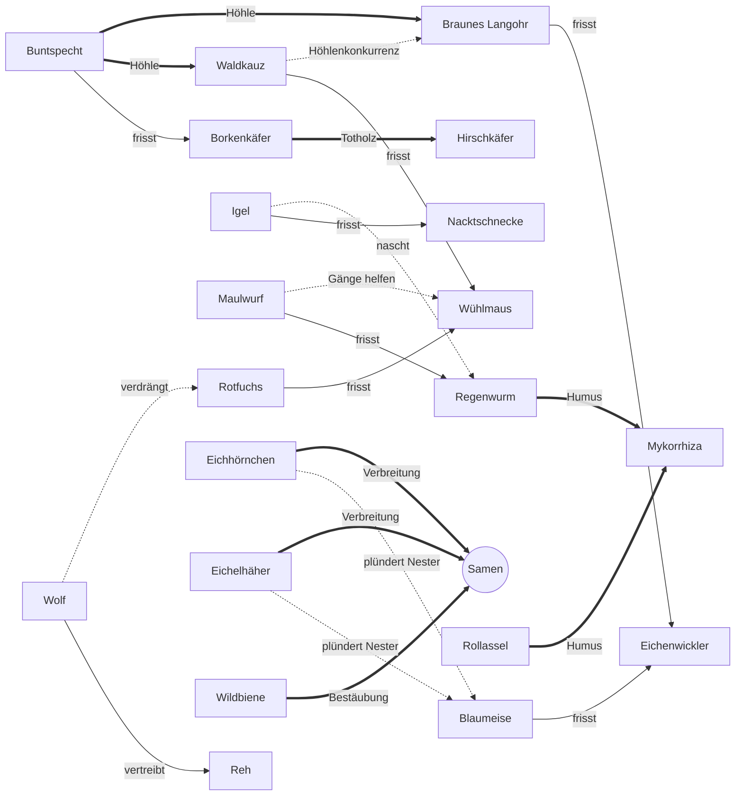

# Ökosystem – Tiere ziehen ein (Designkonzept)

> **Überführt:** Dieses Konzept ist in [`DESIGN_V2.md`](DESIGN_V2.md) aufgegangen
> (Neuausrichtung v2: Begegnungen mit Kartenwahl, Zufriedenheit, Samen als einzige
> Währung). Arten, Nischen, Wechselwirkungen, Pflegemaßnahmen und
> Lebensgemeinschaften wurden dorthin übertragen und angepasst (Abschnitt 5.4 dort).
> Dieses Dokument bleibt nur als Hintergrund erhalten; **maßgeblich ist DESIGN_V2.md.**

> **Status:** Konzept, noch nicht implementiert. Alle Zahlen sind **vorläufige
> Startwerte** und müssen per Simulation gebalanced werden (siehe Abschnitt 9).
> Wenn Teile umgesetzt werden, wandern Regeln und Tabellen nach `GAME_DESIGN.md`.

---

## 1. Vision & Spielgefühl

Dein Baum ist nicht allein. Sobald er groß genug ist, ziehen Regenwürmer in den
Wurzelraum, Meisen in die Krone, ein Waldkauz in die Höhle. Jede Art hilft dem Baum
auf ihre Weise – und manche kosten ihn auch etwas. Wie im Brettspiel *Mischwald* geht
es darum, **Synergien zu entdecken und ein stimmiges Gefüge zu bauen**: Die Raupe
frisst Blätter, aber sie ist auch Futter für die Meise; der Borkenkäfer schadet dem
Stamm, aber er schafft Totholz, in dem der Hirschkäfer leben kann.

**Gefühl:** ein ruhiges Puzzle neben der Kernschleife. Kein Kampf, keine Hektik,
kein Verlust durch Abwesenheit. Ein Ökosystem ist eine **Konstellation, keine
Simulation**: Tiere vermehren sich nicht, sterben nicht und wandern nicht ab. Was du
eingerichtet hast, bleibt – online wie offline.

### Eingriff in die Kernschleife

Die Kernschleife bleibt unverändert: Wasser + Licht → Photosynthese → Energie → Stufen.
Das Ökosystem wirkt nur über **Multiplikatoren** darauf:

```
                 Tiere (Nischen)                Harmonie-Wert
                  │  ±% Wasser/s                   │
                  │  ±% Licht/s                    │
                  │  ±% Photosynthese              │
                  ▼                                ▼
Wurzeln ──► 💧 Wasser ─┐
                       ├─► Photosynthese ──► 🍬 Energie × Harmonie-Bonus
Blätter ──► ☀️ Licht  ─┘
```

- Tiere verschieben **einzelne Glieder** (Wasser, Licht, Photosynthese). Weil die
  Energie durch `min(Wasser, Licht, Photosynthese)` begrenzt ist, wird das Ökosystem
  zu einem zweiten Werkzeug für die bestehende Kernentscheidung „Wo ist mein Engpass?“.
  Ein Tier mit +15 % Wasser bringt nichts, wenn Licht knapp ist – ein Reh, das
  Licht schafft, aber Photosynthese kostet, kann genau richtig sein.
- Der **Harmonie-Wert** belohnt das Gesamtgefüge mit einem globalen
  Energie-Multiplikator und mehr Samen beim Prestige.
- Bezahlt wird mit **Energie** (dieselbe Währung wie Upgrades). Das Ökosystem
  konkurriert also um dieselbe Ressource – eine echte, aber milde Entscheidung.

---

## 2. Lebensräume (Nischen)

Jede Nische hat **begrenzte Plätze**. Ein Platz = eine Population einer Art. Es gibt
mehr Arten als Plätze, also muss der Spieler wählen.

| Nische | Lage am Baum | öffnet ab | Plätze Setzling / Junger Baum / Alter Baum / Hain / Wald / Urwald |
|---|---|---|---|
| 🪱 Wurzelraum | Erde, Wurzeln | Setzling | 1 / 2 / 3 / 3 / 4 / 4 |
| 🍂 Laubstreu | Boden um den Stamm | Junger Baum | – / 1 / 2 / 2 / 3 / 3 |
| 🌳 Krone | Äste, Blätter, Blüten | Junger Baum | – / 2 / 3 / 4 / 4 / 5 |
| 🪵 Stamm & Rinde | Borke, Saftstrom | Alter Baum | – / – / 2 / 2 / 3 / 3 |
| 🕳️ Höhlen & Totholz | Spechthöhlen, tote Äste | Alter Baum | – / – / 1 / 1 / 2 / 2 |
| 🌾 Lichtung | Umgebung im Hain/Wald | Hain | – / – / – / 2 / 3 / 4 |

**Zusätzliche Plätze** in „Höhlen & Totholz“ entstehen durch das Ökosystem selbst
(je höchstens einmal): +1 durch den **Borkenkäfer** (Totholz), +1 durch den
**Buntspecht** (gezimmerte Höhle), +1 durch die Pflegemaßnahme „Totholz liegen lassen“.

Beim Erreichen des Hains stehen damit typischerweise **14–16 Plätze** für 19 Arten
zur Verfügung (ab „Wald“ 20 Arten).

---

## 3. Tierkatalog

**Rollen:** 🌿 Pflanzenfresser (schadet dem Baum, ist Beute) · 🦉 Räuber (braucht Beute,
mindert deren Schaden) · ♻️ Zersetzer · 🐝 Bestäuber · 🌰 Samenverbreiter ·
🍄 Partner (Mutualismus).

**Regeln für alle Arten (vorläufig):**
- **Einzug** kostet einmalig Energie pro Zyklus. Danach ist die Art „bekannt“ und
  kann innerhalb des Zyklus **kostenlos umgesiedelt** werden (Experimentieren
  erwünscht). Jede weitere Population derselben Art kostet ×3. Max. 3 Populationen je Art.
- **Einzugsbedingung** „braucht X“: X muss beim Einzug irgendwo im Ökosystem leben.
  Wird X später entfernt, bleibt der Räuber, ist aber **hungrig** (alle seine Effekte
  halbiert, −3 Harmonie). Nie automatischer Auszug.
- **Schaden** von Pflanzenfressern wird durch jeden passenden Räuber
  **multiplikativ** gemindert (z. B. Specht −75 % → Restschaden ×0,25).
- Prozentwerte derselben Ressource werden **addiert**; die Summe ist pro Ressource auf
  **−30 % … +100 %** begrenzt. Tiere können den Baum also nie lahmlegen.
- „ab Hain“-Effekte wirken erst ab Stufe Hain (mehrere Bäume).

| # | Art | Gruppe / Rolle | Nische | ab | Einzug | Positiv | Negativ | Text |
|---|---|---|---|---|---|---|---|---|
| 1 | Regenwurm | Bodenlebewesen ♻️ | Wurzelraum | Setzling | 150 E | +8 % Wasser | Futter für Maulwurf und Igel | „Frisst sich durch die Erde und hinterlässt Gänge, durch die der Regen sickert.“ |
| 2 | Wühlmaus | Säugetier 🌿 | Wurzelraum | Setzling | 60 E | Beute für Waldkauz und Fuchs | −8 % Wasser | „Knabbert an zarten Wurzeln. Lecker findet sie vor allem der Kauz.“ |
| 3 | Maulwurf | Säugetier 🦉 | Wurzelraum | Junger Baum | 1.500 E, braucht Regenwurm | +6 % Wasser (belüftet den Boden) | Regenwurm-Bonus −50 %; Wühlmaus-Schaden +50 % (nutzt seine Gänge) | „Gräbt unermüdlich – zum Leidwesen der Regenwürmer.“ |
| 4 | Mykorrhiza-Pilz | Pilz 🍄 (Sonderfall, zählt als Art) | Wurzelraum | Junger Baum | 2.500 E, braucht einen Zersetzer (Regenwurm oder Rollassel) | +15 % Wasser; ab Hain +10 % Photosynthese (verbindet die Bäume) | −5 % Photosynthese („Zuckerlohn“) | „Feine Pilzfäden umspinnen die Wurzeln und tauschen Wasser gegen Zucker.“ |
| 5 | Rollassel | Krebstier ♻️ | Laubstreu | Junger Baum | 600 E | +5 % Photosynthese (Humus) | – | „Rollt sich bei Gefahr zur Kugel und macht aus Laub fruchtbare Erde.“ |
| 6 | Nacktschnecke | Weichtier 🌿 | Laubstreu | Junger Baum | 80 E | Beute für Igel | −6 % Licht (frisst Jungtriebe) | „Kommt nachts, wenn es feucht ist. Und sie hat Hunger.“ |
| 7 | Igel | Säugetier 🦉 | Laubstreu | Alter Baum | 6.000 E, braucht Nacktschnecke oder Regenwurm | Schneckenschaden −75 % | Regenwurm-Bonus −25 % | „Schmatzt sich nachts durchs Laub. Schnecken sind sein Leibgericht.“ |
| 8 | Eichenwickler | Insekt 🌿 (Raupe) | Krone | Junger Baum | 100 E | +4 % Wasser (Raupenkot düngt) | −12 % Licht (Blattfraß) | „Eine grüne Raupe, die sich in Blätter einrollt – Meisenfutter erster Güte.“ |
| 9 | Blaumeise | Vogel 🦉 | Krone | Junger Baum | 1.200 E, braucht Eichenwickler | Raupenschaden −50 % | wird von Nesträubern geschwächt | „Ein Meisenpaar verfüttert im Frühling Tausende Raupen.“ |
| 10 | Wildbiene | Insekt 🐝 | Krone | Alter Baum | 5.000 E | +10 % Samen beim Prestige; +4 % Energie (Bestäubung) | −3 % Photosynthese („Nektarzoll“) | „Summt von Blüte zu Blüte und bringt Früchte hervor.“ |
| 11 | Eichhörnchen | Säugetier 🌰 | Krone | Alter Baum | 8.000 E | ab Hain +12 % Photosynthese (vergessene Nüsse keimen); +10 % Samen | −4 % Licht (Knospenfraß); Nesträuber: Blaumeise −25 % | „Versteckt Hunderte Nüsse – und vergisst zum Glück viele davon.“ |
| 12 | Eichelhäher | Vogel 🌰 | Krone | Hain | 18.000 E | ab Hain +15 % Photosynthese (pflanzt Eicheln); mildert Ereignis „Schädlinge“ (Warnrufe) | Nesträuber: Blaumeise −50 % | „Der Förster des Waldes – und der lauteste Wächter.“ |
| 13 | Borkenkäfer | Insekt 🌿 | Stamm & Rinde | Alter Baum | 400 E | schafft Totholz: +1 Platz Höhlen & Totholz | −10 % Wasser (unterbricht den Saftstrom) | „Zeichnet feine Gänge unter die Rinde. Schön anzusehen, schlecht für den Baum.“ |
| 14 | Buntspecht | Vogel 🦉 | Stamm & Rinde | Alter Baum | 9.000 E, braucht Borkenkäfer | Käferschaden −75 %; zimmert Höhle: +1 Platz Höhlen & Totholz | −3 % Wasser (ringelt die Rinde und trinkt Saft) | „Klopft, horcht, hackt. Seine alten Höhlen sind begehrter Wohnraum.“ |
| 15 | Waldkauz | Vogel 🦉 | Höhlen & Totholz | Alter Baum | 12.000 E, braucht Wühlmaus | Wühlmausschaden −75 % | Langohr −25 % (Konkurrenz um ruhige Höhlen) | „Huhu-huuu. Nachts jagt er lautlos über den Waldboden.“ |
| 16 | Braunes Langohr | Säugetier (Fledermaus) 🦉 | Höhlen & Totholz | Alter Baum | 10.000 E, braucht Eichenwickler | Raupenschaden −50 % (fängt die Falter) | – | „Hört mit riesigen Ohren jeden Nachtfalter.“ |
| 17 | Hirschkäfer | Insekt ♻️ (selten) | Höhlen & Totholz | Hain | 20.000 E, braucht freien Totholz-Platz | +5 % Photosynthese; +4 Harmonie (seltene Art) | belegt einen begehrten Höhlenplatz | „Seine Larven leben fünf Jahre im morschen Holz. Geduld ist alles.“ |
| 18 | Reh | Säugetier 🌿 | Lichtung | Hain | 15.000 E | +6 % Licht (hält den Unterwuchs kurz) | −10 % Photosynthese (Verbiss am Jungwuchs) | „Zupft am liebsten die frischesten Triebe.“ |
| 19 | Rotfuchs | Säugetier 🦉 | Lichtung | Hain | 25.000 E, braucht Wühlmaus | Wühlmausschaden −50 % | – (teilt die Beute mit dem Kauz, siehe 4.3) | „Springt mit einem Satz auf die Maus unter dem Laub.“ |
| 20 | Wolf | Säugetier 🦉 | Lichtung | Wald | 200.000 E, braucht Reh | Verbiss −60 %; +5 % Licht („Landschaft der Angst“: Rehe ziehen weiter) | Rotfuchs −50 % | „Er ist zurück. Wo er durchzieht, wächst der Wald wieder dichter.“ |

Größenordnung der Einzugskosten: etwa 1–3 Minuten Produktion zum Zeitpunkt der
Freischaltung (Setzling ~1,5 E/s, Junger Baum ~13 E/s, Alter Baum ~54 E/s,
Hain ~205 E/s, Wald ~960 E/s laut aktueller Simulation). Beutetiere sind absichtlich
billig – sie sind die Eintrittskarte für die Räuber.

---

## 4. Wechselwirkungen

### 4.1 Netz



Legende: `-- frisst -->` Räuber–Beute · `-.->` Konkurrenz / Nesträuber ·
`==>` schafft Lebensraum oder Partnerschaft.

### 4.2 Matrix (Zeile wirkt auf Spalte)

| wirkt auf → | Regenwurm | Wühlmaus | Eichenwickler | Blaumeise | Borkenkäfer | Langohr | Rotfuchs | Reh |
|---|---|---|---|---|---|---|---|---|
| **Maulwurf** | Bonus −50 % | Schaden +50 % | | | | | | |
| **Igel** | Bonus −25 % | | | | | | | |
| **Blaumeise** | | | Schaden −50 % | | | | | |
| **Langohr** | | | Schaden −50 % | | | | | |
| **Eichhörnchen** | | | | −25 % | | | | |
| **Eichelhäher** | | | | −50 % | | | | |
| **Buntspecht** | | | | | Schaden −75 % | | | |
| **Waldkauz** | | Schaden −75 % | | | | −25 % | | |
| **Rotfuchs** | | Schaden −50 % | | | | | | |
| **Wolf** | | | | | | | −50 % | Verbiss −60 % |

### 4.3 Beispiele

- **Totholz-Kette (Kaskade, positiv):** Der Borkenkäfer kostet 10 % Wasser, schafft
  aber Totholz (+1 Platz). Der Buntspecht frisst die Käfer (Rest-Schaden −2,5 %) und
  zimmert eine Höhle (+1 Platz). In die neuen Plätze ziehen Waldkauz und Hirschkäfer.
  Ein „Schädling“ wird so zum Grundstein des Gefüges – genau das Mischwald-Gefühl.
- **Raupenwacht (Räuber–Beute, doppelt):** Eichenwickler allein: −12 % Licht.
  Mit Blaumeise: −6 %. Mit Blaumeise und Langohr: −3 %. Der Raupenkot (+4 % Wasser)
  bleibt – die Raupe wird netto nützlich. Zieht aber ein Eichelhäher ein, plündert
  er Meisennester: die Meise mindert nur noch 25 % statt 50 %.
- **Maulwurf-Dilemma (Konkurrenz):** Der Maulwurf belüftet den Boden (+6 % Wasser),
  frisst aber Regenwürmer (deren +8 % halbiert) und seine Gänge helfen den Wühlmäusen.
  Lohnt nur, wenn der Wurzelraum ohnehin voll mit Wühlmaus + Kauz ist.
- **Geteilte Beute:** Waldkauz und Rotfuchs jagen beide Wühlmäuse. Beide gelten als
  satt, solange mindestens eine Wühlmaus-Population lebt; bei nur einer Wühlmaus
  und zwei Jägern gibt es aber nur einmal die „Satt“-Harmonie (Konkurrenz).
- **Kaskade negativ – Rehe ohne Wolf:** Zwei Rehe bringen +12 % Licht, aber −20 %
  Photosynthese und zählen als unbewachte Pflanzenfresser (−8 Harmonie). Erst der
  Wolf (ab „Wald“) macht aus den Rehen einen Gewinn.

---

## 5. Lenkende Upgrades („Pflegemaßnahmen“)

Pflegemaßnahmen werden einmal mit Energie gekauft und können danach **kostenlos ein-
und ausgeschaltet** werden (Konfiguration, kein Verbrauch). Jede bevorzugt eine
Gruppe und benachteiligt eine andere. „Dichte Krone“ und „Lichte Krone“ schließen
sich gegenseitig aus. Eine Maßnahme, die einen Platz wegnimmt, lässt sich nur
aktivieren, wenn dieser Platz frei ist (Hinweis in der UI: „erst umsiedeln“).

| ID | Name | ab | Kosten | Bevorzugt | Benachteiligt | Text |
|---|---|---|---|---|---|---|
| leave-leaves | Laub liegen lassen | Junger Baum | 1.500 E | +1 Platz Laubstreu; Regenwurm, Rollassel +30 % | Wildbiene −30 % (bodennistende Bienen finden keinen offenen Boden); Schneckenschaden +50 % | „Im Herbst bleibt das Laub, wo es fällt.“ |
| fungus-friendly | Pilzfreundlicher Boden | Junger Baum | 2.000 E | Mykorrhiza +50 % (Wasser und Hain-Bonus) | Zuckerlohn verdoppelt (−10 % Photosynthese); Maulwurf −50 % (zerreißt die Pilzfäden) | „Nicht umgraben, nicht stören – das Geflecht wächst.“ |
| nest-boxes | Nistkästen | Junger Baum | 2.500 E | +1 Platz Höhlen & Totholz schon ab Junger Baum (nur Vögel und Fledermäuse); Blaumeise +30 % | Nestraub durch Eichhörnchen und Eichelhäher doppelt so stark | „Ein Holzkasten mit kleinem Flugloch. Gemütlich – und leicht zu finden.“ |
| dense-crown | Dichte Krone | Alter Baum | 6.000 E | +1 Platz Krone; Blaumeise, Eichelhäher +25 % | Laubstreu-Arten −25 % (kühl und dunkel); Reh-Lichtbonus entfällt | „Ein Dach aus Blättern, unter dem Vögel sicher brüten.“ |
| open-crown | Lichte Krone | Alter Baum | 6.000 E | +6 % Licht; Wildbiene +50 % | −1 Platz Krone; Vögel −20 % | „Ein paar Äste weniger – Sonnenflecken tanzen über den Boden.“ |
| flowering-ivy | Blühender Efeu | Alter Baum | 5.000 E | Wildbiene +50 %; +10 % Samen | −1 Platz Stamm & Rinde; Buntspecht −25 % (Rinde verdeckt) | „Blüht spät im Jahr, wenn sonst nichts mehr blüht.“ |
| deadwood | Totholz liegen lassen | Alter Baum | 8.000 E | +1 Platz Höhlen & Totholz; Specht, Hirschkäfer, Waldkauz, Langohr +25 % | Borkenkäferschaden +50 %; ab Hain −1 Platz Lichtung (umgestürzte Stämme) | „Ein toter Baum lebt länger als ein lebender.“ |
| wildflower-meadow | Wildwiese | Hain | 20.000 E | +1 Platz Lichtung; Wildbiene +50 %; Reh-Lichtbonus +50 % | Wühlmausschaden +50 % (Wiesen sind Mäuseland) | „Margeriten, Klee und hohes Gras am Waldrand.“ |
| woodland-pond | Waldtümpel | Hain | 30.000 E | +8 % Wasser; Langohr +50 % (Insekten über dem Wasser) | Schneckenschaden ×2; Igel −25 % (meidet die nasse Senke) | „Eine feuchte Senke, in der sich der Regen sammelt.“ |
| hunting | Bejagung | Hain | 15.000 E | Verbiss durch Reh −50 % | Rotfuchs und Wolf −40 %; Reh zählt weiterhin als unbewacht | „Der Förster hält die Rehe in Schach – auf Kosten der natürlichen Jäger.“ |

Gestaltungsregel: Jede Maßnahme hat genau **einen klaren Gewinner** und **einen
klaren Verlierer**, beides in einem Satz erklärbar. Die Zahlen sind so gewählt,
dass keine Maßnahme in jedem Aufbau gut ist.

---

## 6. Stimmigkeit – der Harmonie-Wert

### 6.1 Formel (vorläufig)

```
Harmonie H = 2 · verschiedene Arten
           + 2 · vollständig belegte Nischen
           + 3 · satte Räuber              (Beute vorhanden, siehe 4.3 „Geteilte Beute“)
           + Σ  Lebensgemeinschaften       (siehe Tabelle)
           + Sonderpunkte                  (z. B. Hirschkäfer +4)
           − 4 · unbewachte Pflanzenfresser-Populationen
           − 3 · hungrige Räuber
           − 2 · je Population ab der dritten derselben Art („Monokultur“)
H ≥ 0
```

**Belohnung:**
- **Energie-Multiplikator** `1 + 0,003 · H` auf jede erzeugte Energie
  (H = 80 → +24 %). Wirkt auch auf `totalEnergy`, beschleunigt also die Stufen.
- **Samen beim Prestige** `× (1 + H_max / 200)`, wobei `H_max` der höchste im Zyklus
  erreichte Wert ist (Umbauen kurz vor dem Prestige wird nicht bestraft).
- **Harmoniestufen** (nur Anzeige und Grafik): 0–19 „Zarte Anfänge“,
  20–39 „Lebendiges Gefüge“, 40–69 „Stimmiges Ökosystem“, ab 70 „Blühender Mischwald“.

### 6.2 Lebensgemeinschaften (Sets à la Mischwald)

Werden im **Naturtagebuch** als Silhouetten mit Rätselhinweis angezeigt, bis sie
entdeckt sind.

| Lebensgemeinschaft | Arten | Harmonie | Extra | Hinweis im Tagebuch |
|---|---|---|---|---|
| Humusküche | Regenwurm, Rollassel, Mykorrhiza | +6 | +5 % Wasser | „Aus Laub wird Erde, aus Erde wird Leben.“ |
| Raupenwacht | Eichenwickler, Blaumeise, Braunes Langohr | +6 | – | „Tags und nachts wird die Krone bewacht.“ |
| Totholz-Kette | Borkenkäfer, Buntspecht, Hirschkäfer, Waldkauz *oder* Langohr | +8 | – | „Was stirbt, schafft Wohnraum.“ |
| Nachtschicht | Waldkauz, Braunes Langohr, Igel | +5 | – | „Wenn du schläfst, arbeiten sie.“ |
| Samenboten | Eichhörnchen, Eichelhäher, Wildbiene | +6 | +10 % Samen | „Blüte, Frucht und Versteck.“ |
| Wilde Lichtung | Reh, Rotfuchs, Wolf | +8 | – | „Erst der Jäger bringt den Wald ins Gleichgewicht.“ |

### 6.3 Beispielrechnung (Stufe Hain, 16 Plätze)

Annahme: Grundraten ohne Ökosystem ausgeglichen bei je 200/s (Wasser, Licht,
Photosynthese) → 200 Energie/s.

**A – Stimmiges Ökosystem**

| Nische | Belegung |
|---|---|
| Wurzelraum (3) | Regenwurm, Mykorrhiza, Wühlmaus |
| Laubstreu (2) | Rollassel, Igel |
| Krone (4) | Eichenwickler, Blaumeise, Eichhörnchen, Wildbiene |
| Stamm & Rinde (2) | Borkenkäfer, Buntspecht |
| Höhlen & Totholz (1 + 2) | Waldkauz, Braunes Langohr, Hirschkäfer |
| Lichtung (2) | Reh, Rotfuchs |

| Posten | Rechnung | Punkte |
|---|---|---|
| Arten | 16 × 2 | 32 |
| Volle Nischen | 6 × 2 | 12 |
| Satte Räuber | Igel, Meise, Specht, Kauz, Langohr, Fuchs: 6 × 3 | 18 |
| Lebensgemeinschaften | Humusküche 6 + Raupenwacht 6 + Totholz-Kette 8 + Nachtschicht 5 | 25 |
| Sonderpunkte | Hirschkäfer | 4 |
| Unbewacht | Reh (kein Wolf vor „Wald“) | −4 |
| **Harmonie** | | **87 → ×1,261** |

Direkte Effekte:
- Wasser: Regenwurm +8 × 0,75 (Igel) = +6 · Mykorrhiza +15 · Wühlmaus −8 × 0,25 × 0,5 = −1 ·
  Borkenkäfer −10 × 0,25 = −2,5 · Specht −3 · Raupenkot +4 · Humusküche +5 → **+23,5 %**
- Licht: Wickler −12 × (1 − 0,5 · 0,75) × 0,5 = −3,75 · Eichhörnchen −4 · Reh +6 → **−1,75 %**
- Photosynthese: Mykorrhiza −5 + 10 · Rollassel +5 · Wildbiene −3 · Eichhörnchen +12 ·
  Hirschkäfer +5 · Reh −10 → **+14 %**

Energie/s = min(247, 196,5, 228) × 1,261 × 1,04 (Bestäubung) ≈ **258/s (+29 %)**.
Der Engpass ist jetzt Licht – ein Anreiz, über „Lichte Krone“ oder Licht-Upgrades
nachzudenken. Genau diese Rückkopplung soll das System erzeugen.

**B – Unausgewogenes Ökosystem** (billig vollgestopft, ohne Räuber)

| Nische | Belegung |
|---|---|
| Wurzelraum (3) | Regenwurm × 3 |
| Laubstreu (2) | Rollassel × 2 |
| Krone (4) | Eichhörnchen, Eichelhäher, Eichenwickler, Wildbiene |
| Stamm & Rinde (2) | Borkenkäfer × 2 |
| Höhlen & Totholz (1 + 1) | Hirschkäfer, *leer* |
| Lichtung (2) | Reh × 2 |

| Posten | Rechnung | Punkte |
|---|---|---|
| Arten | 9 × 2 | 18 |
| Volle Nischen | 5 × 2 | 10 |
| Satte Räuber | keine | 0 |
| Lebensgemeinschaften | Samenboten | 6 |
| Sonderpunkte | Hirschkäfer | 4 |
| Unbewacht | Wickler 1, Borkenkäfer 2, Reh 2: 5 × −4 | −20 |
| Monokultur | dritter Regenwurm | −2 |
| **Harmonie** | | **16 → ×1,048** |

Direkte Effekte: Wasser +24 − 20 + 4 = **+8 %** · Licht −12 − 4 + 12 = **−4 %** ·
Photosynthese +10 − 3 + 12 + 15 + 5 − 20 = **+19 %**.

Energie/s = min(216, 192, 238) × 1,048 × 1,04 ≈ **209/s (+5 %)**.

→ Gleiche Zahl an Plätzen, ähnliche Kosten, aber das stimmige Gefüge bringt etwa
sechsmal so viel. Wichtig: auch das unausgewogene Ökosystem schadet nicht – es
bringt nur wenig.

---

## 7. Einbettung in die Progression

### 7.1 Freischaltung

| Stufe | Neu im Ökosystem |
|---|---|
| Setzling | Ökosystem-Panel erscheint; Wurzelraum (1 Platz); Regenwurm, Wühlmaus. Teaser: „Etwas regt sich in der Erde …“ |
| Junger Baum | Laubstreu, Krone; Maulwurf, Mykorrhiza, Rollassel, Nacktschnecke, Eichenwickler, Blaumeise; erste Pflegemaßnahmen; Harmonie-Wert sichtbar |
| Alter Baum | Stamm & Rinde, Höhlen & Totholz; Igel, Wildbiene, Eichhörnchen, Borkenkäfer, Buntspecht, Waldkauz, Langohr; Kronen-Pflegemaßnahmen |
| Hain | Lichtung; Eichelhäher, Hirschkäfer, Reh, Rotfuchs; „ab Hain“-Boni der Samenverbreiter und der Mykorrhiza |
| Wald | Wolf; weitere Plätze |
| Urwald | weitere Plätze; Harmoniestufe „Blühender Mischwald“ färbt den ganzen Wald |

### 7.2 Prestige („Neuer Zyklus“)

- **Zurückgesetzt:** Belegung der Nischen, gekaufte Pflegemaßnahmen, Einzugsstatus.
- **Bleibt – Naturtagebuch:** Alle je entdeckten Arten und Lebensgemeinschaften.
  Bekannte Arten kosten im nächsten Zyklus **50 % weniger** Einzug.
- **Bleibt – Stammgast (Samen-Shop):** Eine gewählte Art zieht automatisch ein, sobald
  ihre Nische öffnet (weitere Stammgäste über den Samen-Shop).
- **Samen:** `× (1 + H_max / 200)` sowie Bonus von Wildbiene, Eichhörnchen,
  Samenboten und Blühendem Efeu.
- Idee für später: Nach einem Waldbrand-Prestige ziehen „Pionierarten“ (Specht,
  Hirschkäfer) für 5 Minuten zum halben Preis ein – „Aus der Asche“.

### 7.3 Verbindung zu geplanten Systemen

- **Jahreszeiten:** nur Boni, nie Strafen. Frühling: Bestäuber und Meisen ×1,5.
  Herbst: Samenverbreiter ×1,5. Winter: Winterschläfer (Igel, Langohr) ruhen – ihre
  positiven **und** negativen Effekte pausieren, Harmonie bleibt gleich.
- **Ereignisse:** Tiere mildern Ereignisse statt neue Gefahren zu bringen.
  „Schädlinge“: Blaumeise, Specht, Eichelhäher verkürzen die Dauer.
  „Dürre“: Mykorrhiza halbiert den Wasserverlust. „Sturm“: hinterlässt Totholz
  (+1 Platz Höhlen & Totholz bis zum nächsten Zyklus).
- **Nährstoffe & Pilznetzwerk:** Die Mykorrhiza ist die Brücke. Sobald es die
  Ressource Nährstoffe gibt, produzieren Zersetzer (Regenwurm, Rollassel,
  Hirschkäfer) und Mykorrhiza Nährstoffe statt der Photosynthese-Boni.
- **Baumarten:** Jede Baumart bevorzugt Tiere (Eiche: Eichelhäher, Eichenwickler,
  Hirschkäfer; Kiefer: Waldameise, Kiefernspinner; Birke: Birkenzeisig) – eine
  natürliche Erweiterung des Katalogs.

### 7.4 Idle-Charakter (Leitplanken)

- Keine Zeitdynamik: Effekte hängen nur von der aktuellen Belegung ab. Offline =
  online, keine Überraschungen nach Rückkehr.
- Tiere ziehen **nie von selbst** ein oder aus. Schädlinge kommen nur, wenn der
  Spieler sie einlädt (weil sie billig sind und Räuber ermöglichen).
- Negative Effekte sind gedeckelt (−30 % pro Ressource) und immer vorhersehbar
  (Vorschau vor jedem Einzug).
- Kein Klick-Pflegen, kein Füttern. Eine Sitzung im Ökosystem-Panel pro Stufe genügt.

---

## 8. Darstellung & UI-Ideen

### Renderer (`renderer`)
- **Feste Ankerpunkte je Nische** am prozeduralen Baum: Krone (Äste), Stamm (Rinde),
  Höhle (Astloch), Boden-Querschnitt (Wurzelraum, unter der Erde schon sichtbar),
  Laubstreu (Bodenrand), Lichtung (Bildrand im Hain).
- Tiere als kleine, **gecachte Sprites** (Offscreen-Canvas je Art, einmal gezeichnet),
  Animation nur durch billige Transformationen: Meise hüpft, Raupe krümmt sich,
  Specht nickt, Regenwurm schlängelt sich, Kauz blinzelt in der Dämmerung.
- Effekte sichtbar machen: Fraßspuren an Blättern bei unbewachter Raupe, Totholz-Ast
  mit Borkenkäfer, Pilzfäden als feines Netz im Boden, Blüten bei Wildbiene.
- Harmonie färbt die Szene: ab „Stimmiges Ökosystem“ mehr Blüten, Glühwürmchen
  in der Dämmerung, sattere Farben.
- Der Renderer liest dafür nur einen schmalen Wert aus dem Core
  (z. B. `ecosystemView(state)`: Liste `{ species, niche, slotIndex, hungry }` + Harmoniestufe).

### UI (`ui-dev`)
- **Ökosystem-Panel** als eigener Reiter neben „Upgrades“: eine Zeile pro Nische mit
  Plätzen als Kacheln; leere Plätze zeigen ein „+“.
- **Artenkarte**: Name, Bild, Rolle, grüne und rote Effekt-Chips („+8 % 💧“,
  „−12 % ☀️“), Einzugsbedingung, Kosten.
- **Vorschau vor dem Einzug**: „Energie/s 205 → 214 (+4,4 %), Harmonie 31 → 38“.
  Das ist der wichtigste Baustein gegen Frust.
- **Beziehungen beim Hover**: Linien zu Beute (rot), Partnern (grün), Konkurrenz (grau).
- **Harmonie-Anzeige** mit Aufschlüsselung (Arten, Nischen, Räuber, Gemeinschaften,
  Abzüge) und dem resultierenden Multiplikator.
- **Naturtagebuch**: entdeckte Arten mit Text, Silhouetten mit Rätselhinweis für
  unentdeckte Lebensgemeinschaften.
- Umsiedeln per Drag & Drop oder „Auszug“-Knopf; Pflegemaßnahmen als Schalter.

---

## 9. Technische Skizze für den `core-engineer`

### 9.1 Neue Inhalte (`src/content/`, reine Daten)

- `niches.ts` – `Niche { id, name, description, unlockStage, slotsByStage: number[] }`
- `species.ts` – `Species { id, name, description, group, role, niche, unlockStage,
  inviteCost, requires?: string[][] /* ODER-Gruppen */, maxPopulations, effects: EcoEffect[] }`
- `communities.ts` – `Community { id, name, hint, members: (string | string[])[], harmony, effects?: EcoEffect[] }`
- `stewardship.ts` – `Stewardship { id, name, description, unlockStage, cost,
  exclusiveWith?: string, effects: EcoEffect[] }`

### 9.2 Neue Effekttypen (Logik in `core/formulas.ts`, je mit Test)

| Typ | Felder | Formel / Bedeutung |
|---|---|---|
| `rateBonus` | `resource: water \| light \| photosynthesis`, `percent`, `minStage?`, `kind: 'benefit' \| 'damage'` | `rate × (1 + clamp(Σ percent, −0,30, +1,00))` je Ressource |
| `energyBonus` | `percent` | Faktor auf erzeugte Energie (zusätzlich zur Harmonie) |
| `seedBonus` | `percent` | Faktor beim Prestige (erst mit Prestige-System) |
| `slot` | `niche`, `delta`, `onlyFor?: group[]` | Plätze; Ökosystem-eigene Quellen je max. 1× |
| `predation` | `prey`, `damageFactor` | Restschaden der Beute `× damageFactor`, multiplikativ je Räuber |
| `modifySpecies` | `target: speciesId \| group \| niche`, `part: 'benefit' \| 'damage' \| 'all'`, `factor` | Wirkung anderer Arten skalieren (Maulwurf → Regenwurm 0,5; Nistkasten; Dichte Krone) |
| `harmony` | `points` | Sonderpunkte |

Reihenfolge der Berechnung (eine reine Funktion, z. B. `ecosystemModifiers(state)`):
1. aktive Pflegemaßnahmen und Plätze bestimmen,
2. Faktoren aus `modifySpecies` und `predation` je Art sammeln (hungrige Räuber ×0,5),
3. `rateBonus` je Ressource summieren und begrenzen,
4. Harmonie berechnen → Energie-Multiplikator,
5. Ergebnis `{ water, light, photosynthesis, energy, seeds, harmony, slots }` cachen
   (ändert sich nur bei Spieleraktionen, nicht pro Tick).

`getRates()` multipliziert Wasser, Licht und Photosynthese. In `tick()` wird der
Energie-Multiplikator auf `converted` angewandt: Wasser und Licht werden 1 : 1
verbraucht, gutgeschrieben wird `converted × energyMultiplier` (auch auf `totalEnergy`).

### 9.3 Spielstand (`SAVE_VERSION` 1 → 2)

```ts
ecosystem: {
  placements: Record<string, (string | null)[]>; // Nische → Art-ID je Platz
  invited: string[];       // in diesem Zyklus bezahlte Arten (kostenlos umsiedeln)
  stewardship: Record<string, boolean>; // gekauft → aktiv?
  harmonyMax: number;      // für Samen beim Prestige
  journal: string[];       // Naturtagebuch: Arten + Gemeinschaften, überdauert Prestige
}
```

Migration: alte Stände erhalten ein leeres `ecosystem`. Robustes Laden: unbekannte
Art-IDs verwerfen, Belegung auf die aktuelle Platzzahl kürzen, `null` für leere Plätze.

Neue Aktionen in `tick.ts`: `inviteSpecies(state, speciesId, niche, slot)`,
`relocateSpecies(...)`, `removeSpecies(...)`, `buyStewardship(state, id)`,
`toggleStewardship(state, id)`. Alle geben `false` zurück, wenn ungültig.

### 9.4 Balancing per Simulator (`game-designer`)

- `scripts/simulate.ts` um eine Ökosystem-Strategie erweitern: Beim Erreichen jeder
  Stufe und nach jedem Kauf prüft der Standardspieler alle Einzüge und Pflegemaßnahmen
  und wählt die mit der kürzesten „Wartezeit + Amortisationszeit“ – wie bei Upgrades,
  Bewertung über `steadyEnergyRate × Energie-Multiplikator`.
- Zusätzlich `scripts/ecosystem-search.ts`: Hill-Climbing über Belegungen auf Stufe
  Hain (Startpunkte zufällig per festem Seed), Ausgabe der besten 5 Aufbauten.
  Prüfziele: (a) bester Aufbau +25–40 % Energie, (b) kein Aufbau ohne Räuber unter
  den besten 20, (c) mindestens 3 deutlich verschiedene Aufbauten innerhalb von 5 %
  des Optimums (Vielfalt der Lösungen), (d) Balancing-Ziele bis Hain weiterhin
  innerhalb Faktor 2 – ggf. Stufenschwellen leicht anheben.

---

## 10. MVP-Schnitt

**Ziel:** das Mischwald-Gefühl mit minimalem Umfang – eine Räuber–Beute-Kette,
ein Mutualismus, ein Dilemma, zwei Lebensgemeinschaften.

- **2 Nischen:** Wurzelraum (ab Setzling 1, Junger Baum 2, Alter Baum 3 Plätze),
  Krone (ab Junger Baum 2, Alter Baum 3, Hain 4 Plätze).
- **6 Arten:** Regenwurm, Maulwurf, Mykorrhiza (Wurzelraum); Eichenwickler,
  Blaumeise, Eichhörnchen (Krone).
- **3 Pflegemaßnahmen:** Pilzfreundlicher Boden, Nistkästen (im MVP: Blaumeise +30 %,
  Nestraub ×2, kein Extraplatz), Dichte Krone (im MVP: Kronenvögel +25 %,
  Wurzelraum-Arten −25 %).
- **Harmonie (vereinfacht):** 2 · Arten + 3 · satte Räuber + Gemeinschaften
  (Humusküche-light: Regenwurm + Mykorrhiza +6; Raupenwacht-light: Wickler + Meise +6)
  − 4 · unbewachte Pflanzenfresser. Multiplikator `1 + 0,003 · H`.
- Kein Prestige-Bezug, keine Jahreszeiten, kein Naturtagebuch.

### Aufgaben (je ein PR)

1. **`game-designer`** – Inhalte als Daten: `content/niches.ts`, `content/species.ts`,
   `content/stewardship.ts`, `content/communities.ts` mit den MVP-Werten und Typen;
   Inhaltstests (eindeutige IDs, gültige Nischen-/Art-Verweise, Kosten > 0).
2. **`core-engineer`** – Spielstand v2: `ecosystem` im `GameState`, `SAVE_VERSION = 2`,
   Migration + robustes Laden + Tests (alter Stand, kaputte Belegung, unbekannte IDs).
3. **`core-engineer`** – Formeln: `ecosystemModifiers(state)`, Effekttypen
   `rateBonus`, `predation`, `modifySpecies`, Harmonie, Energie-Multiplikator in
   `getRates`/`tick`; Tests inkl. der Beispielrechnung als Golden Test.
4. **`core-engineer`** – Aktionen: `inviteSpecies`, `relocateSpecies`, `removeSpecies`,
   `buyStewardship`, `toggleStewardship` mit Regeln (Bedingungen, Plätze, Ausschluss) + Tests.
5. **`game-designer`** – Simulator erweitern, MVP-Werte balancen, Tabellen in
   `GAME_DESIGN.md` übernehmen (abhängig von 1–4).
6. **`ui-dev`** – Ökosystem-Panel: Nischen mit Plätzen, Artenkarten mit Effekt-Chips,
   Vorschau vor Einzug, Harmonie-Anzeige mit Aufschlüsselung (abhängig von 2–4).
7. **`renderer`** – Tiere im Baum: Ankerpunkte für Wurzelraum und Krone, gecachte
   Sprites für 6 Arten, Fraßspuren bei unbewachter Raupe (abhängig von 3, parallel zu 6).
8. **`qa-tester`** – Playwright-Smoke-Test: Regenwurm einladen, Harmonie steigt,
   neu laden, Belegung bleibt (abhängig von 6).

Danach in weiteren Ausbaustufen: Laubstreu + Stamm + Höhlen (Totholz-Kette),
Naturtagebuch, Lichtung + Wolf, Prestige-Anbindung, Jahreszeiten/Ereignisse.

---

## 11. Offene Fragen an den Product Owner

1. **Währung für Tiere:** Energie (wie Upgrades) oder eine eigene Ressource
   (z. B. 🍎 Früchte/Nahrung)? *Empfehlung:* Energie im MVP – keine neue Ressource
   in der Oberfläche; eine eigene Währung erst, wenn Nährstoffe kommen.
2. **Ab wann?** Schon ab Setzling als Teaser (1 Platz, Regenwurm) oder erst ab
   Junger Baum, damit das frühe Spiel allein die Kernschleife lehrt?
   *Empfehlung:* Teaser ab Setzling, eigentliches Puzzle ab Junger Baum.
3. **Umsiedeln kostenlos?** Kostenlos nach dem ersten Einzug fördert Experimentieren,
   macht Entscheidungen aber leichter rückgängig. *Empfehlung:* kostenlos – das
   Entdecken von Synergien ist der Kern des Spaßes, Kosten liegen beim Ersteinzug.
4. **Wie stark soll das Ökosystem sein?** Nebenbonus (+20–30 % auf Hain) oder zweite
   Säule (+100 % und mehr)? *Empfehlung:* Nebenbonus im ersten Zyklus; über Prestige
   (Naturtagebuch, Stammgäste, Samen-Bonus) wächst es zur zweiten Säule.
5. **Schädlinge als wählbare Arten:** Ist es stimmig, dass der Spieler Borkenkäfer
   und Raupen selbst „einlädt“, oder sollen sie als Ereignis von außen kommen?
   *Empfehlung:* selbst einladen (billig, ermöglicht Räuber) – vorhersehbar und ohne
   Frust; Ereignisse bleiben milde und werden von Räubern abgefedert.
